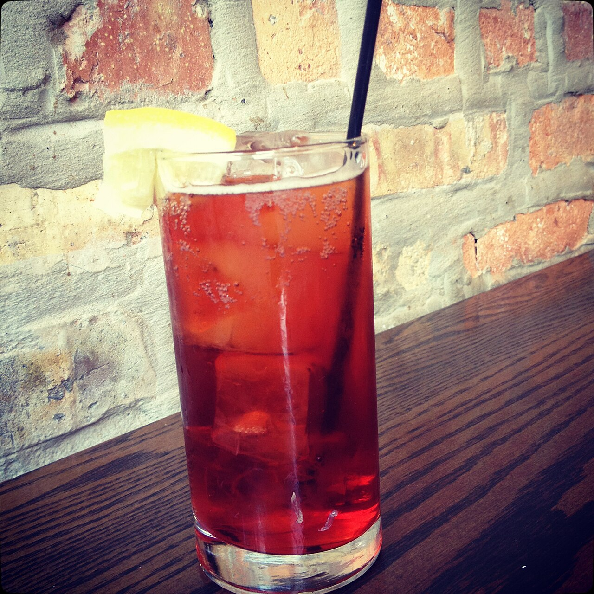

# 美国佬

美国佬是一杯“低酒精”的苦味开胃酒：金巴利、甜味美思与苏打水，加冰，放在古典杯里，配一片橙子。它的颜色是明亮的宝石红，气泡细密，入口先苦后甜，最后留下草本与柑橘的余味。

这杯酒的名字容易让人误解。它不是因为“美国人爱喝”才叫 Americano，而是十九世纪米兰的酒吧里，美国游客与记者喜欢这杯酒，当地人便用“美国佬”来称呼它。名字是外号，配方是意大利的。

图：金巴利、甜味美思与苏打水调成的美国佬。图片：Conrad and Peter，CC BY 2.0，via Wikimedia Commons（[原图页面](https://commons.wikimedia.org/wiki/File:Americano_cocktail_at_Nightwood_Restaurant.jpg)）。

## 苦、甜与气泡的三重奏

金巴利提供苦味与红色，甜味美思提供甜味、酒体与草本香，苏打水提供气泡与稀释。三者缺一不可：没有金巴利，酒会变成甜水；没有味美思，苦味会太硬；没有苏打，酒会太浓、太黏。

这杯酒的结构与内格罗尼相似，但更轻。内格罗尼用金酒替代苏打水，酒精度更高、口感更厚；美国佬用气泡把苦味拉长，适合饭前开胃，也适合长时间聊天。它是“可以喝两杯”的酒，不是“一杯就倒”的酒。

## 配方：金巴利与甜味美思

IBA 的标准配方是金巴利 30 毫升、甜味美思 30 毫升、苏打水适量。等分的比例让苦与甜对称；如果喜欢更苦，可以把金巴利增加到 40 毫升；如果喜欢更甜，可以把味美思增加到 40 毫升。

甜味美思的选择影响很大。意大利的甜味美思（如 Cinzano、Martini Rosso）偏甜、偏香草；法国的甜味美思更干、更草药。金巴利的苦味与橙皮、大黄、人参等草本有关，味美思的草本可以与之呼应，也可以形成对比。

苏打水要冰、要新鲜。气泡是这杯酒的骨架，跑气的苏打水会让酒变得平淡。不要用汤力水替代，汤力水的奎宁苦味会与金巴利的苦味叠加，整体过于苦涩。也不要用可乐，甜味与焦糖会盖住草本。

## 做法：在杯中构建

先在高球杯或古典杯里放满冰块，倒入金巴利与甜味美思，轻轻搅拌，让酒液冷却并稍微稀释。然后沿杯壁注入苏打水，稍微搅拌一次，让气泡与酒液结合。不要剧烈摇晃，否则气泡会迅速消失。

橙片是标准装饰。把橙片放在杯口或杯内，轻压一下让橙油释放；不要挤汁，否则酸度会打破苦甜平衡。也可以加一根橙皮卷，增加香气。装饰不是多余，它补足了这杯酒缺少的柑橘前调。

杯具用古典杯，杯壁厚、手感稳；也可以用高球杯，气泡更持久。冰块要大、要硬，融化慢，避免酒在十分钟内变成水。杯子提前冷藏，能让气泡更稳定。

## 米兰与内格罗尼的前史

美国佬的起源通常追溯到 1860 年代米兰的 Gaspare Campari。金巴利公司创始人在自己的酒吧里调制了这杯酒，最初叫“Milano-Torino”，因为金巴利来自米兰，甜味美思来自都灵。后来美国游客喜欢它，名字逐渐变成 Americano。

1919 年，佛罗伦萨的 Count Camillo Negroni 让调酒师把美国佬里的苏打水换成金酒，于是内格罗尼诞生。这个说法流传很广，也有历史学家提出不同版本，但“美国佬是内格罗尼的前身”已成为鸡尾酒史的通用叙事。

美国佬的流行与意大利开胃酒文化密不可分。饭前喝一杯苦味、低酒精的饮料，既能刺激食欲，又不会让人醉。这种“aperitivo”习惯后来传到全球，美国佬也成为苦味鸡尾酒的入门款。

## 变体与常见错误

常见变体包括“Americano Perfecto”，加一点橙皮苦精；“Americano con Gin”，其实就是内格罗尼的轻量版；“Americano Sour”，加柠檬汁与糖，变成酸甜苦三重结构。还有“Milano-Torino”，用不同的味美思配比，强调产地。

常见错误有四个。第一，苏打水不够冰，气泡很快消失。第二，金巴利与味美思比例失衡，太苦或太甜。第三，冰块太小，融化太快，酒变稀。第四，橙片挤汁，酸度破坏苦甜平衡。美国佬看似简单，实际对温度与比例很敏感。

对家庭调酒者，最实用的建议是：杯子与苏打水都冷藏，冰块大而硬，先调酒再补气泡，橙片只压不挤。记住，这杯酒的目标是“清爽的苦”，不是“浓烈的苦”。

美国佬在不同城市有不同的“默认”：米兰偏重金巴利，都灵偏重味美思，罗马则更喜欢多一点苏打。点单时可以直接说“苦一点”或“甜一点”，酒吧会按比例调整。家庭制作不必追求某个城市的版本，先按等量调一杯，再按自己的口味微调。另一个常被忽略的细节是杯型：高球杯让气泡有上升空间，碟形杯则让苦味更集中；如果只有矮杯，苏打水要减少，否则酒会显得寡淡。

相关条目：[花花公子](ref:boulevardier)。

## 另见与参考资料

- 内格罗尼：参见 [内格罗尼](ref:negroni)。
- 花花公子：参见 [花花公子](ref:boulevardier)。
- 味美思：参见 [味美思](ref:vermouth)。
- 古典杯：参见 [古典杯](ref:rocks)。
- 搅拌：参见 [搅拌](ref:stirring)。

对照阅读：[内格罗尼](ref:negroni)、[味美思](ref:vermouth)。

**关键事实。**

| 项目 | 内容 |
| --- | --- |
| 一句话定位 | 金巴利、甜味美思与苏打水调制的低酒精开胃酒，1860 年代起源于米兰；苦味、甜味与气泡的平衡，使它成为内格罗尼的前身 |
| 类型 | IBA Unforgettables |
| 起源 | 意大利米兰 |

**来源与边界。** 本页关于「美国佬」的关键事实，主要由以下来源交叉核对：International Bartenders Association（IBA 配方分类、原料与比例）、Oxford University Press（鸡尾酒史与术语背景）、CocktailDB（交叉核对配方结构与常见变体）等 5 条来源。价格、批次与状态会变，涉及这些字段时以页面所列来源的最新版本为准。正文为项目自写，来源只作核验，不复制原文。

**并读。** 把「美国佬」与「内格罗尼」、「花花公子」、「味美思」放在一起读时，先确认它们是同一层级还是上下游关系：先确认基酒与比例，再比较酸甜平衡、杯型与出品差异。本页负责给出鸡尾酒的基本坐标，对照条目补上具体案例与差异；读完再回到本页，才能分清哪些差别属于鸡尾酒本身，哪些只是产地、批次或品牌选择。

**适用边界。** 对「美国佬」而言，配方比例、基酒品牌与杯型会变；IBA 版本是参照，不是唯一做法。

**更新提示。** 「美国佬」最近核对于 2026-11-20；配方比例、基酒品牌、杯型与出品标准会变，调酒前以 IBA 或酒吧现行配方为准。

**编者注。** 本页把「美国佬」作为鸡尾酒条目处理：定义、流程与关键数字以正文表格为准，与「内格罗尼」、「花花公子」的差异用对照阅读验证；遇到价格、批次或地址，回到页面所列来源核对。
