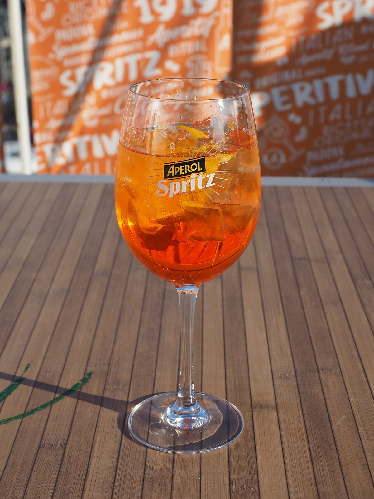

# 阿佩罗气泡

阿佩罗气泡（Aperol Spritz）是一款以阿佩罗、普罗塞克与苏打水调制的低酒精开胃气泡酒。它通常在大肚酒杯或古典杯中加入大量冰块，按三份普罗塞克、两份阿佩罗、一份苏打水的比例直接调配，最后放一片橙子。橙皮的微苦、明显的甜感与持续的气泡是它的识别点，颜色则呈现明亮的橙红。

图：阿佩罗气泡。图片：JIP，CC BY-SA 4.0，via Wikimedia Commons（[原图页面](https://commons.wikimedia.org/wiki/File:Aperol_Spritz_aboard_Viking_Mariella.jpg)）。

> **先给结论**
> **一句话：** 这页判断阿佩罗气泡该不该点、比例和冰水怎么处理。
>
> - **适合谁：** 想弄懂阿佩罗气泡的配方逻辑、点单方式和常见误区的人。
> - **不适合谁：** 只想要“一杯就醉”的配方、不关心比例和冰水的人。
> - **先看这两点：**
>   - 常见比例为普罗塞克 90 毫升、阿佩罗 60 毫升、苏打水 30 毫升，即三比二比一。
>   - 点单时可以直接说“阿佩罗气泡”，若店家使用不同起泡酒，可以询问品牌与甜度。

## 起源与命名

Spritz 一词与意大利东北部的饮酒习惯有关，尤其是威尼托一带的餐前酒文化。流传说法把这种“用气泡水稀释苦味酒或葡萄酒”的做法追溯到奥匈帝国时期驻意大利北部的饮酒方式，但具体年代、地点与传播路径并没有完全一致的档案。写作时宜把它当作流传说法，而不是把某个年份当作定论。

阿佩罗本身是意大利生产的苦味开胃酒，品牌在 20 世纪逐步建立起以橙味、微苦与低酒精度为特征的风格。品牌官方把阿佩罗气泡作为核心饮用方式之一，但官方营销材料与历史研究是两种不同性质的资料：前者说明品牌希望消费者怎么喝，后者才讨论这款饮品在更广泛的饮酒史中如何演变。

名称中的“Spritz”并不专指阿佩罗。意大利的 Spritz 可以用不同苦味酒、不同起泡酒甚至白葡萄酒来制作；阿佩罗气泡只是其中最有名的一支。把“Spritz”当成“阿佩罗”的同义词，会让点单与配方讨论产生歧义。更准确的说法是：以阿佩罗为主体、按气泡酒结构调制的 Spritz。

## 配方结构

常见比例为普罗塞克 90 毫升、阿佩罗 60 毫升、苏打水 30 毫升，即三比二比一。这个比例容易记忆，也方便按杯型放大或缩小。普罗塞克提供气泡、酸度与较轻的酒体，阿佩罗提供橙味、苦味与甜感，苏打水负责拉长口感并降低整体浓度。三者的顺序通常不影响最终结构，但会影响气泡保留与混合均匀度。

普罗塞克不是唯一选择。其他干型起泡酒也可以替代，但甜度、酸度与气泡强度会改变成品；用甜型起泡酒会让整杯更甜，用气泡较弱的酒则会让口感显得平。苏打水也不应被普通矿泉水替代，因为缺少碳酸会让“Spritz”失去标志性的清爽感。若用汤力水替代苏打水，苦味与奎宁气息会叠加，属于另一种风格。

阿佩罗的用量决定苦甜方向。阿佩罗本身含糖，比例提高会让酒体更浓、更甜，同时苦味也更明显；比例降低则更像一杯起泡酒。苏打水的用量看似无关紧要，但它决定稀释程度与气泡持续时间。杯中加入大量冰块会进一步稀释，因此配方写作应同时说明杯型与冰量，而不是只给三个数字。

## 风味与平衡

入口是橙皮的清香与甜味，随后出现轻微的苦感和草本气息，气泡把香气往上带。它不以酒精强度取胜，而是靠“苦、甜、气泡、低温”形成开胃感。平衡的核心是阿佩罗与起泡酒的比例：阿佩罗过多会显得糖浆感重、苦味压过气泡；普罗塞克过多则会让橙味变淡，整杯像普通起泡酒。

温度对这款酒的影响很大。材料不够冷、冰块又少时，气泡会很快散掉，甜味显得黏；冰块过多时，后半杯会被稀释成淡橙水。理想状态是材料预先冷藏、杯中有足够冰块但不过量，并在调好后尽快饮用。橙片不只是装饰，挤一下皮油能补充香气，但不要用力压果肉，以免带出过多苦味。

酒精度较低是这款酒的重要特征，但“低”不等于“没有”。一杯的酒精量取决于阿佩罗与普罗塞克的比例和杯容量，饮用两三杯后的总摄入并不低。把它当成可以无限续杯的饮料，容易忽略酒精累积。用餐时慢慢喝、同时喝水，比追求“喝得快”更符合餐前酒的本意。

## 做法要点

做法以直接调配为主：先把酒杯与材料冷藏，杯中加满冰块，倒入阿佩罗，再加入普罗塞克，最后补苏打水，用吧勺或长匙轻轻提拉一两次，让颜色与气泡均匀即可。不要摇和，摇动会让碳酸迅速流失。也不要过度搅拌，气泡是这款酒的结构之一。

杯型通常选择大肚酒杯、古典杯或较大的高球杯，杯口宽一些有利于香气释放。橙片应选用新鲜橙子，切得稍厚，方便挤压皮油。若杯子外壁需要挂霜，可以提前冰镇；但不必追求“冻杯”，因为过冷的杯子会让香气暂时收敛。冰块应洁净、坚硬、融化较慢，碎冰会加速稀释。

在家庭调制时，先把三者的比例量好，再按杯型调整。若没有普罗塞克，可以用其他干型起泡酒，但要先试小杯，确认甜度与气泡强度。若想降低甜度，可以减少阿佩罗或换用更干的起泡酒。若想增加苦味，可以少量加入其他苦味酒，但这已经偏离标准配方。

## 变体

以金巴利替代阿佩罗，通常称为 Campari Spritz，苦味更强、颜色更深。以 Select 等其他意大利苦味酒替代，则形成各自地方风格的 Spritz。也有用白葡萄酒替代部分起泡酒的做法，酒体更轻、气泡更少；用汤力水替代苏打水会增加奎宁苦味。还有把材料打成冰沙的冰冻版本，口感更像冰饮。

变体的命名应写清替换了什么。把阿佩罗换成金巴利后仍叫“阿佩罗气泡”，会让听者误以为配方未变。甜度与苦度的调整也应在名称或说明中体现，例如“少阿佩罗”或“干型起泡酒版”。只有把变量写清楚，比较不同版本才有意义。

## 怎么点与怎么喝

点单时可以直接说“阿佩罗气泡”，若店家使用不同起泡酒，可以询问品牌与甜度。想要更清爽，可以要求“少阿佩罗、多苏打水”；想要更浓，可以要求“多阿佩罗、少苏打水”。冰块多少会影响稀释速度，也可以按当天温度与饮用速度提出要求。橙片应现切，若看到橙片干边，说明准备时间过久。

它适合作为餐前酒，搭配咸味坚果、橄榄、薯片、硬质奶酪与轻食。甜苦味与咸味能相互衬托，气泡也能清口。阿佩罗气泡容易被果汁、气泡或甜味掩盖酒精度，喝的时候要放慢速度，避免空腹快速饮用；驾车、服药或孕期不应饮酒。作为低酒精饮品，它适合较长的一餐，但仍需计算总摄入量。

在意大利的酒吧里，Spritz 常与一小份薯片或橄榄一起出现，目的是让客人边喝边等餐。家庭聚会可以提前把材料冷藏，但不要提前把阿佩罗与起泡酒混合太久，否则气泡会流失。倒酒时沿杯壁注入，能减少泡沫溢出，也能让层次更清楚。

## 常见误区

第一，把阿佩罗气泡当成橙味汽水。它含酒精，也有苦味与草本层次。第二，认为只有普罗塞克才正宗。其他干型起泡酒也能做出同类饮品，只是风味不同。第三，认为阿佩罗越多越“正宗”。比例是风格选择，过多会压住气泡。第四，摇和或大力搅拌。碳酸会流失，口感变平。第五，认为低酒精就可以无限量饮用。总酒精摄入仍取决于杯数与比例。

相关条目：[开胃酒](ref:aperitif)、[起泡酒](ref:sparkling)、[威尼托](ref:veneto)。

## 另见

- [开胃酒](ref:aperitif)：餐前饮酒的功能与苦味酒的角色。
- [起泡酒](ref:sparkling)：普罗塞克与其他起泡酒的结构差异。
- [威尼托](ref:veneto)：Spritz 饮酒习惯的意大利地域背景。
- [如何选杯](ref:glass)：杯型如何影响香气、冰量与气泡。
- [香气](ref:aroma)：橙皮与草本气息在杯中如何释放。
