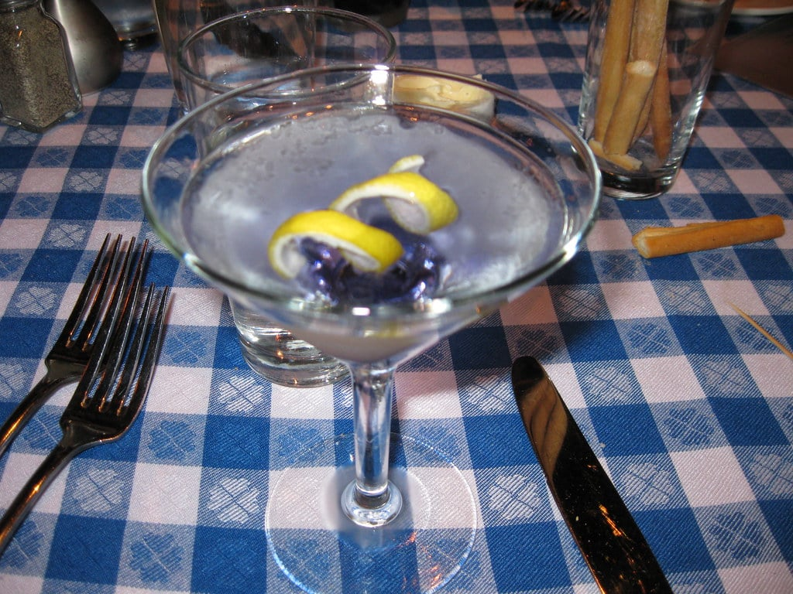

# 飞行

飞行（Aviation）是少数几款“颜色本身就是配方证据”的鸡尾酒。它的淡紫来自紫罗兰利口酒，而不是糖浆或食用色素；当这种利口酒在市场上消失时，这杯酒也跟着变成了另一个样子。要理解它，得先回到 1916 年的纽约。

图：一杯飞行，淡紫灰色酒液盛于碟形杯，杯中有柠檬皮与一颗深色酒渍樱桃。图片：Binder Of Daemons，CC BY 2.0，via [原图页面](https://www.flickr.com/photo.gne?id=3810873586)。

## 1916 年，Hotel Wallick 的 Hugo Ensslin

这款酒最早见于 Hugo Ensslin 的《Recipes for Mixed Drinks》，1916 年在纽约出版。Ensslin 当时是 Hotel Wallick 的主调酒师，这本书收录了当时美国酒吧里流通的大量配方，飞行是其中之一。

名字来自那个时代的航空热。1916 年距莱特兄弟首次动力飞行不过十余年，飞机仍是新鲜事物；“Aviation”这个词带着速度、机械与天空的联想，和杯中淡紫的颜色形成一种刻意的反差。

## 原始配方：三分之二金酒，三分之一柠檬

Ensslin 的原方与今天差别很大：三分之二金酒、三分之一柠檬汁，加两抖 Maraschino、两抖紫罗兰利口酒，加碎冰摇和后滤出。它没有额外糖浆，甜味只来自两抖 Maraschino，整体比现代版本更干、更酸、更金酒主导。

这个比例解释了一个常见误解：飞行不是一杯“花香甜酒”。原始版本的花香只是两抖利口酒的点缀，主体是金酒与柠檬。今天酒吧里更甜、更紫的版本，是后来为了突出颜色与香气而调整的结果。

## 结构化配方：IBA 四材料版

IBA 公开配方把比例拉回到更易饮的平衡：45 毫升金酒、15 毫升 Maraschino、15 毫升柠檬汁、1 吧勺紫罗兰利口酒。酸甜平衡可参考[酸度](ref:acidity)。

| 材料 | 用量 | 说明 |
| --- | --- | --- |
| 金酒（London Dry） | 45 ml | 杜松子与柑橘骨架 |
| Maraschino 利口酒 | 15 ml | 樱桃、坚果与甜味 |
| 鲜柠檬汁 | 15 ml | 提供酸度；现代配方常用 20–22.5 ml |
| 紫罗兰利口酒 | 1 吧勺（约 5 ml） | 颜色与花香，宁少勿多 |

- **比例**：金酒 : Maraschino : 柠檬 : 紫罗兰约为 9 : 3 : 3 : 1。
- **杯型**：预冷的 coupe 或小号鸡尾酒杯。
- **冰**：摇冰；滤冰后杯中不加冰。
- **技法**：加冰摇和 10–12 秒，双重过滤。
- **装饰**：酒渍樱桃，可选；不加也成立。

## 紫罗兰断供之后

紫罗兰利口酒从 20 世纪 30 年代起逐渐从美国市场消失。Drink Lab 的记述把转折点放在 1930 年：Harry Craddock 在《Savoy Cocktail Book》里直接省略了紫罗兰，因为当时已经很难买到；一整代调酒师于是学会了“没有紫罗兰的飞行”。

这个版本后来反而成了标准：金酒、Maraschino 与柠檬，颜色浅、花香弱，喝起来更像一杯加了樱桃的酸酒。Luxardo 的资料把原方的回归放在 2000 年代，并提到 2004 年前后紫罗兰利口酒重新进入美国市场；Drink Lab 则写作 2007 年。年份有出入，但“断供—无紫罗兰版流行—2000 年代回归”这条线是清楚的。

## 颜色：淡紫、灰蓝与“肥皂味”

飞行的颜色不是鲜艳的紫，而是淡紫、灰蓝，甚至带一点灰。它取决于紫罗兰利口酒的品牌、用量与柠檬汁的黄色；用 5 毫升和用 15 毫升，得到的不是同一杯酒。

用量过多时，花香会从“细微”变成“香水”，再变成“肥皂”。5 至 7 毫升是常见的工作区间；超过 10 毫升，紫罗兰就会盖住金酒的杜松子与 Maraschino 的樱桃核香。颜色越艳，往往越接近糖果而不是经典。

## 金酒与 Maraschino 的分工

[金酒](ref:gin)是骨架。London Dry 的杜松子、柑橘皮与干燥草本能托住紫罗兰的花香；老汤姆金酒更甜、更软，会让整杯偏向糖果；花香型金酒则容易和紫罗兰打架。

Maraschino 不是“樱桃糖浆”。它是用樱桃核与果实发酵蒸馏的[利口酒](ref:liqueur)，带坚果、樱桃核与一点苦味；它提供甜味，也提供中段的复杂度。把它换成普通樱桃利口酒，甜度会上升，樱桃味会更直白，飞行的那种“干花香”就没了。

## 摇和、双重过滤与 coupe 杯

飞行是摇和酒。所有材料加冰，摇 10 至 12 秒，双重过滤到预冷的 coupe。双重过滤能拦住碎冰与果肉，让酒液清澈，颜色也更干净；只用普通滤冰器，杯里很快会出现细碎冰渣。

杯型以 coupe 为主。杯口宽、杯身浅，香气容易聚在杯口，淡紫的颜色也能被看清。杯子必须预冷；温杯会让酒在几分钟内升温，花香变得松散。双重过滤的作用见[过滤](ref:filtration)。

## 与粉红佳人的粉色之分

飞行与[粉红佳人](ref:pink-lady)常被放在一起，因为两者都是“带颜色的金酒酸酒”。区别在颜色来源与质地：飞行的淡紫来自紫罗兰利口酒，酒液清澈、没有泡沫；粉红佳人的粉色来自石榴糖浆，蛋白让它表面有一层细泡沫。

配方上也不一样。飞行用 Maraschino 提供樱桃与甜味，不加蛋清；粉红佳人用 applejack 增加果味，用石榴糖浆调色，再用蛋白改变质地。把两杯都叫“花香金酒酒”会抹掉这些结构差异。与[干马天尼](ref:dry-martini)相比，飞行同样以金酒为骨架，但多了 Maraschino 与紫罗兰两层香气，也更酸。

## 常见失败点

第一，紫罗兰倒太多。花香一旦盖过杜松子，整杯就像香水；5 至 7 毫升足够。

第二，柠檬汁不足。Maraschino 与紫罗兰都甜，酸度不够会腻；但柠檬过多又会压住花香。

第三，Maraschino 过量。它不只是甜味，过量会让樱桃味独占中段。

第四，摇和不足或过滤不细。温度不够、碎冰入杯，颜色与口感都会变粗。

第五，用紫罗兰糖浆代替紫罗兰利口酒。糖浆没有酒精与草本结构，颜色更艳，味道更像糖果。

## 变体与无酒精版本

- **Aviation Sans Violette**：省略紫罗兰，保留金酒、Maraschino 与柠檬；这是 1930 年代之后流行的“无紫罗兰版”。
- **更酸的比例**：柠檬提到 20–22.5 毫升，适合喜欢干型酸酒的人。
- **Crème Yvette 替代**：这是一种带香料的紫罗兰利口酒，颜色偏粉紫，甜度更高。
- **樱桃装饰升级**：用酒渍樱桃而不是糖水樱桃，避免额外糖分。

无酒精替代只能近似：0.0% 金酒 45 毫升、樱桃糖浆 10 毫升、紫罗兰糖浆 5 毫升、鲜柠檬 20 毫升，加冰摇和并双重过滤。颜色接近，花香也在，但缺少金酒的杜松子与酒精重量，口感会更薄、更甜。

对照阅读：[金酒](ref:gin)、[酸度（acidity）](ref:acidity)。

**关键事实。**

| 项目 | 内容 |
| --- | --- |
| 一句话定位 | 1916 年由纽约 Hotel Wallick 的 Hugo Ensslin 记录于《Recipes for Mixed Drinks》，以金酒、Maraschino、柠檬汁与紫罗兰利口酒摇和，呈淡紫到灰蓝色，常以樱桃装饰 |
| 类型 | 经典鸡尾酒 |
| 起源 | 美国纽约（1916 年，Hugo Ensslin，Hotel Wallick） |

**来源与边界。** 本页关于「飞行」的关键事实，主要由以下来源交叉核对：International Bartenders Association（官方配方、调制方法与装饰）、Luxardo（紫罗兰利口酒的断供与回归、杯型与配方构成）、Drink Lab（1916 年起源、1930 年《Savoy Cocktail Book》省略紫罗兰与常见比例）等 6 条来源。价格、批次与状态会变，涉及这些字段时以页面所列来源的最新版本为准。正文为项目自写，来源只作核验，不复制原文。
