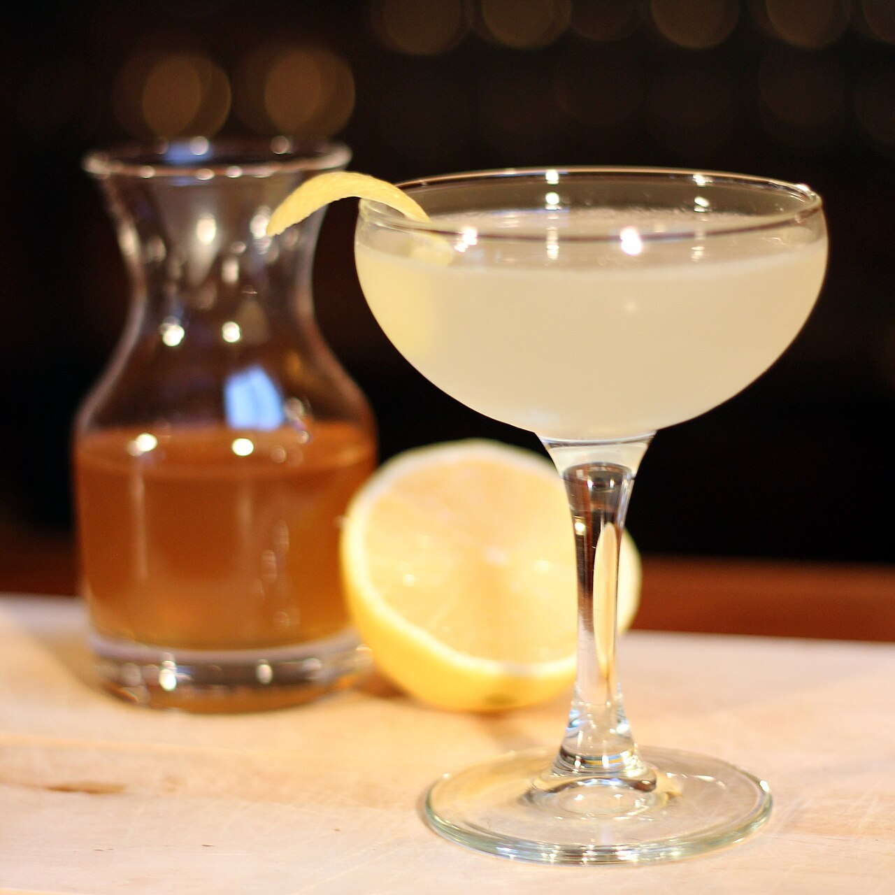

# 蜂膝

蜂膝（Bee's Knees）是一款以金酒、柠檬汁与蜂蜜糖浆调制的经典鸡尾酒。它属于酸酒家族，结构可以写成“金酒 + 柠檬 + 甜味”，只是甜味从砂糖换成了蜂蜜。蜂蜜带来花香、黏度和更厚的口感，也让这杯酒比普通的金酒酸酒更柔、更香。它通常摇和后滤入碟形杯，不加冰，装饰可选柠檬皮或橙皮。

图：蜂膝。图片：Will Shenton，CC BY-SA 3.0，via Wikimedia Commons（[原图页面](https://commons.wikimedia.org/wiki/File:Bee%27s_Knees.jpg)）。

## 禁酒令时期的一杯“好东西”

这款酒常被放在美国禁酒令（1920–1933 年）的语境里。禁酒令期间，合法销售的烈酒质量参差不齐，私酿金酒往往粗糙、刺鼻；蜂蜜和柠檬的作用不只是好喝，也能遮住劣质基酒的棱角。这个解释流传很广，听起来也合理，但要小心：它是后来人的合理推断，不是当时留下的配方笔记。蜂蜜入酒的做法在禁酒令之前就存在，禁酒令只是让“甜味 + 柑橘 + 烈酒”的组合变得更流行。

可以确定的是，Bee's Knees 在 1920 年代的美国饮酒文化中流传开来，并在禁酒令结束后继续出现在酒吧与配方书里。它的流行不是因为它复杂，而是因为它简单：三种材料，一个摇壶，一个杯子。对家庭调酒来说，它也是比较容易上手的一杯，因为蜂蜜糖浆比鲜榨果汁更耐存放。

## 名字：从俚语到酒名

“Bee's Knees”是 1920 年代的美国俚语，意思是“极好的”“顶呱呱的”。同类的说法还有“the cat's pajamas”“the elephant's eyebrows”，都是把动物身上某个部位说成“最棒的东西”，带着那个年代特有的俏皮。把酒名叫作“蜂膝”，并不是说这杯酒和蜜蜂的膝盖有关，而是说它“很好”。

这个命名方式也解释了为什么这款酒在禁酒令时期特别合适：它听起来无害、有趣、带点甜，不像一杯烈酒。名字里的“蜂”又恰好呼应蜂蜜，让人自然地把酒名与配方联系起来。至于是先有名字还是先有配方，没有可靠记录；更可能是酒吧先给酒起了个讨喜的名字，配方再随着流行固定下来。

## 弗兰克·迈耶与丽兹酒店：常被追溯，不是档案

最常见的说法把这款酒归功于 Frank Meier。他是奥地利出生的调酒师，1920 年代在巴黎 Ritz 酒店担任首席调酒师，后来还写过自己的配方书。支持这个说法的人认为，Bee's Knees 是他在巴黎创作、随后传回美国的；也有人认为它本来就是美国禁酒令时期的产物，只是被附会到一位有名的调酒师身上。

问题在于，1920 年代的配方书里并没有一条毫无争议的“Frank Meier 原创 Bee's Knees”记录。Meier 确实在 Ritz 工作，也确实记录了大量鸡尾酒，但“他发明了这款酒”与“这款酒曾经出现在他的酒吧”是两件不同的事。因此本页写作“常被追溯到”，不把丽兹酒店当成唯一的出生地，也不把某个具体年份当成定论。

对读者来说，这个区别有实际意义：如果你在巴黎点一杯 Bee's Knees，它可能是按照欧洲酒吧的偏干风格做的；如果你在纽约点，它可能更甜、更强调蜂蜜。同名酒在不同城市有不同版本，这不是谁“做错了”，而是传播过程中自然形成的差异。

## 蜂蜜糖浆：1:1、2:1 与 3:1

蜂蜜不能直接替代砂糖。它在冷液体里溶解慢，直接舀一勺进摇壶，容易沉底、结块，甜度不均匀，还会让酒液发黏。专业做法是先把蜂蜜与水调成糖浆，冷却后再用。比例通常写作“蜂蜜:水”，按体积计算。

1:1 是最容易操作的版本：蜂蜜与水等体积，搅匀后冷藏。它的甜度适中，流动性好，用量容易控制，适合家庭调酒。2:1 更浓，蜂蜜香气更足，质地更稠，但冬天或冷藏后可能变得难倒，使用前要回温或再搅匀。3:1 是很多现代酒吧偏好的“浓糖浆”：水量少，蜂蜜的风味最集中，甜度也最高，但一毫升的甜度相当于更多的一比一糖浆，配方必须相应减少。

比例改变的不只是甜度，还有质地。水越多，糖浆越稀，酒体越轻，蜂蜜的花香被稀释；水越少，糖浆越稠，酒液在口中更“包”，收口更慢，也更容易显得腻。蜂蜜本身约 80% 是糖，所以 3:1 的糖浆并不是“少糖”，而是“少水”。如果配方只写“蜂蜜糖浆 15 毫升”而不写比例，同样的毫升数可以带来完全不同的甜度，这是很多家庭配方失败的原因。

做糖浆时用温水而不是沸水，搅到完全溶解即可，不必长时间熬煮。煮沸会带走蜂蜜的花香，也会让颜色变深。冷却后装瓶冷藏，取用时用干净的勺子，避免把水或果汁带进瓶里。蜂蜜品种也会改变风味：三叶草蜂蜜温和，橙花蜂蜜花香明显，荞麦蜂蜜浓重、带一点糖蜜味，后者用量要更小心。

## 三种常见比例：IBA、品牌与现代酒吧

IBA 的 Bee's Knees 属于“New Era”类别，配方是金酒 52.5 毫升、蜂蜜糖浆 2 茶匙（约 10 毫升）、鲜榨柠檬汁 22.5 毫升、鲜榨橙汁 22.5 毫升；做法是先把蜂蜜与柠檬汁、橙汁搅到溶解，再加金酒加冰摇和，滤入预冷的鸡尾酒杯，装饰可选柠檬皮或橙皮。

这个版本有两个值得注意的地方。第一，它含橙汁，而经典的三原料配方通常没有橙汁；橙汁降低了酒精度，增加了果汁感，也让成品更接近一杯“蜂蜜柑橘酸酒”。第二，材料表写“蜂蜜糖浆”，步骤却写“把蜂蜜与果汁搅到溶解”，两者并不完全一致；在实际操作中，先做好糖浆再加入，比直接拿蜂蜜和冷果汁较劲更稳定。

现代酒吧常见的版本是金酒 60 毫升、柠檬汁 22.5 毫升、蜂蜜糖浆 15 毫升（通常用 3:1 的浓糖浆）；Beefeater 品牌给出的版本是金酒 50 毫升、柠檬汁 25 毫升、蜂蜜糖浆 15 毫升。前者更烈、更干，后者更柔、更酸。三组数字放在一起看，差别主要来自金酒比例与蜂蜜糖浆浓度，而不是“谁更正统”。

## 与 Gin Sour 的关系

Gin Sour 是酸酒家族的基本型：金酒、柠檬汁、糖，摇和后滤入杯中。Bee's Knees 的结构与它完全相同，只是把糖换成了蜂蜜糖浆。因此它常被描述为“加了蜂蜜的 Gin Sour”，或者“蜂蜜版金酒酸酒”。

这个替换带来的变化不只是风味。砂糖提供的是干净的甜，蜂蜜提供的是带花香、带一点蜡质感的甜，还会增加黏度与酒体；砂糖溶液透明、味道中性，蜂蜜糖浆则可能带颜色和细微的矿物感。蜂蜜的酸度也略低于砂糖溶液，所以同样的甜度下，成品可能显得更圆、更软。

另一个差别在蛋白。Gin Sour 常加蛋白，摇出细密的泡沫，口感更绵；Bee's Knees 通常不加蛋白，蜂蜜本身已经提供了足够的质地，再加蛋白会让口感过厚，也会压住蜂蜜的花香。如果你想要更轻盈的版本，可以不加蛋白；如果想要更接近传统酸酒的绵密感，可以加半个蛋白，但那就更接近“蜂蜜金酒酸酒”，而不是经典 Bee's Knees。

## 金酒怎么选

[金酒](ref:gin)是这杯酒的骨架。伦敦干金酒的杜松子与柑橘皮能穿透蜂蜜的甜，让成品不至于发腻；Plymouth 风格更柔和，和蜂蜜的蜡质感更接近，但需要稍微减少糖浆；海军强度金酒酒精度高，蜂蜜又增加了口感厚度，若不增加稀释，喝起来会又烈又黏。

不建议用香气过于复杂的金酒。蜂蜜本身已经带来花香，如果金酒再有强烈的花香、茶香或热带水果，整杯酒会显得杂乱。也不建议用太低端的金酒再靠蜂蜜遮掩：蜂蜜能包住粗糙，但不能补上骨架。一个实用的判断是，先闻金酒：如果它的香气能和蜂蜜、柠檬放在同一个方向上，就适合；如果它自己已经“很满”，就换一瓶更干净的。

## 摇和、稀释与温度

Bee's Knees 用[摇和](ref:shake)。蜂蜜糖浆黏度高，只有充分摇和才能与柠檬汁、金酒融合；柠檬汁也需要摇和来释放香气。摇和时间通常 10–12 秒，听到冰声变闷、壶身结霜即可。摇和不足，糖浆沉在底部，前几口淡、后几口甜；摇和过度，冰化水太多，蜂蜜的香气被冲淡，酒体变薄。

摇和后建议细滤，尤其是用了自制糖浆或鲜榨柠檬时。细滤能挡住果肉、泡沫和碎冰，让口感更干净；如果做的是加蛋白版本，细滤还能让泡沫更细。滤入预冷的杯子，不要再加冰，否则稀释会继续。

稀释对甜度的影响比对酸度更明显。蜂蜜的甜在低温下显得收敛，温度升高后会变强；如果杯子太暖或喝得太慢，后半杯会越来越甜、越来越黏。理想状态是材料冷藏、杯子预冷、摇和充分，并在酒液仍然清凉时喝完。

## 杯型与装饰

传统上用[碟形杯](ref:coupe)或鸡尾酒杯。碟形杯杯腹宽、杯口略收，能聚住蜂蜜与柠檬的香气，杯脚避免手温；马天尼杯杯口更宽，香气散得快，酒液升温也快。容量 150–200 毫升的碟形杯足够，倒到三分之二左右，留出闻香空间。

装饰不是必需。柠檬皮油能补充柑橘香，橙皮油则与 IBA 版本里的橙汁呼应；蜂蜜本身很香，不需要再加糖边或蜜饯。若用橙皮，喷油后可以擦在杯口，不要丢进酒里久泡，否则会带出过多苦味。若用柠檬轮，切片要薄，避免果肉掉进杯中影响口感。

## 变体：Gold Rush 与其他方向

把金酒换成波本，就是 Gold Rush 的结构：波本、柠檬、蜂蜜糖浆。波本的香草、焦糖与蜂蜜很合拍，成品更甜、更厚，也更适合寒冷天气。它不是 Bee's Knees 的“正宗版本”，而是同一模板换基酒后的另一个经典。

IBA 的橙汁版本可以看作“蜂蜜柑橘酸酒”的方向：橙汁增加果汁感，降低酒精度，让成品更易饮，但也让蜂蜜的香气变得不那么集中。还有用薰衣草蜂蜜、迷迭香蜂蜜或带烟熏味的蜂蜜做糖浆的版本，草本与花香会改变整杯酒的方向；这类改动应该写进名字或说明里，否则同名酒之间的比较没有意义。

## 常见失败点

第一，直接用冷蜂蜜。它不溶解，沉底、结块，甜度不均。第二，糖浆比例不明。15 毫升 1:1 糖浆与 15 毫升 3:1 糖浆，甜度差很多。第三，蜂蜜用量过多。成品黏、腻，压住金酒与柠檬。第四，柠檬不新鲜。酸度与香气都不够，蜂蜜显得更甜。第五，摇和不足。糖浆没有融合，口感分层。第六，金酒太花香或太廉价。前者与蜂蜜打架，后者撑不住。第七，杯子不冷或喝得太慢。回温后甜度上升，越喝越腻。

## 怎么点与怎么喝

点单时可以说“Bee's Knees，金酒基底，蜂蜜糖浆不要太甜”，并问清楚用的是哪一种蜂蜜、糖浆浓度是多少。若喜欢更干，要求减少糖浆或增加柠檬；若喜欢更甜，增加糖浆，但要注意它会同时增加黏度。若不想太烈，可以问杯量，或者选择含橙汁的版本。

它适合作为餐前酒，也适合下午或餐后搭配坚果、蜂蜜甜点、水果塔、软质奶酪与油炸食物。蜂蜜的甜能承接油脂，柠檬的酸能切开腻感。饮用时小口慢喝，注意温度；它的酒精度中等，但蜂蜜让酒精感变得不明显，容易喝快。驾车、服药或孕期不应饮酒。

## 另见

- [金酒](ref:gin)：蜂膝的骨架与风格选择。
- [摇和](ref:shake)：蜂蜜糖浆的融合、冷却与细滤。
- [碟形杯](ref:coupe)：杯腹、杯口与香气聚集。
- [美国禁酒令](ref:prohibition)：这款酒流行背景的历史语境。
- [鸡尾酒基础](ref:basics)：酸酒结构与酸甜平衡。
