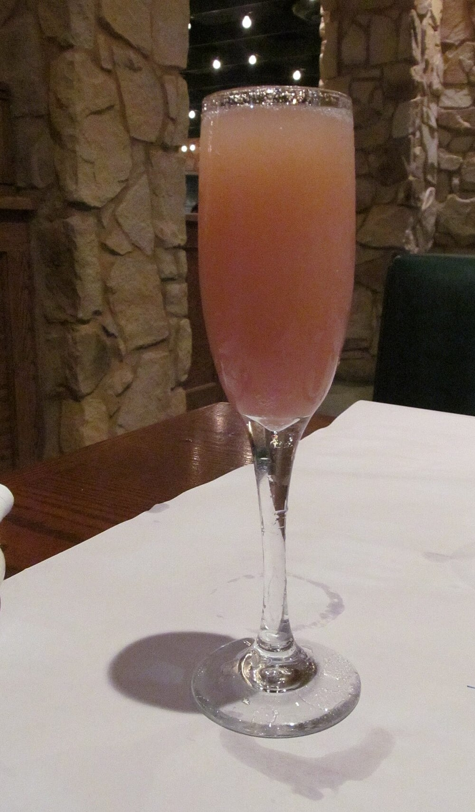

# 贝里尼

贝里尼（Bellini）是以普罗塞克（Prosecco）与白桃泥调制的起泡鸡尾酒，常被当作威尼斯早午餐与餐前酒的象征。它只有两种主要材料，做法也不复杂，但对桃子成熟度、桃泥质地、酒温与气泡的要求很高。一杯好的贝里尼应当像“带气泡的桃子”，而不是甜味汽水。

图：一杯贝里尼，桃粉色酒液盛于笛形杯，杯口有一层细密泡沫。图片：John Phelan，CC BY-SA 3.0，via [原图页面](https://commons.wikimedia.org/wiki/File:Bellini_Cipriani,_Macaroni_Grill,_Dunwoody_GA.jpg)。

## 起源：威尼斯与 Harry's Bar

贝里尼的起源常归于威尼斯的[Harry's Bar](ref:harrys-venice)，时间是 1948 年。品牌叙述把发明者记为朱塞佩·奇普里亚尼（Giuseppe Cipriani），并以威尼斯画家乔瓦尼·贝里尼（Giovanni Bellini）命名：据说酒液柔和的粉橙色让他想到画中人物的衣袍。这个说法流传很广，也常被品牌自己引用，但具体日期与灵感细节仍属于品牌叙述，不宜当作独立档案证据。

可以确定的是，贝里尼与威尼斯的饮酒场景紧密相连：白桃在意大利夏季上市，普罗塞克来自邻近的[威尼托](ref:veneto)产区，两者在同一季节相遇。它也常出现在哈里酒吧的菜单上，与生牛肉薄片一起构成这家店的招牌组合。名称、地点与季节共同解释了这道饮品为什么诞生在威尼斯，而不是别处。

## 配方与比例

IBA 公开配方为：100 毫升普罗塞克、50 毫升白桃泥。做法是先把桃泥倒入预冷的笛形杯，再缓慢加入普罗塞克，轻轻搅拌一次，让两者混合。比例是两份酒对一份桃泥，成品酒精度不高，甜度主要来自桃子。

比例可以按桃子的甜度与普罗塞克的风格调整。桃泥通常在 40–60 毫升之间；普罗塞克在 100–150 毫升之间。桃泥越多，口感越厚、越像果昔；普罗塞克越多，气泡感越强、越清爽。若桃子本身很甜，可以略减桃泥；若普罗塞克偏干，可以略增桃泥。关于起泡酒的结构，可参见[起泡酒](ref:sparkling)。

## 普罗塞克的选择

普罗塞克主要用格雷拉（Glera）葡萄，采用罐式发酵，果香清新，气泡相对轻盈，酒精度通常在 11%–12% 左右。它不是香槟：香槟使用瓶内二次发酵，酵母带来的面包与坚果气息更明显，价格也更高。贝里尼之所以常用普罗塞克，是因为它的青苹果、白花与柑橘香气不会压过桃子。

选择时优先干型（brut）或极干型（extra dry），避免甜型（dolce）。甜型普罗塞克会让整杯过甜，也会掩盖桃子的酸度。酒必须充分冷藏；温度过高时，气泡会迅速散失，桃泥的甜味会变得黏。开瓶后应尽快使用，放置过久的气泡酒会失去张力。

## 白桃泥与桃季

贝里尼的传统用桃是白桃，果肉颜色浅、香气细腻、酸度柔和。桃子成熟度决定成品：未熟的桃子酸硬、香气不足；过熟的桃子容易氧化，带煮水果味。意大利的桃季大致在夏季，因此传统贝里尼带有明显的季节属性；非产季常用冷冻桃泥或果泥替代，风味会有差距。

桃泥的质地同样重要。打成果泥后是否过滤，会改变口感：保留纤维更接近“果肉感”，过滤后更顺滑、更像糖浆。无论哪种，都应避免过度加糖；桃子本身的甜味已经足够。桃泥可以提前冷藏，但不宜长时间暴露在空气中，否则会褐变并失去香气。关于香气如何释放，可参见[香气](ref:aroma)。

## 技法与气泡

贝里尼是直调饮品，不摇和。摇和会让气泡迅速流失，也会让桃泥产生泡沫，入口发虚。正确顺序是先把桃泥放入预冷的笛形杯，再沿杯壁缓慢倒入普罗塞克，最后用吧勺轻轻提拉一次。搅拌过度同样会破坏气泡；目标是让颜色均匀，而不是把酒搅匀到没有层次。

杯型通常选笛形杯或郁金香形杯，容量约 150–200 毫升。杯口收窄有利于收集香气，也能减缓气泡散失。杯子必须干净、无油渍，否则气泡会附着在杯壁上迅速消失。关于杯型与香气的关系，可参见[如何选杯](ref:glass)。倒酒时不要倒满，留出空间让香气聚集。

## 变体与相似饮品

以草莓泥替代桃泥，称 Rossini；以石榴汁替代，称 Tintoretto；以柑橘或橙汁替代，称 Puccini。以橙汁与普罗塞克调制的 Mimosa 与贝里尼结构相近，但酸度更高、颜色更橙。以静止白葡萄酒替代普罗塞克，则更接近“加果泥的白葡萄酒”，气泡感消失，风格完全不同。

变体的命名应当写清替换了什么。把草莓版仍叫贝里尼，会让听者误以为配方未变。比例也应随水果调整：草莓与石榴的甜度和酸度不同，桃泥的 50 毫升不能直接套用。若使用果酱或含糖果泥，糖量要进一步减少。把变体与原型并列比较时，先确认两者的水果、糖与气泡条件一致。

## 常见误区

第一，用黄色桃子或加糖果汁代替白桃泥。颜色与香气都会偏离，甜度也难以控制。第二，普罗塞克没有冷藏。温热的酒会迅速失去气泡，桃泥的甜味也会显得黏。第三，用力搅拌或摇和。气泡是这款酒的结构，不是装饰。第四，桃泥过量。比例失衡后，成品会像稀释的果酱，而不是鸡尾酒。

第五，认为贝里尼必须用香槟。香槟可以做出好喝的水果气泡酒，但会改变风味与成本，传统配方用的是普罗塞克。第六，提前大量混合。贝里尼应当现做现喝，放置后气泡与香气都会下降。第七，忽略桃子的酸度。桃子过甜时，少量柠檬汁可以救回平衡，但加得太多就不再是贝里尼。

## 另见

- [起泡酒](ref:sparkling)：普罗塞克与香槟的工艺差异。
- [Harry's Bar（威尼斯）](ref:harrys-venice)：贝里尼的起源场所。
- [威尼托](ref:veneto)：普罗塞克与白桃的产地背景。
- [如何选杯](ref:glass)：笛形杯如何影响气泡与香气。
- [香气](ref:aroma)：桃香与花香在杯中的释放。

**关键事实。**

| 项目 | 内容 |
| --- | --- |
| 一句话定位 | 以普罗塞克与白桃泥调制的威尼斯经典，常引 1948 年 Harry's Bar 的 Giuseppe Cipriani 为起源；比例多为两份普罗塞克对一份桃泥，桃季与温度决定风味 |
| 类型 | 经典鸡尾酒 |
| 起源 | 意大利威尼斯（Harry's Bar，常引 1948 年） |

**来源与边界。** 本页关于「贝里尼」的关键事实，主要由以下来源交叉核对：International Bartenders Association（普罗塞克与白桃泥的官方配比与调制顺序；确认该饮品属于 IBA 官方鸡尾酒名单）、Cipriani（哈里酒吧的位置、经营与贝里尼的品牌记述；贝里尼与 1948 年的品牌叙述及乔瓦尼·贝里尼的命名关联）、Oxford University Press（提供关于贝里尼起源、桃泥与普罗塞克结构的条目）等 6 条来源。价格、批次与状态会变，涉及这些字段时以页面所列来源的最新版本为准。正文为项目自写，来源只作核验，不复制原文。
