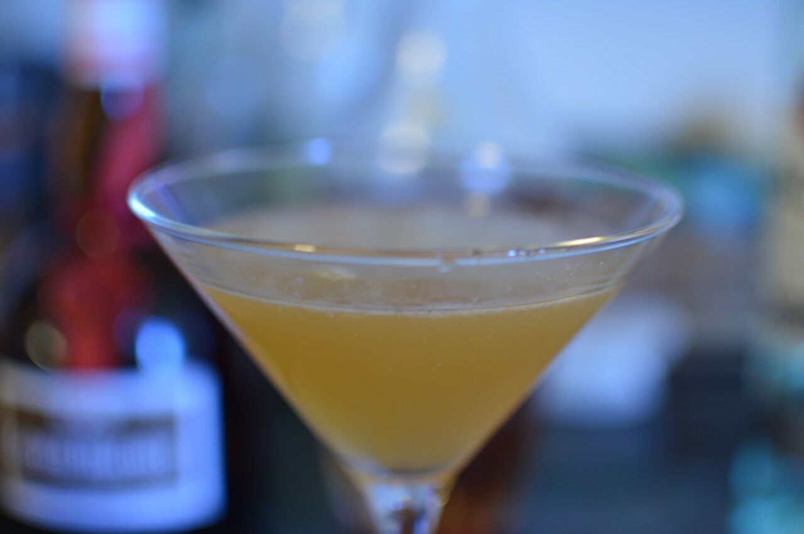

# 床笫之间

床笫之间是一杯“名字比酒更出名”的经典。白朗姆、干邑、橙皮利口酒、柠檬汁，摇和，滤入碟形杯。它的结构像侧车（Sidecar）与玛格丽特的混合：朗姆的甘蔗甜、干邑的葡萄香、橙皮利口酒的柑橘、柠檬的酸。

这杯酒在 1930 年代的巴黎流行，与哈里纽约酒吧（Harry's New York Bar）的调酒师文化有关。名字的暧昧意味，让它成为“禁酒令时代”与“爵士时代”的符号；但酒本身并不轻浮，而是一杯结构严谨的酸酒。

图：白朗姆、干邑、橙皮利口酒与柠檬汁调成的床笫之间。图片：Zach，CC BY-SA 4.0，via Wikimedia Commons（[原图页面](https://commons.wikimedia.org/wiki/File:Between_The_Sheets_Cocktail.jpg)）。

## 朗姆、干邑与橙皮利口酒

白朗姆提供甘蔗的甜与轻盈。它的中性、清爽，能平衡干邑的厚重；没有朗姆，这杯酒会变成“干邑侧车”，缺少热带的圆润。白朗姆要选清淡、干净的，不要用陈年朗姆，否则会压过干邑。

干邑提供葡萄的香与骨架。它的果香、花香与橡木，能撑住柠檬的酸；没有干邑，这杯酒会变成“朗姆酸酒”，缺少深度。干邑不需要昂贵，但要有足够的浓度与香气。

橙皮利口酒提供柑橘与甜。它的橙皮油、糖与酒精，能连接朗姆与干邑，也能平衡柠檬的酸；没有橙皮利口酒，酒会太酸、太干。 triple sec 的甜度适中，适合这杯酒。

柠檬汁提供酸度与新鲜。现榨柠檬汁的酸与香气，能切开三种酒的厚重；瓶装柠檬汁太尖，会破坏平衡。柠檬汁的用量是 1.5 厘升，比三种酒少，酸度刚好。

## 配方：三种酒与柠檬

IBA 的标准配方是白朗姆 3 厘升、干邑 3 厘升、橙皮利口酒 3 厘升、柠檬汁 1.5 厘升。三种酒等量，柠檬汁减半；总量约 105 毫升，滤入碟形杯约七分满。

如果喜欢更酸，可以把柠檬汁增加到 2 厘升；如果喜欢更甜，可以把橙皮利口酒增加到 4 厘升。但 3 比 3 比 3 比 1.5 是经典，也是这杯酒最平衡的版本。

白朗姆选清淡的，如古巴或波多黎各风格。干邑选 VS 或 VSOP，果香明显、价格适中；陈年太久的干邑会被柠檬与橙皮利口酒掩盖。橙皮利口酒选无色或浅色的，避免改变颜色。

柠檬汁要现榨，且过滤掉果肉与籽。果肉会让酒液混浊，籽会带来苦味；过滤后的柠檬汁更清澈，酸度更纯。柠檬要选皮薄、汁多的，室温放置一天出汁率更高。

## 做法：摇和与冷杯

把白朗姆、干邑、橙皮利口酒、柠檬汁倒入摇壶，加冰，摇和 10 到 12 秒。摇和能让四种材料融合、降温；摇得太短，酒液不匀；摇得太长，冰化太多，酒变稀。

就「床笫之间」而言，用细网滤冰器滤入冷藏的碟形杯。滤冰器能挡住碎冰，让酒液清澈；碟形杯的宽口能让香气释放，杯壁的弧度能托住酒体。杯子要提前冷藏，酒液才能保持低温。

装饰可以省略，也可以加一片柠檬皮或一颗樱桃。柠檬皮能强化柑橘香，樱桃能呼应“暧昧”的主题；但传统的床笫之间通常不装饰，让酒液自己说话。

喝的时候先闻香气，再喝一口。朗姆的甜、干邑的果香、橙皮的柑橘、柠檬的酸会依次出现；温度升高后，干邑的木质与橙皮的苦会更明显。这杯酒的层次，来自三种酒的等量平衡。

## 巴黎与“床笫之间”

床笫之间据说起源于 1930 年代的巴黎，与哈里纽约酒吧（Harry's New York Bar）有关。这家酒吧由苏格兰人 Harry MacElhone 经营，是“爵士时代”美国人在巴黎的聚集地，也发明或推广了多款经典鸡尾酒。

关于名字的由来，有说法认为它指“在床单之间”，暗示暧昧与私密；也有说法认为它指“在两张床之间”，与酒吧的布局或某个房间有关。具体由来没有可靠的一手记载，但名字的暧昧意味是明确的。

这杯酒在 1930 年代至 1950 年代流行，后来随着经典鸡尾酒的衰落而少见。21 世纪的“经典复兴”让它回归，成为调酒师展示酸酒平衡的考题。它的名字仍然引人注目，但酒本身值得被认真对待。

对饮用者，名字是文化背景，不是饮用建议。这杯酒的强度不低，三种酒等量，柠檬汁只是平衡；喝的时候要慢，不要被名字与颜色骗了。

## 变体与常见错误

常见变体包括“Between the Sheets with aged rum”，用陈年朗姆替代白朗姆；“Between the Sheets with Gran Marnier”，用金万利替代 triple sec；“Between the Sheets with yuzu”，用柚子汁替代柠檬汁；“Sidecar”，去掉朗姆，只留干邑、橙皮利口酒与柠檬。

常见错误有四个。第一，干邑太陈，压过其他材料。第二，柠檬汁太多，酒太酸。第三，摇和过久，冰化太多，酒变稀。第四，杯子不冷，香气散失。床笫之间的成败，在“平衡”。

对家庭调酒者，最实用的建议是：三种酒等量，柠檬汁减半，现榨并过滤，摇和十秒，滤入冷杯，不加装饰或只加柠檬皮。记住，这杯酒的目标是“优雅的酸酒”，不是“暧昧的甜酒”。

相关条目：[白兰地](ref:brandy)。

## 另见与参考资料

- 朗姆酒：参见 [朗姆酒](ref:rum)。
- 白兰地：参见 [白兰地](ref:brandy)。
- 橙皮利口酒：参见 [橙皮利口酒](ref:triple)。
- 摇和：参见 [摇和](ref:shaking)。
- 碟形杯：参见 [碟形杯](ref:coupe)。

对照阅读：[朗姆酒](ref:rum)、[三重橙酒](ref:triple)。

**关键事实。**

| 项目 | 内容 |
| --- | --- |
| 一句话定位 | 白朗姆、干邑、橙皮利口酒与柠檬汁摇和的经典鸡尾酒，口感介于侧车与玛格丽特之间；名字与巴黎酒吧文化有关，带有明显的暧昧意味 |
| 类型 | IBA Contemporary Classics |
| 起源 | 法国巴黎 |

**来源与边界。** 本页关于「床笫之间」的关键事实，主要由以下来源交叉核对：International Bartenders Association（IBA 配方分类、原料与比例）、Oxford University Press（鸡尾酒史与术语背景）、CocktailDB（交叉核对配方结构与常见变体）等 5 条来源。价格、批次与状态会变，涉及这些字段时以页面所列来源的最新版本为准。正文为项目自写，来源只作核验，不复制原文。

**并读。** 把「床笫之间」与「朗姆酒」、「白兰地」、「三重橙酒」放在一起读时，先确认它们是同一层级还是上下游关系：先确认基酒与比例，再比较酸甜平衡、杯型与出品差异。本页负责给出鸡尾酒的基本坐标，对照条目补上具体案例与差异；读完再回到本页，才能分清哪些差别属于鸡尾酒本身，哪些只是产地、批次或品牌选择。

**适用边界。** 对「床笫之间」而言，配方比例、基酒品牌与杯型会变；IBA 版本是参照，不是唯一做法。

**更新提示。** 「床笫之间」最近核对于 2026-11-20；配方比例、基酒品牌、杯型与出品标准会变，调酒前以 IBA 或酒吧现行配方为准。

**编者注。** 本页把「床笫之间」作为鸡尾酒条目处理：定义、流程与关键数字以正文表格为准，与「朗姆酒」、「白兰地」的差异用对照阅读验证；遇到价格、批次或地址，回到页面所列来源核对。
