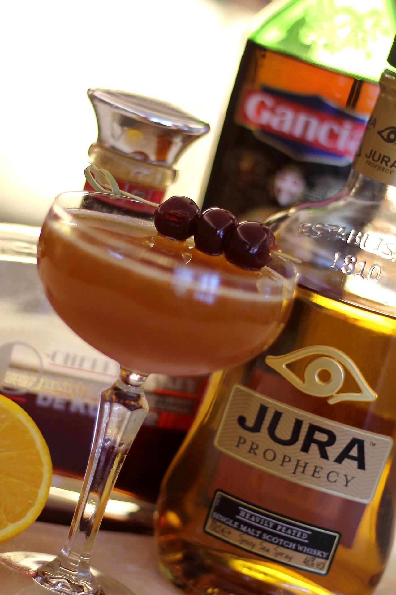

# 血与沙

血与沙是一杯“名字比酒更烈”的经典。苏格兰威士忌、樱桃利口酒、甜味美思、橙汁，四等分，摇和，滤入碟形杯。颜色深红，像斗牛场上的沙与血；味道浓郁，烟熏、果香、苦甜与柑橘在口中交织。

这杯酒的名字来自 1922 年的电影《血与沙》（Blood and Sand），改编自西班牙斗牛士的故事。电影由鲁道夫·瓦伦蒂诺主演，鸡尾酒据说是为电影首映或宣传而创作。名字的戏剧性，让这杯酒在经典鸡尾酒中格外醒目。

图：苏格兰威士忌、樱桃利口酒、甜味美思与橙汁调成的血与沙。图片：Cocktailmarler，CC BY-SA 4.0，via Wikimedia Commons（[原图页面](https://commons.wikimedia.org/wiki/File:Blood_and_Sand.jpg)）。

## 苏格兰威士忌与樱桃

苏格兰威士忌提供骨架与烟熏。 blended scotch 的麦芽、泥煤与谷物，能撑住樱桃与味美思的甜；单一麦芽也可以，但风味更强，可能压过其他材料。不要用太重的泥煤威士忌，否则酒会像“消毒水”。

樱桃利口酒提供果香与甜度。它由樱桃浸渍、加糖、降度制成，颜色深红，味道酸甜；它和威士忌的烟熏是经典组合，像“烟熏樱桃”。樱桃利口酒品牌很多，选味道自然、不过分甜的。

甜味美思提供草本与苦甜。它的苦艾、丁香、肉桂与糖，能平衡樱桃的甜，也能连接威士忌的烟熏；没有味美思，酒会太甜、太单一。甜味美思比干型更适合这杯酒。

橙汁提供酸度与新鲜。现榨橙汁的酸与果香，能切开威士忌与樱桃的厚重；瓶装橙汁太甜，会让酒变得腻。橙汁的用量是四等分，不能少，否则酒会失去平衡。

## 配方：四等分

IBA 的标准配方是苏格兰威士忌 3 厘升、樱桃利口酒 3 厘升、甜味美思 3 厘升、橙汁 3 厘升。3 厘升等于 30 毫升，总量 120 毫升，滤入碟形杯约八分满。四等分是这杯酒的标志，也是最容易记住的比例。

如果喜欢更烈，可以把威士忌增加到 4 厘升，橙汁减少到 2 厘升；如果喜欢更果香，可以把樱桃利口酒增加到 4 厘升。但四等分是经典，也是这杯酒最平衡的版本。

威士忌选 blended scotch，如苏格兰调和威士忌。它的烟熏与谷物甜，能与樱桃、味美思、橙汁融合；单一麦芽的个性太强，容易破坏平衡。不要用波本或黑麦，它们的甜与香料不适合这杯酒。

樱桃利口酒要选深红色、味道自然的。太甜的樱桃利口酒会让酒变成“樱桃糖浆”；太酸的会让酒失去圆润。甜味美思要选意大利风格的，草本与甜度都适中。

## 做法：摇和与橙皮

把威士忌、樱桃利口酒、甜味美思、橙汁倒入摇壶，加冰，摇和 10 到 12 秒。摇和能让四种材料融合、降温；摇得太短，酒液不匀；摇得太长，冰化太多，酒变稀。

就「血与沙」而言，用细网滤冰器滤入冷藏的碟形杯。滤冰器能挡住碎冰，让酒液清澈；碟形杯的宽口能让香气释放，杯壁的弧度能托住酒体。杯子要提前冷藏，酒液才能保持低温。

装饰用橙皮。用削皮器削一条橙皮，挤一下油脂，放在杯口或杯底；橙皮的香气能强化橙汁的柑橘味，也能让颜色更亮。不要用樱桃，那会重复樱桃利口酒的甜。

喝的时候先闻橙皮，再喝一口。烟熏、樱桃、草本、柑橘会依次出现；温度升高后，樱桃与味美思的甜会更明显。这杯酒的层次，来自四种材料的等量平衡。

## 电影与斗牛士

《血与沙》是 1922 年的美国默片，改编自西班牙作家 Vicente Blasco Ibáñez 的小说，讲述一位斗牛士的崛起与毁灭。电影由鲁道夫·瓦伦蒂诺主演，成为当年的票房大片。

鸡尾酒“血与沙”据说为电影首映或宣传而创作，具体创作者与地点没有可靠的一手记载。常见的说法是，它由伦敦或纽约的酒吧在 1922 年前后推出，名字直接借用电影标题。

电影的名字“血与沙”指斗牛场的沙与斗牛士的血，象征荣耀与死亡。鸡尾酒的深红色，正好呼应这个意象；它的烟熏与樱桃，也像斗牛士的浪漫与悲剧。

这杯酒在 1930 年代至 1950 年代流行，后来一度被遗忘，又在 21 世纪的“经典复兴”中回归。今天，它是苏格兰威士忌鸡尾酒的代表之一，也是调酒师展示平衡能力的考题。

## 变体与常见错误

常见变体包括“Blood and Sand with mezcal”，用龙舌兰酒替代威士忌，增加烟熏；“Blood and Sand with blood orange”，用血橙汁，颜色更深；“Sand and Blood”，减少樱桃利口酒，增加威士忌；“Blood and Sand Flip”，加入全蛋，做成 flip 风格。

常见错误有四个。第一，威士忌太泥煤，酒像消毒水。第二，樱桃利口酒太甜，酒变成糖浆。第三，橙汁不新鲜，酸度不足。第四，摇和过久，冰化太多，酒变稀。血与沙的成败，在“平衡”。

对家庭调酒者，最实用的建议是：用调和威士忌，樱桃利口酒与味美思选自然的，橙汁现榨，四等分，摇和十秒，滤入冷杯，橙皮最后挤。记住，这杯酒的目标是“烟熏樱桃的平衡”，不是“甜樱桃酒”。

相关条目：[味美思](ref:vermouth)。

## 另见与参考资料

- 苏格兰威士忌：参见 [苏格兰威士忌](ref:scotch)。
- 味美思：参见 [味美思](ref:vermouth)。
- 摇和：参见 [摇和](ref:shaking)。
- 碟形杯：参见 [碟形杯](ref:coupe)。
- 甜型：参见 [甜型](ref:sweet)。

对照阅读：[苏格兰威士忌](ref:scotch)、[摇酒](ref:shaking)。

**关键事实。**

| 项目 | 内容 |
| --- | --- |
| 一句话定位 | 苏格兰威士忌、樱桃利口酒、甜味美思与橙汁等量摇和的经典鸡尾酒，颜色深红；名字来自 1922 年的斗牛电影，风味浓郁而平衡 |
| 类型 | IBA Contemporary Classics |
| 起源 | 英国 |

**来源与边界。** 本页关于「血与沙」的关键事实，主要由以下来源交叉核对：International Bartenders Association（IBA 鸡尾酒列表与配方分类；该款无独立页面，参考 IBA 鸡尾酒总目录）、Oxford University Press（鸡尾酒史与术语背景）、CocktailDB（交叉核对配方结构与常见变体）等 5 条来源。价格、批次与状态会变，涉及这些字段时以页面所列来源的最新版本为准。正文为项目自写，来源只作核验，不复制原文。

**并读。** 把「血与沙」与「苏格兰威士忌」、「味美思」、「摇酒」放在一起读时，先确认它们是同一层级还是上下游关系：先确认基酒与比例，再比较酸甜平衡、杯型与出品差异。本页负责给出鸡尾酒的基本坐标，对照条目补上具体案例与差异；读完再回到本页，才能分清哪些差别属于鸡尾酒本身，哪些只是产地、批次或品牌选择。

**适用边界。** 对「血与沙」而言，配方比例、基酒品牌与杯型会变；IBA 版本是参照，不是唯一做法。

**更新提示。** 「血与沙」最近核对于 2026-11-20；配方比例、基酒品牌、杯型与出品标准会变，调酒前以 IBA 或酒吧现行配方为准。
