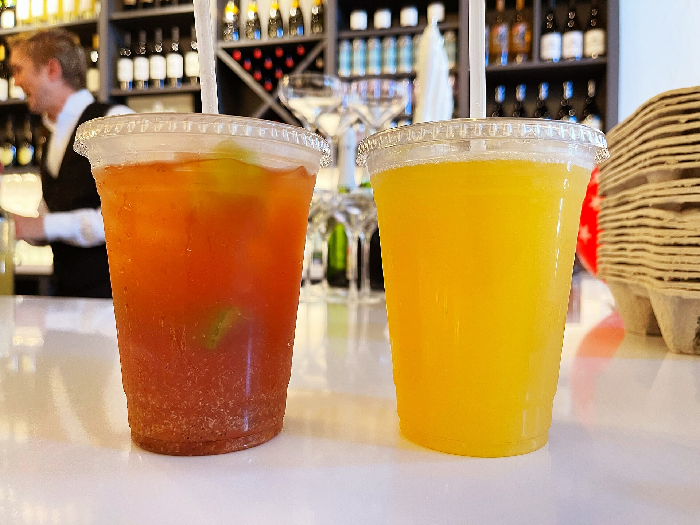

# 血腥玛丽

血腥玛丽（Bloody Mary）是一款以伏特加与番茄汁为主体、用柠檬汁提供酸度、以伍斯特酱和辣椒酱补充鲜味与热度的长饮。它通常在高球杯中加冰调制，以芹菜杆和柠檬角装饰，有时在杯口抹一圈芹菜盐。颜色浓、口感厚、酒精度相对温和，使它常被当作早午餐饮品。

图：血腥玛丽相关实景照片。图片：Missvain，CC BY 4.0，via Wikimedia Commons（[原图页面](https://commons.wikimedia.org/wiki/File:Sausage_Emporium_-_July_4_2021_-_Sarah_Stierch.jpg)）。

## 一杯酒的边界

血腥玛丽属于“咸鲜型”长饮，不是果汁饮料。它的骨架是伏特加、番茄汁与酸味，调味料只是在这个骨架上做微调。伏特加提供酒精与骨架，但优质伏特加应当干净、不抢味；番茄汁提供质地、鲜味与颜色；柠檬汁提供必要的酸度，让厚重的番茄不至于发闷；伍斯特酱带来发酵鲜味与香料气息；辣椒酱提供热度；盐与黑胡椒负责把味道提起来。

它也不等于“番茄汁加酒”。缺少酸度时，成品会像稀释的番茄汤；缺少盐时，番茄的甜味会显得钝；缺少香辛料时，整体会平。反过来，调味料过量会盖住番茄本身。血腥玛丽的高低，很大程度上取决于这几克调料之间的平衡，而不是伏特加的贵贱。

## 起源与争议

血腥玛丽的起源常归于巴黎的[Harry's New York Bar](ref:harrys)。常见叙述是：20 世纪 20 年代，酒吧的调酒师 Fernand Petiot 把伏特加与番茄汁混合；1934 年他转到纽约 St. Regis 酒店的 King Cole Bar 后，加入盐、胡椒、伍斯特酱与辣椒酱，并以“Red Snapper”之名供应。另一条说法把发明权归于艺人 George Jessel，称他在 1927 年前后用伏特加与番茄汁调制了类似饮品。

这些说法各有支持者，但缺少能一锤定音的同期书面证据。可以较稳妥地表述为：这道饮品在 1920 至 1930 年代的美式酒吧文化中成形，巴黎与纽约都留下了早期版本，具体人物、年份与名称来源仍有争议。“Bloody Mary”这个名字究竟指英格兰女王玛丽一世、某位名叫 Mary 的顾客，还是别的来源，也没有统一结论。写作与点单时，把“常归于”与“有争议”说清楚，比给出一个确定答案更可靠。

## 配方与比例

IBA 公开配方为：45 毫升伏特加、90 毫升番茄汁、15 毫升鲜榨柠檬汁、2 滴伍斯特酱、适量辣椒酱、盐与黑胡椒，加冰调制，以芹菜杆和柠檬角装饰。这个比例是 1 份伏特加对 2 份番茄汁，酸度来自 15 毫升柠檬汁。

实际制作时，比例有较大的活动空间。伏特加可在 45–60 毫升之间，番茄汁可在 90–180 毫升之间；番茄汁越多，酒体越厚、酒精度越低，但也越容易显得淡。柠檬汁通常在 10–20 毫升；伍斯特酱 2–4 滴；辣椒酱 2–4 滴；盐一小撮，黑胡椒现磨。与其死记数字，不如先按 IBA 版本做一杯，再根据番茄汁的浓度和酸度微调。

## 原料各自在做什么

番茄汁决定质地。罐装与瓶装番茄汁的稠度、盐分与甜度差别很大，有的品牌已经加盐，有的偏稀。使用前应先尝一口：如果汁体本身很咸，后续加盐就要减少；如果酸度低，柠檬汁就要补足。番茄汁开瓶后容易氧化，放置过久的汁会带金属味或发酸，直接影响成品。

伏特加决定骨架。血腥玛丽不需要昂贵的伏特加，但需要干净的伏特加；带有明显谷物甜味或油感的酒会与番茄冲突。柠檬汁负责酸度与明亮感，鲜榨优于瓶装。伍斯特酱提供凤尾鱼、罗望子与香料的复合鲜味，几滴就够。辣椒酱提供热度，也带来发酵辣椒的酸香。盐提升整体风味，黑胡椒提供辛香与轻微的辛辣尾韵。芹菜杆既是装饰，也是香气来源；杯口抹芹菜盐可以增加咸香，但会让整杯更咸。

## 技法与质地

血腥玛丽通常是“加冰直调”，也可以在两个听壶之间来回倒几次，这种做法叫 roll。Roll 的目的是混合与轻微充气，而不是像摇和那样剧烈冷却与稀释。剧烈摇和会让番茄汁产生大量泡沫，入口发虚，也会让香料的味道变得尖锐。关于调酒的基本结构，可参见[调酒基础](ref:cocktails-guide)。

操作顺序会影响结果：先在杯中加入冰块，再倒入伏特加、番茄汁、柠檬汁与调味料，最后用吧勺从底部向上提拉几次，让盐与酱料均匀分布。若使用芹菜盐或辣椒酱，先少量加入，尝味后再补。冰块要足，杯壁要冷；冰太少，成品会很快变温，番茄的甜味会变得黏腻。关于冰与温度的一般原理，可参见[加冰与温度](ref:ice)。

## 变体与点单

以金酒替代伏特加，通常称 Red Snapper；以龙舌兰替代伏特加，称 Bloody Maria；不加酒精则称 Virgin Mary。以蛤蜊番茄汁替代部分番茄汁，是加拿大的 Bloody Caesar；以啤酒为基底、加入番茄汁与辣酱，则接近 Michelada 的思路。也有加入牛肉汤、辣根或腌菜的版本，这些属于地方化变体，不应默认所有血腥玛丽都含这些成分。

点单时可以说明辣度、酸度与咸度：“少辣”“多加柠檬”“不要芹菜盐”。若店家现调，可以要求把调味料单独放，先尝基酒与番茄汁的比例。作为早午餐饮品，它适合搭配蛋类、培根、烤面包与咸味食物；但它的酒精仍然存在，一杯 45 毫升伏特加的版本约含 18 毫升纯酒精。关于酒度的计算，可参见[酒精度](ref:abv)。

## 常见误区

第一，把血腥玛丽当成“解酒药”。酒精只能推迟不适，不能加速乙醇代谢；以酒解酒会增加总摄入。第二，剧烈摇和。番茄汁起泡后口感发虚，香料也会变得刺鼻。第三，忽略番茄汁本身的盐分与酸度，导致重复调味。第四，冰太少。长饮的温度一升高，番茄的甜与酱料的咸就会失衡。

第五，装饰喧宾夺主。堆满橄榄、腌黄瓜、虾与芝士的“沙拉版”可以好看，但会改变饮品的温度与香气，也让配方难以比较。第六，把芹菜杆当成可吃可不吃的摆设。它提供的香气与清爽感，是这款酒结构的一部分。

## 另见

- [伏特加](ref:vodka)：血腥玛丽的酒精骨架。
- [Harry's New York Bar](ref:harrys)：起源叙述中的巴黎酒吧。
- [调酒基础](ref:cocktails-guide)：直调、搅拌与稀释的基本原则。
- [如何选杯](ref:glass)：高球杯的容量与预冷。
- [酒精度](ref:abv)：长饮的实际酒精摄入。

对照阅读：[伏特加](ref:vodka)、[调酒，是另一种认识酒的方式](ref:cocktails-guide)。
