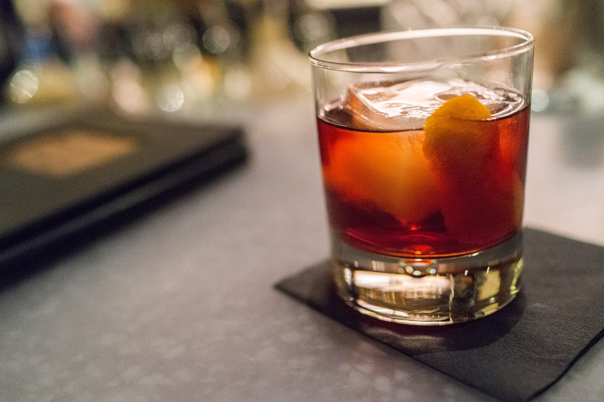

# 花花公子

花花公子（Boulevardier）是一款以威士忌、金巴利和甜味美思调制的经典鸡尾酒。它常被看作“威士忌版 Negroni”，但两者的比例史并不完全相同：1927 年书面记录里的花花公子通常被转述为三味等份，而 IBA 现行的版本是威士忌 45 毫升、金巴利 30 毫升、甜味美思 30 毫升，约为 1.5:1:1。等份更苦、更短，1.5:1:1 更偏威士忌，也更适合现代口味。

图：花花公子相关实景照片。图片：Edsel Little，CC BY-SA 2.0，via Wikimedia Commons（[原图页面](https://commons.wikimedia.org/wiki/File:Society_Lounge_-_Boulevardier_-_16164913902.jpg)）。

> **先给结论**
> **一句话：** 这页判断花花公子该不该点、比例和冰水怎么处理。
>
> - **适合谁：** 想弄懂花花公子的配方逻辑、点单方式和常见误区的人。
> - **不适合谁：** 只想要“一杯就醉”的配方、不关心比例和冰水的人。
> - **先看这两点：**
>   - 点单时可以说“花花公子，波本，1.5:1:1，古典杯加一块大冰”，或者“coupe，不加冰”。
>   - 这款酒的名字来自一本杂志。

## 1927 年，巴黎，一本杂志和一个名字

这款酒的名字来自一本杂志。Erskine Gwynne 是一位在巴黎生活的美国作家，1927 年创办了月刊《The Boulevardier》，这本杂志通常被记作发行到 1932 年。“Boulevardier”在法语里指在城市大道上闲逛、讲究穿着与社交的人，中文常译作“花花公子”，但它更像“都市雅士”，并不完全等同于轻浮的花花公子。

同一年，巴黎 Harry's New York Bar 的 Harry McElhone（也写作 MacElhone）在《Barflies and Cocktails》里记录了这款酒。这本书混合了配方、酒吧轶事与对常客的调侃，书中把配方归给 Gwynne，并留下了“Now is the time for all good Barflies to come to the aid of the party, since Erskine Gwynne crashed in with his Boulevardier Cocktail”一类带着玩笑口吻的句子。因此常见的说法是：Gwynne 是命名者或提供配方的人，McElhone 是记录者与传播者，Harry's New York Bar 是它进入鸡尾酒史的地点。这三重角色经常被压缩成“McElhone 发明了它”，那是不准确的。

## 等份还是 1.5:1:1

花花公子最值得说清楚的，是比例的分歧。

1927 年的原始记录通常被转述为三味等份，也就是威士忌、金巴利、甜味美思各三分之一。这个版本的苦味最直接：金巴利在前，甜味美思在中段提供草本与甜度，威士忌在尾段托底。它酒体不算厚，苦味长，适合作为餐前酒，但对手里有一瓶好威士忌的人来说，威士忌的细节会被金巴利压住。

IBA 的现行配方是威士忌 45 毫升、金巴利 30 毫升、甜味美思 30 毫升，即 1.5:1:1；Campari 品牌方给出的版本是 3:2:2，数值同样是 45、30、30。这个比例把威士忌推到前面，金巴利的苦退到中段，甜味美思负责把两者黏合。成品更圆、更甜，也更接近现代酒吧里常见的“威士忌开胃酒”。

还有第三种常见写法：威士忌 2、金巴利 1、甜味美思 1，即 2:1:1。它比 1.5:1:1 更干、更烈，苦味在尾段更明显。三种比例都能成立，但差异不是细枝末节：等份是“苦味主导”，1.5:1:1 是“威士忌主导”，2:1:1 是“烈酒主导”。点单或写配方时，最好把比例一起说清楚。

## 威士忌：波本、黑麦与调和

IBA 允许波本或黑麦威士忌。波本多以玉米为原料，带香草、焦糖和熟果的甜感，和甜味美思的甜味容易叠加；黑麦更辛辣，胡椒与谷物感强，能把金巴利的苦味托得更清楚。没有哪一种“更正宗”，选择取决于你想要的方向。

高酒精度的威士忌更需要稀释，也更需要搅拌到位；40% 左右的常规装瓶更温和，但在 1.5:1:1 里可能显得薄。反过来，桶强威士忌如果不调整比例，会压住金巴利，让成品变成一杯“带苦味的威士忌”。调和威士忌也能用，但它的谷物与轻微烟熏会让风味更模糊，除非你明确想要那种柔和的方向。

顺便说一句：花花公子不是“把 Negroni 的金酒随手换掉”。威士忌的甜味、木桶和谷物感与金酒的杜松子、芫荽完全不同，替换基酒会改变整杯酒的骨架，而不只是换一个名字。

## 金巴利与甜味美思的分工

[金巴利](ref:campari)提供苦味、红色和草本香气。它的苦不是单一的“药苦”，而是带橙皮、树皮与根茎的复合苦味；它的甜度也不低，只是被苦味遮住。用量太少，酒会变成一杯甜威士忌；用量太多，苦味会压住威士忌的香气，让尾段发干。

[甜味美思](ref:vermouth)提供甜度、葡萄酒的酸度和草本香气。它不是“甜味糖浆”，而是一款加香加强葡萄酒，开瓶后会把氧化味带进酒里。氧化过的美思会有酸败、金属或醋味，足以毁掉整杯酒；开瓶后应冷藏，并在数周内用完。这个细节比换一个昂贵品牌更重要。

两者的比例决定了这杯酒的“苦甜曲线”。等份时，金巴利与美思的甜苦几乎正面相撞；1.5:1:1 时，威士忌把两者隔开，苦味变成中段的背景；2:1:1 时，苦味更靠后，收口更长。调整比例时，一次只动一个变量，否则很难判断是哪一味改变了平衡。

## 搅拌，而不是摇和

花花公子用[搅拌](ref:stir)，不用摇和。三种原料都是酒液，没有果汁、蛋白或奶油需要乳化；搅拌能在不引入空气的情况下降温、稀释，让成品保持清澈与丝滑。摇和会把空气打进去，酒液变浑，口感也会显得粗糙。

操作上，把材料倒入调酒杯，加满冰块，用吧勺搅拌 20–30 秒。判断标准不是“数够时间”，而是杯壁结霜、酒液明显变冷、稀释达到约 20% 到 25%。搅拌不足，酒是温的，苦味与酒精分离；搅拌过度，冰化水太多，酒体变薄，甜味也会显得水。

搅拌后应滤冰倒入杯中。若用古典杯，可以加一块大冰；若用 coupe，则不加冰，直接滤入预冷的杯子。不要在调酒杯里加碎冰，碎冰融化太快，几分钟内就会把比例冲垮。

## 杯型：古典杯还是 coupe

IBA 的方法是滤入预冷的鸡尾酒杯，也就是 coupe 一类的带杯脚高脚杯；现代酒吧更常用[古典杯](ref:rocks)加一块大冰。两种出品都合理，但喝起来不一样。

Coupe 让酒液保持低温，香气在杯腹里聚拢，第一口更锐利，苦味与橙皮香更清楚；缺点是酒液升温快，后半杯会变软。古典杯加一块大冰，稀释慢，酒液会随着冰的融化逐渐打开，苦味变柔，甜味更明显；缺点是杯子宽、香气散得快，冰块质量差时会有冰箱味。

如果选古典杯，用一块尽量大、尽量透明的冰，杯子提前冷藏，倒酒后再挤橙皮油。如果选 coupe，杯量控制在 150–200 毫升，倒到三分之二左右，不要倒满。杯型不是身份的一部分，但它会改变温度和稀释曲线，点单时可以直接说明。

## 与 Negroni 的一步之差

[Negroni](ref:negroni)的结构是金酒、金巴利、甜味美思，通常写作等份，常被追溯到 1919 年的佛罗伦萨。花花公子把金酒换成威士忌，其余两味不变；如果也用等份，它确实可以被看作“威士忌 Negroni”。

但这一步替换带来的变化比名字大。金酒的杜松子与柑橘让苦味显得清亮，威士忌的玉米甜、木桶香和谷物感让苦味显得厚；Negroni 常加冰在古典杯里喝，花花公子在 IBA 的版本里是滤冰后不加冰喝。前者更清爽、更长，后者更浓、更短。把花花公子叫作“威士忌 Negroni”是有效的记忆法，但不应据此认为两者的配方史完全重合。

## 变体：Old Pal、1794 与更远的亲戚

Old Pal 通常写作黑麦威士忌、干味美思与金巴利等份。它把甜味美思换成干味美思，甜度下降，苦味与草本感更突出，收口更干；有些人会觉得它比花花公子更接近“餐前酒”的本意。它的具体来源同样有不同说法，本页不把某一年份当作定论。

1794 通常写作黑麦威士忌、甜味美思、金巴利，再加几滴橙苦精。它常被视为花花公子的现代变体，橙苦精把柑橘香提起来，让金巴利的苦味更有层次。还有把波本换成黑麦、把甜味美思换成更干的风格、或加入少量烟熏威士忌的版本；每一次替换都应写清楚，否则“花花公子”会变成一个没有边界的名字。

## 常见失败点

第一，甜味美思氧化。开瓶太久、没有冷藏，酒会有酸败味，这是最常见也最容易被忽略的失败。第二，比例失衡。金巴利太多，苦味盖住威士忌；威士忌太多，酒变成一杯带红色的烈酒。第三，搅拌不足。酒温不够低，苦味与酒精分离，喝起来“冲”。第四，搅拌过度。冰化水太多，酒体变薄，甜味发空。第五，冰块太小或太多。稀释失控，后半杯像水。第六，装饰省略。橙皮油不是装饰，它把柑橘香带到杯口，能缓和金巴利的苦。第七，用低酒精度威士忌却坚持 1.5:1:1，成品会显得软而散。

## 怎么点与怎么喝

点单时可以说“花花公子，波本，1.5:1:1，古典杯加一块大冰”，或者“coupe，不加冰”。若喜欢更苦，要求等份或增加金巴利；若喜欢更甜，增加甜味美思，而不是加糖浆，因为美思同时提供草本与酸度。若对苦味敏感，可以先从 1.5:1:1 开始，不要一上来就点等份。

它适合作为餐前酒，搭配坚果、橄榄、咸味奶酪、烤肉与苦味蔬菜；等份版本尤其适合搭配偏油腻的食物，苦味能切开油脂。饮用时慢慢喝，注意冰块融化带来的稀释；酒精度不低，不要空腹快速饮用。驾车、服药或孕期不应饮酒。

## 另见

- [波本威士忌](ref:bourbon)：玉米甜、木桶香与酒精度对比例的影响。
- [甜味美思](ref:vermouth)：甜度、草本与开瓶后的氧化问题。
- [金巴利](ref:campari)：苦味、红色与草本香气。
- [Negroni](ref:negroni)：金酒版的同构经典。
- [搅拌](ref:stir)：降温、稀释与清澈酒体。
