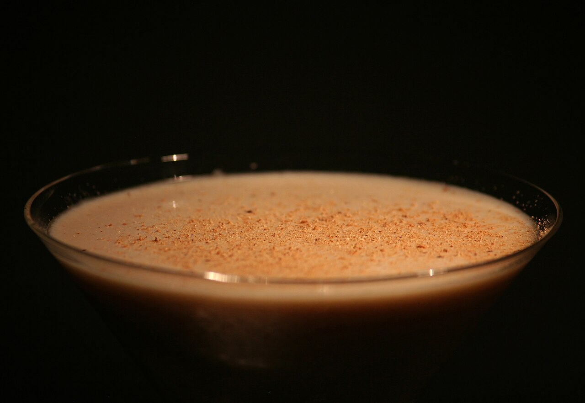

# 白兰地亚历山大

白兰地亚历山大是一杯“奶油甜点酒”。白兰地、白可可利口酒、奶油，等量摇和，滤入碟形杯，表面撒一层肉豆蔻。颜色像浅咖啡，口感像融化的巧克力奶，酒精度不高，适合餐后。

这杯酒的名字与起源有很多说法。有人说它得名于俄国沙皇亚历山大二世，有人说它为了纪念一场皇室婚礼，还有人说“亚历山大”原本是金酒版本，白兰地版本后来居上。可以确认的是：它在 20 世纪初的美国酒吧文化中流行，并在 1920 年代进入欧洲。

图：白兰地、白可可与奶油调成的白兰地亚历山大，表面撒肉豆蔻。图片：Cocktailmarler，CC BY-SA 3.0，via Wikimedia Commons（[原图页面](https://commons.wikimedia.org/wiki/File:Brandy_Alexander.jpg)）。

## 白兰地与白可可

白兰地提供骨架与果香。它的葡萄、橡木与香草味，能撑住奶油的厚重；没有白兰地，这杯酒会变成“可可奶”。白兰地不需要昂贵，但要有一定的浓度与香气；过于清淡的白兰地会被奶油吞掉。

白可可利口酒提供巧克力香与甜度。它没有深色可可的苦，只有可可脂的圆润与糖的甜；它和白兰地是经典组合，像“巧克力加葡萄”。白可可的甜度高，所以配方里不再加糖。

奶油提供质地。淡奶油的脂肪能让酒液乳化，变得柔滑；重奶油太稠，会让酒像酱；牛奶太薄，撑不起酒体。奶油的用量与白兰地、白可可为 1 比 1 比 1，等量是这杯酒的标志。

肉豆蔻是点睛。现磨的肉豆蔻带来木质、辛香与轻微的甜，能切开拓口酒的腻；不撒肉豆蔻，酒会显得单调。肉豆蔻要现磨，粉状的香气已经流失。

## 配方：等分的三样

IBA 的标准配方是白兰地 3 厘升、白可可利口酒 3 厘升、奶油 3 厘升。3 厘升等于 30 毫升，总量 90 毫升，滤入碟形杯约七分满。等量让三种材料互相平衡，谁也不压谁。

如果喜欢更烈的版本，可以把白兰地增加到 4 厘升，奶油减少到 2 厘升；如果喜欢更甜、更奶，可以把奶油增加到 4 厘升。但等量是经典，也是这杯酒最容易记住的比例。

白兰地选 VS 或 VSOP 均可。VS 年轻、果香明显，适合与奶油搭配；VSOP 更圆润，带香草与木质，但可能压过可可。不要用陈年很久的干邑，它的复杂度会被奶油掩盖。

白可可利口酒要选无色或浅色的版本。深色可可会改变颜色，也会带来苦味；无色可可让酒液呈浅咖啡色，符合“亚历山大”的视觉。奶油要冷藏，摇和前才取出。

## 做法：摇和与肉豆蔻

把白兰地、白可可、奶油倒入摇壶，加冰，用力摇和 10 到 12 秒。摇和要让奶油与酒液充分乳化，酒体均匀、细腻；摇得太短，奶油会分离，酒液出现颗粒。

用细网滤冰器滤入冷藏的碟形杯。滤冰器能挡住碎冰与未乳化的奶油，让酒液顺滑；碟形杯的宽口能让香气释放，杯壁的弧度能托住泡沫。

在表面撒现磨肉豆蔻。可以撒在泡沫中央，也可以撒成一条线；肉豆蔻的香气会随着泡沫上升，第一口就能闻到。不要撒太多，否则辛香会压过可可。

装饰可以省略，也可以加一颗咖啡豆或一小片橙皮。咖啡豆能强化“咖啡色”的视觉，橙皮能增加香气；但传统的亚历山大只撒肉豆蔻。

## 亚历山大这个名字

“亚历山大”的名字有多种解释。一种说法是，它得名于俄国沙皇亚历山大二世，因为白兰地版本在 19 世纪末的欧洲宫廷流行；另一种说法是，它为了纪念 1922 年英国公主玛丽与拉塞尔斯勋爵的婚礼。

还有一种说法是，“亚历山大”原本是金酒、可可与奶油的组合，出现在 1910 年代；白兰地版本在 1920 年代取代金酒版本，成为更流行的“亚历山大”。金酒版本今天仍被称为“Alexander”，有时叫“Gin Alexander”。

这些说法大多缺乏一手证据，但都指向同一个事实：这杯酒在 20 世纪初的美国与欧洲流行，名字与皇室、婚礼、酒吧文化交织。名字的具体来历，可能永远无法确认。

对饮用者，名字的故事是附加值，不是配方的一部分。重要的是知道：白兰地版本用等量三种材料，金酒版本用金酒替代白兰地；两者是同一家族的不同分支。

## 变体与常见错误

常见变体包括“Gin Alexander”，用金酒替代白兰地；“Alexander Special”，加入咖啡利口酒；“Peppermint Alexander”，用薄荷利口酒替代可可；“Jack Alexander”，用苹果杰克酒替代白兰地。

常见错误有四个。第一，奶油太少，酒太烈、太薄。第二，摇和不足，奶油分离，酒液有颗粒。第三，肉豆蔻不新鲜，香气不足。第四，杯子不冷，泡沫消失。亚历山大的成败，在“乳化”与“温度”。

对家庭调酒者，最实用的建议是：用淡奶油，三种材料等量，摇和至少十秒，滤入冷杯，肉豆蔻现磨。记住，这杯酒的目标是“柔滑的巧克力奶”，不是“甜奶油”。

相关条目：[摇酒](ref:shaking)。

## 另见与参考资料

- 白兰地：参见 [白兰地](ref:brandy)。
- 摇和：参见 [摇和](ref:shaking)。
- 碟形杯：参见 [碟形杯](ref:coupe)。
- 甜型：参见 [甜型](ref:sweet)。
- 香气：参见 [香气](ref:aroma)。

对照阅读：[白兰地](ref:brandy)、[碟形杯](ref:coupe)。

**关键事实。**

| 项目 | 内容 |
| --- | --- |
| 一句话定位 | 白兰地、白可可利口酒与奶油等量摇和的甜点型鸡尾酒，表面撒肉豆蔻；名字与起源说法众多，是 20 世纪初美国酒吧文化的代表之一 |
| 类型 | IBA Contemporary Classics |
| 起源 | 美国 |

**来源与边界。** 本页关于「白兰地亚历山大」的关键事实，主要由以下来源交叉核对：International Bartenders Association（IBA 鸡尾酒列表与配方分类；该款无独立页面，参考 IBA 鸡尾酒总目录）、Oxford University Press（鸡尾酒史与术语背景）、CocktailDB（交叉核对配方结构与常见变体）等 5 条来源。价格、批次与状态会变，涉及这些字段时以页面所列来源的最新版本为准。正文为项目自写，来源只作核验，不复制原文。

**并读。** 把「白兰地亚历山大」与「白兰地」、「摇酒」、「碟形杯」放在一起读时，先确认它们是同一层级还是上下游关系：先确认基酒与比例，再比较酸甜平衡、杯型与出品差异。本页负责给出鸡尾酒的基本坐标，对照条目补上具体案例与差异；读完再回到本页，才能分清哪些差别属于鸡尾酒本身，哪些只是产地、批次或品牌选择。

**适用边界。** 对「白兰地亚历山大」而言，配方比例、基酒品牌与杯型会变；IBA 版本是参照，不是唯一做法。

**更新提示。** 「白兰地亚历山大」最近核对于 2026-11-20；配方比例、基酒品牌、杯型与出品标准会变，调酒前以 IBA 或酒吧现行配方为准。
