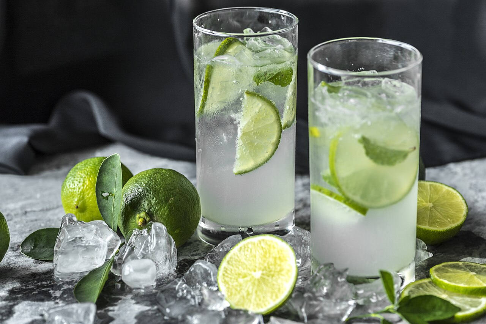

# 卡琵莉亚

卡琵莉亚（Caipirinha）是巴西的国民鸡尾酒，以卡莎萨（cachaça）、青柠与糖为主体，在杯中捣压后加冰。它没有果汁、苏打水或利口酒，结构极其简单：烈酒、酸、甜、冰。正因为简单，青柠的处理、糖的溶解与冰的量都会直接暴露在杯中，做得好与做得随便差别很大。

图：卡琵莉亚。图片：rawpixel.com，CC0，via Wikimedia Commons（[原图页面](https://commons.wikimedia.org/wiki/File:Caipirinha_with_lime.jpg)）。

## 定义与国民地位

卡琵莉亚的主体是[卡莎萨](ref:cachaca)，一种以甘蔗汁发酵后蒸馏的巴西烈酒。它常被拿来与朗姆酒比较，但朗姆酒多以糖蜜为原料，卡莎萨以新鲜甘蔗汁为原料，风味更偏青草、甘蔗与轻微的发酵感。关于原料背景，可参见[甘蔗](ref:sugarcane)。

在巴西，卡琵莉亚出现在酒吧、餐厅、家庭聚会与海滩摊位上，被视为日常饮品而非节庆特调。它的名称来自“caipira”，原指内陆乡村居民，带一点乡土与朴素的意味；加上指小后缀后，语气更像“乡下小酒”。这个名称也提示了它的气质：不精致、不复杂，但直接、解渴、适合炎热天气。

## IBA 配方

IBA 公开配方为：60 毫升卡莎萨、一个青柠、两茶匙砂糖。做法是把青柠洗净后切成楔形，与糖一起放入古典杯，轻压出汁并让糖开始溶解，然后加满冰，倒入卡莎萨，搅拌均匀。配方没有苏打水，也没有额外的糖浆；甜度完全来自糖，酸度完全来自青柠。

比例可以按口味调整。卡莎萨通常在 50–60 毫升之间；青柠用一个中等大小（约 80–100 克）的即可；糖在两茶匙（约 8–10 克）上下，也可以换成 15 毫升糖浆。糖太少，青柠的酸会显得尖；糖太多，会压住卡莎萨的甘蔗香。若青柠特别酸或特别小，应当先少量加糖，尝过再补。

## 卡莎萨的角色

卡莎萨不是“巴西伏特加”。它保留明显的原料特征：新鲜甘蔗汁带来的青草味、发酵带来的酯香、蒸馏带来的轻微辛辣。未陈年的卡莎萨颜色透明，风味直接，适合卡琵莉亚；陈年卡莎萨会带木桶香草与焦糖味，做出来的酒更圆润，但也会偏离经典风格。

酒精度会影响平衡。巴西法规允许的卡莎萨酒度范围较宽，常见装瓶在 38%–48% abv 之间。酒度高的卡莎萨需要更多冰与更充分的搅拌，否则入口会烧；酒度低的版本则可能显得水。关于酒精度的含义，可参见[酒精度](ref:abv)。选择时先看是否干净、是否有明显的甘蔗香，而不是只看品牌。

## 捣压与糖

捣压（muddle）是卡琵莉亚最关键的动作。目的不是把青柠捣成泥，而是压破果肉、释放果汁与果皮精油，同时让糖与果汁接触。青柠切成六到八块楔形，去掉中间的白色海绵层可以减少苦味；保留一部分果皮能提供香气，但不要用力压榨果皮，否则会带出过多苦油。

糖的选择会影响口感。细砂糖溶解快，适合现做；粗砂糖溶解慢，容易沉底，最后几口突然变甜。若使用糖浆，酸与甜的融合更均匀，但少了砂糖在捣压中摩擦果皮带来的香气。无论用哪种糖，都应先与青柠一起轻压，让糖开始溶解，再加冰与酒。关于调酒的基本结构，可参见[调酒基础](ref:cocktails-guide)。

## 冰、杯型与搅拌

卡琵莉亚通常使用古典杯（rocks glass），容量约 250–300 毫升。杯中先放青柠与糖，捣压后加满冰，再倒入卡莎萨，用吧勺从底部向上提拉几次。冰可以是方冰，也可以是碎冰；碎冰降温快、口感更冰爽，但稀释也更快，适合炎热天气快速饮用；方冰融化慢，适合慢慢喝。

杯子应提前冰镇，卡莎萨也应冷藏。冰不足时，饮品会很快变温，酸味变得突出、甜味变得黏。搅拌要轻，目的是让糖与酒均匀，而不是把冰搅碎。若做多杯，最好逐杯捣压，不要提前把青柠泡在酒里，否则果皮苦味会持续析出。关于冰与温度的原理，可参见[加冰与温度](ref:ice)。

## 变体

以伏特加替代卡莎萨，称 Caipiroska；以朗姆酒替代，称 Caipirissima。以草莓、百香果、芒果或菠萝替代部分青柠，形成水果版本，统称 caipirinha de frutas。也有用清酒替代烈酒的版本，酒体更轻。变体的核心逻辑是“烈酒 + 酸 + 甜 + 冰”，替换其中一项就会改变风格。

记录变体时，应写清替换了什么、糖与酸如何调整。例如水果本身含糖，水果版的糖量应减少；用陈年卡莎萨时，青柠可以略减，以免酸度压住桶味。把“加了水果的卡琵莉亚”仍当作经典配方来比较，会得出错误结论。关于杯型与香气的关系，可参见[如何选杯](ref:glass)。

## 常见误区

第一，用摇和代替捣压与搅拌。摇和会让碎冰与果肉悬浮，入口浑浊，也会让青柠皮苦味更明显。第二，只用青柠汁。缺少果皮精油与果肉纤维，香气会单薄。第三，把青柠捣成泥。过度捣压会释放白色海绵层的苦味。第四，糖没有溶解。糖沉底会让最后几口过甜。

第五，冰太少。卡琵莉亚是冰饮，温度一升高就失去清爽感。第六，卡莎萨温着用。室温烈酒会加速冰的融化，也会让酒精感更冲。第七，认为卡琵莉亚必须很甜。甜度是用来平衡青柠的，不是独立目标；过甜会盖住卡莎萨的甘蔗香。第八，把它当成低酒精饮料。60 毫升 40% abv 的卡莎萨约含 24 毫升纯酒精，加上冰的稀释，实际强度仍不低。

## 另见

- [卡莎萨](ref:cachaca)：卡琵莉亚的巴西烈酒主体。
- [甘蔗](ref:sugarcane)：卡莎萨的原料来源。
- [调酒基础](ref:cocktails-guide)：捣压、搅拌与稀释。
- [加冰与温度](ref:ice)：冰型如何改变口感。
- [酒精度](ref:abv)：理解这杯酒的实际强度。

对照阅读：[卡莎萨](ref:cachaca)、[调酒，是另一种认识酒的方式](ref:cocktails-guide)。

**关键事实。**

| 项目 | 内容 |
| --- | --- |
| 一句话定位 | 以卡莎萨、青柠与糖捣压后加冰调制的巴西国饮，酸甜直接、酒体清爽；IBA 配方为 60 毫升卡莎萨、一个青柠与两茶匙糖，捣压与冰的用量决定成败 |
| 类型 | 经典鸡尾酒 |
| 起源 | 巴西（具体起源说法不一） |

**来源与边界。** 本页关于「卡琵莉亚」的关键事实，主要由以下来源交叉核对：International Bartenders Association（卡莎萨、青柠与糖的官方配比及捣压步骤；确认该饮品属于 IBA 官方鸡尾酒名单）、Encyclopaedia Britannica（卡琵莉亚的构成、巴西国民饮品地位与卡莎萨的背景）、Instituto Brasileiro da Cachaça（卡莎萨以甘蔗汁为原料及巴西酒度范围）等 6 条来源。价格、批次与状态会变，涉及这些字段时以页面所列来源的最新版本为准。正文为项目自写，来源只作核验，不复制原文。
