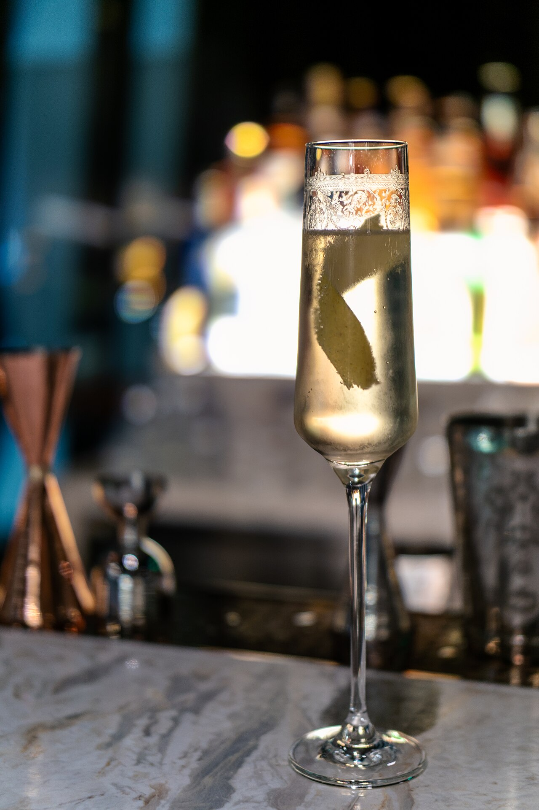

# 香槟鸡尾酒

香槟鸡尾酒是“鸡尾酒”这个词最古老的用法之一：糖、苦精、酒。它的做法极简：一块方糖，滴上安高天娜苦精，放入香槟杯，倒满香槟，加一片柠檬皮。气泡从糖块表面升起，苦精的香料与香槟的酸度形成优雅的对比。

这杯酒在 19 世纪中叶的美国与欧洲流行，后来进入经典鸡尾酒书。它的配方有多个版本，有的加干邑，有的加橙皮利口酒；可以确认的是：糖块、苦精与香槟是它的核心。

图：方糖、苦精与香槟调成的香槟鸡尾酒。图片：Melvin Loi，CC BY-SA 2.0，via Wikimedia Commons（[原图页面](https://commons.wikimedia.org/wiki/File:Champagne_Cocktail_(51022805492).jpg)）。

## 糖块、苦精与香槟

方糖提供甜度与“气泡发生器”。糖块的粗糙表面能让气泡附着，气泡从糖块上升，形成一条细线；砂糖或糖浆没有这种效果，气泡会从杯壁上升，视觉完全不同。

安高天娜苦精提供香料与苦味。它的肉桂、丁香、龙胆根与香料，能平衡香槟的酸与糖的甜；没有苦精，酒会变成“甜香槟”；苦精太多，酒会变成“药水”。2 滴是常见的用量。

香槟提供气泡、酸度与骨架。干型香槟的酸能切开拓口酒的甜，气泡能托起苦精的香料；甜型香槟会让整杯酒过甜，不适合。香槟不需要昂贵，但要有足够的酸度与气泡。

柠檬皮提供香气。柠檬皮的油脂能增加柑橘香，也能让颜色更亮；没有柠檬皮，酒会显得沉闷。柠檬皮要现削，不要削到白色部分，否则会苦。

## 配方：一块糖与两滴苦精

IBA 的标准配方是方糖 1 块、安高天娜苦精 2 滴、香槟 9 厘升，可选干邑 1 厘升。9 厘升等于 90 毫升，约一杯香槟杯的量；干邑能增加骨架与香气，但不是必需。

方糖要选白色的方糖，不要用彩色或风味方糖。彩色方糖会改变颜色，风味方糖会与苦精冲突；白色方糖只提供甜度与气泡附着点，最中性。

苦精要选安高天娜，不要用橙味苦精。安高天娜的香料与香槟的酸更搭；橙味苦精会让酒变成“橙味香槟”，失去古典的香料层次。2 滴是起点，可以先加 1 滴，尝一下再决定。

香槟要冰镇，温度约 6 到 8 摄氏度。温度太高，气泡会迅速逸出；温度太低，香气会被压住。干邑可以常温，也可以在杯底先倒 1 厘升，再倒香槟。

## 做法：让气泡慢慢升起

先把方糖放入香槟杯，滴上安高天娜苦精，让糖块吸收苦精。然后沿杯壁缓慢注入香槟，气泡会从糖块表面升起，形成一条细线。不要搅拌，直接上桌。

倒香槟时用吧匙导流，或把杯子倾斜，让酒液沿杯壁流下。倒得太快，糖块会被冲散，气泡也会损失；倒得太慢，糖块会溶解过多，甜度失衡。

柠檬皮在最后放。用削皮器削一条黄色柠檬皮，挤一下油脂，放在杯口或杯底；柠檬皮的香气会随着气泡上升，第一口就能闻到。不要放柠檬片，那会改变颜色与口感。

如果加干邑，先在杯底倒 1 厘升，再放糖块、苦精，最后倒香槟。干邑会在杯底形成一层，喝的时候逐渐混合，味道有层次。

## 十九世纪的香槟喝法

香槟鸡尾酒在 19 世纪中叶流行，最早出现在美国的酒吧与酒店。1862 年，Jerry Thomas 的《How to Mix Drinks》收录了“Champagne Cocktail”，配方是糖、苦精、香槟与柠檬皮；这是这杯酒最早的书面记载之一。

19 世纪末，这杯酒进入欧洲，成为“美好年代”的餐前酒。它的甜、酸、苦与气泡，符合当时的审美；它的做法简单，也适合家庭与餐厅。后来，随着干型香槟的普及，糖块的用量减少，苦精的用量也更克制。

关于“香槟鸡尾酒”的名字，有说法认为它是最早使用“cocktail”一词的饮品之一；也有说法认为，“cocktail”一词在 1800 年代初期指“糖、苦精、酒”的组合，香槟鸡尾酒只是其中之一。词源的确切历史仍有争议。

可以确认的是：这杯酒的结构——糖、苦精、香槟——是 19 世纪鸡尾酒定义的典型；它的优雅与简单，让它穿越了两个世纪，仍然是经典。

## 变体与常见错误

常见变体包括“Champagne Cocktail with Cognac”，加入干邑；“Champagne Cocktail with Grand Marnier”，加入橙皮利口酒；“Old Cuban”，加入陈年朗姆与薄荷；“French 75”，加入金酒与柠檬汁。

常见错误有四个。第一，糖块太大，甜度失衡。第二，苦精太多，酒变成药水。第三，香槟太甜，整杯酒过甜。第四，倒得太快，气泡与糖块被冲散。香槟鸡尾酒的成败，在“顺序”与“温度”。

对家庭调酒者，最实用的建议是：用白色方糖，安高天娜苦精 2 滴，香槟冰镇，沿壁慢倒，柠檬皮最后放。记住，这杯酒的目标是“优雅的香料气泡”，不是“甜香槟”。笛杯比碟杯更能保留气泡，但碟杯的宽口能让苦精的香气更明显。

相关条目：[开瓶（起泡酒）](ref:opening)。

## 另见与参考资料

- 起泡酒：参见 [起泡酒](ref:sparkling)。
- 开香槟：参见 [开香槟](ref:opening)。
- 香槟笛杯：参见 [香槟笛杯](ref:flute)。
- 皇家基尔：参见 [皇家基尔](ref:kir)。
- 甜型：参见 [甜型](ref:sweet)。

对照阅读：[起泡酒](ref:sparkling)、[香槟笛杯](ref:flute)。

**关键事实。**

| 项目 | 内容 |
| --- | --- |
| 一句话定位 | 糖块、安高天娜苦精与香槟构成的古典鸡尾酒，可选少量干邑；气泡从糖块上升，苦精的香料与香槟的酸度形成优雅对比 |
| 类型 | IBA Contemporary Classics |
| 起源 | 美国 |

**来源与边界。** 本页关于「香槟鸡尾酒」的关键事实，主要由以下来源交叉核对：International Bartenders Association（IBA 配方分类、原料与比例）、Oxford University Press（鸡尾酒史与术语背景）、CocktailDB（交叉核对配方结构与常见变体）等 5 条来源。价格、批次与状态会变，涉及这些字段时以页面所列来源的最新版本为准。正文为项目自写，来源只作核验，不复制原文。

**并读。** 把「香槟鸡尾酒」与「起泡酒」、「开瓶（起泡酒）」、「香槟笛杯」放在一起读时，先确认它们是同一层级还是上下游关系：先确认基酒与比例，再比较酸甜平衡、杯型与出品差异。本页负责给出鸡尾酒的基本坐标，对照条目补上具体案例与差异；读完再回到本页，才能分清哪些差别属于鸡尾酒本身，哪些只是产地、批次或品牌选择。

**适用边界。** 对「香槟鸡尾酒」而言，配方比例、基酒品牌与杯型会变；IBA 版本是参照，不是唯一做法。

**更新提示。** 「香槟鸡尾酒」最近核对于 2026-11-20；配方比例、基酒品牌、杯型与出品标准会变，调酒前以 IBA 或酒吧现行配方为准。

**编者注。** 本页把「香槟鸡尾酒」作为鸡尾酒条目处理：定义、流程与关键数字以正文表格为准，与「起泡酒」、「开瓶（起泡酒）」的差异用对照阅读验证；遇到价格、批次或地址，回到页面所列来源核对。
