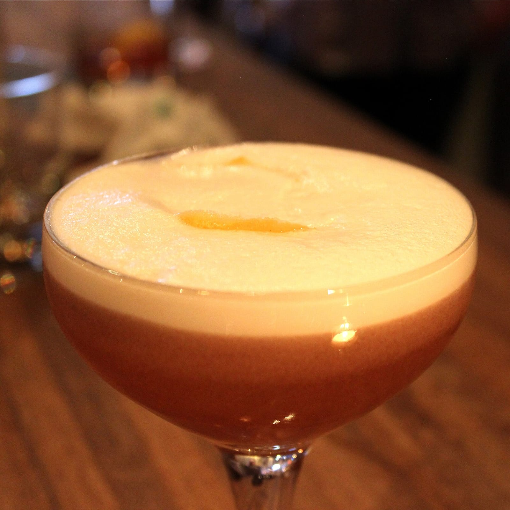

# 三叶草俱乐部

三叶草俱乐部（Clover Club）是一款以[金酒](ref:gin)、柠檬汁、覆盆子糖浆与蛋清摇和调制的经典鸡尾酒。它泡沫细腻、酸甜柔和，常见装饰为覆盆子；名字来自 20 世纪初美国的一家同名俱乐部。

图：三叶草俱乐部相关实景照片。图片：Will Shenton，CC BY-SA 3.0，via Wikimedia Commons（[原图页面](https://commons.wikimedia.org/wiki/File:Clover_Club.jpg)）。

## 定义与身份

三叶草俱乐部的名字与 20 世纪初美国东海岸的一家俱乐部有关，具体起源存在不同记载。这家俱乐部最初是男性社交与辩论团体，后来名字才进入鸡尾酒。本页只把它写成历史背景，不把某一种说法当成定论。

Clover Club 的配方结构是“金酒 + 柠檬 + 覆盆子 + 蛋清”，属于酸型鸡尾酒。覆盆子糖浆提供颜色与果香，蛋清提供泡沫与圆润口感，二者都不是装饰。IBA 版本把比例固定下来，但早期美国酒吧常用新鲜覆盆子捣碎，颜色更暗、果肉更多，过滤也不如今天彻底。

## 配方（IBA 版本）

IBA 公开配方以金酒为基底，加入柠檬汁、覆盆子糖浆与蛋清，先干摇、再加冰摇和，滤入预冷的杯中，以覆盆子装饰。用量是起点，不是法律：柠檬汁多则更酸，糖浆多则更甜，蛋清多则泡沫更厚。

蛋清是结构的一部分，不是装饰。它让成品表面形成细腻泡沫，也让酒体更圆润。干摇（不加冰）能让蛋清充分起泡，再加冰摇和降温与稀释。

## 金酒的选择

[金酒](ref:gin)是这款酒的主体。伦敦干金酒带来杜松子与柑橘的清晰骨架，老汤姆金酒更甜、更柔和，其他风格的金酒则可能带来不同的草本与香料气息。选择取决于你想要的方向。

高酒精度的金酒需要更多稀释，低酒精度的金酒则要少摇。若金酒本身风味强烈，糖浆与柠檬汁的比例也要相应调整，否则成品会失衡。

## 覆盆子糖浆与蛋清

覆盆子糖浆提供果香、酸甜与颜色，是三叶草俱乐部辨识度的重要来源。它本身很甜，比例过高会盖住金酒；比例过低则颜色与果香不足。不同产品的甜度与酸度差异明显。

蛋清提供泡沫与圆润度。新鲜蛋清更容易起泡，陈放一两天的蛋清起泡效果可能更好。使用蛋清时应注意卫生与来源，对生蛋清有顾虑的人可以省略，但成品的口感会不同。

## 摇和与稀释

三叶草俱乐部采用两段摇和：先不加冰干摇，让蛋清起泡；再加冰摇和，降温并稀释。干摇不足，泡沫稀薄；冰摇过度，稀释太多，酒体会变薄。

三叶草俱乐部要加蛋清摇和，冰必须新鲜、干燥、够冷。用大冰块摇和，稀释较慢，泡沫也更细；摇完立即滤入预冷杯，别让融水在摇酒壶里继续泡着酒液。

## 杯型与装饰

传统上使用预冷的鸡尾酒杯或小容量高脚杯，杯口窄、杯身小，便于集中香气与泡沫。三叶草俱乐部用预冷杯是必要步骤：蛋清泡沫在室温下很快塌陷，杯壁越冷，第一口的质地越稳定。

覆盆子是常见装饰，提供果香与视觉识别。它应与糖浆的果味呼应，而不是单纯为了颜色。装饰应在饮用前完成。

## 变体

以其他红色浆果糖浆替代覆盆子糖浆，会改变果香方向；省略蛋清，会得到更清澈、泡沫更少的版本；以其他烈酒替代金酒，会形成不同分支。与[威士忌酸](ref:whiskey-sour)相比，三叶草俱乐部以金酒与果味糖浆替代威士忌。

三叶草俱乐部的变体应看作替换结果：换糖浆改果香，去蛋清改质地，换基酒改骨架；记录时写清换了哪一项，比争论“正宗”更有用。关于鸡尾酒结构的一般说明，可以参考[调酒基础](ref:cocktails-guide)。

## 常见误区

第一，把所有材料一起加冰摇和。蛋清需要先干摇才能形成细腻泡沫。

第二，认为蛋清只是为了好看。它也影响酒体与口感。

第三，忽略糖浆本身的甜度。覆盆子糖浆很甜，柠檬汁需要相应调整。

第四，摇和时间不足。温度不够低、稀释不足，成品会显得厚重。

## 饮用与边界

三叶草俱乐部适合作为餐前或午后饮品，搭配坚果、水果或简单咸味小食。它的酒精度中等，含蛋清，应小口慢饮并补充水分；不要空腹快速饮用。驾车、服药或孕期不应饮酒；对生蛋清有顾虑者应避免。

本页以 Savoy 与 IBA 的版本为骨架，不替某个金酒品牌背书；蛋清、糖浆与柠檬的比例会随配方来源变化。成品的强度取决于金酒的[酒精度](ref:abv)、糖浆用量与冰块稀释，不能只看配方数字。

对照阅读：[金酒](ref:gin)、[调酒，是另一种认识酒的方式](ref:cocktails-guide)，理解酸、甜、冰与稀释的平衡。

## 延伸阅读

- [金酒](ref:gin)：三叶草俱乐部的主体与风格来源。
- [调酒基础](ref:cocktails-guide)：结构、稀释与摇和的一般原则。
- [加冰与温度](ref:ice)：三叶草俱乐部的冰型、稀释与出杯温度。
- [酒精度](ref:abv)：理解成品强度与冰块稀释。
- [威士忌酸](ref:whiskey-sour)：同样使用蛋清的同类经典。

**关键事实。**

| 项目 | 内容 |
| --- | --- |
| 一句话定位 | 以金酒、柠檬汁、覆盆子糖浆与蛋清摇和调制的经典鸡尾酒，泡沫细腻、酸甜柔和，常见装饰为覆盆子；名字来自 20 世纪初美国的一家同名俱乐部 |
| 类型 | 经典鸡尾酒 |
| 起源 | 美国（20 世纪初） |

**来源与边界。** 本页关于「三叶草俱乐部」的关键事实，主要由以下来源交叉核对：International Bartenders Association（官方配方、调制方法与装饰；确认该饮品属于 IBA 官方鸡尾酒名单）、Oxford University Press（三叶草俱乐部的历史背景与基本构成；由原条目末尾参考资料迁移，未逐条复核访问日期）、David Wondrich / Perigee（20 世纪初美国鸡尾酒演变的背景）等 6 条来源。价格、批次与状态会变，涉及这些字段时以页面所列来源的最新版本为准。正文为项目自写，来源只作核验，不复制原文。

**并读。** 把「三叶草俱乐部」与「金酒」、「酒精度（ABV）」、「调酒，是另一种认识酒的方式」放在一起读时，先确认它们是同一层级还是上下游关系：先确认基酒与比例，再比较酸甜平衡、杯型与出品差异。本页负责给出鸡尾酒的基本坐标，对照条目补上具体案例与差异；读完再回到本页，才能分清哪些差别属于鸡尾酒本身，哪些只是产地、批次或品牌选择。

**适用边界。** 对「三叶草俱乐部」而言，配方比例、基酒品牌与杯型会变；IBA 版本是参照，不是唯一做法。
