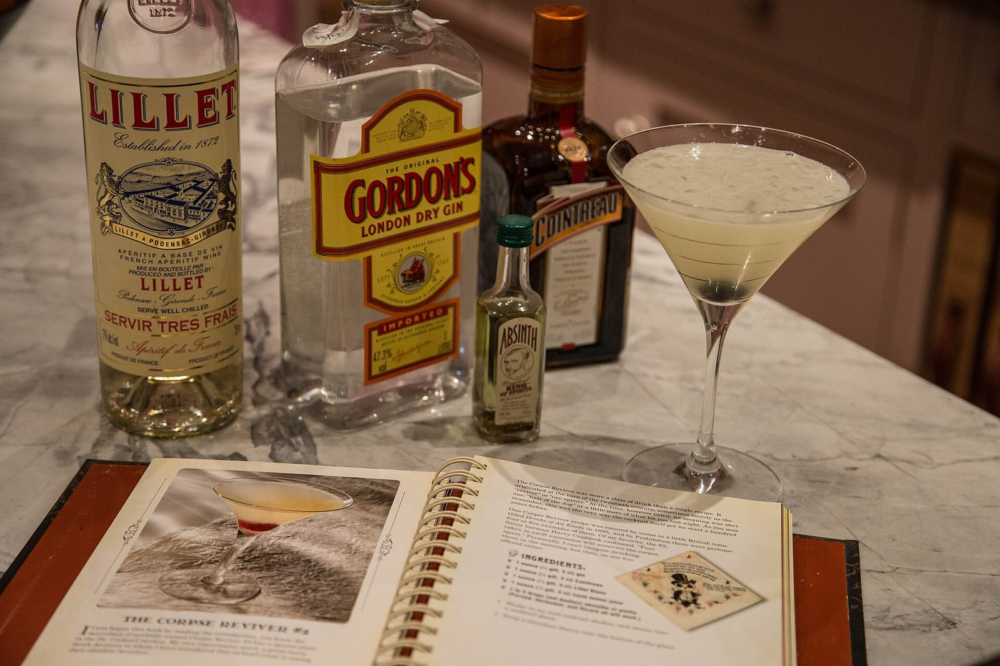

# 还魂酒二号

还魂酒二号（Corpse Reviver #2）是一款以金酒、橙味利口酒、利莱白与柠檬汁等量摇制，并以苦艾酒洗杯的经典鸡尾酒。它通常滤入预冷的碟形杯，成品呈淡黄色，表面可能有细薄泡沫，常以柠檬皮装饰。橙味利口酒的甜橙香、利莱白的酒体与草本、柠檬的酸、苦艾酒的茴香气息共同构成识别点。

图：还魂酒二号相关实景照片。图片：Adrian Scottow，CC BY-SA 2.0，via Wikimedia Commons（[原图页面](https://commons.wikimedia.org/wiki/File:Corpse_Reviver_-2_-_16294945262.jpg)）。

> **先给结论**
> **一句话：** 这页判断还魂酒二号该不该点、比例和冰水怎么处理。
>
> - **适合谁：** 想弄懂还魂酒二号的配方逻辑、点单方式和常见误区的人。
> - **不适合谁：** 只想要“一杯就醉”的配方、不关心比例和冰水的人。
> - **先看这两点：**
>   - 常见配方为金酒 22.5 毫升、橙味利口酒 22.5 毫升、利莱白 22.5 毫升、柠檬汁 22.5 毫升，另用苦艾酒洗杯。
>   - 点单时可以直接说“还魂酒二号”，若店家不熟悉，可以说明是金酒、橙味利口酒、利莱白与柠檬汁等量、苦艾酒洗杯的版本。

## 起源与命名

“Corpse Reviver”是一类以“醒酒”或“提神”为目的的鸡尾酒家族名称，字面意思是“尸体复活者”。这个家族在 20 世纪 30 年代的《萨伏伊鸡尾酒手册》中被记录，其中二号是后来最出名的一支。具体作者、更早的来源与配方演变缺乏完全一致的档案，因此本页把起源写作“流传说法”，不把某个年份或某位作者当作定论。

“二号”意味着家族中还有其他编号版本，最常被提到的是以白兰地为基酒的一号。二号以金酒为基酒，结构更接近酸酒：基酒、橙味利口酒、利莱白与柠檬汁等量，再加苦艾酒洗杯。编号不是品质排序，而是同一家族中不同配方的区分方式；把二号当成“一号的升级版”是一种误解。

名称里的“还魂”常被理解为宿醉后的提神饮品，但它不是药物，也没有解酒功效。它之所以常与早晨或早午餐联系在一起，是因为 20 世纪早午餐文化把这类“提神型”鸡尾酒放进了菜单，而不是因为配方具有医学作用。把命名当成功能承诺，是这款酒最常见的误读。

## 配方结构

常见配方为金酒 22.5 毫升、橙味利口酒 22.5 毫升、利莱白 22.5 毫升、柠檬汁 22.5 毫升，另用苦艾酒洗杯。四者等量，结构清晰：金酒提供草本与杜松子骨架，橙味利口酒提供甜橙香与甜度，利莱白提供酒体、轻微草本与圆润感，柠檬汁提供酸度。苦艾酒不进入主体，只通过洗杯提供茴香香气。

利莱白不是干味美思，也不是普通甜酒。它属于芳香化葡萄酒，带甜味、草本与柑橘气息，酒精度较低。用干味美思替代会让成品更干、更缺甜味；用其他芳香化葡萄酒替代则会改变草本方向。配方应写清使用的是利莱白还是其他同类产品，因为它们的甜度与香气差别明显。

橙味利口酒可以选择君度一类清澈、甜橙香明显的产品，也可以选择其他橙味利口酒。不同产品的甜度、酒精度与苦味不同，替换后柠檬汁的用量可能需要微调。苦艾酒的洗杯量很少，但品牌差异很大：有些更偏茴香与甘草，有些更偏草本与苦味，选择会改变第一印象。

## 风味与平衡

入口先是柠檬的酸与橙味利口酒的甜橙香，随后是金酒的草本、杜松子与利莱白的圆润酒体，尾段留下苦艾酒的茴香与轻微苦味。它属于酸酒家族，平衡的核心是酸与甜：柠檬不足会让整杯显得甜腻，柠檬过多则会压住橙香与草本。苦艾酒不提供主要的酸或甜，它主要负责香气与尾段的茴香感。

苦艾酒洗杯是这款酒的关键步骤。洗杯的意思是让苦艾酒短暂接触杯壁，再倒掉多余部分，只留下薄薄一层香气；它不是把苦艾酒倒进主体，也不是让杯底留一汪酒。洗杯过多会让茴香压过柑橘，洗杯不足则几乎闻不到。杯具应预冷，洗杯后尽快摇和与过滤，避免香气挥发。

温度与稀释会改变层次。刚摇好时酸度最明亮，茴香也最清晰；冰块融化后，甜味与酒体逐渐展开，苦艾酒的香气变淡。它属于短饮，通常不加冰，因此稀释主要发生在摇和阶段。摇和时间不足会让酸甜没有融合，摇和过度则会让酒体变淡、香气散掉。

## 做法要点

做法以摇和与洗杯为主：先把预冷的碟形杯用苦艾酒洗杯，倒掉多余部分；再把金酒、橙味利口酒、利莱白与柠檬汁倒入摇壶，加冰摇到充分冷却，细滤入杯中。一般以柠檬皮装饰，饮用前挤压皮油。双重过滤可以拦住碎冰与果肉，让口感更干净。

洗杯时可以用吧勺或小量杯量取少量苦艾酒，倒入杯中转动，让杯壁均匀接触，然后倒掉。不要把苦艾酒留在杯底，否则第一口会过强。若没有苦艾酒，可以用其他茴香型烈酒少量洗杯，但风味会不同；完全省略也可以，但会失去这款酒的标志性香气。

杯型以碟形杯、马天尼杯或小古典杯为主。杯口宽有助于香气，杯身预冷有助于保持温度。柠檬皮应现切，只取有色外层，避免压到白色部分带出苦味。装饰不宜过多，茴香与柑橘的香气才是重点；若加樱桃或其他装饰，会改变视觉与香气方向。

## 变体

以白兰地为基酒、结构不同的版本通常称为 Corpse Reviver #1，它不是二号的简单替代。以其他芳香化葡萄酒替代利莱白，会得到不同草本方向的版本；用其他橙味利口酒替代，则改变甜橙香的强度。还有把苦艾酒直接加入主体的做法，风味更浓，但已经偏离“洗杯”的原始结构。

变体命名应写清替换了什么。用其他芳香化葡萄酒后仍叫“还魂酒二号”，并非不可，但最好注明替代品；把苦艾酒从洗杯改成加入主体，应说明香气会更重。只有把基酒、橙味利口酒、芳香化葡萄酒与苦艾酒的处理方式写清楚，配方比较才有意义。

## 怎么点与怎么喝

点单时可以直接说“还魂酒二号”，若店家不熟悉，可以说明是金酒、橙味利口酒、利莱白与柠檬汁等量、苦艾酒洗杯的版本。若不喜欢茴香，可以要求“不要洗杯”或“轻洗杯”；若喜欢更明显的茴香，可以要求“洗杯重一点”。柠檬皮可以要求现挤，以补充香气。

它常被放在早午餐菜单上，搭配蛋类、面包、烟熏鱼与轻食。柑橘与茴香能切开油脂，酸度也能清口。但“还魂”只是名字，不能解酒；如果前一晚已经饮酒过量，再喝含酒精的饮品并不会让身体更快恢复。还魂酒二号容易被果汁、气泡或甜味掩盖酒精度，喝的时候要放慢速度，驾车、服药或孕期不应饮酒。

在酒吧里，如果完全闻不到茴香，可能是洗杯不足或苦艾酒倒掉了太多；如果茴香过强、压住柑橘，可能是洗杯过量或杯底残留太多。可以观察杯口香气与酒体颜色，作为判断制作质量的线索。但外观不是唯一标准，酸甜与草本平衡同样重要。

## 常见误区

第一，把“还魂酒”当成真正的解酒药。它只是名字与早午餐文化的产物。第二，把二号当成一号的升级版。两者基酒与结构不同。第三，把苦艾酒当成主要原料。它通常只用于洗杯，提供香气。第四，把利莱白当成干味美思。它是芳香化葡萄酒，甜度与酒精度不同。第五，认为等量比例不能调整。等量是经典结构，但可以根据原料甜度微调。

相关条目：[金酒](ref:gin)、[利口酒](ref:liqueur)、[摇酒](ref:shaking)。

Reviver 不是解酒药：它的作用是作为餐前或全天饮用的酸酒，酒精仍在；把鸡尾酒当成醒酒手段是危险的误解，也会低估它的酒精度。

## 另见

- [金酒](ref:gin)：这款酒的草本与杜松子骨架。
- [利口酒](ref:liqueur)：橙味利口酒的甜橙香与甜度角色。
- [摇和](ref:shaking)：酸酒融合、冷却与稀释的技术基础。
- [马天尼杯](ref:martini)：短饮杯型与香气呈现。
- [香气](ref:aroma)：苦艾酒洗杯如何影响第一印象。
