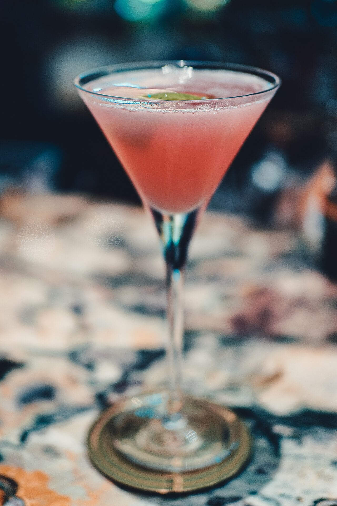

# 大都会

大都会（Cosmopolitan）是一款以[柠檬伏特加](ref:vodka)、[君度](ref:liqueur)、青柠汁与蔓越莓汁摇和后滤入杯中的经典鸡尾酒。它酸甜清爽，颜色粉红，常见装饰为橙皮或青柠片。

图：一杯大都会，粉红色酒液盛于锥形杯，杯口浮着一片青柠装饰。图片：Melvin Loi，CC BY-SA 2.0，via [原图页面](https://commons.wikimedia.org/wiki/File:Cosmopolitan_cocktail_(52272444120).jpg)。

## 定义与身份

“大都会”在 20 世纪后期逐渐流行，常见叙述把它与纽约或迈阿密的酒吧场景联系起来，但具体起源存在多种说法。本页只把它写成历史背景，不把某一种说法当成定论。

大都会是“伏特加 + 君度 + 青柠 + 蔓越莓”的摇和型鸡尾酒，颜色来自蔓越莓汁，酸度来自青柠，甜度与橙香来自君度。它常被归入 1990 年代都市酒吧文化，但同名做法在酸度与蔓越莓比例上差异很大。

## 配方（IBA 版本）

IBA 公开配方使用柠檬伏特加、君度、青柠汁与蔓越莓汁。做法是：将材料与冰块放入摇酒壶，摇和至充分冷却，滤入预冷的杯中，以橙皮或青柠片装饰。

用量是起点，不是法律。伏特加提供酒体，君度提供甜味与柑橘香气，青柠汁提供酸度，蔓越莓汁提供颜色与果味。任何一项变化都会改变平衡，尤其是青柠汁与君度的比例。

## 伏特加与君度

[伏特加](ref:vodka)是这款酒的主体。柠檬风味伏特加带来柑橘香气，普通伏特加则更中性；选择取决于你想要的方向。伏特加的酒精度影响成品的强度，也影响所需稀释量。

[君度](ref:liqueur)是橙味利口酒，提供甜味与柑橘香气，是“大都会”辨识度的重要来源。它的甜度较高，用量过多会让成品偏甜；用量过少则失去标志性的橙香。不同品牌的甜度与香气会有差异，替换时应相应调整。

## 酸与果汁

青柠汁提供酸度，平衡君度的甜味与伏特加的酒精刺激。新鲜青柠汁与瓶装青柠汁的香气差异明显，前者更完整。酸度不足，酒会显得甜腻；酸度过高，会压住柑橘香气。

蔓越莓汁提供颜色与果味，也贡献少量酸度。它的甜度因品牌而异，使用加糖蔓越莓汁时，应减少君度或糖的用量。果汁比例变化会让颜色与口感同时改变。

## 摇和与稀释

大都会通常摇和，而不是搅拌：摇和能更快降温、更好混合。摇和时间不足，温度不够低、稀释不足；摇和过度，稀释太多，酒体会变薄。

大都会靠摇和降温，冰块要干燥、大块，摇到壶壁起霜即可。碎冰降温快但出水也快，容易把蔓越莓与青柠的酸度冲淡；滤酒后不要久放在冰上，以免颜色与香气变淡。

## 杯型与装饰

传统上使用预冷的鸡尾酒杯，杯口窄、杯身小，便于集中香气与呈现颜色。大都会颜色浅，杯壁回温会让蔓越莓的酸显得更尖；预冷杯能让柑橘香与果味多停留一会儿。

橙皮或青柠片是常见装饰，提供柑橘香气与视觉识别。挤压橙皮时，精油会喷到杯口和酒液表面，直接影响第一口的香气。装饰应在饮用前完成。

## 变体

以普通伏特加替代柠檬伏特加，会得到更中性的版本；以其他橙味利口酒替代君度，会改变甜度与香气；以其他红色果汁替代蔓越莓汁，会改变颜色与果味。

大都会的变体常从伏特加、橙味利口酒与果汁三处替换；每换一项，颜色、甜度与香气都会偏移，记录时要把比例一起写下。关于鸡尾酒结构的一般说明，可以参考[调酒基础](ref:cocktails-guide)；与[威士忌酸](ref:whiskey-sour)相比，大都会使用伏特加与利口酒，而不是威士忌与糖浆。

## 常见误区

第一，认为大都会必须很甜。甜度取决于君度与果汁的用量。

第二，忽略青柠汁的新鲜度。瓶装汁的香气与酸度不同。

第三，用加糖蔓越莓汁而不调整甜味来源。成品会过甜。

第四，忽略摇和与稀释。稀释不足，香气打不开，酒精刺激会显得突出。

## 饮用与边界

大都会适合作为餐前或社交场合的饮品，搭配坚果、水果或简单咸味小食。它的酒精度中等偏高，应小口慢饮并补充水分；不要空腹快速饮用。驾车、服药或孕期不应饮酒。

本页以 IBA 版本为骨架，不把某一种伏特加或果汁比例当成唯一答案；颜色深浅与甜度会随原料变化。成品的强度取决于伏特加的[酒精度](ref:abv)、利口酒的甜度与冰块稀释，不能只看配方数字。

大都会的骨架是“酸、甜、果香、稀释”四件事：柠檬伏特加提供干净酒体，君度给橙香与甜度，青柠汁拉酸，蔓越莓汁补色与果味。它容易变成过甜、过淡的粉色饮料，问题通常出在果汁比例与摇和时间，而不是配方名字本身。

对照阅读：[伏特加](ref:vodka)、[酒精度（ABV）](ref:abv)。

## 延伸阅读

- [伏特加](ref:vodka)：大都会的主体与风格来源。
- [利口酒](ref:liqueur)：君度与橙味利口酒的作用。
- [调酒基础](ref:cocktails-guide)：结构、稀释与摇和的一般原则。
- [加冰与温度](ref:ice)：大都会的冰型、稀释与出杯温度。
- [酒精度](ref:abv)：理解成品强度与冰块稀释。
- [威士忌酸](ref:whiskey-sour)：另一款以酸与甜平衡烈酒的经典。

**关键事实。**

| 项目 | 内容 |
| --- | --- |
| 一句话定位 | 以柠檬伏特加、君度、青柠汁与蔓越莓汁摇和后滤入杯中的经典鸡尾酒，酸甜清爽，颜色粉红，常见装饰为橙皮或青柠片 |
| 类型 | 经典鸡尾酒 |
| 起源 | 美国（20 世纪后期，具体起源有争议） |

**来源与边界。** 本页关于「大都会」的关键事实，主要由以下来源交叉核对：International Bartenders Association（官方配方、调制方法与装饰；确认该饮品属于 IBA 官方鸡尾酒名单）、Oxford University Press（大都会的历史背景与基本构成；由原条目末尾参考资料迁移，未逐条复核访问日期）、David Wondrich / Perigee（20 世纪美国鸡尾酒演变的背景）等 6 条来源。价格、批次与状态会变，涉及这些字段时以页面所列来源的最新版本为准。正文为项目自写，来源只作核验，不复制原文。

**并读。** 把「大都会」与「伏特加」、「利口酒」、「酒精度（ABV）」放在一起读时，先确认它们是同一层级还是上下游关系：先确认基酒与比例，再比较酸甜平衡、杯型与出品差异。本页负责给出鸡尾酒的基本坐标，对照条目补上具体案例与差异；读完再回到本页，才能分清哪些差别属于鸡尾酒本身，哪些只是产地、批次或品牌选择。
