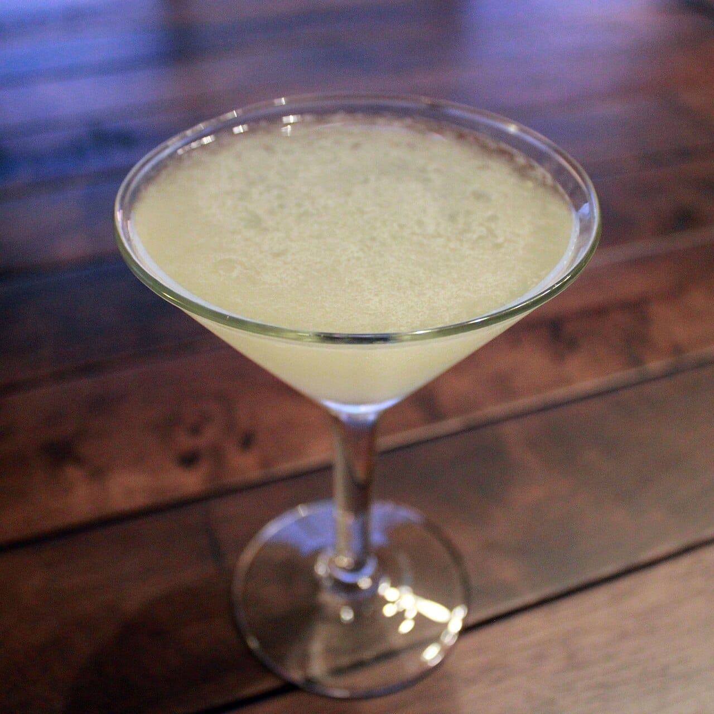

# 代基里

代基里（Daiquiri）是一款以白朗姆、鲜榨青柠汁和细砂糖摇和而成的经典鸡尾酒。IBA 公开配方使用 60 毫升古巴白朗姆、20 毫升鲜榨青柠汁和 2 吧勺细砂糖，先搅拌溶解糖，再加冰摇和，滤入预冷的鸡尾酒杯，不加装饰。

图：代基里。图片：Will Shenton，CC BY-SA 3.0，via Wikimedia Commons（[原图页面](https://commons.wikimedia.org/wiki/File:Classic_Daiquiri_in_Cocktail_Glass.jpg)）。

## 定义与身份

代基里常被追溯到古巴，具体起源有多个版本，涉及不同的地点与年代。本页不把某一种叙述当成定论，只把它写成 19 世纪末至 20 世纪初加勒比饮酒文化的一部分。名称与配方是两件事，同名不同做法需要说明差异。

代基里的核心是白朗姆、青柠与糖的三项平衡，属于酸型家族。冰镇与摇和让酒体变轻，糖的用量决定酸度是否尖锐；使用糖浆比细砂糖更容易溶解，但会带入水分，配方应相应调整。

## 配方（IBA 版本）

IBA 公开配方为：60 毫升古巴白朗姆、20 毫升鲜榨青柠汁、2 吧勺细砂糖。先把原料放入摇酒壶，搅拌使糖溶解，再加冰摇和，滤入预冷的鸡尾酒杯；官方配方不加装饰。

这一版的比例约为 3:1:1（朗姆：青柠：糖量按吧勺计），属于酸型结构。比例不是唯一答案：有人喜欢更酸，有人喜欢更甜，也有人使用糖浆。改变比例就是改变版本，应明确说明。

## 白朗姆

[白朗姆](ref:rum)是主体，提供甘蔗甜香、轻微植物气息和酒精骨架。白朗姆通常颜色浅、风味较轻，适合与青柠搭配；陈年朗姆的桶味更重，会改变成品方向，更适合作为变体。

选择时先看它是否干净、是否有明显的杂味。酒精度高的朗姆需要更多稀释来平衡；酒精度低的朗姆可能让成品显得单薄。配方数字不能单独说明强度，成品的实际强度还取决于摇和带来的稀释。

## 青柠与糖

鲜榨青柠汁提供酸度、清香和新鲜感。瓶装青柠汁的香气和酸度通常不同，能鲜榨时应优先鲜榨。青柠的酸度会随成熟度和品种变化，20 毫升是起点，实际调整要看入口平衡。

细砂糖提供甜度，平衡青柠的酸。糖必须在加冰前溶解，否则摇和后仍可能残留颗粒，最后几口突然变甜。若使用糖浆，应相应减少其他水分，避免成品过稀。

酸甜平衡是代基里的核心。太酸会显得尖锐，太甜会显得黏；平衡时，酸度让朗姆的甘蔗香气更清楚，甜度让口感更圆润。调整时一次只改一个变量，并记录结果。

## 摇和

代基里通常摇和，而不是搅拌。摇和能快速降温、稀释，并把空气带入液体，使口感更轻盈；鲜榨果汁也需要与酒液充分混合，摇和比搅拌更有效。摇和时间过长会稀释过多，过短则冷却和融合不足。

摇和前先不加冰搅拌溶解糖，是为了控制稀释。若一开始就加冰搅拌，糖可能还没溶解，冰却已经开始融化。这个顺序是配方的一部分，不是多余步骤。

## 稀释与温度

代基里是短饮，成品需要足够冷，但不应过度稀释。摇和带来的水量取决于冰量、冰型和摇和时间；使用大而干的冰，稀释更可控；使用碎冰或湿冰，稀释更快。

滤入预冷杯子后，成品会逐渐回温。温度上升会改变酸感和甜感：低温时酸度更突出，回温后甜感更明显。评价时应把温度写进记录，而不是只写“好喝”或“不好喝”。关于冰与温度，可以参考[加冰与温度](ref:ice)。

## 杯型

IBA 配方使用预冷的鸡尾酒杯。杯型应能聚拢香气、方便手持而不传递体温，并呈现清澈的酒液。杯子不冷，成品会迅速回温，酸度和香气都会变化。

没有专用杯时，可以使用杯口略收、容量适中的其他杯子。关键是预冷、容量合适、杯口不过宽。关于杯型与温度的关系，可以参考[如何选杯](ref:glass)。

## 变体

以糖浆替代细砂糖，会改变溶解速度和甜度控制；加入水果或果汁，会形成不同变体；使用陈年朗姆，会带来桶味；做成冰冻版本，会改变稀释和口感；调整青柠与糖的比例，会改变酸甜方向。以其他烈酒替代朗姆，则形成不同的酸型鸡尾酒。

代基里的变体常按水果或冰型命名：草莓代基里、黑莓代基里与冷冻代基里，分别改变糖量、酸度与稀释。若只换朗姆品牌而不改结构，仍是同一版本，不必另起名字。

## 常见误区

第一，糖没有先溶解。加冰后摇和，糖可能仍残留颗粒。

第二，用瓶装青柠汁替代鲜榨。香气和酸度通常不同。

第三，摇和时间随意。过长会稀释过多，过短会冷却和融合不足。

第四，用温杯。杯子不冷，成品会迅速回温。

## 边界

代基里是短饮，酒精度较高，应小口慢饮并补充水分；不要空腹快速饮用。驾车、服药或孕期不应饮酒。本页以 IBA 代基里为骨架，不评价具体朗姆品牌；糖量与青柠酸度会随产地与配方来源变化。

成品的强度取决于朗姆的[酒精度](ref:abv)、糖量和摇和稀释，不能只看配方数字。名称、比例与做法应分开记录，才不会把偏好当成标准。

对照阅读：[朗姆酒](ref:rum)、[调酒，是另一种认识酒的方式](ref:cocktails-guide)。

## 延伸阅读

- [朗姆酒](ref:rum)：代基里的主体与甘蔗香气。
- [调酒基础](ref:cocktails-guide)：摇和、稀释与酸甜平衡。
- [如何选杯](ref:glass)：杯型、预冷与香气聚集。
- [酒精度](ref:abv)：理解成品强度与冰块稀释。

**关键事实。**

| 项目 | 内容 |
| --- | --- |
| 一句话定位 | 白朗姆、青柠汁与细砂糖摇和而成的酸型经典；它结构极简，酸甜、稀释与温度任何一项失衡都会立刻暴露 |
| 类型 | 经典鸡尾酒 |
| 起源 | 古巴（19 世纪末至 20 世纪初，具体起源有争议） |

**来源与边界。** 本页关于「代基里」的关键事实，主要由以下来源交叉核对：International Bartenders Association（官方配方、调制方法与装饰；确认该饮品属于 IBA 官方鸡尾酒名单）、Oxford University Press（代基里的历史背景、基本构成与变体；由原条目末尾参考资料迁移，未逐条复核访问日期）、Dave Arnold / W. W. Norton（摇和、糖溶解、冰与稀释对成品的影响）等 6 条来源。价格、批次与状态会变，涉及这些字段时以页面所列来源的最新版本为准。正文为项目自写，来源只作核验，不复制原文。
