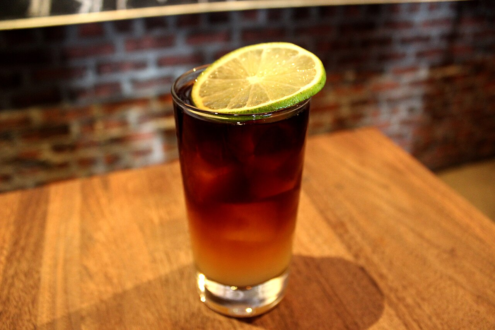

# 黑色风暴

黑色风暴是百慕大的标志性鸡尾酒：深色朗姆、姜汁啤酒、青柠，倒入高球杯，加冰。它的颜色像暴风雨前的海面，姜的辛辣与朗姆的焦糖、香草形成强烈对比，喝起来既有热带感，又有冬天的暖意。

这杯酒的配方只有三种原料，却极容易做坏。姜汁啤酒的姜味、甜度与气泡强度，朗姆的浓度与风格，青柠的酸度，任何一项失衡，都会让酒变成“甜姜水”或“酒精姜汤”。它考验的不是技巧，而是选材。

图：深色朗姆、姜汁啤酒与青柠调成的黑色风暴。图片：Will Shenton，CC BY-SA 3.0，via Wikimedia Commons（[原图页面](https://commons.wikimedia.org/wiki/File:Dark_%27N%27_Stormy.jpg)）。

## 黑色朗姆与姜汁啤酒

深色朗姆是这杯酒的骨架。Gosling's Black Seal 是百慕大的传统选择，带有糖蜜、香草与轻微烟熏味；其他深色朗姆也可以，但风味不同。白色朗姆太轻，会被姜汁啤酒完全压住；陈年朗姆太贵，焦糖与木质味可能过重。

姜汁啤酒不是姜汁汽水。姜汁啤酒的姜味更辣、更天然，气泡也更细；姜汁汽水偏甜、姜味弱，做出来的酒会像糖果。若只有姜汁汽水，可以加一小片鲜姜或几滴姜汁，但口感仍然不同。

青柠是平衡器。它的酸度切开朗姆的甜与姜啤的糖，让酒更清爽；没有青柠，酒会显得厚重、发腻。青柠角比青柠片更实用，可以挤汁后投入杯中。

## 配方：朗姆、姜啤与青柠

IBA 的标准配方是深色朗姆 60 毫升、姜汁啤酒 100 毫升、青柠角 1 个。朗姆与姜啤的比例约为 3 比 5，酒精度中等；如果喜欢更烈，可以把朗姆增加到 80 毫升；如果喜欢更轻，可以减少到 40 毫升。

姜汁啤酒要冰镇，杯子也要冰。姜啤的温度越低，气泡越持久，姜的辛辣也越收敛；常温姜啤会让酒很快变平。朗姆不需要冷藏，但可以提前量好，避免开瓶后手忙脚乱。

青柠角先在杯中轻压，释放精油与少量果汁，再投入杯中。不要挤太多汁，否则酸度会压过姜味；也不要省略，否则酒会失去清爽的骨架。

## 做法：在杯中构建

在 Highball 杯中装满冰块，倒入深色朗姆，挤入青柠汁，轻轻搅拌。然后沿杯壁注入姜汁啤酒，稍微搅拌一次，让酒液与气泡结合。不要剧烈摇晃，否则气泡会迅速消失。

冰块要大、要硬。小冰块融化快，酒会在几分钟内变稀；大冰块融化慢，能保持气泡与温度。杯子提前冷藏，或在杯中装冰后静置一分钟，让杯壁降温。

装饰用青柠角或青柠片。青柠角可以挤汁，也可以留在杯口；青柠片更适合视觉，但香气释放较少。不要加樱桃或菠萝，那不是这杯酒的语言。

## 百慕大的商标故事

黑色风暴起源于百慕大，与 Gosling's Brothers 的朗姆酒和当地姜汁啤酒有关。流传的说法是，二十世纪初期，百慕大的水手把深色朗姆与姜汁啤酒混在一起，用来抵御海上的寒冷；后来这杯酒进入酒吧，成为当地特色。

Gosling's 在美国注册了“Dark 'n' Stormy”商标，规定只有使用 Gosling's Black Seal 朗姆与姜汁啤酒调制的饮品才能使用这个名字。其他酒厂可以用“Dark and Stormy”或“Stormy”来描述类似做法，但不能使用注册商标的拼写。

商标争议并不影响饮用。对消费者，重要的是知道这杯酒的基本结构；对酒吧，重要的是尊重商标与产地叙事。名字可以保护，配方不能垄断。

## 变体与常见错误

常见变体包括“Dark 'n' Stormy with aged rum”，用陈年朗姆增加香草与木质味；“Pink Stormy”，加一点石榴糖浆，颜色变粉；“Stormy Mojito”，在莫吉托里加姜汁啤酒。还有“Light 'n' Stormy”，用白朗姆，口感更轻。

常见错误有四个。第一，用姜汁汽水替代姜汁啤酒，姜味与气泡都不足。第二，姜啤不够冰，气泡很快消失。第三，青柠挤太多，酸度压过姜味。第四，冰块太小，酒变稀。黑色风暴的成败，几乎都在“选材”与“温度”上。

对家庭调酒者，最实用的建议是：买一瓶好的姜汁啤酒，杯子与姜啤都冷藏，青柠角只压不挤，冰块大而硬。记住，这杯酒的目标是“辛辣的清爽”，不是“甜辣的糖水”。

如果没有 Gosling's，可以用其他深色朗姆，但要注意风味：牙买加深色朗姆带 funk 与香蕉味，巴巴多斯深色朗姆更偏焦糖与香草，圭亚那德梅拉拉朗姆更厚重。姜汁啤酒也有风格差异：有的姜味尖锐、有的偏甜、有的气泡强烈；选一瓶姜味清晰、甜度克制的，酒会更平衡。青柠的替代品是柠檬，但柠檬的酸更圆、香气更薄，做出来的酒会少一点“热带”。冰块方面，高球杯适合长条冰或大块冰，融化慢，气泡能维持更久。如果姜啤太甜，可以挤一点青柠汁补救。

相关条目：[朗姆酒](ref:rum)。

## 另见与参考资料

- 莫斯科骡子：参见 [莫斯科骡子](ref:moscow-mule)。
- 朗姆酒：参见 [朗姆酒](ref:rum)。
- 高球杯：参见 [高球杯](ref:highball)。
- 倒酒：参见 [倒酒](ref:pouring)。
- 甜型：参见 [甜型](ref:sweet)。

对照阅读：[莫斯科骡子](ref:moscow-mule)、[高球杯](ref:highball)。

**关键事实。**

| 项目 | 内容 |
| --- | --- |
| 一句话定位 | 深色朗姆与姜汁啤酒加青柠调制的百慕大经典，Gosling's 持有商标；姜的辛辣与朗姆的焦糖形成强烈对比，做法简单却对姜啤品质敏感 |
| 类型 | IBA Contemporary Classics |
| 起源 | 百慕大 |

**来源与边界。** 本页关于「黑色风暴」的关键事实，主要由以下来源交叉核对：International Bartenders Association（IBA 配方分类、原料与比例）、Oxford University Press（鸡尾酒史与术语背景）、CocktailDB（交叉核对配方结构与常见变体）等 5 条来源。价格、批次与状态会变，涉及这些字段时以页面所列来源的最新版本为准。正文为项目自写，来源只作核验，不复制原文。

**并读。** 把「黑色风暴」与「莫斯科骡子」、「朗姆酒」、「高球杯」放在一起读时，先确认它们是同一层级还是上下游关系：先确认基酒与比例，再比较酸甜平衡、杯型与出品差异。本页负责给出鸡尾酒的基本坐标，对照条目补上具体案例与差异；读完再回到本页，才能分清哪些差别属于鸡尾酒本身，哪些只是产地、批次或品牌选择。

**适用边界。** 对「黑色风暴」而言，配方比例、基酒品牌与杯型会变；IBA 版本是参照，不是唯一做法。

**更新提示。** 「黑色风暴」最近核对于 2026-11-20；配方比例、基酒品牌、杯型与出品标准会变，调酒前以 IBA 或酒吧现行配方为准。

**编者注。** 本页把「黑色风暴」作为鸡尾酒条目处理：定义、流程与关键数字以正文表格为准，与「莫斯科骡子」、「朗姆酒」的差异用对照阅读验证；遇到价格、批次或地址，回到页面所列来源核对。
