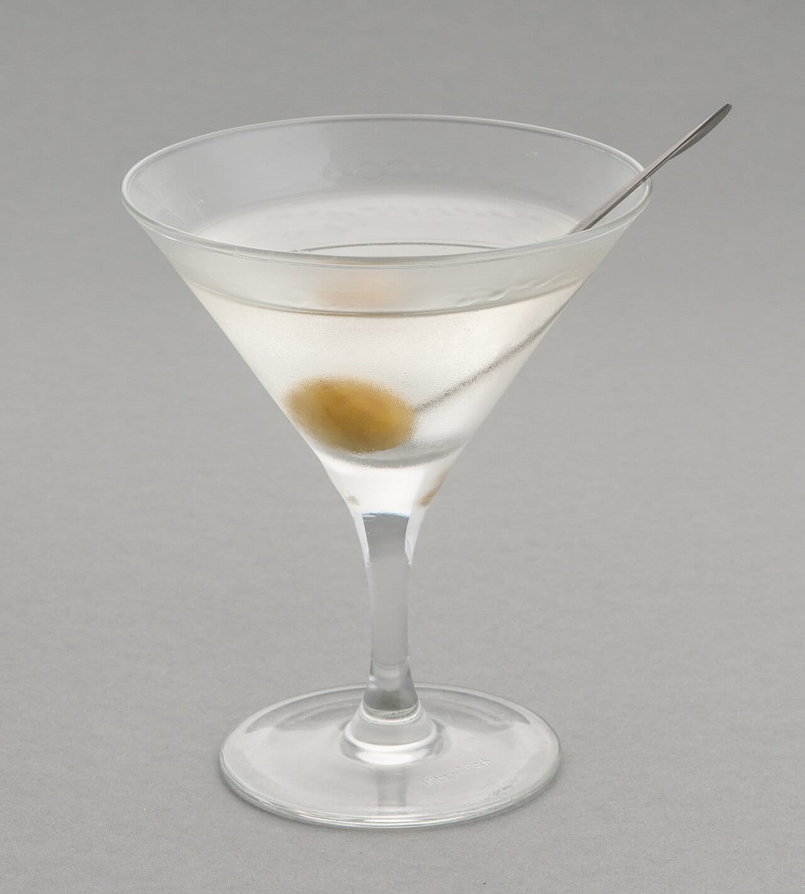

# 干马天尼

干马天尼（Dry Martini）是一款以金酒和干味美思调制的经典鸡尾酒。IBA 公开配方使用 60 毫升金酒和 10 毫升干味美思，加冰搅拌后滤入预冷的杯中，以柠檬皮或橄榄装饰。它追求低温、清澈和克制的香气，而不是果汁感。

图：干马天尼。图片：Ralf Roletschek，CC BY-SA 3.0，via Wikimedia Commons（[原图页面](https://commons.wikimedia.org/wiki/File:15-09-26-RalfR-WLC-0084.jpg)）。

## 定义与身份

“马天尼”这个名字在历史上与多种饮品和品牌有关，具体起源存在争议。本页只把它写成 19 世纪后期美国鸡尾酒演变的背景，不把某一种说法当成定论。名称与配方是两件事，读者不应因为名字相同就假定做法相同。

干马天尼的“干”指干味美思用量少，不是指口感不甜。6:1 是 IBA 的参考比例，实际从 5:1 到 15:1 都有人使用；味美思越少，金酒的植物香气越突出，但平衡也越脆弱。搅拌而非摇和，是为了控制稀释与充气。

## 配方（IBA 版本）

IBA 公开配方为：60 毫升金酒、10 毫升干味美思。把所有原料倒入装有冰块的调酒杯，充分搅拌，滤入预冷的马天尼杯中；挤压柠檬皮释放精油，或按客人要求放入绿橄榄。

这一版的比例是 6:1，属于偏“干”的版本。比例不是唯一答案：有人喜欢更少的味美思，有人喜欢更多。改变比例就是改变版本，应明确说明，而不是继续用同一个名字却不解释差异。

## 金酒与干味美思

[金酒](ref:gin)是主体，提供酒精骨架和植物香气。不同金酒的杜松子、柑橘、草本方向不同，成品风格会明显变化。选择时先想清楚你想要的方向，而不是只看酒精度。

干味美思提供葡萄酒基底、香料和轻微的苦味。它的作用是连接和修饰金酒，而不是把酒变甜。干味美思开瓶后容易氧化，存放不当会带来明显的旧酒味；使用前应确认香气新鲜。

比例决定“干度”。味美思比例越低，金酒越突出，口感越直接；比例越高，酒体越圆润，香气更复杂。所谓“越干越好”只是偏好，不是标准。干度是比例问题，不是名字问题。

## 搅拌与稀释

传统做法是搅拌：降温、稀释、混合，同时避免带入空气和冰屑，成品保持清澈。搅拌不足，温度不够低，入口会显得刺；搅拌过度，稀释太多，酒体会变薄。

搅拌时间取决于冰量、冰型和调酒杯的预冷程度。使用大而干的冰，稀释更可控；使用碎冰或湿冰，稀释更快。目标是让成品足够冷、略有稀释，而不是追求某个固定秒数。关于搅拌与摇和的一般区别，可以参考[调酒基础](ref:cocktails-guide)。

## 温度与杯型

马天尼通常使用锥形、有梗的马天尼杯。杯型的作用是聚拢香气、方便手持而不传递体温，并呈现清澈的酒液。杯子应提前预冷，否则成品会迅速回温，香气和口感都会变化。

没有马天尼杯时，可以使用杯口略收、容量适中的其他杯子。关键是预冷、容量合适、杯口不过宽。关于杯型与温度的关系，可以参考[如何选杯](ref:glass)与[加冰与温度](ref:ice)。

## 干度与比例

“干”在马天尼语境里通常指干味美思的比例低，而不是指口感干涩。比例可以从极少味美思到接近等量，不同比例对应不同风格。比例越低，金酒越直接，酒精刺激也越明显；比例越高，味美思的香料和苦味越清楚。

调整比例时，应保持其他条件不变：同样的金酒、同样的冰、同样的搅拌时间。否则你很难判断变化来自比例还是操作。家庭调制可以用毫升量具，先做 6:1，再按偏好微调。

## 装饰：柠檬皮或橄榄

柠檬皮提供柑橘精油香气，挤压后喷在杯口和酒液表面。它不带来明显酸度，主要影响第一口的香气。橄榄提供咸味和口感，也会改变入口的油脂感与咸鲜感。

柠檬皮与橄榄不是随便替换的关系。想要清爽、香气明亮，选柠檬皮；想要咸鲜、口感更圆，选橄榄。两者同时使用也可以，但应少量，避免掩盖金酒和味美思的细节。装饰应在饮用前完成。

## 变体

以伏特加替代金酒，形成伏特加马天尼；加入橄榄盐水，形成“脏马天尼”；以珍珠洋葱装饰，形成 Gibson；减少味美思，形成更干的版本；增加味美思，形成更“湿”的版本。每一种变体都改变了结构或香气方向。

马天尼的变体由金酒、味美思、橄榄盐水与装饰共同定义；把“干”“湿”“脏”分开记录，才能避免同名不同杯。否则同名不同做法会造成混淆。本页只做概述，具体配方仍以配方页为准。

## 常见误区

第一，认为越干越好。干度是比例偏好，不是质量等级。

第二，用温杯或常温杯。杯子不冷，成品会迅速回温。

第三，摇和却不调整比例。摇和会带来更多稀释和充气，口感与搅拌不同。

第四，味美思开瓶后长期常温存放。氧化会带来旧酒味，影响成品。

第五，装饰越多越好。过多装饰会掩盖主体香气，尤其是橄榄的咸味。

## 边界

马天尼的酒精度较高，应小口慢饮并补充水分；不要空腹快速饮用。驾车、服药或孕期不应饮酒。本页以 IBA 马天尼为骨架，不把某一家的金酒或味美思比例说成标准；干度与咸度本来就靠个人调整。

成品的强度取决于金酒的[酒精度](ref:abv)、味美思比例和冰块稀释，不能只看配方数字。名称、比例与做法应分开记录，才不会把偏好当成标准。

## 延伸阅读

- [金酒](ref:gin)：马天尼的主体与植物香气来源。
- [如何选杯](ref:glass)：杯型、预冷与香气聚集。
- [调酒基础](ref:cocktails-guide)：搅拌、稀释与结构。
- [酒精度](ref:abv)：理解成品强度与冰块稀释。

**关键事实。**

| 项目 | 内容 |
| --- | --- |
| 一句话定位 | 以金酒和干味美思调制的经典鸡尾酒，搅拌后滤入预冷的杯中，以柠檬皮或橄榄装饰；干度取决于味美思的比例，而不是名字 |
| 类型 | 经典鸡尾酒 |
| 起源 | 美国（19 世纪后期，具体起源有争议） |

**来源与边界。** 本页关于「干马天尼」的关键事实，主要由以下来源交叉核对：International Bartenders Association（官方配方、调制方法与装饰；确认该饮品属于 IBA 官方鸡尾酒名单）、Oxford University Press（马天尼的历史背景、比例变化与基本构成；由原条目末尾参考资料迁移，未逐条复核访问日期）、David Wondrich / Perigee（19 世纪美国鸡尾酒演变的背景）等 6 条来源。价格、批次与状态会变，涉及这些字段时以页面所列来源的最新版本为准。正文为项目自写，来源只作核验，不复制原文。
