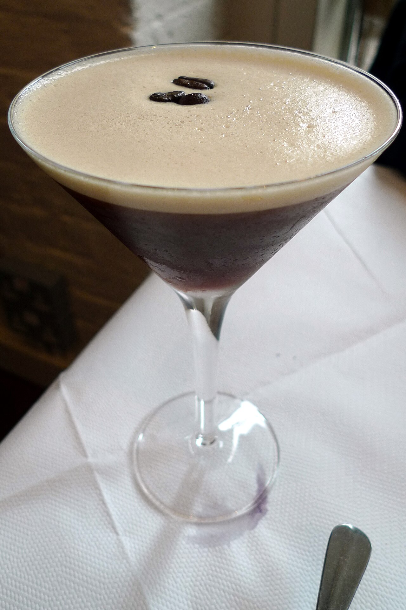

# 浓缩咖啡马天尼

浓缩咖啡马天尼（Espresso Martini）是一款以伏特加、咖啡利口酒、浓缩咖啡与糖浆摇和而成的鸡尾酒。它通常滤入预冷的马天尼杯或碟形杯，表面覆盖一层细密的咖啡泡沫，并以三颗咖啡豆装饰。名字里虽然有“马天尼”，但它不含金酒与干味美思，也不是搅拌型鸡尾酒；它的识别点在于咖啡香气、苦甜平衡与摇和产生的泡沫质地。

图：浓缩咖啡马天尼。图片：Ewan Munro from London, UK，CC BY-SA 2.0，via Wikimedia Commons（[原图页面](https://commons.wikimedia.org/wiki/File:Bistrot_Bruno_Loubet,_Clerkenwell,_London_(4574785649).jpg)）。

## 起源与命名

关于这款酒的诞生，流传最广的说法把它放在 20 世纪 80 年代的伦敦，常与苏豪区的一位调酒师和某个夜晚的临时请求联系在一起：客人想要“喝了能醒”的东西，调酒师便把咖啡与当时流行的马天尼形式结合。具体年份、酒吧名称与对话细节在不同叙述中有出入，因此本页把它写作“流传说法”，不把某个日期当作档案。

名称中的“Martini”是形式借用，而不是配方归属。它借用了马天尼杯的呈现方式与“短饮、冰凉、清澈”的联想，却用咖啡利口酒与浓缩咖啡取代了金酒和味美思。把它归入马天尼家族，容易让人误以为它应该搅拌、应该极干；实际上它必须大力摇和，才能产生泡沫并让咖啡与酒体融合。

咖啡在这款酒里既是风味，也是结构。浓缩咖啡的油脂与泡沫在摇和后形成表层，蛋白或奶油并不是必需项。名称里的“Espresso”强调使用的是浓缩咖啡，而不是普通滴滤咖啡或速溶咖啡；不同萃取方式会带来不同的苦度、酸度与泡沫表现，这也是同名配方差异很大的原因之一。

## 配方结构

常见配方为伏特加 50 毫升、咖啡利口酒 20 毫升、浓缩咖啡 30 毫升、糖浆 10 毫升。伏特加提供酒精骨架，咖啡利口酒提供甜味、咖啡香与酒体，浓缩咖啡提供苦味、酸度与泡沫，糖浆则用来平衡咖啡的苦。比例可以调整，但四者的角色不应混淆：糖浆不是越多越好，咖啡也不是越浓越像“正宗”。

咖啡利口酒的品牌会明显改变甜度与香气。有些产品偏甜、偏香草，有些更苦、更接近咖啡本身；替换品牌时，糖浆用量应随之调整。浓缩咖啡应现萃取，放置太久会失去油脂与香气，泡沫也会变薄。若使用摩卡壶或冷萃浓缩液，风味可以接近，但泡沫结构与 espresso 不同，成品外观会有差距。

糖浆的作用是平衡，而不是让酒变甜。咖啡本身带苦，利口酒又含糖，若糖浆过多，整杯会显得黏腻，苦味反而被放大成“糖浆里的苦”。若咖啡偏酸或偏淡，可以先调整咖啡，而不是一味加糖。配方写作应说明糖浆的浓度，因为 1:1 与 2:1 的糖浆甜度差别很大。

## 风味与平衡

入口是咖啡的烘焙香与苦味，随后是利口酒的甜和伏特加的温暖，尾段留下咖啡的酸与轻微涩感。表面的泡沫带来细腻的口感，也让香气更集中。它不像干马天尼那样追求清澈与极简，而是追求“像一杯冰咖啡，但有酒精度”的完整感。平衡的关键是苦、甜、酸与温度：咖啡太苦时，糖浆或利口酒可以缓和；太甜时，需要更浓的咖啡或少量柠檬皮来提亮。

温度对泡沫与香气影响很大。材料不够冷，摇和后泡沫容易塌；摇和时间不足，泡沫稀薄；摇和过度，冰块融化太多，酒体变淡。理想状态是材料预冷、冰块充足、摇到杯壁充分起霜，再双重过滤到预冷的杯中。咖啡豆装饰不只是图案，靠近杯口时能补充烘焙香气，但不必咀嚼。

酒精度不低，但咖啡因也会带来清醒感，这种“又醉又醒”的组合容易让人低估摄入量。咖啡因不能抵消酒精对判断力与反应速度的影响，也不能解酒。饮用时应控制杯数，避免在深夜连续饮用；对咖啡因敏感的人，即使只喝一杯也可能影响睡眠。

## 做法要点

做法以大力摇和为核心：把伏特加、咖啡利口酒、浓缩咖啡与糖浆倒入摇壶，加满冰块，用力摇约十到十五秒，直到摇壶外壁充分起霜。然后使用细滤网双重过滤，滤入预冷的马天尼杯或碟形杯，静置片刻让泡沫稳定，再放三颗咖啡豆。双重过滤可以拦住碎冰与咖啡渣，让口感更干净。

浓缩咖啡的温度会影响稀释。刚萃取的咖啡很热，加入摇壶后会融化更多冰，因此有人会先把咖啡稍微降温，或减少冰块并缩短摇和时间。家庭制作时，如果没有浓缩咖啡机，可以用摩卡壶制作较浓的咖啡，或使用冷萃浓缩液，但要预期泡沫会不同。速溶咖啡很难产生理想的油脂泡沫，通常不作为首选。

杯型以马天尼杯、碟形杯或较小的古典杯为主。杯口宽有助于香气，杯身预冷有助于泡沫稳定。装饰用三颗咖啡豆是常见做法，也有用橙皮或可可粉的版本；可可粉容易结块，撒之前应过筛。不要把整杯摇成奶昔状，过度摇和会让冰水比例过高，咖啡香也会被稀释。

## 变体

以朗姆酒或白兰地替代伏特加，会得到更甜、更具酒体感的版本；以decaf浓缩咖啡替代，可以降低咖啡因，但风味仍会不同。加入香草、咸焦糖或榛果糖浆，会改变甜味方向；加入少量橙皮油，则能提亮咖啡的酸。还有一种不加糖浆、改用甜型利口酒平衡的版本，甜度更圆润但酒精更高。

“浓缩咖啡马天尼”与“Carajillo”不是同一款酒。后者通常以咖啡与利口酒直接调配，不一定使用伏特加，也不强调马天尼杯的呈现。把它们混为一谈，会让配方比较失去意义。变体命名应写清替换的基酒、咖啡类型与甜味来源，否则同名不同做法会造成误解。

## 怎么点与怎么喝

点单时可以说“浓缩咖啡马天尼，少糖浆、咖啡浓一点”，或询问店家使用哪种咖啡利口酒。若对咖啡因敏感，可以要求 decaf，但风味会略薄。泡沫是这款酒的重要部分，应尽快饮用；放置太久，泡沫会塌，香气也会散。不要为了拍照长时间放置，尤其是在温暖的室内。

它适合作为餐后酒，搭配巧克力、坚果、咖啡风味的甜点，也可以替代一部分餐后咖啡。咖啡的苦与甜点的甜能相互平衡，但不要把它当成“解酒饮品”。饮用后仍需时间代谢酒精，不应驾车。若在晚餐中已经喝了其他酒，应把这一杯计入总摄入量。

在酒吧里，如果看到调酒师只是轻轻摇几下，泡沫通常不会理想；如果摇壶外壁没有明显挂霜，冷却也不充分。可以观察泡沫是否细密、是否与杯口齐平，作为判断制作质量的线索。但外观不是唯一标准，咖啡的新鲜度与甜度平衡同样重要。

## 常见误区

第一，认为它属于干马天尼家族，因此应该搅拌。它需要摇和来产生泡沫并混合咖啡。第二，认为泡沫来自蛋清。经典版本依靠浓缩咖啡的油脂与摇和，不需要蛋清。第三，认为咖啡越多越“正宗”。过多的咖啡会稀释酒体并带来更多苦味。第四，认为咖啡因能解酒。咖啡因只能让人感觉清醒，不能降低血液酒精浓度。第五，认为糖浆可有可无。糖浆负责平衡咖啡苦味，但用量需要根据咖啡与利口酒调整。

相关条目：[伏特加](ref:vodka)、[利口酒](ref:liqueur)、[摇酒](ref:shaking)。

## 另见

- [伏特加](ref:vodka)：这款酒的酒精骨架与中性风格。
- [利口酒](ref:liqueur)：咖啡利口酒的甜度、香气与酒体作用。
- [摇和](ref:shaking)：泡沫、冷却与稀释的技术基础。
- [马天尼杯](ref:martini)：短饮杯型与泡沫呈现。
- [香气](ref:aroma)：咖啡香气如何被温度与泡沫影响。
