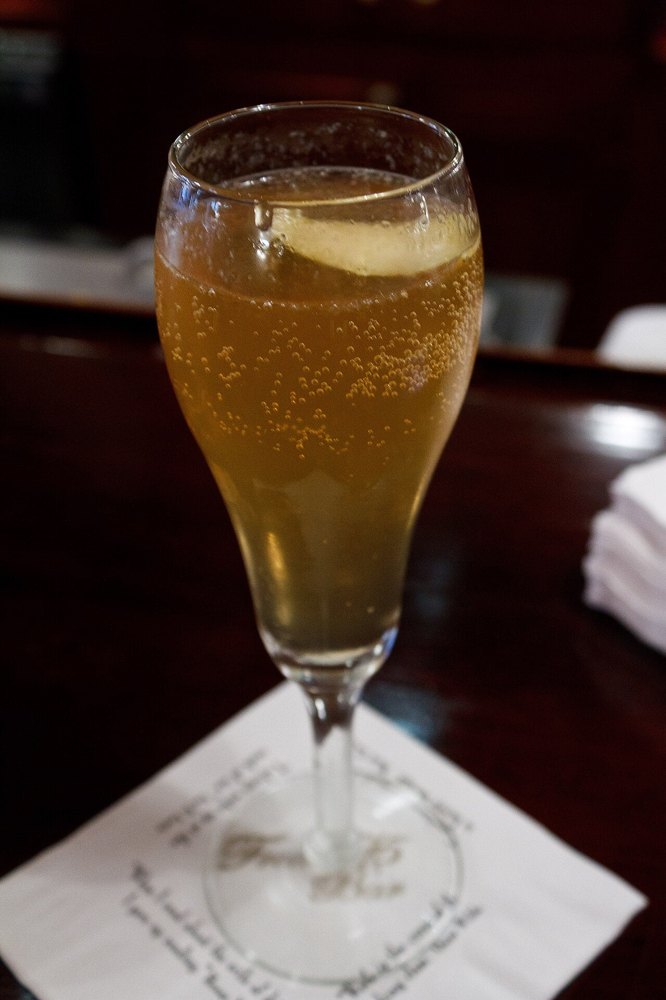

# 法国 75

法国 75（French 75）是一款以[金酒](ref:gin)、柠檬汁与糖浆摇和后补入[香槟](ref:sparkling)的气泡短饮。它通常装在预冷的[香槟笛杯](ref:flute)或郁金香杯里，颜色淡金，气泡细密，杯口可以有柠檬皮油，也可以什么都不放。入口是柠檬的酸与糖的圆润，随后香槟带来气泡、果香与轻微的酵母味，金酒在尾段提供杜松与酒精骨架。它喝起来轻，实际酒精度接近强化葡萄酒，气泡会把酒精藏得很好。

图：一杯法国 75，金黄色酒液与细密气泡，杯口饰有一片柠檬。图片：Gary J Wood，CC BY-SA 2.0，via [原图页面](https://commons.wikimedia.org/wiki/File:French_75.jpg)。

> **先给结论**
> **一句话：** 这页判断法国 75该不该点、比例和冰水怎么处理。
>
> - **适合谁：** 想弄懂法国 75的配方逻辑、点单方式和常见误区的人。
> - **不适合谁：** 只想要“一杯就醉”的配方、不关心比例和冰水的人。
> - **先看这两点：**
>   - 点单时可以直接说“法国 75”，并确认基酒是金酒还是干邑。
>   - 法国 75 的名字来自法国军队在第一次世界大战前装备的 75 毫米野战炮，正式型号是 Canon de 75 modèle 1897。

## 名字来自一门炮

法国 75 的名字来自[法国](ref:france)军队在第一次世界大战前装备的 75 毫米野战炮，正式型号是 Canon de 75 modèle 1897。这门炮以射速快、机动性好著称，常被当作法国军工的代表；把它拿来给一杯气泡鸡尾酒命名，玩笑在于这杯酒“入口轻、后劲像炮”。名字里的 75 不是年份，也不是酒精度，而是口径。

这个命名在 20 世纪初的报纸与鸡尾酒书里逐渐固定。关于它最早出现在哪一年、由谁命名，资料并不完全一致，因此本页写作“常被追溯到一战期间”，而不是把某个日期当成唯一答案。可以确认的是，名字与那门炮的流行形象有关，而不是与法国 75 年的某个历史事件有关。

名字的拼写也有变体。法语里会写作 Soixante-Quinze，英语里通常写 French 75，有时省掉空格写成 French75。不同写法指向同一类饮品，但配方可能不同；看到酒单上的名字时，最好确认基酒是金酒还是干邑，以及是否加了糖浆。

## 巴黎 Harry's New York Bar 的 1915 年

最常见的起源叙述把这款酒放在一战期间的巴黎，地点是 Harry's New York Bar。它在 1915 年前后出现，常与酒吧的经营者 Harry MacElhone 联系在一起。具体是哪一年、是否为 MacElhone 本人所创，资料之间存在出入；更稳妥的说法是“常被追溯到 1915 年的巴黎 Harry's New York Bar”，而不是把创作权写成确定事实。

早期印刷配方并不统一。有资料指出，1915 年前后以 Soixante-Quinze 为名的饮品出现过金酒、石榴糖浆、苹果白兰地与柠檬的组合；今天以金酒、柠檬、糖与香槟为准的版本，是后来在鸡尾酒书里逐渐稳定下来的。1927 年的《Here's How!》与 1930 年的《Savoy Cocktail Book》常被提到，说明这款酒在禁酒令时期已经进入英语世界的鸡尾酒书写。

这段历史解释了一个常见误解：法国 75 不是“香槟加金酒”这么简单的一次发明，而是多种早期配方在酒吧实践与印刷传播中收敛的结果。今天回看，它既有巴黎酒吧的城市文化背景，也有战争命名的时代气息；两者共同构成了这款酒的识别度。

## 香槟什么时候加

做法上最重要的一条是：香槟最后加，而且不要摇。IBA 的方法是先把金酒、柠檬汁与糖浆加冰[摇和](ref:shaking)，滤入预冷的香槟笛杯，再缓慢补入香槟。原因很直接：香槟里的二氧化碳在摇壶里会被剧烈释放，摇完以后气泡所剩无几，酒液也会因为过度氧化而失去新鲜的果香。

加香槟时应沿杯壁缓慢倒入，或者先倒到杯身一半，轻轻旋转杯脚让酒液混合，再补到七分满。不要用吧勺用力搅拌，也不要把香槟从一个杯子倒进另一个杯子；这些动作都会制造湍流，让气泡提前跑掉。理想的成品是酒液颜色均匀、表面有一层细小的气泡，而不是厚厚的气泡堆。

如果先加香槟再补金酒混合物，香槟会被迫承受额外的搅拌，气泡损失更大；如果把所有材料一起倒进摇壶，得到的是没有气泡的酸酒。顺序不是仪式，而是气泡保留的技术条件；这也是[鸡尾酒基础](ref:basics)里关于“先调基酒、最后补气泡”的基本顺序。酒吧里常见的做法是“基酒摇好、香槟现开、现倒”，家庭制作也应遵循这个顺序。

## 糖量与酸度的窄窗

IBA 的配方是金酒 30 毫升、柠檬汁 15 毫升、糖浆 15 毫升、香槟 60 毫升。糖浆通常指 2 比 1 的浓糖浆；如果使用 1 比 1 的糖浆，15 毫升带来的甜度会低不少，需要适当增加用量。柠檬汁提供酸，糖浆提供甜，香槟提供气泡与少量残糖，三者的比例窗口比看起来窄：糖多一点会盖住香槟的酵母味，酸多一点会让气泡显得尖。

这杯酒的难点在于“加香槟之前”的 base 必须稍微偏浓、偏甜。因为香槟会稀释整体，气泡也会让酸度在口腔里显得更明亮；如果 base 按纯酸酒的标准调到刚好，补入香槟后往往会偏淡。反过来，如果 base 调得太甜，香槟的清爽感会被压住，喝起来像甜汽水。通常的做法是让 base 的甜酸略偏向甜，再靠香槟的酸度与气泡拉回平衡。

糖量还影响气泡的持久度。糖会增加液体的黏度，让气泡上升得慢一些，但过多的糖会让口感发腻；完全不甜的版本（例如只用少量糖浆）会让柠檬的酸与香槟的酸叠加，喝起来尖锐。若想减少糖，可以增加柠檬汁的量并选用较干的香槟，但不要用苏打水替代香槟，那会失去酵母与果香。

## 金酒还是干邑

金酒版本是 IBA 与国际酒吧最常见的写法。伦敦干金的杜松、柑橘皮与草本香气能穿过香槟的酵母味，给尾段一个清楚的骨架；如果金酒过于花香或过于柔和，容易被香槟盖住。选择酒精度在 40% 至 47% 之间的干金酒比较稳妥，过于橡木桶陈年的金酒会带来香草与木味，和香槟的清爽方向不一定合拍。

干邑版本在美国南部有很深的根基。新奥尔良的 Arnaud's 把它的酒吧命名为 French 75 Bar，并以干邑作为基酒；干邑的果香、花香与橡木味让成品更圆、更宽，酸度也显得柔和。常见的干邑版本会减少糖浆，让酒更干，以突出葡萄与陈年烈酒的香气。它不是“金酒版的替代品”，而是另一条平行的传统。

选择哪一种，取决于想要的结构。金酒版更清脆、更偏草本与柑橘；干邑版更圆润、更偏葡萄与香料。两者的共同点是香槟与柠檬，差异主要在尾段的骨架。点单时可以直接问“gin or cognac”，这不是挑剔，而是确认配方方向。

## 气泡、温度与杯型

香槟的温度决定了气泡的寿命。瓶身应在冰箱里充分冷却，理想温度大约在 6 至 8 摄氏度；温度越高，二氧化碳越容易从酒里跑出来，倒进杯子后气泡也会更粗、更快消失。杯子同样要预冷，但不要把杯子冻到结霜，过冷的杯壁会让香气封闭，也会让杯口出现水汽。

杯型在笛杯与郁金香杯之间取舍。笛杯细长、气泡上升的路径长，气泡保留得久，视觉上也更像庆典；但杯口窄，香气释放慢，金酒与柠檬的细节不容易闻到。郁金香杯杯腹更宽、杯口略收，香气更开放，适合强调酒体与酵母味；代价是气泡消失得更快。两种都成立，关键是不要把酒倒满，留出气泡上升的空间。

不要用太大的杯子。法国 75 的总量大约 120 毫升，加上摇和稀释，成品在 140 至 150 毫升；倒进 200 毫升以上的大杯，酒液太浅，温度上升快，气泡也散得快。杯口不要做糖边，糖会破坏香槟的干爽，也会让杯口变黏。

## 为什么它比看起来更容易醉

法国 75 的酒精度大约在 14% 至 16% 之间，接近一杯加强葡萄酒，但因为气泡、酸度与低温，酒精感被掩盖得很好。气泡会加快酒精的吸收，低温会压低味觉对酒精的敏感度，柠檬与糖又让饮品显得像果汁汽水；三个因素叠加，很容易让人喝得比预期快。

计算一下：30 毫升 40% 的金酒带来约 12 毫升纯酒精，60 毫升 12% 的香槟带来约 7 毫升，总纯酒精约 19 毫升；摇和稀释后总体积约 140 毫升，酒精度约 14%。这个数字不算高，但一杯接一杯时，累积速度比想象中快。它适合作为一杯开场酒，而不是整晚的唯一饮品。

饮用时应配水，避免空腹；驾车、服药或孕期不应饮酒。若酒吧使用更高酒精度的香槟或加强型气泡酒，成品会更强，点单时可以问一句酒精度或品牌。不要把“喝起来像汽水”当成“没有酒精”。

## 常见失败点

第一，香槟温度太高。气泡粗、消失快，酒液也会显得甜腻。第二，把香槟倒进摇壶。摇完以后只剩酸酒，没有气泡。第三，糖浆过多。成品像甜汽水，香槟的酵母与果香被盖住。第四，柠檬汁不新鲜。预榨汁的香气平，酸度也显得尖。第五，杯子太小或倒得太满。气泡没有上升空间，温度上升快。第六，用甜型气泡酒替代干型香槟。残糖会改变整杯的平衡，尤其是干邑版本。

还有一个常见问题是“base 调得太淡”。如果金酒、柠檬与糖浆在摇和时加冰太多、摇得太久，稀释过度，补入香槟后整体会水薄。正确做法是控制摇和时间，摇到冷却即可，不要把冰完全摇化；base 应该比最终成品略浓，给香槟留出稀释空间。

## 变体与季节

干邑版是最有地域传统的变体，常见于新奥尔良；它以干邑替代金酒，糖量通常更克制，风味更圆。粉红香槟版用粉红香槟替代干型香槟，颜色更漂亮，果味更明显，但酸度与气泡的骨架会变柔。也有用其他气泡酒（如克雷芒）替代香槟的版本，成本更低，但酵母味与酸度不同。

季节上，它适合春季与节日场合，也适合作为早午餐的开场酒。搭配生蚝、鱼子酱、炸物、柑橘沙拉与轻度奶酪都合适；气泡与酸度能切开油脂，柠檬与香槟的果香能承接海鲜。不建议搭配重奶油或过甜的甜点，气泡会把甜味放大，酸度也会显得突兀。

家庭制作时，可以把 base 提前调好并冷藏，但香槟必须现开现倒。base 放置太久会失去柠檬的鲜香，也会让金酒的草本变得沉闷；如果提前批量制作，最好把柠檬汁与糖浆分开保存，饮用前再混合。

## 怎么点与怎么配

点单时可以直接说“法国 75”，并确认基酒是金酒还是干邑。若不喜欢太甜，可以要求减少糖浆或使用更干的香槟；若喜欢更酸，可以要求多一点柠檬，但要注意香槟本身也有酸度。若酒吧使用郁金香杯，香气会更开放；使用笛杯，气泡会更持久。两种都可以，按当时想要的体验选择。

它适合作为餐前酒或庆典饮品，不适合作为重口味菜肴的配酒。生蚝、虾、炸鸡、薯条、柑橘沙拉与软质奶酪都能和它相处；香槟的酸与气泡清口，金酒的草本能承接海鲜的鲜味。饮用时慢慢喝，配水，避免空腹；它的酒精藏在气泡里，第二杯之前最好先吃点东西。

在酒吧里，如果成品没有气泡，可能是香槟温度太高、倒得太猛，或者 base 与香槟混合时搅拌过度；如果成品过甜，可能是糖浆过多或使用了甜型气泡酒。可以观察气泡是否细密、酒液是否清澈，作为判断制作质量的线索，但最终还是要看酸、甜与气泡的平衡。

## 常见误区

第一，认为法国 75 必须用香槟，不能用其他气泡酒。香槟是经典，但克雷芒、卡瓦等干型气泡酒也可以做出成立的作品，只是风味不同。第二，认为名字里的 75 是年份。它指的是炮的口径。第三，认为金酒版本才是唯一正宗。干邑版本有独立的地域传统。第四，把香槟与 base 一起摇。气泡会全部损失。第五，认为它酒精度低。它接近加强葡萄酒，气泡会掩盖酒精。第六，在杯口做糖边。糖会破坏香槟的干爽与气泡。

## 另见

- [金酒](ref:gin)：杜松与柑橘骨架如何穿过香槟。
- [起泡酒](ref:sparkling)：香槟、克雷芒与其他气泡酒的选择。
- [法国](ref:france)：巴黎酒吧文化与命名的地域背景。
- [摇和](ref:shaking)：基酒的冷却与稀释控制。
- [香槟笛杯](ref:flute)：气泡保留与香气释放的取舍。
