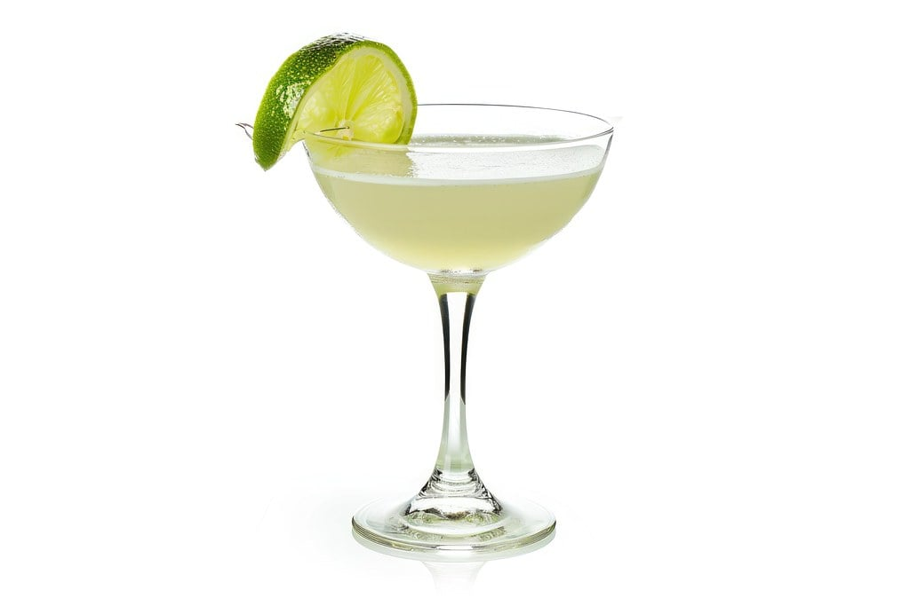

# 吉姆雷特

吉姆雷特（Gimlet）是一款以金酒和青柠为核心的短饮。它有两个版本：一个用青柠糖浆（lime cordial），一个用鲜榨青柠汁加糖浆。前者是历史上更早、也更“经典”的写法，后者是当代酒吧更常见的写法。两者不是同一个配方换一种原料，而是酸度、甜度、香气和质地都不同的两杯酒。

图：一杯吉姆雷特，淡黄绿色酒液盛于碟形杯，杯口挂着一片青柠。图片：ccnull.de Bilddatenbank，CC BY 2.0，via [原图页面](https://www.flickr.com/photo.gne?id=53457787167)。

> **先给结论**
> **一句话：** 这页判断吉姆雷特该不该点、比例和冰水怎么处理。
>
> - **适合谁：** 想弄懂吉姆雷特的配方逻辑、点单方式和常见误区的人。
> - **不适合谁：** 只想要“一杯就醉”的配方、不关心比例和冰水的人。
> - **先看这两点：**
>   - 青柠糖浆版的结构非常简单：金酒加青柠糖浆，比例常见在 2:1 到 3:1 之间，例如金酒 60 毫升、青柠糖浆 20–25 毫升。
>   - 先说要紧的：在 IBA 现行的官方鸡尾酒名单中，找不到 Gimlet 条目。

## 两种配方，两种酒

青柠糖浆版的结构非常简单：金酒加青柠糖浆，比例常见在 2:1 到 3:1 之间，例如金酒 60 毫升、青柠糖浆 20–25 毫升。成品清澈、甜润，青柠的香气像被“保存”过，带一点糖果感和轻微的咸鲜；酸度不高，口感偏圆，酒体比鲜榨版更厚。

鲜榨版的结构是金酒、鲜榨青柠汁和糖浆，常见写法是金酒 60 毫升、青柠汁 22.5 毫升、糖浆 15 毫升。它的酸度更高，香气更亮，入口更尖，收口也更短；青柠的果皮油带来清新的苦香，但放久了会变沉闷。因为含果肉与果油，鲜榨版通常需要摇和并细滤，青柠糖浆版则可以搅拌。

两杯都叫 Gimlet，但点单时如果不说明，你喝到的可能是其中任意一杯。比较稳妥的说法是“用青柠糖浆的 Gimlet”或“鲜榨青柠版”，而不是假设对方和你用同一个配方。

## 皇家海军军医的故事，为什么只是故事

最流行的起源说法，把这款酒与英国皇家海军军医 Thomas Gimlette 联系在一起。常见版本是：19 世纪末到 20 世纪初，海军长期在海上航行，船员需要服用青柠汁预防坏血病，但青柠汁又酸又难入口；Gimlette 把金酒掺进青柠汁，让药变得好喝，于是有了以他命名的 Gimlet。Thomas Gimlette 确有其人，生于 1857 年，卒于 1943 年，曾官至皇家海军外科少将；但“他把金酒加进青柠汁，因而发明了这款酒”的说法，缺乏同时代的配方、书信或酒吧记录支持。

更麻烦的是时间线。柑橘汁预防坏血病在皇家海军的历史要早得多，18 世纪末柠檬汁已经成为制度的一部分，青柠汁的普及还要更晚；而“金酒加青柠糖浆”作为一种酒吧饮品，要到 19 世纪末、20 世纪初才逐渐成形。把一款 20 世纪的鸡尾酒直接归功于一位军医的个人灵感，是把两段历史缝在了一起。

还有一个更朴素的解释：gimlet 原本是一种细长的钻孔工具，水手用它给酒桶开孔取酒；“gimlet”作为饮品名，可能来自这种“钻孔”的动作或工具，而不是某位军医的姓氏。这个说法同样没有定论，但它提醒我们：名字的来源与配方的来源是两件事，不能因为姓氏相同就当成证据。

因此，本页把军医故事写成“流传故事”，不写成史实。它解释了这款酒为什么会和海军、青柠、防坏血病联系在一起，但不能证明发明者是谁。

## 钱德勒与《漫长的告别》

吉姆雷特进入大众文化，很大程度上要归功于 Raymond Chandler 1953 年的小说《The Long Goodbye》。书中的侦探 Philip Marlowe 对 Gimlet 有一段常被引用的描述，大意是“真正的 Gimlet 是一半金酒、一半 Rose's 青柠汁，别的什么都不加”。这句话把两个信息同时钉进了流行记忆：一是配方极简，二是比例可以到 1:1。

1:1 在今天听起来很甜，但放在 1950 年代的语境里并不奇怪。Rose's 青柠糖浆本身含糖，1:1 的成品甜度高、酒精度被压到 20% 以下，喝起来更像一杯带酒味的青柠饮料。Chandler 写的是一种人物口味，不是调配标准；把它当成“唯一正确的 Gimlet”，会把历史小说当成配方手册。

小说带来的效果是文化上的：很多人第一次知道这款酒，不是因为酒吧，而是因为一本书。这也解释了为什么 Gimlet 的“经典形象”总是和“极简、冷峻、一半一半”联系在一起，尽管现实中的配方要复杂得多。

## IBA 与历史配方：7:3 与 1:1

先说要紧的：在 IBA 现行的官方鸡尾酒名单中，找不到 Gimlet 条目。它不像 Sidecar 或 Negroni 那样有一个可引用的 IBA 官方页面，因此本页不把任何比例称为“IBA 官方配方”。

能查到的是历史版本。IBA 在 1985 年的配方手册中给出的 Gimlet 常被转述为金酒 7/10、青柠糖浆 3/10，也就是约 2.3:1；这个比例比 Chandler 的 1:1 干得多，也更接近现代酒吧的做法。更早的《The Savoy Cocktail Book》（1930 年）则给出金酒与青柠汁各半的写法；注意它写的是青柠汁，不是青柠糖浆，所以同样是 1:1，酸度会高得多，也更接近一杯“金酒酸酒”。

三个版本放在一起，可以看出所谓“经典比例”从来不是单一的：7:3 偏酒体，1:1 偏甜或偏酸，取决于用的是糖浆还是鲜榨汁。写配方时，至少要说清三件事：金酒多少、青柠以什么形式出现、糖浆是否另加。否则“Gimlet”只是一个名字。

## 青柠糖浆：酸度、甜度与质地

青柠糖浆不是“青柠味的糖水”那么简单。它通常由青柠汁、糖和少量保存剂制成，有些产品还会加入青柠果皮油。糖降低了酸度的尖锐感，也提高了黏度，让酒液在口中更“厚”；果皮油带来香气，但也会带来一点苦味。1867 年，Lauchlan Rose 为一种让青柠汁在海上长期保存的方法申请了专利，这类保存技术后来演变成商业青柠糖浆，也把“青柠”从新鲜水果变成了可以长期储存的工业原料。

糖浆版的优点是可预测：同一瓶糖浆，今天和下周的味道几乎一样，酸度稳定，出品速度快。缺点是香气扁平，甜度高，喝多了会腻；如果糖浆开瓶太久或保存不当，还会出现金属味或类似洗洁精的气味。用量上，60 毫升金酒配 20–25 毫升糖浆是常见起点；糖浆越多越甜，酸度越低，酒体越厚，但青柠的清香也越容易被盖住。

鲜榨青柠汁的酸度通常在 5%–6%（以可滴定酸计），明显高于糖浆版被糖稀释后的酸度。它的香气来自果皮油和果汁本身，明亮、短暂、容易氧化；挤好后放半小时，香气就会明显下降。鲜榨版因此需要更高的糖浆用量来平衡，常见是 22.5 毫升青柠汁配 15 毫升糖浆；这个比例不是固定答案，青柠的成熟度、品种和季节都会改变酸度。

## 鲜榨版本怎么调

鲜榨版的第一步是选青柠。皮薄、手感重、表面有细小油点的青柠通常汁水多、香气足；表皮发亮、手感轻的往往汁少。挤汁前把青柠回温到室温，出汁率更高；但挤出的汁要尽快使用，不要提前一小时准备。

配方可以从金酒 60 毫升、鲜榨青柠汁 22.5 毫升、糖浆 15 毫升开始。糖浆用 1:1 的简单糖浆即可；如果青柠特别酸，可以把糖浆加到 17.5 毫升，或者把青柠汁减到 20 毫升。先按标准比例做一杯，再根据入口调整，不要同时改三个变量。

摇和时加冰摇 10–12 秒，细滤入预冷的杯中。鲜榨汁含果肉，普通滤冰器挡不住细渣，细滤能让口感更干净，也能挡住碎冰。装饰用青柠轮或青柠皮油：青柠轮提供视觉与一点果皮香，皮油则更直接，喷在杯口上方即可，不要挤进酒里太多，否则苦味会过量。

## 搅还是摇

青柠糖浆版通常搅拌，鲜榨版通常摇和。理由不是“传统”，而是原料：糖浆版没有果肉和果油，搅拌足以降温、稀释并保持清澈；摇和会把空气打进去，让本应清透的酒液变浑，也会让甜味显得浮。鲜榨版有果肉、果油和纤维，只有摇和才能把它们与酒液充分混合，并让酸度变得柔和。

搅拌的参数是 20–30 秒，直到杯壁结霜、稀释达到 20% 左右。摇和的参数是 10–12 秒，听到冰声变闷即可。两者都不能靠“多搅一会儿”来降温：时间越长，冰化水越多，成品越薄。若使用碎冰，时间要缩短，否则稀释会失控。

有些酒吧会把糖浆版也摇和，理由是“让口感更活泼”。这不算错，但要知道它在改变质地：摇和后的糖浆版会带一层细泡，入口更轻，清澈度下降。若你想要的是一杯像马天尼一样冷静、透明的酒，搅拌更合适；若你想要更柔和、更接近酸酒的口感，摇和也成立。

## 杯型：coupe、martini 与 Nick & Nora

传统上使用[碟形杯](ref:coupe)或鸡尾酒杯。碟形杯杯腹宽、杯口略收，香气有空间聚集，酒液升温比锥形杯慢；马天尼杯杯口宽、杯身浅，第一口香气直接，但升温快、容易洒。IBA 没有为 Gimlet 指定杯型，因为它不在现行名单里；历史上，这类短饮多用带杯脚的小杯。

如果想让青柠香气更集中，选杯口略收的碟形杯，容量 150–200 毫升，倒到三分之二左右。如果想让酒液保持低温、快速喝完，选马天尼杯，但要注意它不适合慢慢聊天。Nick & Nora 杯容量更小、杯口更窄，也能用，尤其适合糖浆版这种酒体较厚、香气较甜的版本。

无论用哪一种，杯子都要提前冷藏。温杯会让酒液在倒入后迅速回温，酸度变松，青柠香也散得更快。关于杯型与香气的通用原则，可以参考[如何选杯](ref:basics)。

## 金酒怎么选

[金酒](ref:gin)是这款酒唯一的风味骨架，选择比比例更重要。伦敦干金酒的杜松子、芫荽和柑橘皮与青柠是同一方向，成品干净、利落；Plymouth 风格更柔和、带一点泥土感，和青柠糖浆的甜味容易融合；海军强度金酒酒精度高，需要更多稀释，否则酒精感会压住青柠。

不建议用香气过于复杂的现代金酒：当金酒本身带有大量花香、茶香或热带水果时，青柠的酸会把这些细节打散，成品显得混乱。也不建议用低品质金酒再靠糖浆遮掩，糖浆只能盖住粗糙，不能补上骨架。

如果做糖浆版，金酒的杜松子需要更明显，才能穿透糖浆的甜；如果做鲜榨版，金酒的柑橘调可以与青柠果皮油呼应，但不要选苦味过重的配方，否则会和青柠的苦叠加。关于金酒的风格差异，可以延伸阅读[金酒](ref:gin)。

## 常见失败点

第一，青柠糖浆放太久。开瓶后冷藏也只能延缓氧化，出现金属味或药水味时应丢弃。第二，糖浆比例过高。甜味盖住金酒与青柠，喝起来像一瓶加酒的青柠汽水。第三，鲜榨汁提前挤好。香气在半小时内明显下降，酸度也会变得单调。第四，摇和或搅拌过度。冰化水太多，酒体变薄。第五，杯子不冷。回温后酸与酒精分离，口感变粗。第六，金酒选错。过于花香或过于廉价的金酒都会让成品失去骨架。第七，不细滤。鲜榨版的果肉与碎冰让口感浑浊。

## 怎么点与怎么喝

点单时最好直接说明版本：“Gimlet，用青柠糖浆”，或“鲜榨青柠版，金酒 60 毫升”。可以问调酒师用哪一种金酒、糖浆是自制还是瓶装；如果对方反问你“要甜一点还是酸一点”，那就是在问糖浆与青柠的比例。想要更干，要求减少糖浆或增加青柠；想要更甜，增加糖浆，而不是要求加更多金酒。

它适合作为餐前酒，搭配牡蛎、盐渍坚果、清淡海鲜、炸物或青柠味的甜点。糖浆版更适合搭配咸鲜与油炸食物，鲜榨版更适合搭配生蚝与白肉鱼。饮用时小口慢喝，注意回温；它的酒精度通常在 20% 上下，但一杯接一杯仍然会累积。驾车、服药或孕期不应饮酒。

## 另见

- [金酒](ref:gin)：吉姆雷特的主体与风格选择。
- [摇和](ref:shake)：鲜榨版的混合、冷却与细滤。
- [碟形杯](ref:coupe)：杯腹、杯口与香气聚集。
- [干马天尼](ref:martini)：同为金酒短饮，但结构更干。
- [鸡尾酒基础](ref:basics)：酸酒、稀释与出品判断。
