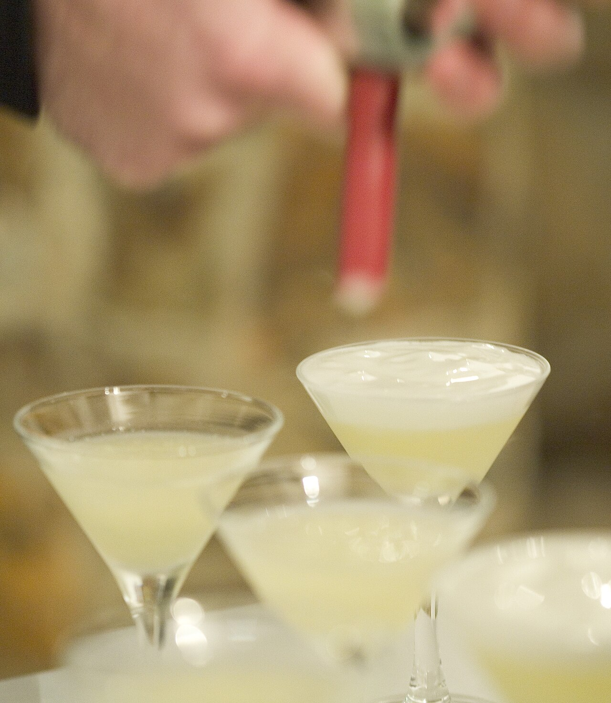

# 金菲士

金菲士（Gin Fizz）是金酒、柠檬汁、糖与苏打水组成的短饮：前三样加冰摇和，滤入细长杯，最后补一小股苏打。IBA 公开配方是 45 ml 金酒、30 ml 新鲜柠檬汁、10 ml 糖浆，苏打只作收尾，成品不加冰。它和一杯金酒酸只差一步——把水换成气泡水，但这一步决定了温度、稀释与口感。

图：金菲士。图片：Charles Haynes，CC BY-SA 2.0，via Wikimedia Commons（[原图页面](https://commons.wikimedia.org/wiki/File:Gin_Fizz_en_El_Bulli.jpg)）。

## 定义与身份

“菲士”在 19 世纪的美国酒吧里指一类结构：烈酒、柑橘、糖，摇和后补苏打。金菲士是其中最有名的一支，也是判断其他菲士的模板。它与[金酒](ref:gin)酸类鸡尾酒的区别不在配料表，而在顺序：苏打在摇和之后才进场，因此气泡更完整、酒体更轻、稀释更少。老汤姆、荷兰或伦敦干金酒都能做，风味走向不同。

## 结构化配方：45 / 30 / 10

以 IBA 公开版为准：

- 金酒 45 ml
- 新鲜柠檬汁 30 ml
- 糖浆 10 ml
- 苏打水 少量，常见约 10 ml，补至杯口（IBA 原文只写 splash）
- 杯型：细长坦布勒杯（thin tall tumbler），提前冰镇
- 冰：摇和用冰；杯中不加冰
- 技法：除苏打外全部加冰摇和，滤入杯中，再缓慢补苏打
- 装饰：柠檬片，可选柠檬皮

IBA 特别注明“不加冰饮用”。这与很多酒吧的实际做法不同：Beefeater 的官方版本用 50 ml 金酒、25 ml 柠檬汁、10 ml 糖浆，滤入加冰的高球杯，再补苏打，以柠檬皮装饰。两套数字都成立：前者更浓缩、气泡更持久，后者更凉、更耐喝。关于结构与稀释的一般原则，见[调酒基础](ref:cocktails-guide)。

## 摇和之后才加苏打

摇和的任务是降温、混匀、给出一部分稀释；苏打的任务是提供气泡。两者同时进行，气泡会在摇壶里被撞碎，倒出来只剩甜水。正确顺序是：摇和、滤入冰镇过的杯子、沿杯壁缓慢注入苏打，最后轻轻提一下，不要搅拌。

补苏打时杯子越冷、酒液越冷，二氧化碳保留得越久；温杯、热酒、猛烈倾倒，都会让气泡在几秒内跑掉。这也是 IBA 要求“不加冰”的原因之一：稀释曲线是平的，气泡不会一边喝一边被冲淡。

## 菲士家族：Silver、Golden 与 Ramos

菲士是一棵有明确分支的树：

- Silver Fizz：加蛋清。Beefeater 的官方做法是先不加冰干摇约 20 秒，再加冰摇到冷，滤入杯中补苏打。蛋白带来细腻泡沫与更圆的口感。
- Golden Fizz：加蛋黄。这是 19 世纪末酒吧手册里的做法，今天已少见；蛋黄会增加体重与颜色，也会压住一部分柑橘香。
- Royal Fizz：加整颗蛋，介于两者之间。
- Ramos Gin Fizz：加奶油、蛋清、青柠与橙花水，是菲士家族里最特殊的一支。

## Ramos 的 12 分钟摇和

Ramos Gin Fizz 由 Henry C. Ramos 于 1888 年在新奥尔良的 Imperial Cabinet Saloon 创制。它的名字几乎和“摇 12 分钟”绑在一起：早期做法要求连续摇满 12 分钟，才能把奶油、蛋清与糖乳化到绵密。生意最好时，Ramos 雇了三十多名“摇酒童”轮流上阵；1915 年狂欢节期间，常见记载是最多同时动用 32 名调酒师。Ramos 本人不饮酒，晚上 8 点关店，禁酒令生效后于 1919 年 10 月 27 日午夜卖出最后一杯，配方在他去世前不久才交给《New Orleans Item-Tribune》。

今天的可行版本是：金酒 60 ml、柠檬汁 15 ml、青柠汁 15 ml、糖浆 22.5 ml、淡奶油 30 ml、橙花水 3 滴、蛋清 1 个、苏打水 60 ml。先把除苏打外的材料干摇至少 1 分钟，再加冰摇到冷，滤入柯林斯杯，最后补苏打并轻搅。12 分钟是历史，不是今天的门槛；但“先干摇、再冰摇、最后补苏打”的顺序不能省。

## 杯型、冰量与“不加冰”的菲士

菲士传统上用细长杯。Bormioli Rocco 的器皿指南给出：高球杯 10–12 盎司，柯林斯杯 12–14 盎司。菲士更接近前者，容量小、杯壁薄、便于展示气泡；柯林斯杯更高，能装下更多冰与装饰。

冰量决定两件事：摇和时的稀释速度，以及杯中后续的稀释。IBA 版不加冰，酒液温度靠摇和建立，喝到最后也不会变淡；加冰版入口更凉，但冰在融化，味道会一路往下走。两种都可以，但不能既加冰又按“不加冰”的水量补苏打，否则一定寡淡。

## 与汤姆柯林斯的四个边界

IBA 把[汤姆柯林斯](ref:tom-collins)的配方列在“John Collins”条目下：45 ml 金酒、30 ml 柠檬汁、15 ml 糖浆、60 ml 苏打水，在高球杯中加冰直调，装饰柠檬片与马拉斯奇诺樱桃，并注明“做 Tom Collins 时用老汤姆金酒”。把它和金菲士并排，有四条清晰的边界：

1. 苏打量：金菲士是一小股，约 10 ml；柯林斯是 60 ml。
2. 糖量：金菲士 10 ml，柯林斯 15 ml。
3. 冰：金菲士杯中不加冰，柯林斯杯中加冰。
4. 基酒与杯型：柯林斯传统用老汤姆金酒、12–14 盎司柯林斯杯；金菲士多用伦敦干金酒、10–12 盎司高球或菲士杯。

同一套 45 / 30 骨架，靠这四项分成了两种喝法。

## 金酒风格与酸甜校准

伦敦干金酒给杜松子与柑橘的清晰骨架，老汤姆金酒更圆、更甜，海军强度金酒则需要更多稀释。45 ml 是容量，不是强度承诺。柠檬汁要用新鲜的，30 ml 大约是一个中等柠檬的汁量；糖浆 10 ml 在今天的口味里偏干，如果金酒本身很冲，可以把糖浆加到 15 ml，但不要用糖粉直接替代，摇不匀。成品的强度还取决于摇和稀释，可参考[酒精度](ref:abv)。

## 常见失败点：温度、稀释与气泡

第一，摇和不足。壶壁没有起霜、手感觉不到明显变冷，说明温度还不够，气泡补进去也会很快散。

第二，冰太小、摇太久。碎冰在十几秒内就能把酒稀释成水，菲士本来酒体就轻，经不起。

第三，先加苏打再摇。这是最彻底的一种失败，气泡全失。

第四，杯子没冰。酒液入杯即升温，二氧化碳溶解度下降。

第五，蛋白版没干摇。蛋清没有打发，补苏打后只有一层薄沫。

第六，柠檬汁提前挤好放太久。香气氧化，酸度还在，但新鲜感没了。关于冰型与温度，见[加冰与温度](ref:ice)。

## 变体与无酒精版本

把柠檬换成青柠，会得到更锋利、更干的版本；把金酒换成伏特加或朗姆，是另一支菲士；加蛋白、蛋黄、奶油，分别是 Silver、Golden 与 Ramos。无酒精版本可以用 0% 金酒替代，保留柠檬、糖浆与苏打的 30 / 10 / 约 10 结构；也可以直接用苏打水、柠檬与糖浆做一杯柠檬苏打，但那就不是菲士的完整香气了。

与[威士忌酸](ref:whiskey-sour)相比，金菲士多了一步补苏打，少了蛋清带来的厚度；两者共享“烈酒 + 柑橘 + 糖”的骨架。

## 饮用与边界

金菲士适合餐前、午后或炎热天气，配坚果、橄榄、简单咸味小食都合适。它容量小、入口快，容易在不知不觉中喝完；建议慢饮并配水。驾车、服药或孕期不应饮酒。

本页只记录有来源的版本，不把任何一套比例说成唯一答案。成品的强度由金酒酒精度、糖浆量、摇和稀释与苏打量共同决定。

## 延伸阅读

- [金酒](ref:gin)：基酒风格与选择。
- [调酒基础](ref:cocktails-guide)：摇和、稀释与结构。
- [加冰与温度](ref:ice)：冰型如何改变成品。
- [酒精度](ref:abv)：理解强度与稀释。
- [威士忌酸](ref:whiskey-sour)：同属酸类的对照。
- [汤姆柯林斯](ref:tom-collins)：同一骨架的长饮版本。
