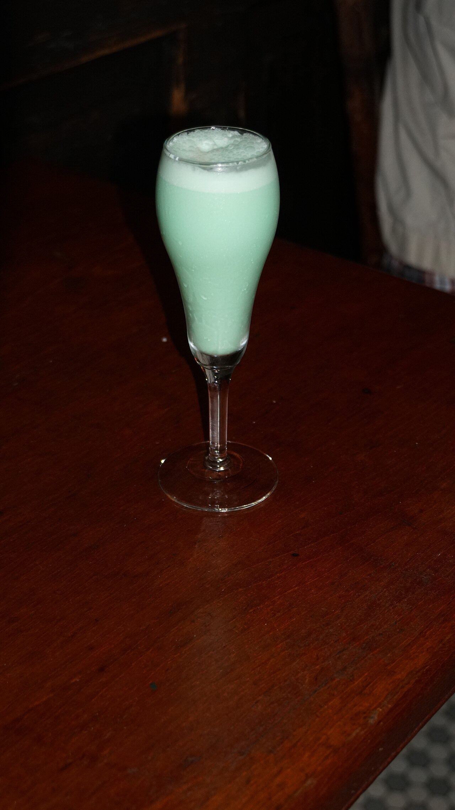

# 蚱蜢

蚱蜢是一杯“甜点酒”。绿薄荷利口酒、白可可利口酒、奶油，摇和后滤入碟形杯，颜色淡绿，口感像融化的薄荷巧克力。它的酒精度不高，甜度高，适合餐后，也适合第一次接触鸡尾酒的人。

图：绿薄荷、白可可与奶油摇成的蚱蜢，淡绿如甜点。图片：Miguel Discart，CC BY-SA 2.0，via Wikimedia Commons（[原图页面](https://commons.wikimedia.org/wiki/File:Grasshopper_Cocktail,_French_Quarter,_New_Orleans.jpg)）。

这杯酒在 20 世纪中叶的美国流行，尤其在新奥尔良与法属区的酒吧文化中留下痕迹。它的配方简单，但要让绿色、薄荷香与奶油质感平衡，需要控制温度与摇和。

## 薄荷、可可与奶油

绿薄荷利口酒提供颜色、薄荷香与甜度。它的绿色来自色素，薄荷味来自薄荷油；用量过多，酒会像牙膏；用量不足，颜色与香气都不够。选择品质好的绿薄荷，味道更自然。

白可可利口酒提供巧克力香与圆润的甜。它没有深色可可的苦，只有可可脂的香气与糖的甜；它和薄荷是经典组合，像薄荷巧克力。白可可的甜度高，所以不需要额外加糖。

奶油提供质地与圆润。奶油的脂肪能包裹薄荷的刺激，让酒变得柔滑；没有奶油，这杯酒会变成“薄荷甜酒”，失去“甜点”的质感。奶油的用量通常是利口酒的两倍以上，才能撑起酒体。

三者的比例约为 1 比 1 比 2.5。薄荷与可可等量，奶油多一些；这个比例让酒液呈淡绿色，口感像液体甜点。如果奶油太少，酒会太烈、太薄；太多，酒会太腻、颜色太浅。

## 配方：等分利口酒，双倍奶油

IBA 的标准配方是绿薄荷利口酒 2 厘升、白可可利口酒 2 厘升、奶油 5 厘升。2 厘升等于 20 毫升，5 厘升等于 50 毫升；总量约 90 毫升，滤入碟形杯后约七分满。

奶油要用淡奶油（half-and-half 或 single cream），不要用重奶油。重奶油的脂肪太高，摇和后会很稠，口感像酱；淡奶油更容易起泡，口感更轻。如果没有淡奶油，可以用牛奶加少量重奶油。

绿薄荷与白可可要冷藏。冷藏的利口酒能让酒液更快冷却，减少摇和时的稀释；常温利口酒会让冰化得更快，酒变稀。奶油也要冷藏，否则摇和不匀。

不需要糖浆。绿薄荷与白可可都含糖，奶油也有乳糖；再加糖，酒会过甜。如果觉得太甜，可以减少绿薄荷，或加几滴柠檬汁，但传统配方不加。

## 做法：摇和与冷杯

把绿薄荷、白可可、奶油倒入摇壶，加冰，用力摇和 10 到 12 秒。摇和时间要够，让奶油与酒液充分乳化，酒体变得均匀、细腻；摇得太短，奶油会分离，酒液会出现颗粒。

摇和后用细网滤冰器滤入冷藏的碟形杯。滤冰器能挡住碎冰与未乳化的奶油，让酒液顺滑；碟形杯的宽口能让薄荷香释放，杯壁的弧度能托住奶油泡沫。

杯子要提前冷藏。冷杯能让酒液保持低温，也能让泡沫更稳定；常温杯子会让酒液回温，泡沫很快消失。如果没有冷藏杯，可以用冰块水镇杯几分钟，倒掉后再用。

装饰用薄荷叶。薄荷叶可以放在泡沫上，也可以夹在杯口；它能强化薄荷香，也能让颜色更有层次。不要加樱桃或可可粉，那会改变这杯酒的“甜点”语言。

## 新奥尔良的甜点酒

蚱蜢的起源有多种说法，最流行的是 20 世纪初的新奥尔良，尤其是法属区的 Tujague's 餐厅。传说一位调酒师为了做出“像薄荷巧克力”的甜点酒，把绿薄荷、白可可与奶油混合，后来这杯酒成为餐厅的招牌。

另一种说法认为，这杯酒在 1910 年代至 1920 年代出现于美国，具体地点无法确认；还有说法把它与禁酒令时期的“甜点替代品”联系起来。这些说法大多缺乏一手证据，但都指向同一个方向：它是美国南方的甜点酒传统。

这杯酒在 1950 年代至 1970 年代流行，尤其在美国的餐后酒文化中。它的颜色、甜度与“甜点”定位，让它在家庭聚会与餐厅菜单上都有一席之地。后来，随着低糖与清淡口味的兴起，它逐渐变成“复古鸡尾酒”。

名字“蚱蜢”与昆虫无关，可能来自酒的绿色，也可能来自“跳跃”的口感。具体命名由来没有可靠的一手记载，使用时不必过度解释。

## 变体与常见错误

常见变体包括“Flying Grasshopper”，加入伏特加，酒精度更高；“Girl Scout”，加入薄荷巧克力奶油，更甜；“Grasshopper Shake”，像奶昔一样加冰淇淋；“After Eight”，用深色可可利口酒，颜色更深。

常见错误有四个。第一，奶油太少，酒太烈、太薄。第二，摇和不足，奶油分离，酒液有颗粒。第三，杯子不冷，泡沫消失。第四，绿薄荷太多，酒像牙膏。蚱蜢的成败，在“乳化”与“比例”。

对家庭调酒者，最实用的建议是：用淡奶油，三种材料都冷藏，摇和至少十秒，滤入冷杯，薄荷叶最后放。记住，这杯酒的目标是“柔滑的薄荷巧克力”，不是“薄荷味的甜奶”。

相关条目：[碟形杯](ref:coupe)。

## 另见与参考资料

- 摇和：参见 [摇和](ref:shaking)。
- 碟形杯：参见 [碟形杯](ref:coupe)。
- 甜型：参见 [甜型](ref:sweet)。
- 香气：参见 [香气](ref:aroma)。
- 浓缩咖啡马天尼：参见 [浓缩咖啡马天尼](ref:espresso)。

对照阅读：[摇酒](ref:shaking)、[甜型（sweet）](ref:sweet)。

**关键事实。**

| 项目 | 内容 |
| --- | --- |
| 一句话定位 | 绿薄荷利口酒、白可可利口酒与奶油摇和而成的甜点型鸡尾酒，颜色淡绿、口感像薄荷巧克力；起源于新奥尔良的说法流传最广 |
| 类型 | IBA Contemporary Classics |
| 起源 | 美国新奥尔良 |

**来源与边界。** 本页关于「蚱蜢」的关键事实，主要由以下来源交叉核对：International Bartenders Association（IBA 配方分类、原料与比例）、Oxford University Press（鸡尾酒史与术语背景）、CocktailDB（交叉核对配方结构与常见变体）等 5 条来源。价格、批次与状态会变，涉及这些字段时以页面所列来源的最新版本为准。正文为项目自写，来源只作核验，不复制原文。

**并读。** 把「蚱蜢」与「摇酒」、「碟形杯」、「甜型（sweet）」放在一起读时，先确认它们是同一层级还是上下游关系：先确认基酒与比例，再比较酸甜平衡、杯型与出品差异。本页负责给出鸡尾酒的基本坐标，对照条目补上具体案例与差异；读完再回到本页，才能分清哪些差别属于鸡尾酒本身，哪些只是产地、批次或品牌选择。

**适用边界。** 对「蚱蜢」而言，配方比例、基酒品牌与杯型会变；IBA 版本是参照，不是唯一做法。

**更新提示。** 「蚱蜢」最近核对于 2026-11-20；配方比例、基酒品牌、杯型与出品标准会变，调酒前以 IBA 或酒吧现行配方为准。
