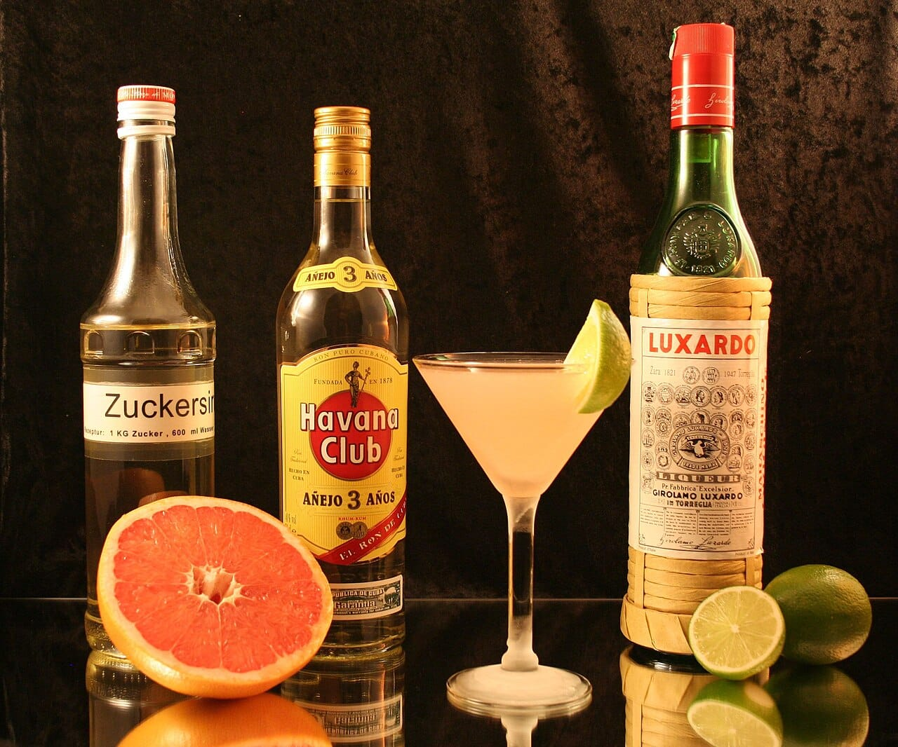

# 海明威代基里

海明威代基里（Hemingway Daiquiri）是一款以[白朗姆](ref:rum)、新鲜西柚汁、青柠汁与黑樱桃利口酒摇制的短饮，配方里不加糖。它通常滤入预冷的碟形杯，颜色接近淡粉的葡萄柚汁，装饰可以是一小片西柚皮或青柠轮。与标准代基里相比，它更干、更苦、酒精度更高，柑橘的体量也更大；喝起来像一杯被抽掉甜味的酸酒，葡萄柚的苦与黑樱桃利口酒的核果香负责把结构撑住。

图：海明威代基里。图片：Achim Schleuning (E-Mail: comander02_de@yahoo.de )，CC BY-SA 3.0 de，via Wikimedia Commons（[原图页面](https://commons.wikimedia.org/wiki/File:Hemingway_Daiquiri.jpg)）。

> **先给结论**
> **一句话：** 这页判断海明威代基里该不该点、比例和冰水怎么处理。
>
> - **适合谁：** 想弄懂海明威代基里的配方逻辑、点单方式和常见误区的人。
> - **不适合谁：** 只想要“一杯就醉”的配方、不关心比例和冰水的人。
> - **先看这两点：**
>   - 西柚汁在这杯酒里不是“另一种酸”。
>   - 除了 IBA 的 60 比 40 比 15 比 15，还有更干的现代版本，把西柚减到 15 毫升、黑樱桃利口酒减到 10 毫升，酸度更集中，酒体更小。

## 哈瓦那的 El Floridita

这款酒的名字与古巴哈瓦那的 [El Floridita](ref:floridita) 紧紧绑在一起。酒吧的官方叙述把 Constantino Ribalaigua Vert 放在中心位置：这位加泰罗尼亚移民在 1914 年开始在 El Floridita 当调酒师，1918 年成为店主，后来以“Constante”这个绰号被客人记住。他被认为是把代基里做成酒吧招牌的人之一，也有资料把冷冻代基里的流行归到他名下。

El Floridita 在 20 世纪上半叶是哈瓦那酒吧文化的一部分，常客里有作家、记者、演员和商人。欧内斯特·海明威在 1930 年代开始频繁出现，1939 年以后长期住在哈瓦那附近，酒吧与他的关系因此被反复书写。具体是哪一年、哪一次交谈促成了这杯酒，资料之间并不完全一致，所以更稳妥的说法是“常与海明威联系在一起”，而不是把某个日期当成档案。

这款酒在 IBA 的名单里写作“Hemingway Special”，与“Hemingway Daiquiri”“Papa Doble”指向同一杯酒的不同版本。名字的多样性本身说明它的传播不是单线的：酒吧、作家、游客与后来的调酒师各自添加了一层叙述。

## “Papa Doble”与海明威的订单

流传最广的故事是，海明威觉得酒吧的标准代基里太甜，要求“双份朗姆、不要糖”。酒吧随后用西柚汁与黑樱桃利口酒调整了配方，做出更干、更有力的版本。另一种说法认为，这款酒原本是 El Floridita 的“3 号代基里”一类的内部配方，海明威的偏好只是让它变得更出名。两种说法都把“无糖”和“双份”放在核心位置，但创作归属并不完全清楚。

“Papa Doble”这个名字常被解释为“给 Papa 的双份”。Papa 是海明威在古巴与西班牙语世界的昵称，Doble 是“双份”。它描述的是份量，不是某种固定的配方比例；不同酒吧把“双份”理解为双倍朗姆、双倍总量，或者两者兼有。点单时说“Papa Doble”，得到的可能是一杯大杯的海明威代基里，也可能只是双倍分量的标准代基里。

围绕海明威酒量的轶事很多，但本页不把“一次喝多少杯”当作事实。可以确认的是，这杯酒因为他的名字获得了远超普通代基里的传播；至于他本人的饮用习惯，属于传记与酒吧传说交叠的地带，读者应把它当作文化叙事，而不是配方参数。

## 不加糖之后，甜味从哪里来

标准代基里由朗姆、青柠与糖浆构成，糖的作用是压住青柠的尖酸，让朗姆的甜感展开。海明威版把糖浆拿掉，甜味改由黑樱桃利口酒提供。IBA 的配方是 60 毫升白朗姆、40 毫升西柚汁、15 毫升黑樱桃利口酒与 15 毫升青柠汁；黑樱桃利口酒约 32% 酒精度，含糖量不低，但它的甜带着樱桃核与杏仁的香气，不是白砂糖的直甜。

这就解释了为什么“无糖”不等于“干到没有甜味”。15 毫升黑樱桃利口酒提供的糖分，足以让 55 毫升柑橘汁不至于变成纯粹的酸水；但它的甜是带香气的、收尾偏干的甜，和糖浆的圆润不同。若把黑樱桃利口酒也减掉，成品会变成朗姆加两种柑橘汁，酸度与苦味都会裸露，除非额外加糖，否则很难平衡。

不加糖还改变了口感。糖浆会增加黏度与体积感，去掉它以后，酒体更薄、更直接，酒精的轮廓更清楚。西柚汁的果肉与纤维也会影响质地，因此多数配方要求把果汁过滤，避免摇和后出现过多残渣。质地的干净与否，在这杯酒里比在标准代基里里更容易被察觉。

## 西柚的苦如何补位

西柚汁在这杯酒里不是“另一种酸”。它的酸度通常低于青柠，但带有明显的苦味，苦味来自柚皮苷一类化合物，白瓤和果皮附近更集中。40 毫升西柚汁让成品有体积、有苦味，也有一种干燥的柑橘香；它把朗姆的甜感往后推，让酒喝起来更像开胃酒，而不是热带甜饮。

苦味在这里承担了糖原本的结构作用。糖会把酸“包起来”，苦则会把酸“拉长”，让酸度在口腔里停留更久。西柚的苦与黑樱桃利口酒的甜形成一对拉力：甜在前，苦在后，青柠的酸贯穿中间。若西柚太甜、苦味不足，整杯会显得软；若西柚过苦，黑樱桃利口酒的樱桃香会被压住，尾段变得像药。

选择西柚时，红心与白心都可以，但风味方向不同。红心更甜、颜色更粉，成品更讨喜；白心更苦、更干，结构更清楚。鲜榨后应尽快使用，放置会让香气变钝，也会增加苦味。不要用加糖的瓶装西柚汁替代，它的糖酸比已经固定，会把这杯酒变成另一杯饮料。

## 与代基里的比例差异

[标准代基里](ref:daiquiri)的骨架是朗姆、青柠与糖浆，柑橘的量通常远少于朗姆，甜味由糖浆单独负责。海明威版的朗姆与柑橘总量接近一比一：60 毫升朗姆对 55 毫升果汁。这个比例让酒体更轻、更酸，也让酒精被更多地稀释。它不是“把代基里的糖换成西柚”那么简单，而是把整个酸酒的重心从甜转向苦与柑橘。

另一个差异是酒精度。标准代基里在摇和后通常在 20% 上下；海明威版因为果汁比例高，成品大约在 18% 至 20% 之间，看起来接近，但口感更干、更烈，因为缺少糖的包裹。它容易让人低估强度：颜色像果汁，入口像酸饮，酒精却在后段慢慢上来。这也是“Papa Doble”这个名字容易被误读的地方，双份不是双倍安全。

有些现代配方会把西柚降到 15 毫升、黑樱桃利口酒降到 10 毫升，得到更紧、更酸的版本；另一些配方则保留 40 毫升西柚，但增加青柠来提亮。这些差异说明这款酒没有唯一正确的比例，只有一套可描述的平衡：朗姆要够，柑橘要新鲜，甜味要刚好托住苦味。

## 摇和与稀释

做法是[摇和](ref:shaking)。把白朗姆、西柚汁、青柠汁与黑樱桃利口酒倒入摇壶，加冰，用力摇 10 到 15 秒，直到壶壁充分起霜，然后双重过滤，滤入预冷的碟形杯。摇和的目的不只是冷却，还包括把三种液体与酒精充分混合，并引入少量空气，让口感不至于死板。这也是[鸡尾酒基础](ref:basics)里关于酸酒的基本顺序：先混合，再冷却，最后过滤。西柚汁里的果肉与纤维会在这一步被打散，双重过滤能让成品更干净。

稀释量需要控制。果汁比例高的酒更容易被水冲淡，如果摇和过久，成品会变得水薄，西柚的苦与朗姆的香都会被削弱。理想状态是摇到温度足够低、稀释大约 20%，然后立即停止。冰块的大小与硬度会影响速度：碎冰降温快但融化也快，大块硬冰更适合这杯酒。

不要在杯中加冰。海明威代基里是短饮，通常滤入预冷的碟形杯后直接饮用；加冰会持续稀释，也会让西柚的苦味变得更明显。若环境炎热，可以把杯子冰得更透，或者把成品做得略微更浓，但不要用大量冰块去对抗温度。

## 杯型、温度与装饰

杯型以[碟形杯](ref:coupe)为主。宽杯腹让西柚与樱桃的香气有空间展开，短杯身让饮用者不必仰头；容量通常在 150 至 200 毫升，倒到三分之二左右。也可以使用较大的鸡尾酒杯或 Nick & Nora 杯，但杯口越窄，香气越集中，酒精感也越明显。杯子必须预冷，否则酒液升温后苦味会变得突出。

装饰不是必需。常见做法是放一小片西柚皮或青柠轮，西柚皮在杯口挤压后能补充柑橘油，让第一口更明亮；青柠轮则更中性。不要做糖边，也不要在杯里放糖渍樱桃；这杯酒的结构已经由黑樱桃利口酒提供甜味，额外的糖会破坏“干”的特点。

温度建议在 4 至 6 摄氏度。太冷会压住西柚的香气，太暖则让酒精与苦味变得尖锐。它适合在餐前或下午饮用，不适合长时间放在桌上；如果喝得慢，最好用小杯分两次倒，而不是让一大杯慢慢升温。

## 风味结构与常见失衡

入口先是西柚的苦与青柠的酸，随后是朗姆的甘蔗甜与轻微酒热，黑樱桃利口酒在中段补上樱桃、杏仁与花香，尾段回到柑橘皮的苦。它的层次不靠糖浆的甜来串联，而靠柑橘的苦与樱桃核的香来连接。理想状态是“干而不枯”：酸度足够，苦味有支撑，酒精被稀释到可以连续饮用。

常见失衡包括：西柚汁太甜，成品发软；西柚汁放久了，苦味变脏；黑樱桃利口酒过多，杏仁香压过柑橘；青柠不足，酸度撑不住朗姆；摇和不足，酒精刺鼻；摇和过度，水薄而苦。调整时先检查果汁的新鲜度，再检查甜味来源，最后才考虑改变朗姆的品牌或用量。

朗姆的选择也会改变成品。轻酒体的白朗姆让柑橘更突出，适合干型风格；带有轻微酯香或甘蔗甜的白朗姆会增加复杂度，但也可能让成品更甜。陈年朗姆不是不行，但它的香草与木味会把这杯酒推向另一个方向；如果使用，最好把它当作有意的变体。

## 变体与配方分歧

除了 IBA 的 60 比 40 比 15 比 15，还有更干的现代版本，把西柚减到 15 毫升、黑樱桃利口酒减到 10 毫升，酸度更集中，酒体更小。也有把西柚换成粉红葡萄柚、把青柠换成柠檬的版本，风味会更柔和，但苦味的结构会改变。冷冻版把材料与冰打成冰沙，适合炎热天气，但稀释与口感都不同于摇和版。

变体命名应写清替换了什么。“Hemingway Special”通常指 IBA 的配方，“Papa Doble”强调双份与无糖，“Hemingway Daiquiri”是更宽泛的称呼。若把西柚换成血橙，或把黑樱桃利口酒换成其他樱桃利口酒，最好在名字里注明；否则同名配方之间的比较没有意义。

还有一类“低酒精版”会减少朗姆、增加西柚，或加入苏打水做成高球。它们可以很好喝，但已经不是同一杯酒的结构：酒精降低后，苦味与酸度的比例需要重新设计，不能只靠加水解决。

## 怎么点与怎么配

点单时可以说“海明威代基里”或“Hemingway Special”，并确认是否加糖。若酒吧的版本偏甜，可以要求减少黑樱桃利口酒；若不喜欢苦味，可以询问西柚的种类，红心通常更甜。若想要更烈，可以要求双份朗姆，但要同时接受更大的体积与更强的酒精感。不要要求加糖浆后再称“无糖版”，那会自相矛盾。

它适合作为餐前酒，搭配酸橘汁腌鱼、烤鱼、海鲜、柑橘沙拉和轻度奶酪。西柚的苦能切开油脂，青柠的酸能清口，朗姆的甜则承接海鲜的鲜味。不建议搭配重奶油或过甜的甜点，苦味会被放大，酒体也会显得单薄。

海明威代基里容易被果汁、气泡或甜味掩盖酒精度，喝的时候要放慢速度，避免空腹快速饮用；驾车、服药或孕期不应饮酒。它的颜色像果汁，容易让人忘记酒精含量；如果连续喝两杯，最好同时喝水，并确认自己是否还需要第三杯。

## 常见误区

第一，认为“无糖”就是完全没有甜味。黑樱桃利口酒含糖，甜味只是换了来源。第二，用瓶装西柚汁替代鲜榨汁。糖酸比与香气都不同，成品会变软。第三，把“Papa Doble”当成一个固定配方。它更像份量与偏好的描述。第四，认为颜色越粉越好。颜色取决于西柚品种，味道才是判断标准。第五，把海明威的名字当成品质保证。同名酒吧与同名配方都可能做出不同的平衡。

## 另见

- [朗姆酒](ref:rum)：白朗姆的甘蔗甜与酒体。
- [代基里](ref:daiquiri)：这杯酒的原型与比例参照。
- [El Floridita](ref:floridita)：哈瓦那酒吧与 Constantino 的背景。
- [摇和](ref:shaking)：果汁比例高的酸酒如何控制稀释。
- [碟形杯](ref:coupe)：短饮的香气与温度。
