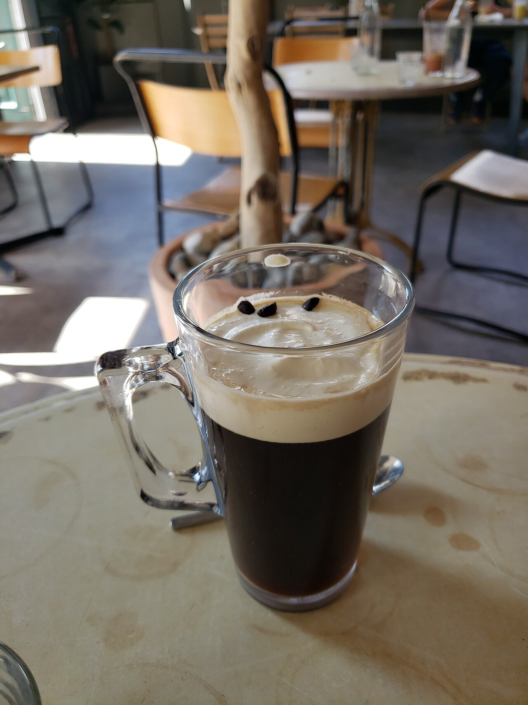

# 爱尔兰咖啡

爱尔兰咖啡是少数“热”的经典鸡尾酒：热咖啡、爱尔兰威士忌、红糖，最后浮上一层轻微打发的奶油。它既有咖啡的苦与香，也有威士忌的暖与辛辣，奶油则把两者包在一起，形成一杯像甜点又像药物的饮料。

它的技术难点不在配方，而在分层。奶油必须浮在咖啡表面，不能沉下去，也不能完全混进液体；喝的时候要穿过奶油，让咖啡与酒一起入口。温度、糖度与奶油的脂肪含量，都会影响这层“帽子”能否站住。

图：热咖啡、爱尔兰威士忌、红糖与轻微打发的奶油。图片：Andy Li，CC0，via Wikimedia Commons（[原图页面](https://commons.wikimedia.org/wiki/File:Irish_Coffee_-_T_@_Hove_2023-09-07.jpg)）。

## 一杯有温度的酒

爱尔兰咖啡适合寒冷天气、深夜与机场。它的酒精度不低，却被咖啡的苦与奶油的甜遮住，因此容易喝快；热饮又会让酒精更快吸收。它是一杯“慢慢喝”的酒，不是解渴的饮料。

与浓缩咖啡马天尼相比，爱尔兰咖啡不做摇和、不加冰，依靠温度与脂肪构建质地；与热托迪相比，它更甜、更厚，也更依赖咖啡。它站在鸡尾酒与咖啡饮品之间，两边都不完全属于。

## 配方：咖啡、威士忌与糖

IBA 的标准配方是爱尔兰威士忌 40 毫升、热咖啡 80 毫升、奶油 30 毫升、红糖 1 茶匙。糖必须先溶于热咖啡，再与威士忌混合；奶油单独轻微打发，最后浮在表面。

威士忌的选择以爱尔兰威士忌为传统。它的口感柔和、谷物与果香明显，不会像泥煤威士忌那样压过咖啡。用苏格兰威士忌也可以，但泥煤味会与咖啡的烘焙味冲突；用朗姆或白兰地则偏离了这杯酒的身份。

咖啡要热、浓、无糖。浅烘咖啡酸度高，与奶油结合后可能显得尖；深烘咖啡苦味重，能撑住威士忌与糖。速溶咖啡不是不能用，但香气与油脂不足，口感会薄。糖的作用不是单纯甜味，而是提高液体的密度与黏度，帮助奶油浮起。

## 做法：奶油如何浮在表面

先用热水预热杯子，倒掉水，避免杯壁带走咖啡的热量。把红糖放入杯中，倒入热咖啡搅拌至完全溶解，再加入威士忌，轻轻搅拌。液体装到杯子的七分满，留出奶油的空间。

奶油要冷藏，但不要冷冻。用打蛋器或奶泡器打到“浓稠但可流动”的状态，不能打成硬性发泡。沿杯壁或勺背缓慢倒入，让奶油铺在咖啡表面。倒得太快，奶油会沉；打发过度，奶油会成块。

喝的时候不要搅拌。嘴唇穿过奶油，让咖啡与酒从奶油下方进入口中；每一口都同时带有奶油、咖啡与威士忌。杯具用高脚杯或爱尔兰咖啡杯，杯壁厚、保温好，杯口收窄，便于香气聚集。

## 福因斯机场的传说

流传最广的起源是 1940 年代爱尔兰福因斯机场。调酒师 Joe Sheridan 为寒夜抵达的乘客准备热咖啡，加入威士忌与红糖，再用奶油封顶。传说一位乘客问这是什么咖啡，他回答“爱尔兰咖啡”。

另一种说法认为，类似做法在更早的维也纳或法国咖啡馆出现。无论起源如何，爱尔兰咖啡在 1950 年代通过旧金山的酒吧进入美国，随后成为全球机场与酒吧的常见项目。它的流行与航空旅行、寒冷气候和“用一杯酒暖身”的想象有关。

这杯酒的名字带有强烈的国家标签，却没有地理保护。任何酒吧都可以叫它 Irish Coffee，只要配方与做法大致相符。名字是文化符号，不是法律认证。

## 变体与常见错误

常见变体包括“Irish Coffee with Baileys”，用爱尔兰奶油利口酒替代部分奶油；“French Coffee”，用白兰地替代威士忌；“Mexican Coffee”，用龙舌兰与肉桂。还有“Cold Irish Coffee”，加冰与冷萃咖啡，适合夏季。

常见错误有四个。第一，杯子没预热，咖啡很快变凉。第二，糖没完全溶解，杯底留下颗粒。第三，奶油打发过度，变成一块固体，无法穿过。第四，倒入奶油太快，奶油沉入咖啡，分层失败。爱尔兰咖啡的成败，几乎都在“温度”与“倒入速度”上。

对家庭调酒者，最实用的建议是：先烧水预热杯子，咖啡要现煮，糖要搅拌到看不见，奶油只打到能流动。倒奶油时用勺背，慢一点。记住，这杯酒是“喝温度”，不是“喝配方”。

咖啡的选择同样关键。中深烘的阿拉比卡豆，手冲或法压，浓度中等，酸度低，能与威士忌的甜香衔接；意式浓缩太浓，会压过威士忌；速溶咖啡太薄，撑不住奶油。水温控制在 85 到 90 摄氏度，避免过苦；如果咖啡太酸，可以选深烘豆，如果太苦，可以减少浸泡时间。杯子越热，奶油分层越稳。

相关条目：[威士忌](ref:whisky)。

## 另见与参考资料

- 浓缩咖啡马天尼：参见 [浓缩咖啡马天尼](ref:espresso-martini)。
- 威士忌：参见 [威士忌](ref:whisky)。
- 高脚广口杯：参见 [高脚广口杯](ref:goblet)。
- 分层：参见 [分层](ref:layering)。
- 甜型：参见 [甜型](ref:sweet)。

对照阅读：[浓缩咖啡马天尼](ref:espresso-martini)、[高脚广口杯](ref:goblet)。

**关键事实。**

| 项目 | 内容 |
| --- | --- |
| 一句话定位 | 热咖啡、爱尔兰威士忌、红糖与轻微打发的奶油分层而成的热饮，1940 年代起源于爱尔兰福因斯机场；关键是温度、糖与奶油的浮层 |
| 类型 | IBA Contemporary Classics |
| 起源 | 爱尔兰福因斯 |

**来源与边界。** 本页关于「爱尔兰咖啡」的关键事实，主要由以下来源交叉核对：International Bartenders Association（IBA 配方分类、原料与比例）、Oxford University Press（鸡尾酒史与术语背景）、CocktailDB（交叉核对配方结构与常见变体）等 5 条来源。价格、批次与状态会变，涉及这些字段时以页面所列来源的最新版本为准。正文为项目自写，来源只作核验，不复制原文。

**并读。** 把「爱尔兰咖啡」与「浓缩咖啡马天尼」、「威士忌」、「高脚广口杯」放在一起读时，先确认它们是同一层级还是上下游关系：先确认基酒与比例，再比较酸甜平衡、杯型与出品差异。本页负责给出鸡尾酒的基本坐标，对照条目补上具体案例与差异；读完再回到本页，才能分清哪些差别属于鸡尾酒本身，哪些只是产地、批次或品牌选择。

**适用边界。** 对「爱尔兰咖啡」而言，配方比例、基酒品牌与杯型会变；IBA 版本是参照，不是唯一做法。

**更新提示。** 「爱尔兰咖啡」最近核对于 2026-11-20；配方比例、基酒品牌、杯型与出品标准会变，调酒前以 IBA 或酒吧现行配方为准。

**编者注。** 本页把「爱尔兰咖啡」作为鸡尾酒条目处理：定义、流程与关键数字以正文表格为准，与「浓缩咖啡马天尼」、「威士忌」的差异用对照阅读验证；遇到价格、批次或地址，回到页面所列来源核对。
