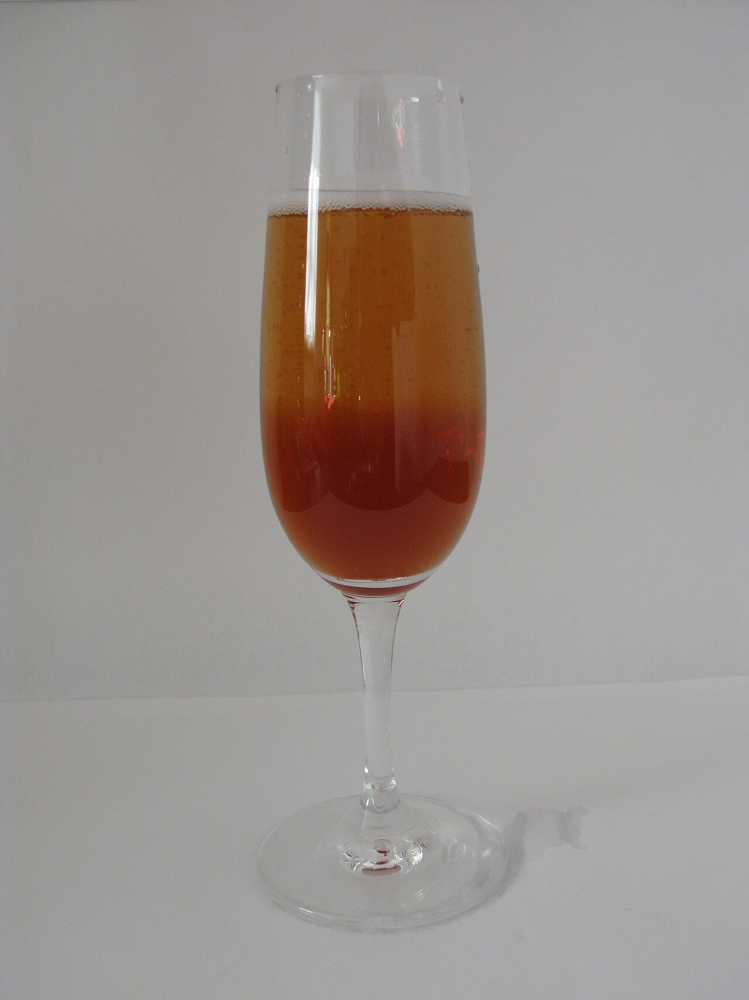

# 皇家基尔

皇家基尔是香槟鸡尾酒里最简单的一种：黑加仑利口酒，加香槟。没有摇和，没有糖浆，没有装饰，只有两种液体与气泡。它的颜色像深红的宝石，气泡从杯底升起，甜与酸在口中形成强烈对比。

这杯酒的名字来自第戎市长费利克斯·基尔（Félix Kir）。他推广的“基尔酒”是白葡萄酒加黑加仑，而“皇家”版本把白葡萄酒换成香槟。理解这杯酒，要理解“基尔”与“皇家”的关系，也要理解黑加仑与气泡的平衡。

图：黑加仑利口酒与香槟调成的皇家基尔，深红带气泡。图片：Martin Asche，CC BY-SA 3.0，via Wikimedia Commons（[原图页面](https://commons.wikimedia.org/wiki/File:Kir_Royal.jpg)）。

## 黑加仑与香槟

黑加仑利口酒（crème de cassis）是这杯酒的灵魂。它由黑加仑果实浸渍、加糖、降度制成，颜色深红近黑，味道酸甜、带浆果与叶子气息。它的糖分高、比重高，倒入香槟后会沉底，再慢慢向上扩散。

香槟提供气泡、酸度与骨架。香槟的酸度能切开拓口酒的甜，气泡能把黑加仑的香气托起；没有气泡，酒会显得沉闷；没有酸度，酒会变成甜浆。香槟不需要昂贵，但必须是干型，甜型香槟会让整杯酒过甜。

比例是关键。黑加仑利口酒太多，酒会变成“黑加仑汁”，香槟的酸与气泡被压住；太少，颜色浅、味道淡，像一杯带色的香槟。IBA 的比例是 1 厘升对 10 厘升，约一比十，颜色与味道都刚好。

杯子用香槟笛杯或碟形杯。笛杯能保留气泡、展示颜色；碟杯能展示香气，但气泡消失更快。两种杯子都可以，关键是杯子要干净、无油渍，否则气泡会消失。

## 配方：1 厘升与 10 厘升

IBA 的标准配方是黑加仑利口酒 1 厘升、香槟 10 厘升。1 厘升等于 10 毫升，10 厘升等于 100 毫升；这个比例让酒液呈深红色，但不至于变成糖浆。

如果杯子更大，可以按比例增加：2 厘升黑加仑配 20 厘升香槟。不要只增加香槟，否则颜色会变浅、甜度不足；也不要只增加黑加仑，否则酒会过甜、过重。

香槟要提前冷藏，温度约 6 到 8 摄氏度。温度太高，气泡会迅速逸出；温度太低，香气会被压住。黑加仑利口酒可以常温，也可以冷藏；冷藏后倒入，能让酒液更快融合。

不需要糖浆或柠檬汁。黑加仑利口酒已经提供甜度与酸度，香槟提供酸度与气泡；再加糖或柠檬，会破坏原本的平衡。这杯酒的美，来自“少”。

## 做法：先利口酒，后香槟

先在笛杯或碟杯中倒入黑加仑利口酒。然后沿杯壁缓慢注入香槟，让两层层叠，形成深红在下、金色在上的效果。不要搅拌，直接上桌；喝的时候，酒液会自然混合。

倒香槟时用吧匙导流，或把杯子倾斜，让酒液沿杯壁流下。倒得太快，酒液会剧烈混合，气泡也会损失；倒得太慢，黑加仑会挂在杯壁，颜色不匀。

如果想让颜色更均匀，可以在倒入香槟后轻轻搅拌一次，但会损失部分气泡。想要“分层”的视觉，就不要搅；想要“一致”的味道，可以轻微搅。两种做法都成立，取决于场合。

装饰可以省略，也可以加一颗黑加仑或一片柠檬。黑加仑能强化主题，柠檬能增加香气；但传统的皇家基尔通常不装饰，让颜色与气泡自己说话。

## 第戎市长的名字

“基尔”的名字来自费利克斯·基尔（Félix Kir，1876–1968），第戎市长、天主教神父、法国抵抗运动成员。他在二战后推广“基尔酒”：勃艮第白葡萄酒（通常是 Aligoté）加黑加仑利口酒，用来消耗当地过剩的黑加仑与白酒。

“皇家基尔”（Kir Royale）是基尔酒的变体：把白葡萄酒换成香槟。名字里的“Royale”指香槟，而不是“皇家”的头衔。这个变体在 20 世纪中后期流行，成为法国餐前酒的经典。

关于基尔酒的起源，还有“二战期间第戎酒吧为掩盖劣质白酒而加黑加仑”的说法。这类说法缺乏一手证据，更像地方传说。可以确认的是：基尔本人推广了这种喝法，名字也因他而来。

名称与配方没有商标保护，法国各地酒吧都可以做“Kir”与“Kir Royale”。但“Kir”作为地名与人名，使用时应注意尊重历史语境，不要把地方叙事简化成“某位市长发明了一种酒”。

## 变体与常见错误

常见变体包括“Kir”，用勃艮第白葡萄酒替代香槟；“Kir Pétillant”，用气泡白葡萄酒替代香槟；“Kir Imperial”，用覆盆子利口酒替代黑加仑；“Kir Normand”，用苹果酒替代白葡萄酒。

常见错误有四个。第一，香槟太甜，整杯酒过甜。第二，黑加仑倒太多，酒变成糖浆。第三，香槟温度太高，气泡迅速消失。第四，杯子有油渍，气泡无法附着。

对家庭调酒者，最实用的建议是：买干型香槟或干型气泡酒，黑加仑利口酒冷藏，杯子提前冰镇，先倒利口酒再沿壁倒香槟，不搅或只轻搅一次。记住，这杯酒的目标是“深红的清爽”，不是“甜酒”。

相关条目：[起泡酒](ref:sparkling)。

## 另见与参考资料

- 黑加仑利口酒：参见 [黑加仑利口酒](ref:cassis)。
- 起泡酒：参见 [起泡酒](ref:sparkling)。
- 贝里尼：参见 [贝里尼](ref:bellini)。
- 香槟笛杯：参见 [香槟笛杯](ref:flute)。
- 开香槟：参见 [开香槟](ref:opening)。

对照阅读：[黑加仑利口酒](ref:cassis)、[贝里尼](ref:bellini)。

**关键事实。**

| 项目 | 内容 |
| --- | --- |
| 一句话定位 | 黑加仑利口酒与香槟调制的法国经典，起源于第戎的基尔酒；颜色深红，气泡细密，甜酸对比强烈，是最简单的香槟鸡尾酒之一 |
| 类型 | IBA Contemporary Classics |
| 起源 | 法国第戎 |

**来源与边界。** 本页关于「皇家基尔」的关键事实，主要由以下来源交叉核对：International Bartenders Association（IBA 鸡尾酒列表与配方分类；该款无独立页面，参考 IBA 鸡尾酒总目录）、Oxford University Press（鸡尾酒史与术语背景）、CocktailDB（交叉核对配方结构与常见变体）等 5 条来源。价格、批次与状态会变，涉及这些字段时以页面所列来源的最新版本为准。正文为项目自写，来源只作核验，不复制原文。

**并读。** 把「皇家基尔」与「黑加仑利口酒」、「起泡酒」、「贝里尼」放在一起读时，先确认它们是同一层级还是上下游关系：先确认基酒与比例，再比较酸甜平衡、杯型与出品差异。本页负责给出鸡尾酒的基本坐标，对照条目补上具体案例与差异；读完再回到本页，才能分清哪些差别属于鸡尾酒本身，哪些只是产地、批次或品牌选择。

**适用边界。** 对「皇家基尔」而言，配方比例、基酒品牌与杯型会变；IBA 版本是参照，不是唯一做法。

**更新提示。** 「皇家基尔」最近核对于 2026-11-20；配方比例、基酒品牌、杯型与出品标准会变，调酒前以 IBA 或酒吧现行配方为准。
