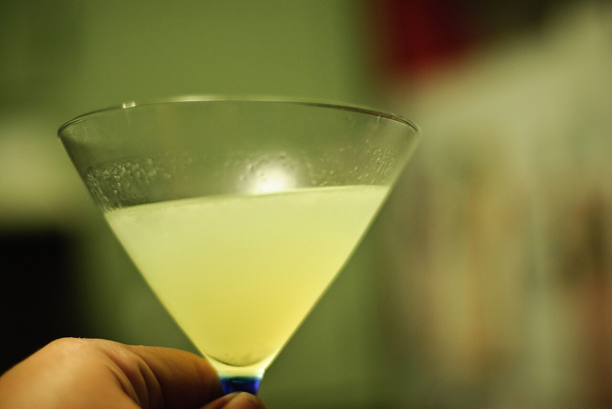

# 最后一语

最后一语（Last Word）是一款以金酒、绿查特、黑樱桃利口酒与新鲜青柠汁等份摇制的短饮。它通常滤入预冷的碟形杯，不加冰，颜色是清亮的黄绿色，装饰可以省略，也可以放一小片青柠皮或一颗马拉斯奇诺樱桃。入口先是青柠的酸，随后是绿查特的草本强度与黑樱桃利口酒的甜香，尾段回到金酒的杜松与草本的轻微苦味。四味等份看起来简单，实际每一种都在争夺同一块味觉空间。

图：最后一语。摄影：The Last Word cocktail raised。署名：Don LaVange，CC BY-SA 2.0，来自 Wikimedia Commons（[来源](https://commons.wikimedia.org/w/index.php?curid=18593444)）。

> **先给结论**
> **一句话：** 这页判断最后一语该不该点、比例和冰水怎么处理。
>
> - **适合谁：** 想弄懂最后一语的配方逻辑、点单方式和常见误区的人。
> - **不适合谁：** 只想要“一杯就醉”的配方、不关心比例和冰水的人。
> - **先看这两点：**
>   - 最著名的变体之一是 Final Ward，以黑麦威士忌替代金酒、以柠檬汁替代青柠汁，保留绿查特与黑樱桃利口酒。
>   - 这款酒的起源常被追溯到 1915 至 1916 年的底特律运动俱乐部（Detroit Athletic Club），时间在禁酒令生效之前。

## 名字与底特律运动俱乐部

这款酒的起源常被追溯到 1915 至 1916 年的底特律运动俱乐部（Detroit Athletic Club），时间在禁酒令生效之前。与它联系最多的人物是杂耍艺人 Frank Fogarty，他以“都柏林吟游诗人”的称号在舞台上表演。常见的说法是 Fogarty 常点这款酒，并把它带出了俱乐部；至于他是否就是创作者，资料之间并不一致，因此更稳妥的写法是“与 Fogarty 相关”，而不是把某个名字写成唯一作者。

“最后一语”这个名字的确切来历也没有档案定论。一种常见的解释是它借用了杂耍舞台上的“最后一句话”，暗示这是一杯收尾用的酒；这属于命名趣闻，不能当作可核实的配方档案。可以确认的是，这款酒在 1951 年 Ted Saucier 的《Bottoms Up!》里有印刷记录，这说明它在禁酒令前后已经存在，而不是 2000 年代的新发明。

禁酒令在 1920 年生效后，俱乐部酒吧的体系被打断，这款酒逐渐从主流酒单上消失。到 1950 年代末，它已经很少被提起，只在旧配方书里留下一个名字。它的第一次“复活”不是靠广告，而是靠调酒师在旧书里重新发现它，这一点与很多现代经典的身世相似。

## 等份比例为什么成立

国际调酒师协会（IBA）的版本是[金酒](ref:gin)、绿查特、黑樱桃利口酒与青柠汁各 22.5 毫升，摇和后滤入鸡尾酒杯。四等份的好处是容易记忆、容易按比例放大，但它并不意味着四种材料的强度相同。绿查特酒精度 55%，黑樱桃利口酒约 32%，金酒通常在 40% 至 47% 之间，青柠汁则几乎不含酒精；等份是体积上的平等，不是味觉上的平等。

这个结构能成立，靠的是糖与酸的互相抵消，逻辑与[代基里](ref:daiquiri)这类三件式酸酒相通。绿查特和黑樱桃利口酒都含糖，青柠汁提供酸，金酒提供骨架和杜松香气。[摇和](ref:shaking)带来的稀释大约占成品体积的 20% 至 25%，水把 55% 的草本利口酒拉到可以连续饮用的强度，也让酸度变得圆润。如果跳过稀释，四等份会显得又甜又烈，草本味像药酒一样压住青柠。

等份还带来一个实际好处：配方可以按 20 毫升、30 毫升或 45 毫升统一放大，不需要记三套数字。但放大时要考虑杯型与冰量。同样比例倒进更大的杯子，表面积增加，温度上升更快，香气散失也更快；如果一次做三五杯，最好分批摇和，而不是把所有材料倒进一个大摇壶，因为冰与液体的比例会改变稀释速度。

## 绿查特：草本强度从哪里来

绿查特由加尔都西会修士的配方演变而来，官方资料给出的酒精度是 55%，以约 130 种植物浸提。它的香气层次很密，常见描述包括薄荷、桉树、茴香、甘草、松针和香料；入口先甜，随后是明显的苦与热。它不是一款可以大口喝的利口酒，但在最后一语里，22.5 毫升已经足够撑起整杯的草本骨架。

高酒精度在这里有两个作用。第一，它把植物香气带得更远，让酒在杯口就有明显的草本气息；第二，它提高了整体的酒精强度，使这款酒喝起来比颜色看起来更硬。绿查特的甜度也不低，只是被苦味和酒精压住，所以配方不需要额外加糖浆。若把绿查特减量、再加糖浆，得到的会是另一种更柔和的饮品，而不是同一杯酒。

绿查特开瓶后香气会缓慢变化，但它的高酒精度让它比很多低度利口酒耐放。保存时应避光、避热，瓶口密封；如果放在吧台被阳光直射，草本香会变得沉闷。用量很小的鸡尾酒尤其依赖利口酒的新鲜度，因为它的风味没有被其他材料掩盖。

## 绿查特与黄查特的分岔

绿查特和黄查特是同一体系下的两种酒，但方向不同。绿查特酒精度 55%，甜度较低，草本与苦味更尖锐；黄查特酒精度 43%，糖分更高，常被描述为更柔和、更偏藏红花与蜂蜜。把黄查特直接替换进最后一语，成品会更甜、更圆，绿色也会变浅，原本的“草本冲击”被削掉一半。

如果手边只有黄查特，可以把它当作一个有意的变体，而不是原配方的等价替代。调整方向通常是减少黑樱桃利口酒、略微增加青柠汁，让酸度重新把甜味拉回来；但即使这样，草本的方向仍然不同。更诚实的做法是在酒单上写“黄查特版”，让饮用者知道自己喝到的是另一种平衡。

其他草本利口酒也不能随意顶替。热内皮（Génépy）一类的高山草本酒更偏松针与花香，苦味较弱；斯特雷加（Strega）更甜、更香草；某些苦味利口酒的苦度又太高。最后一语的结构依赖绿查特那种“高酒精度加高草本密度”的组合，换掉它，四等份的比例就要重新设计。

## 黑樱桃利口酒不是樱桃糖浆

[黑樱桃利口酒](ref:liqueur)（maraschino liqueur）常被误解为糖渍樱桃的汁。它其实是用马拉斯卡樱桃连核浸提、蒸馏后加糖制成的透明利口酒，常见酒精度约 32%。它的香气不是新鲜樱桃的果味，而是樱桃、杏仁核、玫瑰和轻微发酵感的混合；甜度明显，但收尾偏干。最后一语里的“樱桃”来自这里，不是杯底那颗红色樱桃。

它的作用有三层。第一是甜味，抵消青柠的酸；第二是香气，把绿查特的草本从“药感”拉向花香与核果；第三是酒体，让四等份不至于显得水薄。用量过多时，杏仁核的香气会变得像肥皂或止咳糖浆，压住杜松；用量过少时，青柠会显得尖，绿查特的苦味也会更裸露。

装饰用的樱桃又是另一件事。真正用马拉斯卡樱桃做的酒渍樱桃，风味和罐装鸡尾酒樱桃差别很大；后者更多是糖、色素和香精。若用后者装饰，视觉上成立，香气上却补不了多少。最后一语本来可以不装饰，所以宁可省略，也不要用一颗与酒体无关的糖樱桃。

## 摇和、稀释与杯型

这款酒用摇和而不是搅拌，原因在于青柠汁与两种甜利口酒需要充分乳化与融合。把材料与冰块放进摇壶，用力摇 10 到 12 秒，直到壶壁起霜；然后双重过滤，拦住碎冰与果肉，滤入预冷的[碟形杯](ref:coupe)。摇和时间太短，酸与甜没有合并，入口会先酸后甜；摇得过久，冰融太多，酒体变薄，草本也会散掉。这也是[鸡尾酒基础](ref:basics)里反复强调的判断：冷却与稀释要同时到位。

碟形杯的宽杯腹有助于香气释放，但杯口太宽也会让温度上升得快。合适的容量大约在 120 至 150 毫升，倒到杯身的三分之二左右，留出闻香的空间。杯子必须预冷；如果直接倒进室温杯子，酒液会在几十秒内升温，55% 的绿查特会显得刺鼻，青柠也会更尖。

是否需要装饰取决于配方与场合。传统做法常常不加装饰，让黄绿色本身成为识别点；也可以挤一小片青柠皮油，增加柑橘的明亮感。不要在杯口做糖边，这款酒已经有足够的糖；糖边会让第一口过甜，也会把草本的苦味推到最后。

## 风味结构与常见失衡

刚入口时，青柠的酸是最先被注意到的，接着绿查特的薄荷、茴香与松针气息展开，黑樱桃利口酒在中段补上甜与核果香，金酒的杜松与酒精热度在尾段出现。四者等份的理想状态是没有任何一方独占，但每一方都能被辨认出来。它不属于“酸甜易饮”的类型，草本与苦味始终在场。

常见的失衡有几种。青柠过多，酸会压住樱桃的甜，绿查特显得像药；黑樱桃利口酒过多，杏仁香过重，尾段发黏；绿查特过多，苦味与酒精一起上来，金酒被完全遮住；金酒选择过于花香或过于低度，骨架会撑不住。调整时一次只改一个变量，先判断问题在酸、甜、苦还是酒精度。

温度对这款酒的影响很大。理想饮用温度大约在 4 至 6 摄氏度，太冷会压住香气，太暖则让酒精与苦味变得突出。它适合慢慢喝，但不适合放到冰块融化，因为杯中通常没有冰，温度上升后结构会逐渐松散。若在户外或炎热环境饮用，最好用小杯、快喝，或者把杯子提前冰透。

## 从西雅图到“现代经典”

这款酒的现代复兴常被归功于西雅图 Zig Zag Café 的调酒师 Murray Stenson。常见的说法是他在 2000 年代初（有资料写作 2003 年，也有写作 2004 年）从 Ted Saucier 的旧书中重新发现配方，把它放上酒单，随后成为酒吧的畅销酒。具体年份在不同叙述中有出入，但“Stenson 让这款酒重新被广泛看见”这一点，在鸡尾酒复兴的叙述里相对一致。

它之所以成为“现代经典复兴”的典型，有几个原因。等份结构容易传播，酒液颜色有辨识度，故事里有禁酒令前的俱乐部和杂耍艺人，喝起来又有足够的复杂度让调酒师愿意讨论。2000 年代以后，调酒师网络、鸡尾酒比赛与社交媒体把这些要素放大，一款旧配方可以在几年内进入全球酒吧的酒单。

“复兴”不等于“发明”。把最后一语说成 2000 年代的新作品，会抹掉它在禁酒令前的身世；反过来，把它说成从未中断的经典，也不准确。它经历过消失、被旧书保存、再被调酒师带回吧台的过程，这个曲折本身就是现代经典文化的一部分。

## 变体与点单

最著名的变体之一是 Final Ward，以黑麦威士忌替代金酒、以柠檬汁替代青柠汁，保留绿查特与黑樱桃利口酒。黑麦的辛香与柠檬的明亮让成品更干、更偏威士忌骨架；它通常被归功于纽约调酒师 Phil Ward，属于“有说法认为”的创作归属。另一个方向是黄查特版，口感更柔、更甜，但草本冲击较弱。

点单时可以直接说“最后一语”，并确认使用的是绿查特而不是黄查特。如果觉得太甜，可以要求减少黑樱桃利口酒；如果觉得草本太重，可以询问是否能用更轻的绿查特用量，但那已经偏离等份结构。若不喜欢樱桃核的杏仁香，这款酒可能不适合；不要指望用樱桃糖浆替代，味道会完全不同。

它适合作为餐前或餐后短饮，搭配硬质奶酪、熏鸭、烤坚果和黑巧克力。草本与苦味能切开油脂，樱桃香与巧克力也能呼应。最后一语容易被果汁、气泡或甜味掩盖酒精度，喝的时候要放慢速度，避免空腹快速饮用；驾车、服药或孕期不应饮酒。它的酒精度不低，第二杯应考虑是否还需要。

## 常见误区

第一，把“等份”理解成“味道相同”。四种材料的酒精度、糖分与香气强度完全不同，等份只是体积比例。第二，用黄查特替代绿查特却仍称原版。黄查特更甜、更低度，成品方向会变。第三，用樱桃糖浆或鸡尾酒樱桃汁代替黑樱桃利口酒。前者是糖水，后者才是利口酒。第四，认为颜色越绿越正宗。颜色会受批次、光线与杯型影响，香气和平衡才是判断标准。第五，把这款酒当成“烈性甜酒”一口喝完。它是短饮，但 55% 的绿查特让它的实际强度不低。

## 另见

- [金酒](ref:gin)：杜松骨架与草本之间的张力。
- [利口酒](ref:liqueur)：绿查特与黑樱桃利口酒的角色。
- [摇和](ref:shaking)：酸、糖与高酒精度利口酒的融合。
- [碟形杯](ref:coupe)：短饮的香气释放与温度控制。
- [代基里](ref:daiquiri)：同样以酸、甜与烈酒构成的三件式结构。
