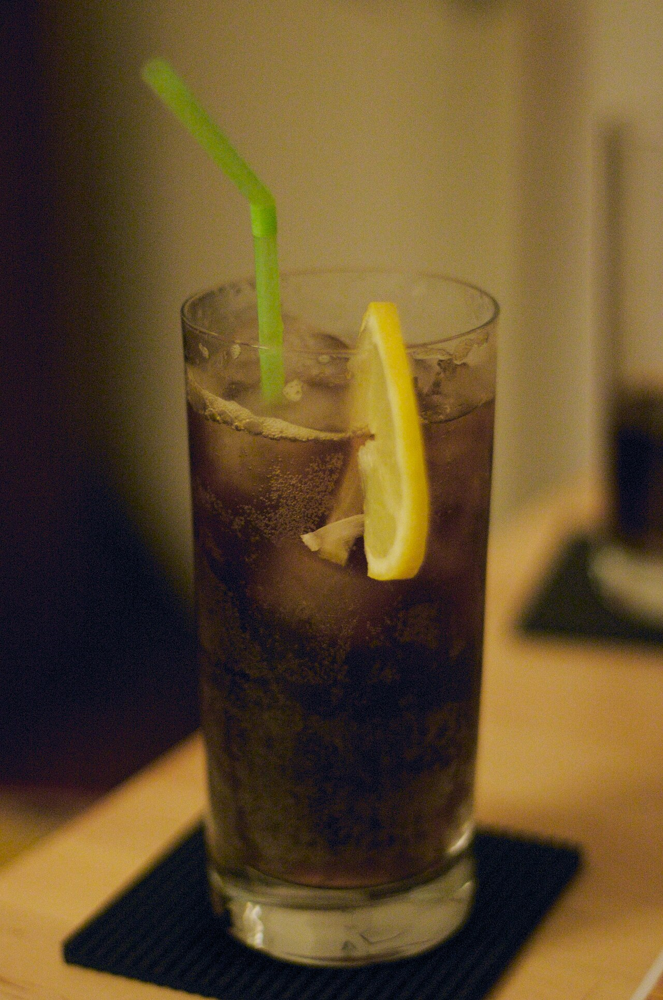

# 长岛冰茶

长岛冰茶是鸡尾酒里最著名的“伪装”。它看起来像一杯加冰的红茶，颜色来自可乐与柠檬，喝起来有柑橘与焦糖的甜，实际酒精度却接近纯饮。五种基酒各 15 毫升，加上利口酒与可乐，一杯下去，强度远超外观。

这杯酒在 1970 年代的长岛酒吧出现，后来成为派对文化的符号。它的配方有多个版本，起源说法也有争议；可以确认的是，它的结构是“多种基酒 + 柑橘 + 糖 + 可乐”。

图：五种基酒与可乐调成的长岛冰茶，外观酷似冰红茶。图片：Alisdair McDiarmid，CC BY 2.0，via Wikimedia Commons（[原图页面](https://commons.wikimedia.org/wiki/File:Long_Island_Iced_Tea_with_Lemon_and_Straw.jpg)）。

## 五种基酒的平衡

伏特加、金酒、白朗姆、龙舌兰、橙皮利口酒，五种酒各有性格。伏特加中性，负责“酒精度”；金酒带杜松子与草本，负责香气；白朗姆带甘蔗的甜，负责圆润；龙舌兰带植物与胡椒，负责骨架；橙皮利口酒带柑橘与甜，负责连接。

五种酒等量混合，单喝会显得杂乱；但加上柠檬汁、糖浆与可乐，它们会被“稀释”成一个统一的酒体。可乐的焦糖与磷酸，柠檬的酸，糖浆的甜，把五种酒的棱角磨平，留下一个“像冰茶”的错觉。

比例的关键是“等量”。任何一种酒放多，都会破坏平衡：金酒多，酒会太草本；龙舌兰多，酒会太冲；橙皮利口酒多，酒会太甜。等量是这杯酒的“民主”，也是它危险的地方。

## 配方：每种 15 毫升

IBA 的标准配方是伏特加、金酒、白朗姆、龙舌兰、橙皮利口酒各 15 毫升，柠檬汁 30 毫升，糖浆 15 毫升，可乐适量。总酒精度约 40 度，加上可乐与冰，入口仍然很烈。

柠檬汁要新鲜。瓶装柠檬汁的酸度太尖，和可乐的焦糖不协调；现榨柠檬汁的酸更圆，香气更足。糖浆可以用自制简单糖浆，也可以用市售；糖浆的作用是平衡柠檬的酸，不是增加甜味。

可乐要冰镇，且不要提前倒入。可乐的气泡与颜色是这杯酒的“伪装”，提前倒入会跑气，颜色也会变深。上桌前再沿杯壁注入，保留气泡与层次。

杯子用高球杯，容量 300 毫升以上。五种酒加果汁已经接近 150 毫升，再加冰与可乐，杯子太小会溢出，太大则显得空。透明杯子能让“冰茶”的颜色被看见。

## 做法：摇和后加可乐

把五种基酒、柠檬汁、糖浆倒入摇壶，加冰，摇和 10 到 12 秒，让酒液冷却、混合。然后滤入装满冰块的高球杯，沿杯壁注入可乐，轻轻搅拌一次。不要摇可乐，否则气泡会消失。

摇和的目的是冷却与融合，不是稀释。摇壶里的冰要足够，摇完立刻滤出，避免酒液继续稀释。滤入杯中时用细网滤冰器，挡住碎冰，让酒体清澈。

可乐的用量决定了颜色与强度。一般 30 到 50 毫升，颜色像浓红茶；太少，颜色浅、酒太烈；太多，颜色深、酒变淡。可以先倒 30 毫升，尝一下，再决定是否加。

装饰用柠檬角或柠檬片。柠檬角可以挤汁，增加酸度；柠檬片更适合视觉。不要加樱桃，那会破坏“冰茶”的伪装。吸管可加可不加，加了会让人喝得更快，也更危险。

## 长岛与禁酒令传说

长岛冰茶的起源有多个版本。最常见的说法是 1972 年，Robert “Rosebud” Butt 在长岛 Oak Beach Inn 工作，为了参加一场鸡尾酒比赛，把几种基酒混在一起，加上可乐与柠檬，做出“像冰茶”的酒。

另一个版本把起源追溯到禁酒令时期：调酒师用多种酒与可乐掩盖酒精，逃避检查。这个说法缺乏一手证据，更像后来的叙事包装。禁酒令时期的“茶”确实存在，但与这杯酒的直接关系无法确认。

还有说法认为，这杯酒在 1970 年代之前就以其他名字出现，长岛的版本只是让它流行。无论起源如何，这杯酒的结构——多种基酒、柑橘、糖、可乐——是 1970 年代美国酒吧文化的产物。

名字里的“长岛”指纽约长岛，不是地理上的“长岛冰茶产地”。这杯酒与长岛的酒吧文化绑定，而不是与茶园或茶产区绑定。

## 变体与常见错误

常见变体包括“Long Beach Iced Tea”，用蔓越莓汁替代可乐，颜色偏红；“Texas Tea”，加威士忌，酒精度更高；“Tokyo Tea”，用蜜瓜利口酒，颜色偏绿；“Adios Motherfucker”，颜色偏蓝，名字更烈。

常见错误有四个。第一，可乐提前倒入，气泡消失，颜色变深。第二，摇和过久，冰化太多，酒变稀。第三，柠檬汁不足，酒太甜、太烈。第四，杯子太小，冰与可乐放不下，比例失衡。

对家庭调酒者，最实用的建议是：先把五种基酒与柠檬、糖浆摇匀，尝一下强度；可乐最后加，边加边尝；杯子与冰块提前冷藏；喝慢一点，这杯酒的“冰茶”外观会骗人。不要用无糖可乐，甜味剂的苦味会破坏“冰茶”的错觉。

相关条目：[金酒](ref:gin)。

## 另见与参考资料

- 伏特加：参见 [伏特加](ref:vodka)。
- 金酒：参见 [金酒](ref:gin)。
- 朗姆酒：参见 [朗姆酒](ref:rum)。
- 龙舌兰：参见 [龙舌兰](ref:tequila)。
- 高球杯：参见 [高球杯](ref:highball)。

对照阅读：[伏特加](ref:vodka)、[朗姆酒](ref:rum)。

**关键事实。**

| 项目 | 内容 |
| --- | --- |
| 一句话定位 | 五种基酒、柠檬汁、糖浆与可乐组成的高球鸡尾酒，看起来像冰茶，实际酒精度很高；1970 年代长岛酒吧的起源说法存在争议 |
| 类型 | IBA Contemporary Classics |
| 起源 | 美国长岛 |

**来源与边界。** 本页关于「长岛冰茶」的关键事实，主要由以下来源交叉核对：International Bartenders Association（IBA 配方分类、原料与比例）、Oxford University Press（鸡尾酒史与术语背景）、CocktailDB（交叉核对配方结构与常见变体）等 5 条来源。价格、批次与状态会变，涉及这些字段时以页面所列来源的最新版本为准。正文为项目自写，来源只作核验，不复制原文。

**并读。** 把「长岛冰茶」与「伏特加」、「金酒」、「朗姆酒」放在一起读时，先确认它们是同一层级还是上下游关系：先确认基酒与比例，再比较酸甜平衡、杯型与出品差异。本页负责给出鸡尾酒的基本坐标，对照条目补上具体案例与差异；读完再回到本页，才能分清哪些差别属于鸡尾酒本身，哪些只是产地、批次或品牌选择。

**适用边界。** 对「长岛冰茶」而言，配方比例、基酒品牌与杯型会变；IBA 版本是参照，不是唯一做法。

**更新提示。** 「长岛冰茶」最近核对于 2026-11-20；配方比例、基酒品牌、杯型与出品标准会变，调酒前以 IBA 或酒吧现行配方为准。

**编者注。** 本页把「长岛冰茶」作为鸡尾酒条目处理：定义、流程与关键数字以正文表格为准，与「伏特加」、「金酒」的差异用对照阅读验证；遇到价格、批次或地址，回到页面所列来源核对。
