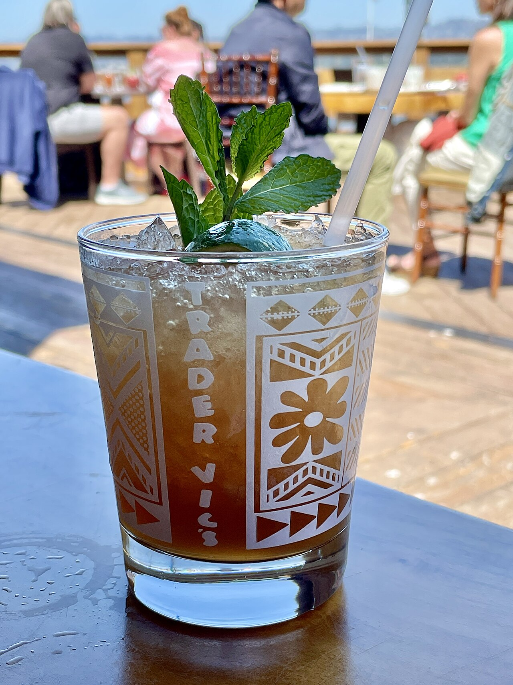

# 迈泰

迈泰（Mai Tai）是朗姆酒、橙皮利口酒、杏仁糖浆与青柠汁的组合，1944 年由奥克兰的 Trader Vic（Victor Bergeron）做出。原始版本用 17 年的 J. Wray Nephew 牙买加朗姆，加青柠、荷兰橙皮利口酒、冰糖浆与法国杏仁糖浆，手摇后倒入碎冰，以薄荷与榨空的青柠壳收尾。它只有四五种材料，却是提基鸡尾酒里最容易被做坏的一杯。

图：迈泰。图片：Kevdo，CC BY-SA 4.0，via Wikimedia Commons（[原图页面](https://commons.wikimedia.org/wiki/File:Mai_Tai_at_Trader_Vic%27s_Emeryville.jpg)）。

## 定义与身份

迈泰不是果汁潘趣。它的骨架是“朗姆 + 青柠 + 杏仁 + 橙”，甜味来自糖浆与利口酒，不来自菠萝汁。IBA 把它列在“当代经典”里，说明它已经不是某一家酒吧的私房酒，而是有公共标准的作品。与[得其利](ref:daiquiri)相比，迈泰在朗姆、青柠、糖的三角上又加了橙皮利口酒与杏仁糖浆，并把碎冰带进杯中。

## 结构化配方：IBA 版与 Trader Vic's 版

IBA 公开配方：

- 琥珀色牙买加朗姆 30 ml
- 马提尼克糖蜜朗姆 30 ml
- 橙皮利口酒 15 ml
- 杏仁糖浆 15 ml
- 新鲜青柠汁 30 ml
- 糖浆 7.5 ml
- 杯型：双份古典杯或高球杯
- 冰：与冰摇和后连冰倒入，杯中可再加碎冰
- 技法：全部材料加冰摇和，不过滤
- 装饰：菠萝角、薄荷叶、青柠皮

Trader Vic's 今天公布的版本是：银朗姆 30 ml、深色朗姆 30 ml、杏仁糖浆 15 ml、橙皮利口酒 22.5 ml、冰糖浆 7.5 ml、青柠汁 30 ml，加碎冰摇和后倒入迈泰杯，装饰半个青柠壳与薄荷。两版的差别主要在橙皮利口酒的量和朗姆组合，结构完全一致。若想理解摇和与稀释的基本逻辑，见[调酒基础](ref:cocktails-guide)。

## 17 年朗姆与 1944 年的奥克兰

按 Trader Vic 本人在 1970 年接受采访时的说法：1944 年，他在奥克兰餐厅的服务吧台取下了一瓶 17 年的 J. Wray Nephew 牙买加朗姆。那酒中等酒体，却有加勒比朗姆的浓郁香气，“不该被别的味道盖住”。他只加了青柠、荷兰橙皮利口酒、一点冰糖浆与一勺法国杏仁糖浆，加碎冰手摇，最后插一枝薄荷，端给来自大溪地的朋友 Ham 与 Carrie Guild。Carrie 喝了一口说：“Mai Tai—Roe Ae”，意思是“好到天上去了”。这句话成了酒名。Trader Vic 的餐厅 1934 年以 Hinky Dinks 开业，1938 年改名 Trader Vic's；1944 年，迈泰在这家店里诞生。

## “Maita'i”：一句大溪地语的命名

“Maita'i”在大溪地语里是“好”“最好”的意思。Trader Vic 的版本把它译成“out of this world—the best”。调酒史作者 Jeff “Beachbum” Berry 在访谈中也提醒，常见的读法并不准确；在大溪地语里，这个词就是“最好”的意思。命名的故事来自 Trader Vic 自己的回忆，Carrie Guild 那句话没有独立录音可查；把它当作“有来源的创始叙事”，而不是法庭证词，是更稳妥的读法。

## 争议版本：Don the Beachcomber 与 QB Cooler

另一套说法来自 Don the Beachcomber（Donn Beach）。他的遗孀 Phoebe Beach 在 2001 年出版的书中称，迈泰是 Donn 在 1933 年禁酒令结束、酒吧开业时发明的，Trader Vic 把它拿走了。调酒史作者 Jeff “Beachbum” Berry 查过 Don the Beachcomber 的菜单：1937 年的菜单上没有迈泰，Donn 的菜单要到 1960 年代才出现这个名字。Donn 本人对身边人讲的则是另一个版本：Vic 在 1937 年喝过一杯“QB Cooler”，很喜欢，后来做出了迈泰。Berry 的结论是：两杯酒只共享朗姆与青柠，其他材料完全不同；Vic 做出的那杯，才是后来成为“迈泰”的酒。争议没有书面定论，但“1944 年、奥克兰、Trader Vic”仍是目前证据最完整的一条线。

## 从碎冰到迈泰杯：杯型与装饰

Trader Vic's 用专门的迈泰杯，杯身矮、杯口略收，装碎冰与半个青柠壳；IBA 允许双份古典杯或高球杯。碎冰的作用不只是冷：它让酒在入口前继续稀释，口感一层层变淡，适合慢慢喝。装饰的核心是“半个榨空的青柠壳 + 一枝薄荷”：青柠壳倒扣在冰上，像一座小岛；薄荷拍一下再插，香气才出得来。IBA 另加菠萝角与青柠皮，视觉更热闹，但不影响配方。关于冰型与温度，见[加冰与温度](ref:ice)。

## 1950 年代之后：加果汁的“改良版”

1953 年，Trader Vic's 与 Matson 航运合作，把迈泰带到夏威夷的 Royal Hawaiian、Moana 与 Surfrider 酒店；1959 年夏威夷成为美国第 50 个州，迈泰也跟着从提基酒吧走进主流餐厅。为了迎合更广的口味、降低成本与酒精度，1950 年代以后的餐厅版本常加入橙汁、菠萝汁，做成颜色更浅、容量更大的“夏威夷迈泰”。这类版本与 1944 年配方只共享朗姆、青柠与杏仁的骨架，甜度和体积都翻了一倍。它们不是“错”，但应该叫“加果汁版”，而不是“原始配方”。

## 杏仁糖浆与橙皮利口酒的平衡

杏仁糖浆（orgeat）提供坚果香与圆润感，本身很甜；橙皮利口酒提供柑橘香与另一层甜。两者相加，必须有足够的青柠汁来托住。IBA 用 15 ml 杏仁 + 15 ml 橙皮 + 30 ml 青柠；Trader Vic's 用 15 ml 杏仁 + 22.5 ml 橙皮 + 30 ml 青柠 + 7.5 ml 冰糖浆。如果手里只有 amaretto，不能用等量替代：amaretto 酒精度更低、甜度更高，常见做法是减量并补一点青柠。橙皮利口酒从君度到干橙利口酒，甜度差异很大，第一次做建议按 15 ml 起。

## 摇和、碎冰与稀释

迈泰要摇，不要搅。加冰摇 8–10 秒，听到冰声变闷、壶壁起霜即可；摇太久，碎冰化水，酒体就薄了。IBA 的做法是连冰倒入，不再过滤；如果用的是大冰块摇和，则需要滤入装有碎冰的杯子。杯子提前冰镇，薄荷最后放，喝之前轻嗅杯口。

## 常见失败点：甜度、青柠与碎冰

第一，杏仁糖浆过量。15 ml 是上限，多了会像杏仁糖水。

第二，用瓶装青柠汁。香气不足，酸度死板。

第三，全部用深色朗姆。颜色深不等于层次多，反而压住青柠。

第四，摇太久或碎冰太多。五分钟后就只剩水味。

第五，省略青柠壳与薄荷。它们不是装饰，是香气的一部分。

第六，把“加果汁版”当成原始配方。那是另一种酒。

## 变体与无酒精版本

换朗姆组合是最常见的变体：全牙买加、全马提尼克，或加入一小部分高酯朗姆。减少杏仁糖浆会得到更干的版本；用葡萄柚汁与法勒南，则靠近 Donn 系的提基风格。无酒精版本可以用 0% 朗姆替代，保留 30 ml 青柠、15 ml 杏仁糖浆、15 ml 无酒精橙皮利口酒与 7.5 ml 糖浆，摇和后倒碎冰，装饰不变。

## 饮用与边界

迈泰酒精度不低，容量也不小，适合餐前或夏夜，配烤肉、坚果、咸味小食。碎冰会持续稀释，最好在 20 分钟内喝完；慢饮、配水，不要空腹。驾车、服药或孕期不应饮酒。成品的强度取决于朗姆的[酒精度](ref:abv)、利口酒的甜度与碎冰稀释，不能只看配方数字。

本页的年份、人物与配方分别来自 Trader Vic's 官方叙述、IBA 配方与 Imbibe 杂志的访谈；争议部分保留双方说法。

## 延伸阅读

- [朗姆酒](ref:rum)：迈泰的基酒与风格。
- [利口酒](ref:liqueur)：橙皮利口酒的甜度与香气。
- [得其利](ref:daiquiri)：同为朗姆、青柠与糖的骨架。
- [调酒基础](ref:cocktails-guide)：摇和、稀释与结构。
- [加冰与温度](ref:ice)：碎冰与冷却对成品的影响。
- [酒精度](ref:abv)：理解强度与碎冰稀释。
