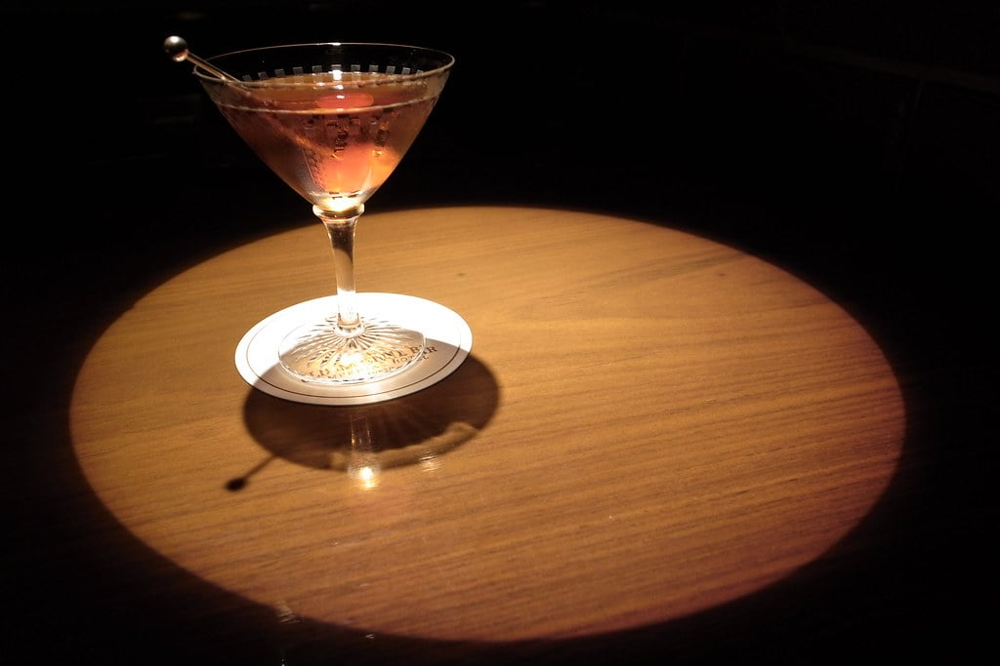

# 曼哈顿

曼哈顿（Manhattan）是一款以[黑麦威士忌](ref:whisky)、甜味[美思](ref:vermouth)与苦精调制的经典鸡尾酒。它在搅拌后滤入杯中，以樱桃装饰，结构简洁：威士忌提供骨架，美思补充甜味与香料，苦精拉出层次。

图：一杯曼哈顿，深琥珀色酒液盛于碟形杯，杯口横放酒签与一颗酒渍樱桃。图片：naotakem，CC BY 2.0，via [原图页面](https://www.flickr.com/photo.gne?id=6992048786)。

## 定义与身份

“曼哈顿”这个名字的来历有多种叙述，常见说法与纽约曼哈顿区或某家酒吧有关，但缺乏统一结论。本页只把它写成历史背景，不把某一种说法当成定论。

曼哈顿属于“烈酒 + 甜味美思 + 苦精”的搅拌型鸡尾酒，与马丁内斯、布鲁克林等构成家族。黑麦威士忌的辛香、甜味美思的草本甜感与苦精的香料味，是三层结构；樱桃是常见装饰，但不是定义的一部分。

## 配方（IBA 版本）

IBA 公开配方使用黑麦威士忌、甜味美思与少量苦精，比例大致为威士忌多于美思。做法是：将材料与冰块放入搅拌杯，搅拌至充分冷却与稀释，滤入预冷的杯中，以樱桃装饰。

用量是起点，不是法律。威士忌与美思的比例会明显改变风格：威士忌多则更干、更烈，美思多则更甜、更柔。苦精几滴即可，过多会压住威士忌与美思的香气。

## 威士忌的选择

[威士忌](ref:whisky)是这款酒的主体。黑麦威士忌带来辛辣、干燥与香料感，波本则更甜、更圆润；苏格兰威士忌可能带来泥煤或麦芽味。经典配方偏向黑麦，但选择取决于你想要的方向。

高酒精度的威士忌需要更多搅拌稀释，低酒精度的威士忌则要少搅拌。若换成风味强烈的威士忌，糖分与美思的比例也要相应调整，否则成品会失衡。

## 美思的作用

[美思](ref:vermouth)是加香加强葡萄酒，甜味美思提供糖分、草本与香料气息，是曼哈顿甜味的主要来源。它与威士忌的组合形成了这款酒的骨架：烈酒的强度被甜味包裹，香气则向草本与香料方向展开。

不同品牌的美思在甜度、苦味与香气上差异明显。甜味美思偏甜、草本气息浓，干味美思则更干、更苦。经典曼哈顿使用甜味美思，替换为干味美思会得到更干的变体，应记录清楚。

## 搅拌与稀释

曼哈顿通常在搅拌杯中加冰搅拌，再滤入杯中，而不是在杯中直接加冰。搅拌不足，温度不够低、稀释不足，香气打不开；搅拌过度，稀释太多，酒体会变薄。

冰块的质量直接影响结果。大冰块融化慢，稀释可控；碎冰降温快，但容易过度稀释。目标是在冷却的同时保留足够酒体，而不是追求某个固定时间。关于曼哈顿的冰型、稀释与温度，可参考[加冰与温度](ref:ice)。

## 杯型与装饰

传统上使用预冷的鸡尾酒杯或小容量高脚杯，杯口窄、杯身小，便于集中香气。曼哈顿不加冰时全靠杯体保温；预冷杯能压住酒精感，让樱桃与橙皮的香气缓慢展开。

樱桃是常见装饰，提供甜香与视觉识别。挤压橙皮也可以补充柑橘香气，但不是必需。装饰应在饮用前完成，提前放置太久会失去香气。

## 变体

以波本替代黑麦，会得到更甜的版本；以干味美思替代甜味美思，会得到更干的版本；以其他烈酒替代威士忌，则形成不同分支。若使用不同苦精，香气方向也会改变。

曼哈顿的变体围绕威士忌、味美思与苦精展开；换波本会更甜，换干味美思会更干，换苦精则改香气，记录时要写清替换项。关于鸡尾酒结构的一般说明，可以参考[调酒基础](ref:cocktails-guide)；与以威士忌、糖、苦精为基础的[古典](ref:old-fashioned)相比，曼哈顿以美思替代糖。

## 常见误区

第一，认为曼哈顿必须很甜。甜度取决于美思的用量与品牌。

第二，苦精越多越好。苦精是香气，不是主要味道。

第三，忽略搅拌与稀释。没有适量稀释，香气打不开，酒精刺激会显得突出。

第四，把干味美思当作甜味美思的替代而不调整比例。替换后风格会明显变化。

## 饮用与边界

曼哈顿适合作为餐前慢饮，搭配坚果、奶酪或简单咸味小食。曼哈顿的酒精度较高，应小口慢饮并补充水分；不要空腹快速饮用。驾车、服药或孕期不应饮酒。

本页以 IBA 曼哈顿为骨架，不替具体威士忌品牌背书；黑麦、波本与美思比例都会改变成品。成品的强度取决于威士忌的[酒精度](ref:abv)、美思的甜度与冰块稀释，不能只看配方数字。

对照阅读：[威士忌](ref:whisky)、[酒精度（ABV）](ref:abv)。

## 延伸阅读

- [威士忌](ref:whisky)：曼哈顿的主体与风格来源。
- [美思](ref:vermouth)：甜味与香料的主要来源。
- [调酒基础](ref:cocktails-guide)：读曼哈顿所需的结构、稀释与搅拌原则。
- [加冰与温度](ref:ice)：曼哈顿的冰型、稀释与出杯温度。
- [酒精度](ref:abv)：理解成品强度与冰块稀释。
- [古典](ref:old-fashioned)：以威士忌、糖与苦精为基础的另一款经典。

**关键事实。**

| 项目 | 内容 |
| --- | --- |
| 一句话定位 | 以黑麦威士忌、甜味美思与苦精调制的经典鸡尾酒，搅拌后滤入杯中，以樱桃装饰；结构简洁，甜味与香料层层展开 |
| 类型 | 经典鸡尾酒 |
| 起源 | 美国（19 世纪后期，具体起源有争议） |

**来源与边界。** 本页关于「曼哈顿」的关键事实，主要由以下来源交叉核对：International Bartenders Association（官方配方、调制方法与装饰；确认该饮品属于 IBA 官方鸡尾酒名单）、Oxford University Press（曼哈顿的历史背景与基本构成；由原条目末尾参考资料迁移，未逐条复核访问日期）、David Wondrich / Perigee（19 世纪美国鸡尾酒演变的背景）等 6 条来源。价格、批次与状态会变，涉及这些字段时以页面所列来源的最新版本为准。正文为项目自写，来源只作核验，不复制原文。

**并读。** 把「曼哈顿」与「威士忌」、「味美思」、「酒精度（ABV）」放在一起读时，先确认它们是同一层级还是上下游关系：先确认基酒与比例，再比较酸甜平衡、杯型与出品差异。本页负责给出鸡尾酒的基本坐标，对照条目补上具体案例与差异；读完再回到本页，才能分清哪些差别属于鸡尾酒本身，哪些只是产地、批次或品牌选择。

**适用边界。** 对「曼哈顿」而言，配方比例、基酒品牌与杯型会变；IBA 版本是参照，不是唯一做法。

**更新提示。** 「曼哈顿」最近核对于 2026-11-07；配方比例、基酒品牌、杯型与出品标准会变，调酒前以 IBA 或酒吧现行配方为准。
