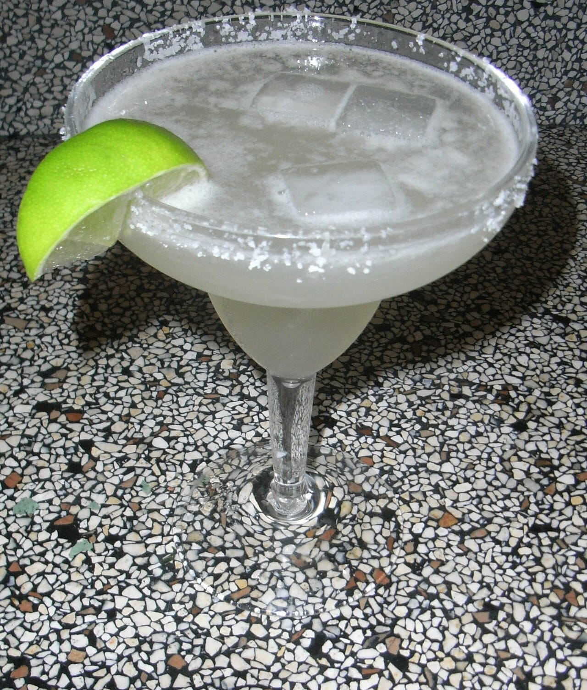

# 玛格丽特

玛格丽特（Margarita）是一款以龙舌兰、橙皮酒和鲜榨青柠汁摇和而成的经典鸡尾酒。IBA 公开配方使用 50 毫升百分之百龙舌兰酒、20 毫升橙皮酒和 15 毫升鲜榨青柠汁，摇和后滤入预冷的杯中，可选半圈盐边。

图：玛格丽特。图片：Akke Monasso，CC BY-SA 3.0，via Wikimedia Commons（[原图页面](https://commons.wikimedia.org/wiki/File:MargaritaReal.jpg)）。

## 定义与身份

玛格丽特的起源有多种说法，涉及不同的地点、人物与年份。本页不把某一种叙述当成定论，只把它写成 20 世纪墨西哥与美国边境地区饮酒文化的一部分。名称与配方是两件事，同名不同做法需要说明差异。

## 配方（IBA 版本）

IBA 公开配方为：50 毫升百分之百龙舌兰酒、20 毫升橙皮酒、15 毫升鲜榨青柠汁。把所有原料放入装有冰块的摇酒壶，摇和后滤入预冷的鸡尾酒杯；可选在杯口做半圈盐边。

这一版的比例约为 10:4:3，酸甜比较克制。比例不是唯一答案：有人喜欢更酸，有人喜欢更甜，也有人使用不同的橙皮酒。改变比例就是改变版本，应明确说明，而不是继续用同一个名字却不解释差异。

## 龙舌兰

[龙舌兰](ref:tequila)是主体，提供植物香气、辛辣感和酒精骨架。IBA 配方特别写明“百分之百龙舌兰”，强调原料来源；混合型龙舌兰酒的法规与风味不同，不能简单当作同一种原料。

不同龙舌兰酒的风格差异明显：有的偏青草与胡椒，有的偏熟果与甜香，陈年款还可能带木桶和香草。选择时应看它是否能与青柠的酸度和橙皮酒的甜味平衡，而不是只看酒精度。

## 橙皮酒

橙皮酒提供甜度、柑橘香气和酒体。它连接龙舌兰的辛辣与青柠的酸度，让成品不至于太尖。不同橙皮酒的甜度、苦味和酒精感不同，替换会明显改变成品。

橙皮酒不是“可有可无的甜味剂”。用量太少，酸甜平衡会偏向青柠，口感变尖；用量太多，甜味会盖住龙舌兰。若使用较甜的橙皮酒，可以适当减少糖浆或增加青柠汁，但应一次只改一个变量。

## 青柠汁与酸甜平衡

鲜榨青柠汁提供酸度、清香和新鲜感。瓶装青柠汁的香气与酸度通常不同，能鲜榨时应优先鲜榨。青柠汁的酸度会随成熟度和品种变化，配方中的毫升数只是起点，实际调整应看入口平衡。

酸甜平衡是玛格丽特的核心。太酸会显得尖锐，太甜会显得黏；平衡时，酸度让龙舌兰的植物香气更清楚，甜度让口感更圆润。调整时先确认青柠汁和橙皮酒的酸甜比例，再考虑是否需要少量糖浆。

## 摇和与冰

玛格丽特通常摇和，而不是搅拌。摇和能快速降温、稀释，并把空气带入液体，使口感更轻盈；同时，鲜榨果汁需要与酒液充分混合，摇和比搅拌更有效。摇和时间过长会稀释过多，过短则冷却和融合不足。

冰的质量直接影响成品。使用大而干的冰，稀释较可控；使用碎冰或湿冰，稀释更快。摇和后应立即滤入预冷杯中，避免继续浸泡在冰水中。关于冰型与温度，可以参考[加冰与温度](ref:ice)。

## 盐边

盐边是可选项，IBA 配方写作“半圈盐边”。盐能增强咸鲜感、压低苦味，也会改变入口的酸感。盐太多会盖住龙舌兰和青柠的细节，太少则几乎没有作用。

做盐边时，先用青柠汁润湿杯口外沿，再蘸细盐，避免把盐撒进杯中。只做半圈，是为了让饮用者可以选择“有盐”或“无盐”的入口。盐边不是装饰口号，而是风味结构的一部分。

## 杯型与温度

IBA 配方使用预冷的鸡尾酒杯。杯型应能聚拢香气、方便手持而不传递体温。传统上也有使用更宽、更矮的玛格丽特杯，但杯型不是定义的一部分；关键是预冷、容量合适、杯口不过宽。

杯子不冷，成品会迅速回温，酸度和香气都会变化。没有专用杯时，可以使用杯口略收的小型杯子。关于杯型与温度的关系，可以参考[如何选杯](ref:glass)。

## 变体

以其他橙皮酒替代，会改变甜度和柑橘方向；加入果汁，会形成更长的饮品；使用冰冻做法，会改变稀释和口感；以其他烈酒替代龙舌兰，则形成不同的变体。盐边、糖边或无边的选择，也会改变入口。

玛格丽特的变体常以杯型、冰型或水果区分：冰沙版用碎冰，古典版用冰块；草莓或芒果版会提高甜度，需减糖浆。盐边与糖边是装饰选择，不是定义。

## 常见误区

第一，认为玛格丽特必须甜。过甜会盖住龙舌兰和青柠的细节。

第二，用瓶装青柠汁替代鲜榨。香气和酸度通常不同，能鲜榨时优先鲜榨。

第三，盐边做满整圈。满圈会让每一口都过咸，半圈更可控。

第四，摇和时间随意。过长会稀释过多，过短会冷却和融合不足。

## 边界

玛格丽特的酒精度取决于龙舌兰和橙皮酒的比例，不能只看配方数字。它适合作为餐前或休闲饮用，应小口慢饮并补充水分；不要空腹快速饮用。驾车、服药或孕期不应饮酒。

本页以 IBA 玛格丽特为骨架，不评价具体龙舌兰品牌；橙皮酒、糖浆与青柠的比例会随配方来源变化。成品的强度还受冰块稀释影响，参见[酒精度](ref:abv)。名称、比例与做法应分开记录，才不会把偏好当成标准。

## 延伸阅读

- [龙舌兰](ref:tequila)：玛格丽特的主体与植物香气。
- [调酒基础](ref:cocktails-guide)：摇和、稀释与酸甜平衡。
- [如何选杯](ref:glass)：杯型、预冷与香气聚集。
- [酒精度](ref:abv)：理解成品强度与冰块稀释。

**关键事实。**

| 项目 | 内容 |
| --- | --- |
| 一句话定位 | 以龙舌兰、橙皮酒和鲜榨青柠汁摇和而成的经典鸡尾酒；酸甜与盐边是结构的一部分，不是装饰口号 |
| 类型 | 经典鸡尾酒 |
| 起源 | 墨西哥（20 世纪，具体起源有争议） |

**来源与边界。** 本页关于「玛格丽特」的关键事实，主要由以下来源交叉核对：International Bartenders Association（官方配方、调制方法与盐边选项；确认该饮品属于 IBA 官方鸡尾酒名单）、Oxford University Press（玛格丽特的历史背景、基本构成与变体；由原条目末尾参考资料迁移，未逐条复核访问日期）、Dave Arnold / W. W. Norton（摇和、冰与稀释对酸甜平衡的影响）等 6 条来源。价格、批次与状态会变，涉及这些字段时以页面所列来源的最新版本为准。正文为项目自写，来源只作核验，不复制原文。
