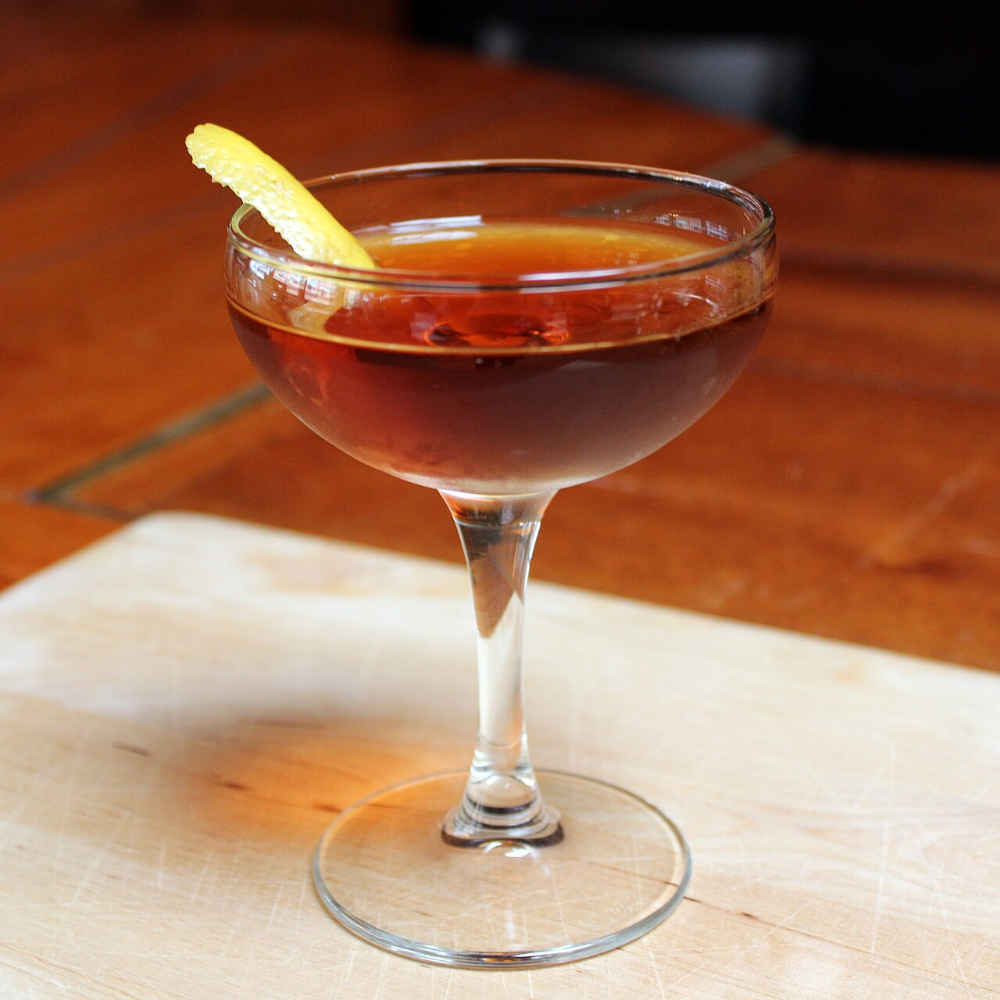

# 马天尼兹

马天尼兹是金酒、甜味美思、玛拉斯奇诺与橙味苦精的组合。它常被描述为“金酒版的曼哈顿”，也被视为干马天尼的前身：同样有金酒与味美思，但多了樱桃利口酒的甜与苦精的橙香，口感更圆、更柔。

这杯酒的历史模糊，配方版本众多，正是它有趣的地方。有人用等量金酒与甜味美思，有人偏重金酒；有人加玛拉斯奇诺，有人用黑樱桃酒；有人加橙味苦精，有人只用安高天娜。理解结构，比背下某一个版本更重要。

图：金酒、甜味美思、玛拉斯奇诺与苦精调成的马天尼兹。图片：Will Shenton，CC BY-SA 3.0，via Wikimedia Commons（[原图页面](https://commons.wikimedia.org/wiki/File:Martinez_Cocktail.jpg)）。

## 金酒版的曼哈顿

曼哈顿用威士忌、甜味美思与苦精，马天尼兹把威士忌换成金酒。金酒的杜松与柑橘香，与甜味美思的草本、玛拉斯奇诺的樱桃甜形成三层结构：金酒在前，味美思在中，樱桃在后，苦精收尾。

与干马天尼相比，马天尼兹更甜、更柔，酒精度略低。干马天尼追求“干”与“冷”，马天尼兹追求“圆”与“香”。它适合作为金酒鸡尾酒的入门，也适合喜欢甜味但不想要糖浆感的人。

## 配方：金酒、甜味美思与玛拉斯奇诺

IBA 的标准配方是金酒 45 毫升、甜味美思 45 毫升、玛拉斯奇诺 15 毫升、橙味苦精 2 滴。等量的金酒与味美思让甜味更明显；如果喜欢更干，可以把金酒增加到 60 毫升，味美思减到 30 毫升。

玛拉斯奇诺是关键。它用酸樱桃发酵蒸馏，带甜、带坚果与樱桃核的苦香；不能用樱桃糖浆替代，否则酒会变成糖果。橙味苦精提供柑橘皮与香料，也可以用橙皮油替代，但苦精的草本层次更复杂。

甜味美思的选择决定底色。意大利甜味美思偏香草与焦糖，法国甜味美思偏干、偏草药。与曼哈顿相比，马天尼兹更适合用偏草本的味美思，因为金酒本身已经有明显的植物香。

## 做法：搅拌与樱桃

把所有液体倒入装满冰的搅拌杯，搅拌约 20 秒，直到杯壁结霜、酒液充分冷却。滤入碟形杯，避免碎冰进入。搅拌比摇和更合适：这杯酒没有果汁、蛋清或奶油，摇和会带入过多气泡，破坏柔顺的口感。

装饰用樱桃。玛拉斯奇诺樱桃（maraschino cherry）是标准选择，也可以用酒渍樱桃。樱桃不仅是装饰，它的甜与酸可以补足杯口的香气；不要把樱桃汁滴进酒里，否则甜度会失衡。

杯具用碟形杯或马天尼杯。碟形杯口宽，香气更容易释放；马天尼杯更冷、更利落，但容易洒。杯子提前冷藏，能让酒保持低温更久。

## 起源争议

马天尼兹的起源没有定论。最常见的说法是 1880 年代，旧金山的酒吧或纽约的酒店调酒师创作了这杯酒；有人把它归功于 Jerry Thomas 的配方书，也有人认为它来自加州的赛马会或意大利移民社区。

名字也有多种解释：可能来自“Martinez”这个姓氏，也可能来自加州城市 Martinez，还可能只是“Martin”的变体。无论哪种，名字在十九世纪末已经出现，并逐渐进入鸡尾酒手册。

马天尼兹与干马天尼的关系同样模糊。有人认为它是干马天尼的前身，有人认为是平行发展的两支。可以确定的是，十九世纪末的金酒、味美思与苦精组合，孕育了后来一系列“金酒+味美思”的经典。

## 变体与常见错误

常见变体包括“Martinez Perfecto”，加一点橙皮油；“Tom Martinez”，用老汤姆金酒，甜度更高；“Martinez Cocktail”用黑樱桃酒替代玛拉斯奇诺，颜色更深、口感更厚。还有“Marguerite”，去掉樱桃利口酒，更接近干马天尼。

常见错误有四个。第一，摇和而非搅拌，酒液充满气泡、口感粗糙。第二，玛拉斯奇诺过量，甜味压过金酒。第三，苦精过量，橙味变成药味。第四，杯子不够冷，酒在几分钟内升温。马天尼兹的难点是“平衡”，不是“配方”。

对家庭调酒者，最实用的建议是：金酒与味美思先等分，玛拉斯奇诺从 10 毫升起步，苦精只加两滴，搅拌到足够冷。尝一口，再决定是否调整。记住，这杯酒的目标是“圆润的香”，不是“甜”。

樱桃是马天尼兹的传统装饰，但它的作用不是甜，而是香气：玛拉斯奇诺樱桃的果香能与酒里的玛拉斯奇诺呼应，也能让杯口多一层红色。没有樱桃，可以用橙皮替代，挤一下油脂，香气更清爽。苦精的选择也影响风格：橙味苦精让酒更明亮，安高天娜让酒更沉稳，两者各两滴也可以。搅拌的时间通常在 20 到 30 秒，取决于冰块的大小与杯子的温度；搅拌到杯壁结霜、酒液明显变冷即可，不要过度稀释。

相关条目：[干马天尼](ref:dry-martini)。

## 另见与参考资料

- 曼哈顿：参见 [曼哈顿](ref:manhattan)。
- 干马天尼：参见 [干马天尼](ref:dry-martini)。
- 金酒：参见 [金酒](ref:gin)。
- 味美思：参见 [味美思](ref:vermouth)。
- 碟形杯：参见 [碟形杯](ref:coupe)。

对照阅读：[曼哈顿](ref:manhattan)、[金酒](ref:gin)。

**关键事实。**

| 项目 | 内容 |
| --- | --- |
| 一句话定位 | 金酒、甜味美思、玛拉斯奇诺与橙味苦精调制的经典鸡尾酒，1880 年代出现于美国；被视为干马天尼与曼哈顿之间的桥梁，甜苦平衡微妙 |
| 类型 | IBA Unforgettables |
| 起源 | 美国（起源有争议） |

**来源与边界。** 本页关于「马天尼兹」的关键事实，主要由以下来源交叉核对：International Bartenders Association（IBA 配方分类、原料与比例）、Oxford University Press（鸡尾酒史与术语背景）、CocktailDB（交叉核对配方结构与常见变体）等 5 条来源。价格、批次与状态会变，涉及这些字段时以页面所列来源的最新版本为准。正文为项目自写，来源只作核验，不复制原文。

**并读。** 把「马天尼兹」与「曼哈顿」、「干马天尼」、「金酒」放在一起读时，先确认它们是同一层级还是上下游关系：先确认基酒与比例，再比较酸甜平衡、杯型与出品差异。本页负责给出鸡尾酒的基本坐标，对照条目补上具体案例与差异；读完再回到本页，才能分清哪些差别属于鸡尾酒本身，哪些只是产地、批次或品牌选择。

**适用边界。** 对「马天尼兹」而言，配方比例、基酒品牌与杯型会变；IBA 版本是参照，不是唯一做法。

**更新提示。** 「马天尼兹」最近核对于 2026-11-20；配方比例、基酒品牌、杯型与出品标准会变，调酒前以 IBA 或酒吧现行配方为准。

**编者注。** 本页把「马天尼兹」作为鸡尾酒条目处理：定义、流程与关键数字以正文表格为准，与「曼哈顿」、「干马天尼」的差异用对照阅读验证；遇到价格、批次或地址，回到页面所列来源核对。
