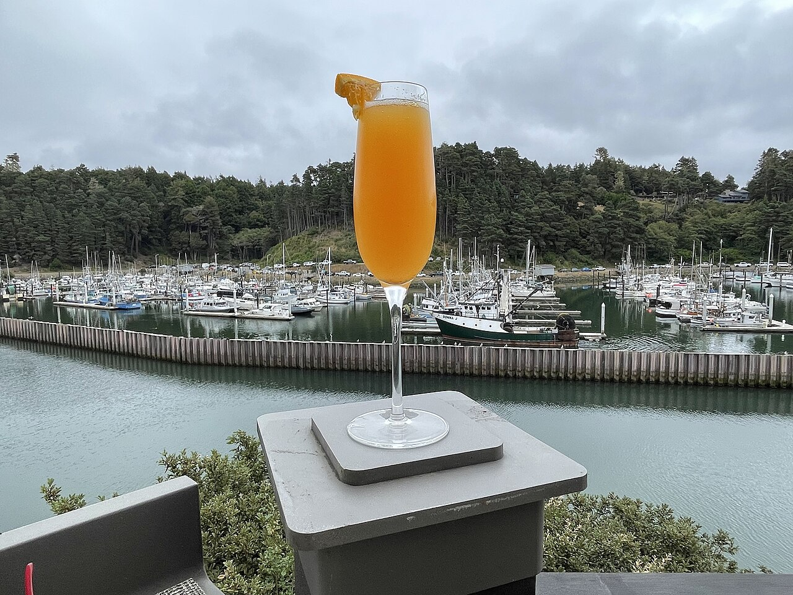

# 含羞草

含羞草是早午餐桌上最常见的起泡酒鸡尾酒：香槟与橙汁等分，倒入笛杯，有时再加一点橙皮油。它的酒精度低、气泡细、颜色像清晨的阳光，因此比大多数经典鸡尾酒更容易被接受。

但“简单”不等于“随便”。橙汁的温度、酸度与果肉含量，香槟的甜度与气泡强度，甚至杯子的形状，都会改变一杯含羞草的性格。用现榨橙汁与冰镇香槟，和用浓缩果汁与常温起泡酒，几乎是两种饮料。

图：香槟与橙汁等分调制的含羞草，常见于早午餐。图片：Missvain，CC BY 4.0，via Wikimedia Commons（[原图页面](https://commons.wikimedia.org/wiki/File:Mimosa_at_Noyo_Harbor_Inn_-_August_2022_-_Sarah_Stierch_02.jpg)）。

## 一杯早午餐的酒

含羞草的功能不是佐餐，而是“唤醒”。它出现在早餐、早午餐、婚礼与假日餐桌，通常比正餐酒更轻、更酸、更解腻。与贝里尼相比，含羞草更清爽，因为橙汁的酸度更高；与纯香槟相比，它更便宜、更易饮，也更适合不常喝酒的人。

这种定位决定了配方逻辑：香槟提供气泡与骨架，橙汁提供甜味、酸味与颜色，两者必须平衡。橙汁太甜，酒会显得黏；橙汁太酸，香槟的果味被压住；香槟太甜，整体会像果汁汽水。好的含羞草喝起来像“带气泡的橙子”，而不是“兑了酒的橙汁”。

## 配方：等分还是偏酸

IBA 的标准配方是香槟与橙汁各 10 厘升，等分。等分的好处是记忆简单、颜色稳定；缺点是橙汁的品种差异太大，冬天与夏天的酸度可以差很多。很多调酒师会把橙汁略减，或加几滴柠檬汁，让气泡更突出。

香槟的选择取决于预算与场合。真正香槟（Champagne）气泡细、酸度高，适合正式场合；克雷芒（Crémant）、卡瓦（Cava）或普罗塞克（Prosecco）也能做出好喝的含羞草，但甜度与气泡感不同。普罗塞克偏甜、气泡较松，适合喜欢果味的人；卡瓦偏干、酸度清亮，更接近香槟。

橙汁最好现榨并过滤。果肉会堵住气泡、让口感浑浊；浓缩果汁则常有煮熟味。若提前准备，橙汁要冷藏，香槟在开瓶前才取出，避免气泡流失。杯具用笛杯或碟形杯，前者聚气、后者更宽，香气表现不同。

## 做法：先果汁，后香槟

先在杯中倒入橙汁，再沿杯壁缓慢注入香槟。顺序不能反：先倒香槟再倒橙汁，会把气泡打散，颜色也不易均匀。倒酒时杯身倾斜，减少冲击；倒到七分满即可，留出香气空间。

不建议加冰。冰会稀释酒体，也会让气泡快速消失；如果橙汁与香槟都充分冷藏，酒本身已经够冷。若一定要加，用大块老冰，并在短时间内喝完。

装饰用橙皮或橙片。橙皮油能补足香气，但不要挤进太多，否则苦味会压过气泡。婚礼或派对场合可以加一颗樱桃，但那是视觉装饰，不是配方的一部分。

## 名字与年代

含羞草的名字来自黄色的小花，颜色与酒液相像。流传最广的起源是 1925 年巴黎里茨酒店的调酒师 Frank Meier，他把香槟与橙汁混合，做成一杯适合白天喝的酒。另一个版本说，英国酒吧在更早的时候就有类似做法。

无论起源如何，含羞草真正流行是在二十世纪后半叶。美国的早午餐文化、婚礼自助餐与航空公司的头等舱，把它推成了“不需要调酒师也能做”的社交饮品。它的流行不是因为复杂，而是因为稳定、便宜、人人能接受。

有趣的是，含羞草与贝里尼经常被放在一起比较。贝里尼用桃泥与普罗塞克，口感更厚、更甜；含羞草用橙汁与香槟，更酸、更轻。两者都证明了同一件事：起泡酒加水果，可以成为一套完整的饮品语言。

## 变体与常见错误

最常见的变体是“Grand Mimosa”：在橙汁与香槟之外加一小杯 Grand Marnier，增加橙香与酒精度。另一个变体是“Mimosa Royale”，用更贵的香槟与血橙汁，颜色更深、酸度更高。还有“Mimosa Punch”，把配方放大到派对规模，加水果块与冰块。

常见错误有三个。第一，用常温橙汁与常温香槟，气泡与清爽感全失。第二，倒酒顺序反了，气泡被橙汁冲散。第三，杯子没洗干净，残留的洗涤剂会毁掉气泡。含羞草没有复杂的技巧，只有对温度、比例与清洁的坚持。

对家庭调酒者，最实用的建议是：先把橙汁与香槟都冷藏，现榨现做，等分起步，再按橙汁的酸度微调。记住，含羞草的目标是“轻”，不是“浓”。

橙汁的种类也决定风格：脐橙甜、酸度低，酒会更柔和；血橙酸度高、颜色深，酒会更醒；葡萄柚汁则更苦，接近含羞草的另一个分支。无论用哪种，都要现榨并过滤果肉，否则泡沫会很快消失。

相关条目：[起泡酒](ref:sparkling)。

## 另见与参考资料

- 贝里尼：参见 [贝里尼](ref:bellini)。
- 起泡酒：参见 [起泡酒](ref:sparkling)。
- 香槟笛杯：参见 [香槟笛杯](ref:flute)。
- 开瓶（起泡酒）：参见 [开瓶（起泡酒）](ref:opening)。
- 三重橙酒：参见 [三重橙酒](ref:triple-sec)。

对照阅读：[贝里尼](ref:bellini)、[香槟笛杯](ref:flute)。

**关键事实。**

| 项目 | 内容 |
| --- | --- |
| 一句话定位 | 由等分香槟与橙汁调制的早午餐鸡尾酒，酒精度低、气泡轻盈；名字来自黄色花，配方简单却对温度与比例敏感 |
| 类型 | IBA Contemporary Classics |
| 起源 | 法国巴黎（流传说法） |

**来源与边界。** 本页关于「含羞草」的关键事实，主要由以下来源交叉核对：International Bartenders Association（IBA 配方分类、原料与比例）、Oxford University Press（鸡尾酒史与术语背景）、CocktailDB（交叉核对配方结构与常见变体）等 5 条来源。价格、批次与状态会变，涉及这些字段时以页面所列来源的最新版本为准。正文为项目自写，来源只作核验，不复制原文。

**并读。** 把「含羞草」与「贝里尼」、「起泡酒」、「香槟笛杯」放在一起读时，先确认它们是同一层级还是上下游关系：先确认基酒与比例，再比较酸甜平衡、杯型与出品差异。本页负责给出鸡尾酒的基本坐标，对照条目补上具体案例与差异；读完再回到本页，才能分清哪些差别属于鸡尾酒本身，哪些只是产地、批次或品牌选择。

**适用边界。** 对「含羞草」而言，配方比例、基酒品牌与杯型会变；IBA 版本是参照，不是唯一做法。

**更新提示。** 「含羞草」最近核对于 2026-11-20；配方比例、基酒品牌、杯型与出品标准会变，调酒前以 IBA 或酒吧现行配方为准。

**编者注。** 本页把「含羞草」作为鸡尾酒条目处理：定义、流程与关键数字以正文表格为准，与「贝里尼」、「起泡酒」的差异用对照阅读验证；遇到价格、批次或地址，回到页面所列来源核对。
