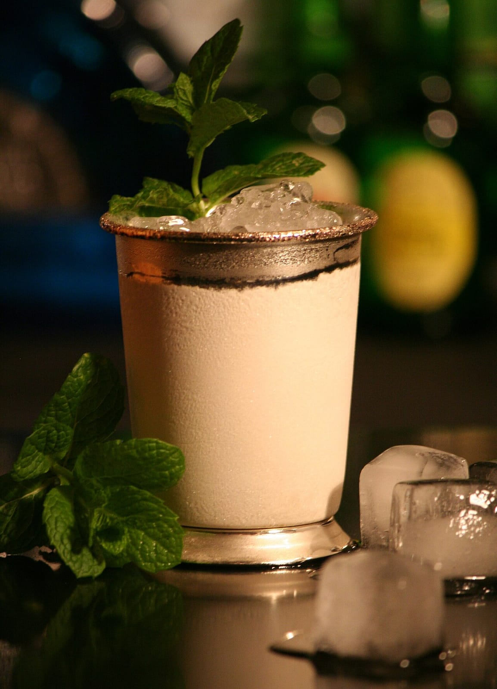

# 薄荷朱利普

薄荷朱利普（Mint Julep）是一款以[波本威士忌](ref:bourbon)、薄荷与糖调制的经典鸡尾酒。碎冰填满杯中，常见装饰为薄荷枝；风格清凉、甜润，是美国南方赛马文化的代表饮品。

图：薄荷朱利普。图片：Cocktailmarler，CC BY-SA 3.0，via Wikimedia Commons（[原图页面](https://commons.wikimedia.org/wiki/File:Mint_Julep_im_Silberbecher.jpg)）。

## 定义与身份

薄荷朱利普常与美国南方的赛马活动联系在一起，历史叙述可追溯到 19 世纪。它的名字与薄荷有关，具体起源存在多种说法，本页只把它写成历史背景，不把某一种说法当成定论。

薄荷朱利普是“烈酒 + 糖 + 薄荷 + 碎冰”的南方饮品，常与肯塔基赛马会联系在一起。它的关键不在配方比例，而在杯壁结霜与薄荷香气的释放：碎冰填满杯子，搅拌到杯壁起霜，入口时温度低、稀释缓。

## 配方（IBA 版本）

IBA 公开配方以波本威士忌、薄荷与糖为基础，做法是：在杯中放入薄荷与糖，轻轻压出香气但不要压碎叶片；加入少量威士忌搅拌至糖溶解；用碎冰填满杯子，再倒入剩余威士忌，充分搅拌使杯壁结霜；最后以薄荷枝装饰。

用量是起点，不是法律。不同酒吧与家庭的配方在威士忌用量、糖量与冰量上差异明显。关键是让薄荷香气、甜味与威士忌的强度保持平衡。

## 波本的选择

[波本威士忌](ref:bourbon)是这款酒的主体。它带来玉米甜香、香草与焦糖，与薄荷的清凉气息形成对照。黑麦威士忌更辛辣、更干，也可以作为替代，但风格会改变。

高酒精度的威士忌需要更多冰与搅拌稀释，低酒精度的威士忌则要少搅拌。若威士忌风味强烈，糖与薄荷的用量也要相应调整，否则成品会失衡。关于[威士忌](ref:whisky)的一般分类，可以参考对应条目。

## 薄荷与糖

薄荷提供清凉香气与视觉识别。压叶时只需轻轻按压，让香气释放；压碎叶片会带入苦味，影响口感。薄荷的新鲜度直接影响香气，枯萎的叶片香气明显减弱。

糖提供甜味与圆润度，平衡威士忌的酒精刺激与薄荷的清凉感。糖太少，成品会显得干涩；糖太多，会盖住薄荷香气。糖浆比砂糖更容易溶解，适合冷饮调制。

## 碎冰与搅拌

碎冰是薄荷朱利普的核心：它让酒液快速降温，并在杯中形成结霜的外观。碎冰融化快，稀释也快，因此需要充分搅拌后尽快饮用。

搅拌的目的不仅是混合，也是让杯壁降温结霜。搅拌不足，温度不够低、香气打不开；搅拌过度，稀释太多，酒体会变薄。关于薄荷朱利普的冰型、稀释与温度，可参考[加冰与温度](ref:ice)。

## 杯型与装饰

传统上使用银杯或厚壁杯，杯身较高，便于填满碎冰并保持低温。薄荷朱利普的银杯或厚壁杯要预冷，碎冰才不会一接触杯壁就化成水，稀释过快会冲淡薄荷。

薄荷枝是常见装饰，提供清凉香气与视觉识别。装饰应插在碎冰中，饮用前轻嗅可以增强香气体验。装饰应在饮用前完成。

## 变体

以黑麦威士忌替代波本，会得到更辛辣的版本；以其他烈酒替代威士忌，会形成不同分支；减少糖量，会得到更干、更强调薄荷的版本。不同南方案例在冰量与糖量上也有差异。

薄荷朱利普的变体主要在威士忌、糖量与冰型之间移动；黑麦更辛辣，少糖更清爽，碎冰粗细则改变稀释速度。关于鸡尾酒结构的一般说明，可以参考[调酒基础](ref:cocktails-guide)；与[古典](ref:old-fashioned)相比，薄荷朱利普以碎冰与薄荷替代搅拌与苦精。

## 常见误区

第一，把薄荷叶压碎。过度挤压会带入苦味。

第二，认为碎冰只是装饰。碎冰影响温度与稀释速度。

第三，忽略糖与威士忌的平衡。过甜会盖住薄荷。

第四，只用枯萎的薄荷。香气会明显不足。

## 饮用与边界

薄荷朱利普适合作为夏日饮品，搭配坚果、咸味小食或南方风味菜式。薄荷朱利普的酒精度较高，应小口慢饮并补充水分；不要空腹快速饮用。驾车、服药或孕期不应饮酒。

本页以 IBA 薄荷朱利普为骨架，不把某一种波本或糖量说成唯一做法；南方各州的冰量与甜度本来就有差异。成品的强度取决于威士忌的[酒精度](ref:abv)、糖量、碎冰量与融化速度，不能只看配方数字。

薄荷朱利普不是“把薄荷放进威士忌”那么简单：糖要先与薄荷轻压释放香气，碎冰要填满杯体，搅拌让酒液快速降温并适度稀释。波本提供玉米甜感与桶味，薄荷提供清凉；若只用整枝薄荷装饰而不压香，成品会显得单薄。

对照阅读：[波本威士忌](ref:bourbon)、[酒精度（ABV）](ref:abv)。

## 延伸阅读

- [波本威士忌](ref:bourbon)：薄荷朱利普的主体与风格来源。
- [威士忌](ref:whisky)：威士忌分类与产区背景。
- [调酒基础](ref:cocktails-guide)：读薄荷朱利普所需的结构、稀释与搅拌原则。
- [加冰与温度](ref:ice)：碎冰与冷却对成品的影响。
- [酒精度](ref:abv)：理解成品强度与冰块稀释。
- [古典](ref:old-fashioned)：以威士忌、糖与苦精为基础的另一款经典。

**关键事实。**

| 项目 | 内容 |
| --- | --- |
| 一句话定位 | 以波本威士忌、薄荷与糖调制的经典鸡尾酒，碎冰填满杯中，常见装饰为薄荷枝；风格清凉、甜润，是美国南方赛马文化的代表饮品 |
| 类型 | 经典鸡尾酒 |
| 起源 | 美国南方（19 世纪） |

**来源与边界。** 本页关于「薄荷朱利普」的关键事实，主要由以下来源交叉核对：International Bartenders Association（官方配方、调制方法与装饰；确认该饮品属于 IBA 官方鸡尾酒名单）、Oxford University Press（薄荷朱利普的历史背景与基本构成；由原条目末尾参考资料迁移，未逐条复核访问日期）、David Wondrich / Perigee（19 世纪美国鸡尾酒演变的背景）等 6 条来源。价格、批次与状态会变，涉及这些字段时以页面所列来源的最新版本为准。正文为项目自写，来源只作核验，不复制原文。

**并读。** 把「薄荷朱利普」与「波本威士忌」、「威士忌」、「酒精度（ABV）」放在一起读时，先确认它们是同一层级还是上下游关系：先确认基酒与比例，再比较酸甜平衡、杯型与出品差异。本页负责给出鸡尾酒的基本坐标，对照条目补上具体案例与差异；读完再回到本页，才能分清哪些差别属于鸡尾酒本身，哪些只是产地、批次或品牌选择。

**适用边界。** 对「薄荷朱利普」而言，配方比例、基酒品牌与杯型会变；IBA 版本是参照，不是唯一做法。
