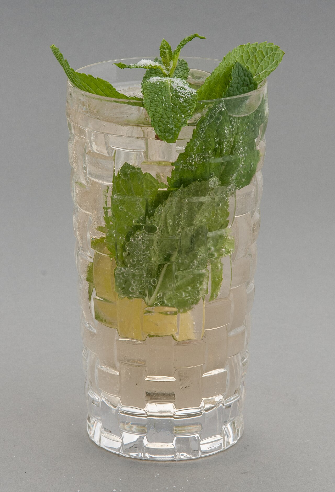

# 莫吉托

莫吉托（Mojito）是一款以白朗姆、青柠、薄荷、蔗糖和苏打水调制的长饮。IBA 公开配方使用 45 毫升古巴白朗姆、20 毫升鲜榨青柠汁、6 枝薄荷、2 茶匙白蔗糖和适量苏打水，在杯中调制，以薄荷枝和青柠片装饰。

图：莫吉托。图片：Ralf Roletschek，CC BY-SA 3.0，via Wikimedia Commons（[原图页面](https://commons.wikimedia.org/wiki/File:15-09-26-RalfR-WLC-0072.jpg)）。

## 定义与身份

莫吉托常被追溯到古巴，但具体起源有多个版本，涉及不同的年代、地点与人物。本页不把某一种叙述当成定论，只把它写成古巴与加勒比饮酒文化的一部分。名称与配方是两件事，同名不同做法需要说明差异。

## 配方（IBA 版本）

IBA 公开配方为：45 毫升古巴白朗姆、20 毫升鲜榨青柠汁、6 枝薄荷、2 茶匙白蔗糖、适量苏打水。做法是：把薄荷、糖和青柠汁混合，加入少量苏打水，加满冰，倒入朗姆酒，再补苏打水，轻轻搅拌，让所有原料混合。

这一版是“杯中调制”，不是摇和后滤冰。薄荷只轻压，不捣碎；糖需要溶解；冰要足够，才能保持低温和气泡。用量是起点，不是法律；改变糖量、青柠量或薄荷量，都会改变成品。

## 薄荷

薄荷提供清凉感和香气，是莫吉托识别度最高的部分。IBA 配方用 6 枝薄荷，但薄荷品种、叶片大小和新鲜度都会影响强度。薄荷不新鲜时，香气弱，甚至会带草腥味。

处理薄荷时应轻压，而不是捣碎。用力捣碎会释放叶片的苦味和叶绿素味，让成品发苦；轻压只释放表层精油，香气更干净。薄荷枝可以保留在杯中作为装饰，但不要长时间浸泡到发黑。

## 青柠与糖

青柠汁提供酸度、清香和新鲜感。鲜榨比瓶装更可靠，因为瓶装汁的香气和酸度通常不同。青柠的酸度会随成熟度变化，配方中的 20 毫升是起点，实际调整要看入口平衡。

白蔗糖提供甜度，平衡青柠的酸。糖太少，成品会尖；糖太多，会盖住薄荷和朗姆。糖的溶解很重要，未溶解的糖会沉在杯底，最后几口突然变甜。可以先在少量青柠汁中搅溶糖，再加其他原料。

## 白朗姆

[白朗姆](ref:rum)是主体，提供甘蔗甜香和酒精骨架。白朗姆通常经过过滤，颜色浅、风味较轻，适合与青柠和薄荷搭配；陈年朗姆的桶味更重，会改变成品方向。

选择白朗姆时，先看它是否干净、是否带明显的甘蔗或植物香气。酒精度高的朗姆需要更多冰和气泡来平衡；酒精度低的朗姆则可能让成品显得单薄。配方数字不能单独说明强度。

## 苏打与冰

苏打水提供气泡和清爽感，也参与稀释。气泡太多会刺激，太少则显得沉闷；苏打水应在最后加入，轻轻搅拌，避免把气泡搅散。冰要足够，既降温又保持气泡。

冰的质量直接影响长饮。大冰块融化慢，稀释可控；碎冰降温快，但会让成品迅速变淡。莫吉托通常使用较多冰块，让杯中出现明显的冰层；如果冰太少，苏打水会很快变温，口感变平。关于冰型与温度，可以参考[加冰与温度](ref:ice)。

## 捣压与搅拌

捣压（muddle）的目的是释放薄荷和青柠的香气，不是把原料碾碎。轻压几下即可，看到薄荷叶略微破开、香气出来就停。过度捣压会带来苦味，也会让叶片碎片悬浮在杯中。

搅拌的目的是混合，不是摇和。莫吉托是长饮，需要保留气泡和冰层；摇和会带入过多空气、碎冰，并让气泡快速散失。轻轻搅拌几次，让朗姆、青柠、糖和苏打水混合即可。

## 杯型

莫吉托通常使用高球杯或较大的直身杯，容量足以容纳冰、薄荷和苏打水。杯口不宜太窄，否则薄荷枝难以放置；杯壁不宜太薄，否则手持时升温快。

杯子应提前冰镇，减少冰的快速融化。没有专用杯时，选一只直身、容量足够的杯子即可。关于杯型与香气的关系，可以参考[如何选杯](ref:glass)。

## 变体

以陈年朗姆替代白朗姆，会带来桶味和更重的酒体；减少糖或增加青柠，会改变酸甜平衡；加入水果（如草莓、百香果）会形成不同变体；以其他气泡饮料替代苏打水，会改变甜度和气泡感。

莫吉托的变体多来自水果与香草：草莓、百香果、罗勒或黄瓜都会改变香气与酸度。增加水果泥时应减少糖浆，否则甜度会盖过薄荷；用其他基酒则应改名。

## 常见误区

第一，把薄荷捣碎。过度捣压会释放苦味，轻压即可。

第二，糖没有溶解。糖沉底会让最后几口过甜。

第三，冰太少。冰不足会让气泡快速散失，成品变温变平。

第四，用摇和代替搅拌。摇和会破坏气泡和冰层，长饮不需要。

第五，认为薄荷越多越好。过多薄荷会带来草腥味，也会堵塞吸管。

## 边界

莫吉托是长饮，酒精度取决于朗姆用量和稀释程度，不能只看配方数字。它适合炎热天气或休闲场景，应小口慢饮并补充水分；不要空腹快速饮用。驾车、服药或孕期不应饮酒。

本页只记录一个有来源的版本，不评价具体品牌，也不把某一种比例说成唯一正确答案。成品的强度还受冰块和苏打水稀释影响，参见[酒精度](ref:abv)。

对照阅读：[朗姆酒](ref:rum)、[调酒，是另一种认识酒的方式](ref:cocktails-guide)。

## 延伸阅读

- [朗姆酒](ref:rum)：莫吉托的主体与甘蔗香气。
- [调酒基础](ref:cocktails-guide)：结构、稀释与搅拌。
- [如何选杯](ref:glass)：杯型、容量与预冷。
- [酒精度](ref:abv)：理解长饮的实际强度。

**关键事实。**

| 项目 | 内容 |
| --- | --- |
| 一句话定位 | 以白朗姆、青柠、薄荷、蔗糖和苏打水调制的长饮；薄荷只轻压，冰要足，酸甜与气泡共同决定它是否清爽 |
| 类型 | 经典鸡尾酒 |
| 起源 | 古巴（起源叙述有多个版本） |

**来源与边界。** 本页关于「莫吉托」的关键事实，主要由以下来源交叉核对：International Bartenders Association（官方配方、调制顺序与装饰；确认该饮品属于 IBA 官方鸡尾酒名单）、Oxford University Press（莫吉托的历史背景、基本构成与古巴饮酒语境；由原条目末尾参考资料迁移，未逐条复核访问日期）、Dave Arnold / W. W. Norton（冰、稀释与长饮口感的一般原理）等 6 条来源。价格、批次与状态会变，涉及这些字段时以页面所列来源的最新版本为准。正文为项目自写，来源只作核验，不复制原文。
