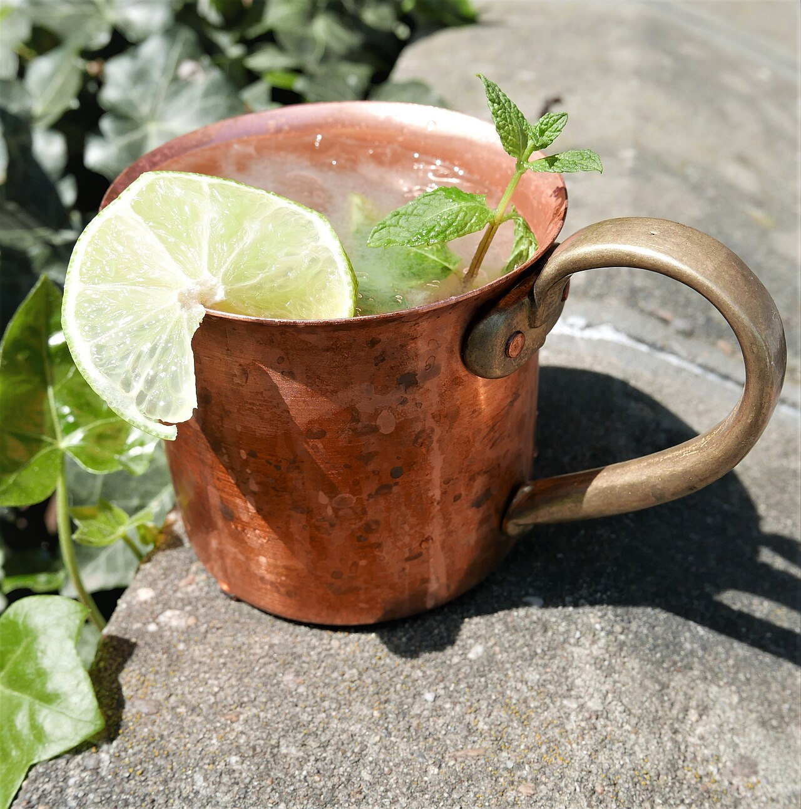

# 莫斯科骡子

莫斯科骡子（Moscow Mule）是一款以伏特加、姜汁啤酒与青柠汁调制的长饮。它通常在高球杯或铜杯中加入大量冰块，最后补入姜汁啤酒，以青柠角装饰。姜的辛辣与气泡带来直接的刺激，青柠提供酸度，伏特加则充当干净的酒精骨架。这款酒结构简单，却很容易因为姜汁啤酒的甜度、冰量与青柠用量而出现明显差异。

图：莫斯科骡子。图片：Gordito1869，CC BY-SA 4.0，via Wikimedia Commons（[原图页面](https://commons.wikimedia.org/wiki/File:Cocktail_Moscow_Mule_im_Kupferbecher_mit_Minze.jpg)）。

## 起源与命名

关于这款酒的诞生，公开叙述并不完全一致。流传最广的说法把它放在 20 世纪 40 年代的美国，与伏特加品牌、姜汁啤酒品牌和酒吧经营者的合作推广有关；铜杯与“骡子”的形象也常被解释为营销的一部分。人物、地点与先后顺序在不同版本里有出入，因此本页只把它写作“流传说法”，不把某个具体日期当作档案。

名字里的 Moscow 并不表示酒起源于莫斯科，更多是对当时伏特加来源的联想；这同样是一种解释，而不是可核实的史料。“Mule”常被说成姜的辛辣像被踢了一脚，也属于命名趣谈。名称与配方是两件事：即使名字带有地域暗示，也不能据此推断原料、品牌或饮用方式。

铜杯在这款酒的故事里出现得很早，但它并不是法律意义上的“标准器具”。铜的导热性好，杯壁容易挂霜，视觉上更冰凉；换成高球杯，酒液的基本结构并不会改变。把铜杯当成身份标志，容易让讨论偏离真正影响口感的因素，例如姜汁啤酒的甜辣比例、青柠的新鲜度与冰块质量。

## 配方结构

常见配方为伏特加 45 毫升、姜汁啤酒 120 毫升、青柠汁 10 毫升，加冰直接调制。比例不是唯一标准：伏特加提供骨架，姜汁啤酒同时带来甜度、辛辣与气泡，青柠汁负责把甜味拉回平衡。若杯子较大或冰块较多，可以按同样比例放大，但要先确认杯容量，避免加冰后溢出。

要区分姜汁啤酒与姜汁汽水。前者姜味更强烈、甜度与辛辣更明显，后者更温和、更像普通汽水。用姜汁汽水替代时，成品会变薄，通常需要减少青柠或补一点姜糖浆，但那就已经是另一种饮品。配方写作应同时标明所用的是姜汁啤酒还是姜汁汽水，否则同样的毫升数会产生完全不同的结果。

伏特加的选择对成品影响相对有限，它主要提供酒精与干净的骨架；姜汁啤酒的品牌、甜度和姜的提取方式反而更关键。青柠要现挤，预榨果汁的香气会衰减，酸度也可能变得平板。糖浆不是必需项，因为姜汁啤酒通常已经含糖；只有在姜汁啤酒特别干、或杯子很大导致稀释明显时，才考虑少量补充。

## 风味与平衡

入口先是姜的辛辣与气泡，随后是青柠的酸和伏特加的干净酒感。它不追求复杂的陈年风味，而是靠温度、碳酸与酸度形成爽快感。平衡的关键是甜与酸：姜汁啤酒本身甜度不低，青柠不足会显得糖水感重，青柠过多则压住姜香。冰块的融化会持续稀释，所以第一口的浓度通常最高，饮用节奏也会改变体验。

姜的“辣”不是辣椒那种灼热，而是姜辣素带来的温热与刺激感，和气泡的物理刺激叠加在一起。若觉得太甜，优先增加青柠汁或换用更干的姜汁啤酒；若觉得太酸，先减少青柠而不是加糖，因为加糖会让整杯变得更像甜饮料。温度也很重要：姜汁啤酒不够冷，加冰后风味会显得松散，气泡也不够紧实。

这款酒的酒精度属于中等，但容量大、饮用时间长，实际摄入的酒精并不一定少。冰的融化会改变浓度，也会改变香气释放；当杯中出现大量水味时，说明冰已经融得太多，继续慢慢喝只会更淡。此时不必强行喝完，倒掉重做比硬撑更合理。

## 做法要点

做法以直接调配为主：先把杯子与姜汁啤酒冷藏，杯中加满新鲜冰块，倒入伏特加与青柠汁，最后沿杯壁补入姜汁啤酒，轻轻搅拌一次让层次合并。不要摇和，摇动会让碳酸快速逸出，也会让姜汁啤酒过度稀释。青柠角在饮用前再挤，皮油与酸度都更清楚。

杯子的预冷常被忽略。铜杯可以提前放冰箱，或至少用冰块转动冷却；高球杯同理。冰块应使用洁净、无异味、融化较慢的冰块，碎冰会迅速稀释并让气泡消失。若使用铜杯，注意杯口与内壁是否清洁，铜材质不适合长时间存放酸性液体，调好后应尽快饮用。

装饰以青柠角或青柠片为主，也可加一片姜或一小枝薄荷，但不要堆叠过多，以免遮挡杯口与香气。挤青柠皮时只取有色外层，不要压到白色部分，否则会带出苦味。若配方中加了糖浆，应先与青柠汁混合，再倒入伏特加，最后补姜汁啤酒，顺序清楚才容易复现。

## 变体

以波本威士忌替代伏特加，通常叫 Kentucky Mule；以金酒替代则是 London Mule 一类；以龙舌兰替代常见于 Mexican Mule。还有加入薄荷、黄瓜或姜片的版本，以及用无糖姜汁啤酒降低甜度的做法。变体应写清替换了哪一种原料，否则同名不同做法会混淆。

替换基酒会改变风味方向：波本带来甜木与香草感，金酒带出草本与杜松子，龙舌兰则更植物、更辛香。姜汁啤酒的甜辣强度也需要跟着调整，不能只换基酒而保留原来的青柠量。若把姜汁啤酒换成姜汁汽水，最好把它视为“姜汁汽水版”，而不是继续沿用原配方名称。

还有一种常见做法是加入少量姜糖浆或蜂蜜糖浆，让姜味更集中；但糖分会同时提高，需要相应增加酸度。任何变体都应记录基酒、姜汁啤酒类型、青柠量与甜味来源，只有这样才能判断一次调整是否真的更好喝。

## 怎么点与怎么喝

点单时可以直接说“莫斯科骡子，少冰、青柠多一点”，或询问姜汁啤酒的品牌与甜度。铜杯不是必须，若店家使用高球杯也正常。若不喜欢太甜，可以请店家减少姜汁啤酒、增加青柠，或换用更干的姜汁啤酒；若喜欢姜味更强，可以要求加鲜姜片，但要注意它会继续浸泡出辣味。

它适合搭配辛辣、油炸或咸味重的食物，姜的辛辣与油脂相互抵消，气泡能清口。作为长饮，份量较大，应慢慢喝并配水；驾车、服药或孕期不应饮酒。冰量大的版本在炎热天气更舒服，但也要注意饮用速度，避免在很短时间内摄入过多酒精。

在酒吧里，这款酒通常不会经过长时间陈放，点单后应尽快饮用。若杯子外壁挂霜明显，说明预冷做得不错；若冰块很快变成水，说明冰的质量或室温有问题。喝到后半杯时如果味道明显变淡，可以补一点青柠汁，但不建议再加糖浆。

## 常见误区

第一，认为铜杯是配方的一部分。铜杯影响温度与呈现，不改变基本风味。第二，把姜汁汽水当成姜汁啤酒。两者姜味强度不同，替代后应调整配方。第三，摇和姜汁啤酒。碳酸会流失，口感会变平。第四，认为伏特加越贵越好。伏特加主要提供干净骨架，品牌差异有限。第五，认为必须很甜。青柠与冰的稀释可以调整甜感，甜不是这款酒的目的。

相关条目：[伏特加](ref:vodka)、[高球杯](ref:highball)、[调酒，是另一种认识酒的方式](ref:basics)。

## 另见

- [伏特加](ref:vodka)：这款酒的酒精骨架与中性风格。
- [高球杯](ref:highball)：长饮的杯型、冰量与碳酸保持。
- [鸡尾酒基础](ref:basics)：直接调配、比例与器具的基本概念。
- [酸度](ref:acidity)：青柠如何影响甜感与整体平衡。
- [莫吉托](ref:mojito)：另一款以青柠、气泡与长饮结构为核心的鸡尾酒。
