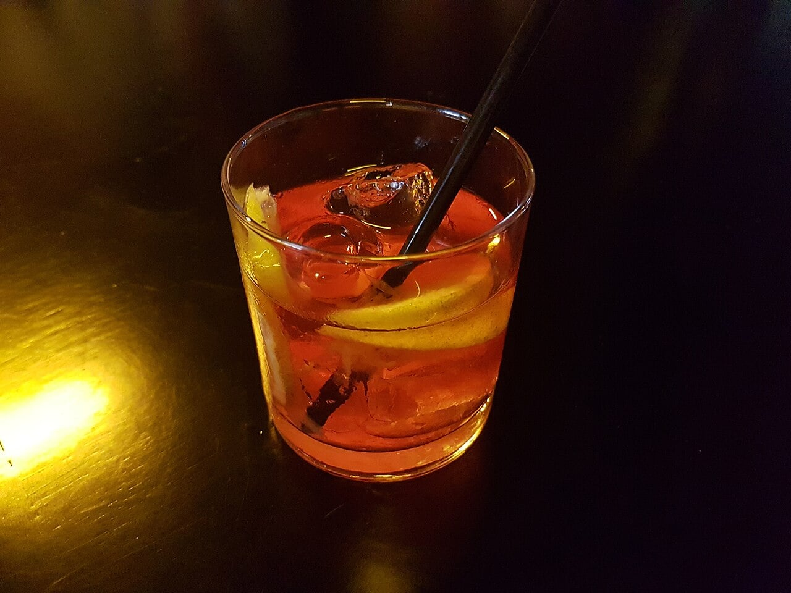

# 内格罗尼

内格罗尼（Negroni）是一款以金酒、苦味开胃酒和甜味美思调制的经典鸡尾酒。国际调酒师协会（IBA）的公开配方使用三者各 30 毫升，搅拌后滤入装有冰块的古典杯。

图：一杯内格罗尼，红色酒液盛于古典杯，杯中有冰块、橙片与一根黑色吸管。图片：Sudhertzen，CC BY-SA 4.0，via [原图页面](https://commons.wikimedia.org/wiki/File:Negroni_(cocktail).jpg)。

## 定义与身份

身份层与配方层分开，是为了避免把“某家酒吧的做法”当成“内格罗尼的定义”。IBA 配方是国际通行的参考之一，但不同酒吧会调整比例、品牌与装饰；只要三者结构与平衡成立，仍属于内格罗尼家族。

名称本身来自内格罗尼伯爵的姓氏，这与“由谁发明”的叙事相关，但不等于有完整档案支持每一个细节。鸡尾酒史中许多故事经过口耳相传与再叙述，写作时应标注“流传说法”，不把传说当作档案。

内格罗尼的等分比例是教学起点，不是法律。金酒的草本、金巴利的苦橙与甜味美思的香料，在等量时互相制衡；若金酒过多，苦味会被酒精压住，若味美思过多，酒体变甜、苦味变软。搅拌时间与冰块大小决定稀释，杯中的大冰块则控制后续稀释。

## 配方与比例

IBA 配方为金酒、苦味开胃酒、甜味美思各 30 毫升，加冰搅拌，滤入装有冰块的古典杯，以橙皮或橙片装饰。等量比例是经典版本，便于记忆与教学，但不是唯一正确的比例。

比例会显著改变风味：金酒比例高，草本与杜松子更突出；苦味酒比例高，苦感与柑橘皮味更强；甜味美思比例高，酒体更圆润、甜感更明显。调整时应一次只改一个变量，才能判断变化来自哪里。

用量换算要与杯型匹配：杯太小，加冰后容易溢出；杯太大，香气散失且稀释过快。家庭调制可使用量勺或小量杯，按体积而非目测估计，才能稳定复现。配方的可执行性，取决于单位、顺序与器具是否写清。

## 原料与角色

[金酒](ref:gin)提供骨架与草本香气，是酒精与香气的主要来源。苦味开胃酒提供苦味、红色色调与柑橘、草本气息，是“苦甜平衡”的关键。甜味美思提供甜感、酒体与香料层次，缓和苦味并连接另外两种原料。

三种原料都含酒精，成品酒精度较高。具体数值取决于品牌与比例，不能只用[酒精度](ref:abv)标签判断杯中强度；冰块融化会持续稀释，饮用过程中的口感会变化。

选择品牌会明显改变成品：金酒的植物配方决定草本方向，苦味酒的苦度与柑橘感决定骨架，甜味美思的香料与甜度决定圆润度。换品牌不等于换配方，但会让同一比例呈现不同风格，记录时应同时写清品牌与比例。

## 调制方法

常用方法是加冰搅拌，使原料冷却、稀释并均匀混合，再滤入预冷或装有冰块的杯中。搅拌而非摇和，是为了避免过度充气与过快稀释；但若使用较甜的美思，也有人选择短摇，这属于风格选择。

橙皮装饰不是可有可无的摆设：挤压橙皮释放的精油会直接影响香气。装饰前应确认橙皮干净、无蜡层残留。制作时应使用新鲜冰块，避免使用有异味或融化过快的冰。

## 风味与平衡

内格罗尼的典型表现是苦、甜、草本与柑橘并重，入口有苦感但不失圆润，余味带橙皮与香料。它不以酸甜为主，也不追求果汁感；评价重点是三种原料是否协调，而不是某一种原料是否突出。

平衡会随温度与稀释变化。刚调好时酒体紧、苦感强；冰块融化后逐渐柔和，甜感与香气更开放。若觉得过苦，可略增美思；若觉得过甜，可略增苦味酒或金酒。调整应小幅度进行。

## 变体

以波本威士忌替代金酒，通常称为 boulevardier，风味更甜、更木质。以苏打水替代金酒，回到更早的 americano 形式，酒精度更低。以起泡酒替代部分原料，则形成 sbagliato 一类变体，口感更轻。

变体不是“错误版本”，而是有明确替换逻辑的分支。记录变体时应写清替换了哪一种原料、比例如何变化，否则同名不同做法会造成混淆。本页只做概述，具体配方仍以配方页为准。

## 饮用与搭配

适合作为餐前酒，搭配咸味坚果、橄榄、硬质奶酪与腌肉。苦味与油脂能相互平衡，甜味美思也能承接咸鲜。作为餐后酒时，应降低份量，避免在已饮酒的情况下继续快速饮用。

餐前酒的份量通常小于餐后酒，目的是打开食欲而不是灌醉。若一桌人继续点第二杯，应同时补充水与食物；冰块的融化速度也会影响第二杯的浓度。鸡尾酒的“强度”是杯中体验，不只是配方酒精度。

使用[古典杯](ref:vessel)时，杯口较宽，香气容易散开；也可用较小的杯型控制份量。饮用应适量，避免空腹快速饮用；驾车或服药期间不应饮酒。橙皮装饰应在饮用前再挤压，以保留香气。

## 常见误区

第一，认为只有等量比例才是正宗。等量是经典版本，不是唯一版本。
第二，把苦味酒当成“药酒”。它是配制酒，风味与法规属性不同。
第三，认为搅拌不重要。搅拌影响冷却、稀释与均匀度。
第四，用摇和替代搅拌而不调整比例。摇和会带来更多稀释与充气。

对照阅读：[内格罗尼配方（IBA 版本）](ref:recipe)、[古典杯](ref:vessel)。

## 延伸阅读

- [配方版本](ref:recipe)：可执行的用量、步骤与器具。
- [金酒](ref:gin)：内格罗尼的骨架与草本香气来源。
- [古典杯](ref:vessel)：杯型与冰块对香气和稀释的影响。
- [酒精度](ref:abv)：理解成品强度与冰块稀释。

**关键事实。**

| 项目 | 内容 |
| --- | --- |
| 一句话定位 | 由金酒、苦味开胃酒与甜味美思等量调制的经典鸡尾酒；鸡尾酒身份与配方版本分开记录 |
| 类型 | 经典鸡尾酒 |
| 起源 | 意大利佛罗伦萨（流传说法） |

**来源与边界。** 本页关于「内格罗尼」的关键事实，主要由以下来源交叉核对：International Bartenders Association（官方配方与调制方法；内格罗尼在官方鸡尾酒名单中的位置）、Oxford University Press（提供关于内格罗尼、苦味酒与美思的条目；由原条目末尾参考资料迁移，未逐条复核访问日期）、Campari（三等分配方与 1919 年起源说明）。价格、批次与状态会变，涉及这些字段时以页面所列来源的最新版本为准。正文为项目自写，来源只作核验，不复制原文。
