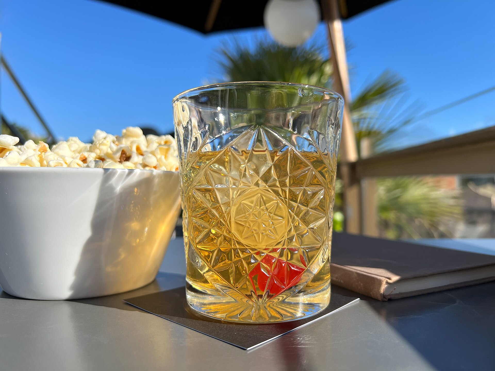

# 古典

古典（Old Fashioned）是一款以威士忌、糖、苦精和少量水调制的经典鸡尾酒。它不使用果汁或碳酸饮料，结构简单：用糖和水把烈酒打开，用苦精增加层次，最后以橙皮或樱桃装饰。正因为简单，威士忌本身的风格很难被掩盖。

图：古典相关实景照片。图片：Capvideo，CC BY 4.0，via Wikimedia Commons（[原图页面](https://commons.wikimedia.org/wiki/File:Claris_Hotel,_Barcelona,_Smoky_Old-Fashioned_with_Popcorn.jpg)）。

## 定义与身份

“古典”这个名字指向一种做法：在 19 世纪后期，当更复杂的鸡尾酒开始流行时，有人点“老式”的做法，即烈酒、糖、水与苦精的组合。具体起源与命名过程存在多种叙述，本页只把它写成历史背景，不把某一种说法当成定论。

## 配方（IBA 版本）

IBA 公开配方使用 45 毫升波本或黑麦威士忌、一块方糖、数滴安高天娜苦精和数滴清水。做法是：在古典杯中放方糖，滴上苦精和少量水，捣拌至溶解；加满冰块，倒入威士忌，轻轻搅拌；以橙片或橙皮、以及酒渍樱桃装饰。

这一版强调“在杯中完成”，而不是先搅拌再滤冰。方糖需要充分溶解，否则最后几口会突然变甜；苦精需要均匀分布，否则香气只集中在表面。用量是起点，不是法律；改变威士忌、糖量或苦精，都会改变成品。

## 糖、苦精与水

糖的作用不是让酒变甜，而是圆润酒体、缓和酒精刺激。糖太少，酒会显得干硬；糖太多，会盖住威士忌的香气。方糖比糖浆更难控制溶解速度，因此需要少量水辅助；若使用糖浆，应相应减少水量。

苦精提供香气和轻微的苦味，常见的是安高天娜苦精。它的作用类似香料，不是让酒变苦。几滴就足够，过多会压住威士忌本身。不同苦精的配方差异很大，换苦精等于换风格，应记录清楚。

水的作用常被低估。少量水能打开香气、降低酒精刺激，让威士忌的层次更清楚。水太多会稀释酒体，让成品变得寡淡。加水量应与糖的溶解需要和威士忌的酒精度匹配。

## 威士忌的选择

[威士忌](ref:whisky)是这款酒的主体。波本常带来玉米甜香、香草和焦糖；黑麦更辛辣、更干；苏格兰威士忌则可能带来泥煤、麦芽或桶味。IBA 配方允许波本或黑麦，但没有规定必须使用某一种品牌。

选择时先想清楚你想要的方向：想要甜香和圆润，选波本；想要辛香和骨架，选黑麦；想要烟熏或复杂度，可以尝试其他威士忌，但要相应调整糖和苦精。高酒精度的威士忌需要更多水来打开，低酒精度的威士忌则要少加水。

## 搅拌与稀释

古典的搅拌发生在杯中，冰块会持续融化。搅拌不足，糖没有完全溶解，温度也不够低；搅拌过度，稀释太多，酒体会变薄。目标是让糖溶解、温度下降、香气打开，而不是追求某个固定时间。

冰块的质量直接影响结果。大冰块融化慢，稀释可控；碎冰降温快，但会让酒在几分钟内变淡。若使用大冰，威士忌可以提前稍微冷却；若使用普通冰块，搅拌时间应缩短，避免过度稀释。

## 杯型与冰

传统上使用[古典杯](ref:rocks)：矮而宽，便于放方糖、捣拌和加大冰。宽杯口让香气扩散，也让橙皮装饰有位置。杯子没有杯梗，手持杯身会传递体温；想延长保冷，可以握住杯口附近或使用杯垫。

杯子容量会影响配方比例。杯太小，加冰后容易溢出；杯太大，香气空腔过大，香气容易散。配方中的“加满冰”应根据杯子调整，而不是照搬。关于古典的冰型、稀释与温度，可参考[加冰与温度](ref:ice)。

## 装饰

橙皮或橙片提供柑橘香气，酒渍樱桃提供甜香和视觉识别。挤压橙皮时，精油会喷到杯口和酒液表面，直接影响第一口的香气。樱桃不是必需，但选择时要注意它本身的甜度和颜色是否会影响成品。

装饰应在饮用前完成。提前放置太久，柑橘皮会变干，香气减弱；樱桃在酒液中浸泡太久，也会释放额外甜味。装饰的作用是补充，不是掩盖。

## 变体

以糖浆替代方糖，会改变溶解速度和甜度控制；以不同苦精替代安高天娜，会改变香气方向；以其他烈酒替代威士忌，则形成不同的变体，例如以金酒或朗姆酒为基底。若加苏打水，会成为更长的饮品，酒精度和口感都不同。

古典的变体主要围绕甜味与基酒：用糖浆代替方糖更容易溶解，用波本代替黑麦会更甜、更香草；加橙片与樱桃是 20 世纪后的装饰风格，早期版本通常只用柠檬皮。

## 常见误区

第一，认为古典必须很甜。糖只是平衡工具，过量会盖住威士忌。

第二，用糖粉直接干搅。糖粉不易溶解，容易结块；少量水或糖浆更可靠。

第三，苦精越多越好。苦精是香气，不是主要味道，几滴通常足够。

第四，忽略稀释。没有适量水，香气打不开，酒精刺激会显得突出。

## 饮用与边界

古典适合作为餐前或餐后慢饮，搭配坚果、奶酪或简单咸味小食。古典的酒精度较高，应小口慢饮并补充水分；不要空腹快速饮用。驾车、服药或孕期不应饮酒。

本页只记录一个有来源的版本，不评价具体品牌，也不把某一种威士忌或比例说成唯一正确答案。成品的强度取决于威士忌的[酒精度](ref:abv)、糖量和冰块稀释，不能只看配方数字。

对照阅读：[威士忌](ref:whisky)、[调酒，是另一种认识酒的方式](ref:cocktails-guide)。

## 延伸阅读

- [威士忌](ref:whisky)：古典的主体与风格来源。
- [古典杯](ref:rocks)：杯型、冰块与手持方式。
- [调酒基础](ref:cocktails-guide)：读古典所需的结构、稀释与搅拌原则。
- [酒精度](ref:abv)：理解成品强度与冰块稀释。

**关键事实。**

| 项目 | 内容 |
| --- | --- |
| 一句话定位 | 以威士忌、糖、苦精与水调制的经典鸡尾酒；它用少量糖和水把烈酒打开，结构简单，却能清楚呈现威士忌本身 |
| 类型 | 经典鸡尾酒 |
| 起源 | 美国（19 世纪，具体起源有争议） |

**来源与边界。** 本页关于「古典」的关键事实，主要由以下来源交叉核对：International Bartenders Association（官方配方、调制方法与装饰；确认该饮品属于 IBA 官方鸡尾酒名单）、Oxford University Press（古典鸡尾酒的历史背景与基本构成；由原条目末尾参考资料迁移，未逐条复核访问日期）、David Wondrich / Perigee（19 世纪美国鸡尾酒演变的背景）等 6 条来源。价格、批次与状态会变，涉及这些字段时以页面所列来源的最新版本为准。正文为项目自写，来源只作核验，不复制原文。
