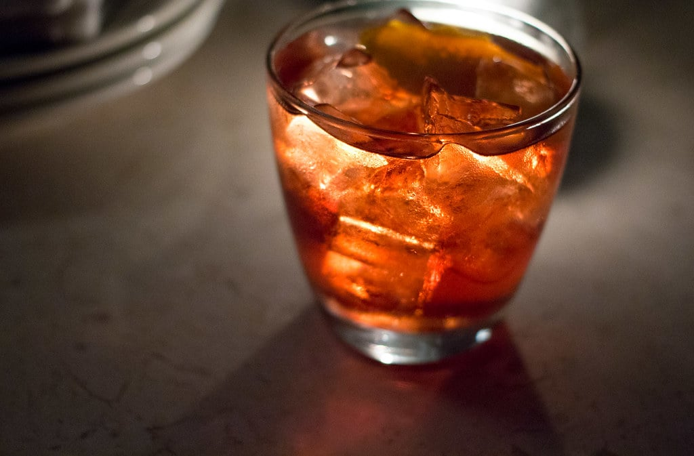

# 老广场

老广场（Old Pal）是一款以[黑麦威士忌](ref:whisky)、[金巴利](ref:liqueur)与[干味美思](ref:vermouth)等比例调制的经典鸡尾酒。它搅拌后滤入杯中，常见装饰为柠檬皮，风格偏苦、偏干。

图：一杯老广场，红橙色酒液盛于古典杯，杯中有冰块与一片柑橘皮。图片：goodiesfirst，CC BY 2.0，via [原图页面](https://www.flickr.com/photo.gne?id=9071091103)。

## 定义与身份

老广场的常见叙述把它与 20 世纪 20 年代的巴黎酒吧场景联系起来，名字与“老朋友”有关。具体起源存在多种说法，本页只把它写成历史背景，不把某一种说法当成定论。

老广场与内格罗尼、Boulevardier 同属“烈酒 + 苦味酒 + 味美思”的等分家族，区别在于基酒：内格罗尼用金酒，Boulevardier 用波本或黑麦，老广场用黑麦。等分是经典结构，但黑麦的辛香与金巴利的苦味会互相拉扯，实际调酒时可按客人口味微调。

## 配方（经典比例）

经典做法使用黑麦威士忌、金巴利与干味美思，三者比例接近等分。做法是：将材料与冰块放入搅拌杯，搅拌至充分冷却与稀释，滤入预冷的杯中，挤压柠檬皮并放入杯中。

用量是起点，不是法律。威士忌提供骨架，金巴利提供苦味与草本香气，干味美思提供干燥的草本背景。任何一项比例变化都会明显改变苦味与酒体。

## 威士忌与金巴利

[威士忌](ref:whisky)是这款酒的主体。黑麦威士忌带来辛辣与干燥的骨架，波本则更甜、更圆润；选择取决于你想要的方向。威士忌的风味强度会影响苦味与草本香气的平衡。

[金巴利](ref:liqueur)是苦味利口酒，提供苦味、橙香与草本气息，是老广场辨识度的重要来源。它的苦味较强，比例过高会压住威士忌；比例过低则失去标志性的苦味结构。不同品牌的苦度与甜度会有差异。

## 干味美思的作用

[干味美思](ref:vermouth)是加香加强葡萄酒，提供干燥的草本背景与少量酒体。它与金巴利的苦味相互衬托，让成品保持偏干的方向；若换成甜味美思，风格会明显变甜、变柔。

不同品牌的干味美思在草本香气与苦味上差异明显。替换时应调整比例，否则成品可能过苦或过干。味美思开瓶后应冷藏，避免氧化后失去香气。

## 搅拌与稀释

老广场通常搅拌，而不是摇和：搅拌能控制稀释，并保持酒体清澈。搅拌不足，温度不够低、稀释不足；搅拌过度，稀释太多，酒体会变薄。

老广场是搅拌型，搅拌杯与古典杯都应预冷。用大冰块搅拌，稀释更可控；古典杯里放一块大冰，能让酒液保持低温而不迅速变水。不要用碎冰，否则黑麦与金巴利的苦味会被稀释得单薄。

## 杯型与装饰

传统上使用预冷的鸡尾酒杯或小容量高脚杯，杯口窄、杯身小，便于集中香气。老广场的苦味与干味美思需要低温支撑；杯体预冷后，第一口的苦香更清晰，回温后也不至于散得太快。

就「老广场」而言，柠檬皮是常见装饰，提供柑橘香气与视觉识别。挤压柠檬皮时，精油会喷到杯口和酒液表面，直接影响第一口的香气。装饰应在饮用前完成。

## 变体

以波本替代黑麦，会得到更甜的版本；以甜味美思替代干味美思，会得到更柔、更甜的版本；以其他苦味利口酒替代金巴利，会改变苦味与香气方向。

老广场的变体取决于威士忌、味美思与苦味利口酒；换甜味美思会更柔，换金巴利则改苦味方向，记录时不能只写“老广场”。关于鸡尾酒结构的一般说明，可以参考[调酒基础](ref:cocktails-guide)；与[尼格罗尼](ref:negroni)相比，老广场以干味美思替代甜味美思，并改用威士忌。

## 常见误区

第一，认为老广场必须很甜。它的方向偏苦、偏干。

第二，把金巴利当作普通甜味利口酒。苦味是它的核心。

第三，忽略搅拌与稀释。稀释不足，香气打不开，苦味会显得尖锐。

第四，把干味美思与甜味美思随意替换而不调整比例。风格会明显变化。

## 饮用与边界

老广场适合作为餐前慢饮，搭配坚果、橄榄或简单咸味小食。它的酒精度较高，苦味明显，应小口慢饮并补充水分；不要空腹快速饮用。驾车、服药或孕期不应饮酒。

本页以 IBA 老广场为骨架，不替具体威士忌或金巴利版本背书；味美思的干甜与苦精用量都会改变成品。成品的强度取决于威士忌的[酒精度](ref:abv)、利口酒的甜度与冰块稀释，不能只看配方数字。

对照阅读：[威士忌](ref:whisky)、[味美思](ref:vermouth)。

## 延伸阅读

- [威士忌](ref:whisky)：老广场的主体与风格来源。
- [利口酒](ref:liqueur)：金巴利与苦味利口酒的作用。
- [味美思](ref:vermouth)：干味美思的草本背景。
- [调酒基础](ref:cocktails-guide)：读老广场所需的结构、稀释与搅拌原则。
- [加冰与温度](ref:ice)：老广场的冰型、稀释与出杯温度。
- [酒精度](ref:abv)：理解成品强度与冰块稀释。
- [尼格罗尼](ref:negroni)：以甜味美思与金酒构成的同类经典。

**关键事实。**

| 项目 | 内容 |
| --- | --- |
| 一句话定位 | 以黑麦威士忌、金巴利与干味美思等比例调制的经典鸡尾酒，搅拌后滤入杯中，常见装饰为柠檬皮，风格偏苦、偏干 |
| 类型 | 经典鸡尾酒 |
| 起源 | 美国（20 世纪 20 年代，巴黎流传） |

**来源与边界。** 本页关于「老广场」的关键事实，主要由以下来源交叉核对：Oxford University Press（老广场的历史背景与基本构成；由原条目末尾参考资料迁移，未逐条复核访问日期）、David Wondrich / Perigee（20 世纪美国鸡尾酒演变的背景）、International Bartenders Association（确认该饮品属于 IBA 官方鸡尾酒名单）等 5 条来源。价格、批次与状态会变，涉及这些字段时以页面所列来源的最新版本为准。正文为项目自写，来源只作核验，不复制原文。

**并读。** 把「老广场」与「威士忌」、「利口酒」、「味美思」放在一起读时，先确认它们是同一层级还是上下游关系：先确认基酒与比例，再比较酸甜平衡、杯型与出品差异。本页负责给出鸡尾酒的基本坐标，对照条目补上具体案例与差异；读完再回到本页，才能分清哪些差别属于鸡尾酒本身，哪些只是产地、批次或品牌选择。

**适用边界。** 对「老广场」而言，配方比例、基酒品牌与杯型会变；IBA 版本是参照，不是唯一做法。

**更新提示。** 「老广场」最近核对于 2026-11-07；配方比例、基酒品牌、杯型与出品标准会变，调酒前以 IBA 或酒吧现行配方为准。
