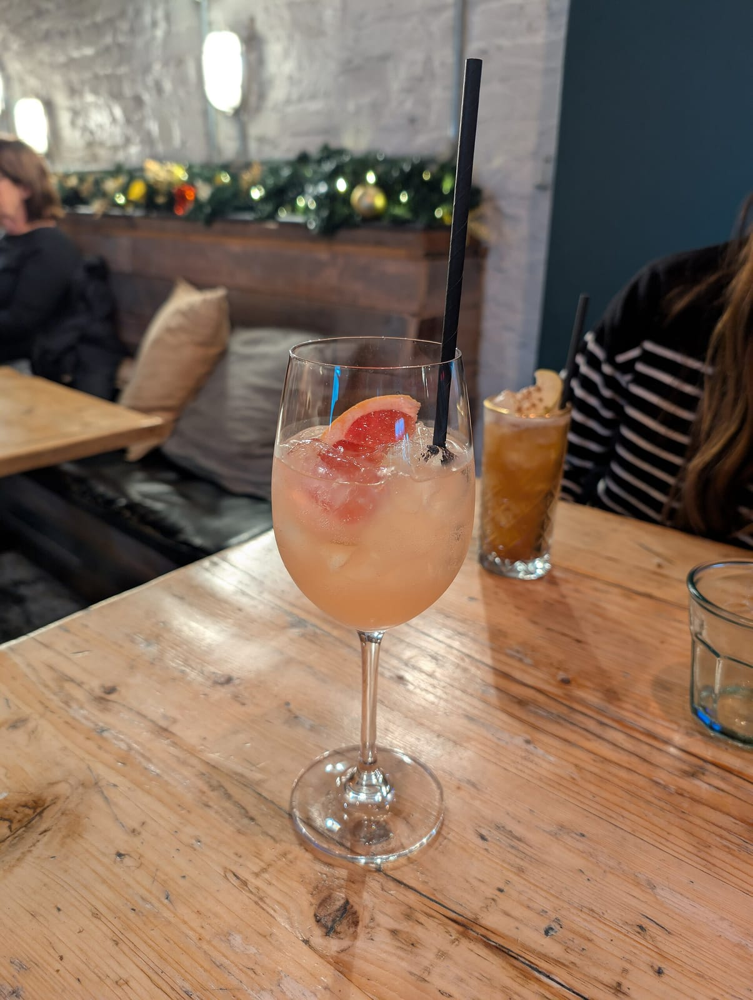

# 帕洛玛

帕洛玛（Paloma）是一款以龙舌兰、西柚风味与青柠调制的清爽长饮。它通常在高球杯中加入大量冰块，以龙舌兰、青柠汁和西柚汽水或西柚果汁直接调配，杯口可做盐边，最后放一片西柚。西柚的苦甜、龙舌兰的植物气息、青柠的酸与气泡共同构成它的识别点，颜色从淡粉到橙红不等。

图：帕洛玛相关实景照片。图片：Andy Li，CC0，via Wikimedia Commons（[原图页面](https://commons.wikimedia.org/wiki/File:Paloma_Spritz_-_Purezza_2024-12-17.jpg)）。

> **先给结论**
> **一句话：** 这页判断帕洛玛该不该点、比例和冰水怎么处理。
>
> - **适合谁：** 想弄懂帕洛玛的配方逻辑、点单方式和常见误区的人。
> - **不适合谁：** 只想要“一杯就醉”的配方、不关心比例和冰水的人。
> - **先看这两点：**
>   - 点单时可以直接说“帕洛玛”，并询问使用的是西柚汽水还是鲜榨西柚汁。
>   - 帕洛玛的起源没有单一档案。

## 起源与命名

帕洛玛的起源没有单一档案。流传说法通常把它放在 20 世纪中期的墨西哥，并与当地西柚风味饮料的流行联系在一起；也有叙述把它与某个品牌或某家酒吧的推广有关。具体发明者、年份与首发地点在不同版本里有出入，因此本页只写作“流传说法”，不把某个具体日期当作定论。

“Paloma”在西班牙语中意为“鸽子”，与味道没有直接关系。关于这个名字的由来，有说是命名者的偏好，有说是某种饮料的商标或昵称，但这些说法缺乏一致的公开档案。名称的趣味不应被写成确定的历史；更稳妥的写法是说明它属于墨西哥西语命名传统，具体动机不可考。

这款酒在墨西哥的流行，与西柚风味汽水的普及密切相关。简化版只需龙舌兰、青柠与西柚汽水，家庭与酒吧都容易复制；更讲究的版本则使用鲜榨西柚汁并补苏打水。两种做法都叫帕洛玛，但配方结构、甜度与苦味强度不同，记录时应写清使用的是汽水还是鲜果汁。

## 配方结构

常见配方有两种。简化版为龙舌兰 50 毫升、青柠汁 15 毫升、西柚汽水 100 毫升，加冰直接调制；鲜果汁版为龙舌兰 50 毫升、鲜榨西柚汁 100 毫升、青柠汁 15 毫升、糖浆 10 毫升、苏打水 60 毫升。前者更轻、更甜、气泡更强，后者更接近真实西柚的苦与酸，但需要更多步骤。

龙舌兰提供植物气息与酒精骨架。 Blanc 或 reposado 都可以使用：前者更清爽、更青草，后者更圆润、带一点木桶甜感；陈年较久的龙舌兰会压过西柚的清爽，因此不是唯一选择。西柚汁的苦味来自柚皮苷等成分，与青柠的酸不同，二者叠加能让甜味显得更有层次。

糖浆只应在鲜果汁版中考虑，而且要看西柚本身的甜度。西柚汽水已经含糖，再加糖浆会让整杯变成甜饮料。盐边不是配方的一部分，但它会改变对甜与苦的感知：少量盐能压住苦味、突出甜味，也会让龙舌兰的植物气息更清楚。盐边可做全边、半边或只在杯口一侧，按个人偏好决定。

## 风味与平衡

入口是西柚的酸与微苦，随后是龙舌兰的青草或熟果气息，青柠把酸度推得更明亮，气泡让整杯显得轻。它不像玛格丽特那样以酸与橙味利口酒为核心，而是以西柚的苦甜为主轴。平衡的关键是西柚的苦、糖的甜与青柠的酸：苦味太强时，少量盐或糖可以缓和；太甜时，增加青柠或换用鲜果汁；太酸时，先检查西柚本身是否过酸。

温度与气泡对这款酒很重要。西柚汽水不够冷，气泡会很快散掉，甜味显得黏；冰块太多，后半杯会被稀释成淡粉色水。理想状态是材料冷藏、杯中有足够冰块、调好后尽快饮用。盐边会随着饮用逐渐溶解，前半杯的咸感更明显，后半杯则回归西柚本身的味道。

酒精度属于中等，但长饮容量大，饮用时间也长。龙舌兰的酒精感可能被西柚的苦甜与气泡掩盖，容易让人喝得比预期快。搭配食物、慢慢饮用并补充水分，比单纯追求“清爽”更安全。驾车、服药或孕期不应饮酒。

## 做法要点

做法以直接调配为主：先做盐边（如需），把粗盐放在小碟中，用青柠角润湿杯口外侧，再将杯口倒扣沾盐，避免盐落入杯中。然后加满冰块，倒入龙舌兰与青柠汁，最后补西柚汽水或西柚果汁加苏打水，轻轻搅拌一次。不要摇和，碳酸会流失。

鲜果汁版建议先摇和龙舌兰、西柚汁、青柠汁与糖浆，再滤入装有冰块的高球杯，最后补苏打水。这样可以让酸、甜、苦更均匀，也能让果汁的香气更完整。简化版则不需要摇和，直接在高球杯中构建即可，但要让龙舌兰与汽水充分接触，避免第一口全是酒。

装饰以一片西柚或西柚角为主，也可加青柠角。西柚片应现切，干边会影响香气与外观。盐边用的盐以粗盐为宜，细盐溶解太快，咸感会迅速进入酒液。若不喜欢盐边，可以省略，或在杯口只做一小段，让客人自行选择。

## 变体

以梅斯卡尔替代龙舌兰，会得到更烟熏、更植物化的版本，常被称为 Mezcal Paloma。加入辣椒或辣椒糖浆，可以做成辣味帕洛玛；把材料打成冰沙，则是冰冻版本。还有用葡萄柚汁加苏打水、用汤力水替代西柚汽水的做法，苦味会更明显。降低糖分可以用无糖西柚汽水，但酸度需要重新平衡。

变体命名应写清替换了什么。用梅斯卡尔后仍叫“帕洛玛”并非不可，但最好注明 Mezcal Paloma；用汤力水替代西柚汽水时，它已经更接近另一种苦味长饮。只有把基酒、柑橘来源与甜味来源写清楚，配方比较才有意义。

## 怎么点与怎么喝

点单时可以直接说“帕洛玛”，并询问使用的是西柚汽水还是鲜榨西柚汁。想要更清爽，可以要求“少糖、青柠多一点”；想要更苦，可以要求鲜榨西柚汁或加一点西柚皮油。盐边可以要求“半盐边”或“不要盐边”。若店家使用西柚汽水，甜度通常较高，可以要求减少汽水、增加青柠。

它适合在炎热天气、户外或搭配墨西哥菜、烤肉、海鲜与咸味小吃。西柚的苦能平衡油脂，气泡能清口，盐边则增强咸鲜感。帕洛玛容易被果汁、气泡或甜味掩盖酒精度，喝的时候要放慢速度，避免在空腹时快速饮用；驾车、服药或孕期不应饮酒。作为长饮，它的容量较大，第二杯应考虑是否还需要酒精。

在酒吧里，如果西柚片是提前切好并放久的，香气会明显减弱；如果盐边过厚，第一口会过咸。可以观察杯口是否干净、冰块是否充足、气泡是否仍在。喝到后半杯时若味道变淡，可以挤一点青柠，但不建议再加糖浆。

## 常见误区

第一，把帕洛玛当成玛格丽特的变体。两者都以龙舌兰为基础，但柑橘结构与甜味来源不同。第二，认为盐边是必需项。盐边是风格选择，不是配方定义。第三，认为只有鲜榨西柚汁才正宗。西柚汽水版是广泛存在的简化做法，只是风味不同。第四，认为龙舌兰越多越好。过多的酒精会压住西柚的苦甜平衡。第五，把西柚汽水当成无糖饮料。它通常含糖，甜度需要计入配方。

相关条目：[高球杯](ref:highball)。

## 另见

- [龙舌兰](ref:tequila)：这款酒的基酒风格与植物气息。
- [高球杯](ref:highball)：长饮的杯型、冰量与气泡保持。
- [鸡尾酒基础](ref:basics)：直接调配与比例调整的基本概念。
- [酸度](ref:acidity)：青柠与西柚如何共同塑造酸感。
- [玛格丽特](ref:margarita)：另一款以龙舌兰与柑橘为核心的鸡尾酒。

对照阅读：[龙舌兰酒](ref:tequila)、[调酒，是另一种认识酒的方式](ref:basics)。

**关键事实。**

| 项目 | 内容 |
| --- | --- |
| 一句话定位 | 以龙舌兰、西柚汁或西柚汽水与青柠调制的清爽长饮，西柚的苦甜、盐边与气泡构成主要特征 |
| 类型 | 现代经典鸡尾酒 |
| 起源 | 墨西哥（流传说法） |
