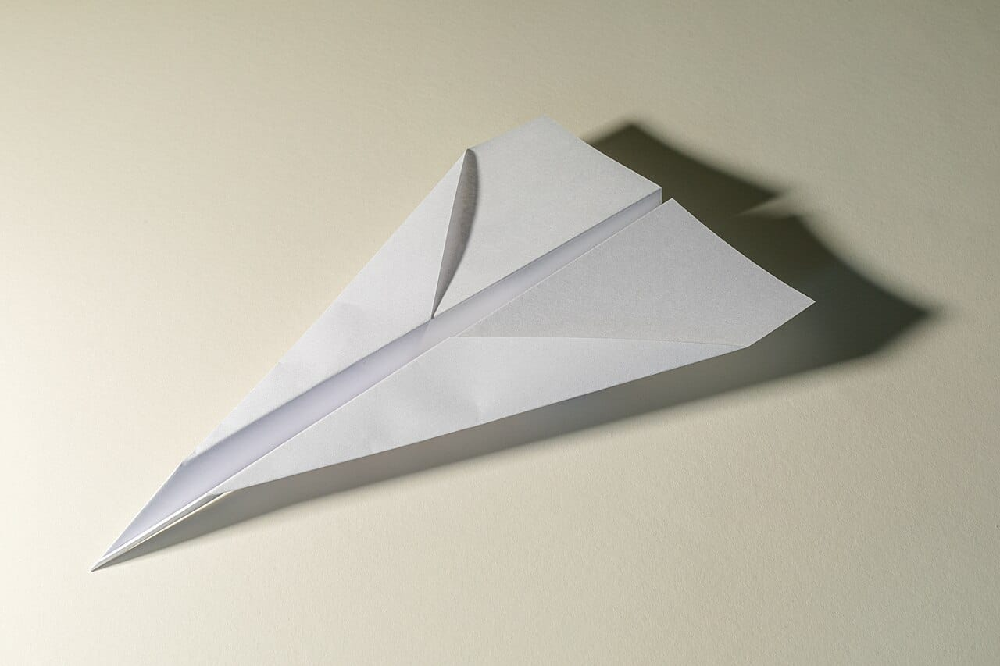

# 纸飞机

纸飞机（Paper Plane）是一款以波本威士忌、阿佩罗、阿玛罗与柠檬汁等量摇制而成的鸡尾酒。它通常滤入预冷的碟形杯，成品呈粉橙色，表面可能有细薄泡沫，一般不加装饰或只放一小片柠檬皮。苦甜、草本、柑橘与波本的甜木气息并重，是 2000 年代以后传播较广的现代经典之一。

图：纸飞机。图片：Dietmar Rabich，CC BY-SA 4.0，via Wikimedia Commons（[原图页面](https://commons.wikimedia.org/wiki/File:Papierflieger_--_2021_--_7215.jpg)）。

> **先给结论**
> **一句话：** 这页判断纸飞机该不该点、比例和冰水怎么处理。
>
> - **适合谁：** 想弄懂纸飞机的配方逻辑、点单方式和常见误区的人。
> - **不适合谁：** 只想要“一杯就醉”的配方、不关心比例和冰水的人。
> - **先看这两点：**
>   - 常见配方为波本威士忌 30 毫升、阿佩罗 30 毫升、阿玛罗 30 毫升、柠檬汁 30 毫升，四者等量。
>   - 点单时可以直接说“纸飞机”，并询问使用哪一种阿玛罗。

## 起源与命名

关于这款酒的诞生，流传说法集中在 2000 年代末的纽约，常把它与当地一家酒吧和一位调酒师联系在一起。具体年份、首发酒吧与配方细节在不同叙述中有出入，因此本页只写作“流传说法”，不把某个日期当作档案。可以确定的是，它属于 2000 年代以后“现代经典”讨论中出现得较早、随后在全球酒吧传播的一批鸡尾酒之一。

名称常被说成来自一首同名歌曲，歌名与“纸飞机”的意象也常被用来说明这款酒的轻盈感与方形的视觉联想。这个关联属于命名趣闻，而不是可核实的配方档案。名字本身不提示原料，也不暗示某种固定的比例；它更多是记忆点，让人把这款粉橙色、苦甜平衡的短饮与一个具体的文化符号联系起来。

把纸飞机称作“波本版内格罗尼”是一种常见的简化，但并不准确。内格罗尼以金酒、苦味酒与甜味美思构成，纸飞机则以波本、阿佩罗、阿玛罗与柠檬汁构成；它们都追求苦甜平衡，但柑橘与草本的方向不同。把两者混为一谈，会忽略柠檬汁在纸飞机中带来的酸度与结构作用。

## 配方结构

常见配方为波本威士忌 30 毫升、阿佩罗 30 毫升、阿玛罗 30 毫升、柠檬汁 30 毫升，四者等量。波本提供甜木、香草与酒精骨架，阿佩罗提供橙味、苦味与颜色，阿玛罗提供草本、苦甜与酒体，柠檬汁提供酸度并把整体拉紧。等量比例容易记忆，也方便按杯型放大或缩小。

阿玛罗的选择会明显改变成品。常见做法使用 Nonino 一类较柔和、带香草与柑橘气息的阿玛罗；换成更苦、更浓的品种，苦味会压过阿佩罗的橙香，整体变得更沉重。替换阿玛罗时，柠檬汁与糖的比例可能需要微调，但那就已经偏离原始配方。记录配方应写清阿玛罗的品牌或类型，而不只是“阿玛罗”。

波本的选择也会改变甜度与木质气息。较高的玉米比例带来更甜、更圆润的口感；较高的黑麦比例则更辛香、更干燥。阿佩罗与阿玛罗本身含糖，柠檬汁负责平衡，因此不需要额外加糖浆。若觉得太甜，优先增加柠檬汁或换用更干的波本；若觉得太苦，先检查阿玛罗是否过苦，而不是直接加糖。

## 风味与平衡

入口先是柠檬的酸与阿佩罗的橙味，随后是阿玛罗的草本苦甜与波本的香草、焦糖气息，尾段留下轻微的苦与柑橘皮香。它不像内格罗尼那样以苦味酒和甜味美思为主轴，而是用柠檬汁把苦甜结构拉得更紧、更明亮。平衡的核心是酸、甜、苦与草本：任何一方过多，都会让粉橙色的酒体显得单一。

温度与稀释会改变层次。刚摇好时酸度最明亮，苦味也最清晰；冰块融化后，甜味与草本气息逐渐展开，苦味变得柔和。它属于短饮，通常不加冰或只加少量冰，因此稀释主要发生在摇和阶段。摇和时间不足会让酸甜没有融合，摇和过度则会让酒体变淡、颜色变浅。

阿佩罗与阿玛罗都含糖，柠檬汁的酸度是平衡的关键。若柠檬汁不足，整杯会显得像带苦味的糖浆；若柠檬汁过多，波本的甜木与阿玛罗的草本会被压住。调整时应一次只改一个变量，先确认问题来自酸、甜、苦还是草本，再决定换哪一种原料。

## 做法要点

做法以摇和为主：把波本、阿佩罗、阿玛罗与柠檬汁倒入摇壶，加冰摇到充分冷却，细滤入预冷的碟形杯或小古典杯。一般不加装饰，或只放一小片柠檬皮；若加柠檬皮，应在饮用前挤压皮油，以补充柑橘香气。双重过滤可以拦住碎冰与果肉，让口感更干净。

杯型以碟形杯、小古典杯或马天尼杯为主。杯口宽有助于香气释放，杯身预冷有助于保持温度。不要加太多冰，否则会继续稀释并让颜色变淡；若使用古典杯，可以放一块较大的冰，但要注意它会让酒体更快变淡。装饰不宜过多，纸飞机的视觉重点通常是酒液本身的粉橙色。

家庭制作时，先把四者按等量量好，再根据阿玛罗与波本的甜度微调柠檬汁。柠檬要现挤，预榨果汁的香气会衰减。摇和时间通常十到十五秒，直到摇壶外壁充分起霜。若没有阿玛罗，不要用普通苦味酒随意替代；风味结构会明显改变，最好把它视为另一种饮品。

## 变体

以黑麦威士忌替代波本，会得到更辛香、更干燥的版本；以其他阿玛罗替代，则改变草本与苦甜的方向。把四者等量放大、一次制作多杯，是酒吧常见的做法；也有把材料与冰打成冰沙的冰冻版本。加入少量橙皮油或葡萄柚皮油，可以提亮柑橘香气，但不改变基本结构。

变体命名应写清替换了什么。把阿玛罗换成更苦的品种后仍叫“纸飞机”，并非不可，但最好注明“某阿玛罗版”；把波本换成黑麦后，甜木气息会减弱，也应说明。只有把基酒、苦味酒、阿玛罗与酸味来源写清楚，配方比较才有意义。

## 怎么点与怎么喝

点单时可以直接说“纸飞机”，并询问使用哪一种阿玛罗。若不喜欢太苦，可以要求“阿玛罗轻一点”或换用较柔和的品种；若喜欢更明亮，可以要求“柠檬多一点”。它通常不加装饰，若想要香气，可以要求一小片柠檬皮。杯型与冰量会影响稀释速度，也可以按个人偏好提出要求。

它适合作为餐后酒，搭配黑巧克力、柑橘甜点、坚果与硬质奶酪。苦甜与草本能平衡甜点的糖分，柠檬的酸则清口。纸飞机容易被果汁、气泡或甜味掩盖酒精度，喝的时候要放慢速度，避免空腹快速饮用；驾车、服药或孕期不应饮酒。它酒精度不低，第二杯应考虑是否还需要。

在酒吧里，如果颜色偏淡、苦味被酸压住，可能是柠檬汁过多或摇和过度；如果颜色偏深、甜味过重，可能是阿玛罗或阿佩罗比例偏高。可以观察颜色是否呈现清晰的粉橙、口感是否干净，作为判断制作质量的线索。但外观不是唯一标准，苦甜与草本的平衡同样重要。

## 常见误区

第一，把纸飞机当成“波本版内格罗尼”。两者的原料与柑橘结构不同。第二，认为等量比例是唯一正确的版本。等量是经典做法，但阿玛罗与波本的差异会改变平衡。第三，认为阿玛罗可以随意替换。不同阿玛罗的苦度与草本方向差异很大。第四，加糖浆。阿佩罗与阿玛罗已含糖，柠檬汁负责平衡。第五，把装饰当成必需项。纸飞机通常以酒液本身呈现，不加装饰也成立。

相关条目：[波本威士忌](ref:bourbon)、[开胃酒](ref:aperitif)、[内格罗尼](ref:negroni)。

## 另见

- [波本威士忌](ref:bourbon)：这款酒的甜木与香草骨架。
- [开胃酒](ref:aperitif)：阿佩罗的苦甜与橙味角色。
- [内格罗尼](ref:negroni)：同样追求苦甜平衡的经典对照。
- [摇和](ref:shaking)：酸度融合、冷却与稀释的技术基础。
- [如何选杯](ref:glass)：碟形杯与短饮的呈现方式。
