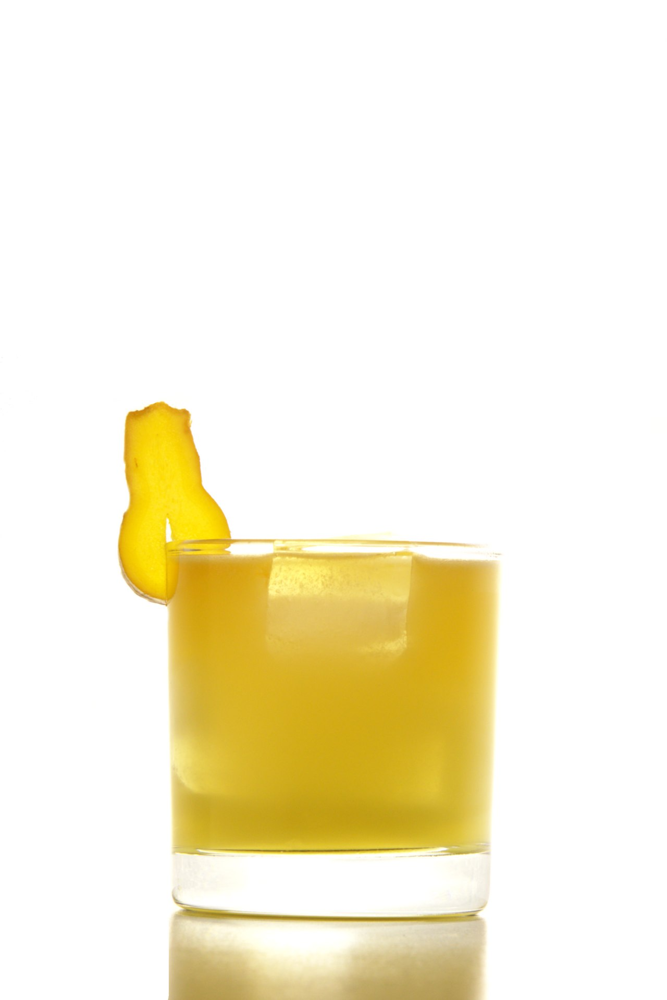

# 盘尼西林

盘尼西林（Penicillin）是一款以苏格兰调和威士忌、柠檬汁、蜂蜜姜糖浆摇制，并在表面浮一层艾雷岛威士忌的鸡尾酒。它通常滤入装有冰块的古典杯，以糖姜片装饰。柠檬的酸、蜂蜜的甜、姜的辛辣与艾雷岛威士忌的泥煤烟熏共同构成识别点，喝起来像一杯带烟熏气息的蜂蜜姜茶，但酒精度并不低。

图：盘尼西林。摄影：File:Penicillin Cocktail.png。署名：Matthias Friedlein (www.augustine-bar.de)，CC BY-SA 4.0，来自 Wikimedia Commons（[来源](https://commons.wikimedia.org/w/index.php?curid=41778882)）。

## 起源与命名

关于这款酒的诞生，流传说法集中在 2000 年代中期的纽约，常把它与当地一家酒吧和一位调酒师联系在一起。具体年份、酒吧名称与配方演变在不同叙述中有出入，因此本页只写作“流传说法”，不把某个日期当作档案。可以确定的是，它属于 2000 年代以后“现代经典”讨论中出现得较早、传播较广的一批鸡尾酒之一。

名称取自抗生素“盘尼西林”，也就是青霉素。姜与蜂蜜在传统上常被视为缓解喉咙不适的组合，调酒师用这个名字暗示“药感”与治愈联想；但这是命名的趣味，不是医学功效。鸡尾酒不能治疗感染，也不能替代药物。把名字当成健康承诺，是对这款酒最常见的误读之一。

配方里的“分层”也是命名之外的结构特征：主体是调和苏格兰威士忌、柠檬、蜂蜜与姜，最后浮一层重泥煤的艾雷岛威士忌。浮层不只是装饰，它让饮用者先闻到烟熏，再进入蜂蜜姜的甜辣主体。把艾雷岛威士忌直接混入摇壶，会改变香气结构，也会让烟熏味变得模糊。

## 配方结构

常见配方为调和苏格兰威士忌 60 毫升、柠檬汁 22.5 毫升、蜂蜜糖浆 22.5 毫升、姜糖浆 7.5 毫升，摇和后滤入装有冰块的古典杯，最后浮艾雷岛威士忌 7.5 毫升。调和威士忌提供谷物与轻微烟熏的骨架，柠檬提供酸，蜂蜜糖浆提供甜与花香，姜糖浆提供辛辣，艾雷岛威士忌提供泥煤香气。

蜂蜜糖浆不是直接舀一勺蜂蜜。蜂蜜在冷液体中不易溶解，直接使用会让甜度不均匀，也会让质地变得黏。通常把蜂蜜与水按体积约二比一或一比一加热搅拌成糖浆，冷却后再用；比例不同，甜度与流动性也不同。配方应写明糖浆比例，否则同样的毫升数会带来不同的甜度。

姜糖浆可以自制，也可以购买。自制时把鲜姜切碎、加热浸泡、过滤后加糖，风味更直接；市售产品的姜辣强度与甜度差异很大。柠檬要现挤，蜂蜜与姜的风味在放置后会变得沉闷。艾雷岛威士忌的用量很小，但品牌差异明显：有些更偏药感与海风，有些更偏篝火与灰烬，选择会改变第一印象。

## 风味与平衡

入口先是柠檬的酸与蜂蜜的甜，随后姜的辛辣逐渐展开，尾段出现泥煤烟熏与轻微苦味。它像一杯温润的姜茶，但酒精会带来明显的热度。平衡的核心是酸、甜、辣与烟熏：蜂蜜过多会显得黏、压住姜；柠檬过多会让姜的辛辣变得尖锐；姜糖浆过多会盖过蜂蜜的花香；艾雷岛浮层过多则会让烟熏压住主体。

烟熏不是“越重越好”。浮层的目的是提供香气，而不是让整杯变成泥煤汤。倒入时应沿杯壁或吧勺背面缓慢注入，让它在液面上形成一层薄膜；搅拌会破坏分层，也会让烟熏迅速扩散。喝的时候第一口会先接触到烟熏，随后才是蜂蜜姜的甜辣，层次感来自这个顺序。

温度与稀释会改变平衡。冰块的融化会让甜味与姜辣逐渐柔和，烟熏也会变得更淡；如果杯子太大、冰太多，后半杯会显得水薄。理想状态是材料冷藏、摇和充分、冰块洁净且不过量，并在风味仍然集中时饮用。它适合慢慢喝，但不应放到冰块完全融化。

## 做法要点

做法以摇和为主：把调和苏格兰威士忌、柠檬汁、蜂蜜糖浆与姜糖浆倒入摇壶，加冰摇到充分冷却，细滤入装有新鲜冰块的古典杯。然后把艾雷岛威士忌沿杯壁或吧勺背面轻轻浮在表面，最后放一片糖姜或姜片。不要摇和艾雷岛威士忌，也不要用力搅拌成品，否则浮层会消失。

糖姜片可以自制，也可以购买。自制时把姜片在糖浆中慢煮、捞出晾干、裹上细糖；市售糖姜的甜度与辣度差异很大。装饰不是必需，但一片糖姜能补充姜的香气，也让饮用者可以嚼食。若不喜欢甜，可以省略糖姜，只用姜片或柠檬皮。

家庭制作时，蜂蜜糖浆应提前调好并冷藏。姜糖浆的辣度可以通过浸泡时间调整：浸泡越久，辣味越强；加糖越多，甜味越重。摇和时间不足会让蜂蜜与姜糖浆没有充分融合，喝起来层次断裂；摇和过度则会让冰块融化太多，烟熏浮层也更容易被稀释。

## 变体

以其他重泥煤威士忌替代艾雷岛浮层，会得到不同方向的烟熏，例如更偏海盐、药草或灰烬。以梅斯卡尔替代浮层，则增加龙舌兰的植物与烟熏气息。也有把姜糖浆换成鲜姜汁、把蜂蜜换成其他甜味剂的版本，但甜度与质地会改变。还有一些配方把艾雷岛威士忌直接混入主体，风味更统一，但少了分层的香气。

变体命名应写清替换了什么。把浮层换成梅斯卡尔后仍叫“盘尼西林”，并非不可，但最好注明“梅斯卡尔浮层版”；把蜂蜜换成糖浆后，甜味的香气会不同，也应说明。只有把基酒、甜味来源、姜的来源与浮层写清楚，同名配方之间的比较才有意义。

## 怎么点与怎么喝

点单时可以直接说“盘尼西林”，并询问浮层使用哪一款艾雷岛威士忌。若不喜欢太甜，可以要求“少蜂蜜、姜多一点”；若不喜欢烟熏，可以要求“不要浮层”，但那就少了这款酒的标志性香气。若对姜的辛辣敏感，可以要求减少姜糖浆，或让店家把姜味调轻。

它适合在寒冷天气、餐后或作为一杯“安慰型”鸡尾酒，搭配烟熏肉类、烤肉、姜味甜点与坚果。蜂蜜与姜的甜辣能承接油脂，烟熏则与烤物的焦香呼应。盘尼西林容易被果汁、气泡或甜味掩盖酒精度，喝的时候要放慢速度，避免空腹快速饮用；驾车、服药或孕期不应饮酒。它的酒精度不低，第二杯应考虑是否还需要。

在酒吧里，如果浮层很快与主体混合，可能是倒入太快或杯子太小；如果完全没有烟熏香气，可能是浮层用量太少或使用了不合适的威士忌。可以观察浮层是否形成清晰的薄膜，作为判断制作质量的线索。但外观不是唯一标准，酸甜与姜辣的平衡同样重要。

## 常见误区

第一，把盘尼西林当成真正的药。它只是名字借用，没有治疗作用。第二，用生蜂蜜直接替代蜂蜜糖浆。蜂蜜不易溶解，甜度会不均匀。第三，认为艾雷岛威士忌是基酒。它通常只是浮层，主体是调和苏格兰威士忌。第四，认为烟熏越重越好。浮层是为了香气，不是让整杯变成泥煤汤。第五，把姜味不足归咎于威士忌。姜糖浆的用量与品质才是关键。

相关条目：[苏格兰威士忌](ref:scotch)、[摇酒](ref:shaking)、[苏格兰](ref:scotland)。

## 另见

- [苏格兰威士忌](ref:scotch)：调和威士忌与艾雷岛泥煤风格的背景。
- [摇和](ref:shaking)：冷却、稀释与蜂蜜姜糖浆的融合。
- [苏格兰](ref:scotland)：威士忌产区与风格差异的地域背景。
- [古典杯](ref:rocks)：短饮杯型、冰块与浮层的呈现。
- [鸡尾酒基础](ref:basics)：摇和、过滤与装饰的基本概念。
