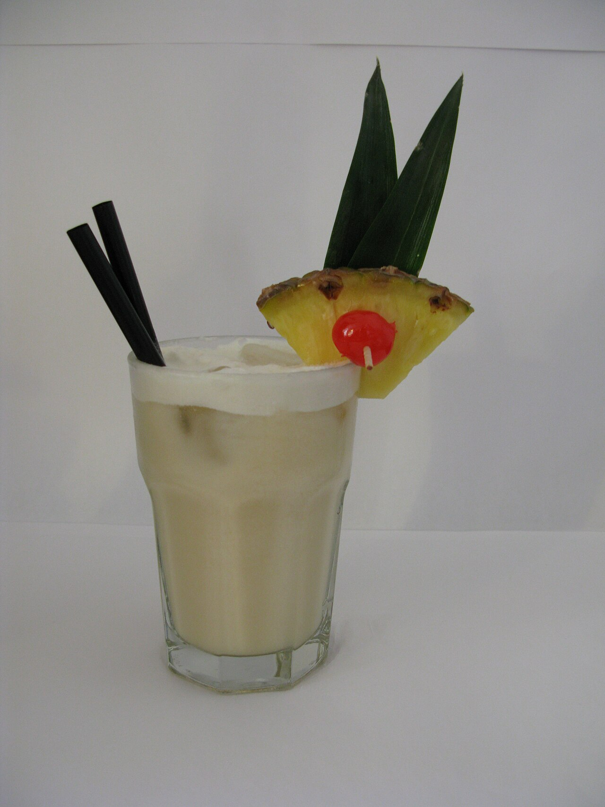

# 椰林飘香

椰林飘香是热带鸡尾酒的代表：白朗姆、椰浆与菠萝汁，加冰打碎，倒入高球杯，杯沿挂一片菠萝。它甜、厚、冰凉，喝起来像液体版的菠萝椰奶，却因为朗姆的存在保留了酒精的骨架。

这杯酒的难点不是配方，而是质地。椰浆的脂肪、菠萝汁的酸度、冰的颗粒与搅拌时间，共同决定它是“绵密的冰沙”还是“稀薄的水果水”。同一份配方，不同比例与打法，可以差出好几个层次。

图：朗姆酒、椰浆与菠萝汁打成的椰林飘香，杯沿配菠萝。图片：Martin Asche，CC BY-SA 3.0，via Wikimedia Commons（[原图页面](https://commons.wikimedia.org/wiki/File:Pina_Colada_(Cocktail).jpg)）。

## 三层的热带结构

第一层是朗姆。白朗姆提供干净的甘蔗甜与酒精度，不抢椰子和菠萝的风头；陈年朗姆会增加香草与木质味，适合“深色椰林飘香”的变体。第二层是椰浆，带来脂肪、厚度与热带香气；第三层是菠萝汁，提供酸度、果香与颜色。

三层必须平衡。椰浆太多，酒会腻、糊嘴；菠萝汁太多，酒会酸、变薄；朗姆太多，椰子与菠萝被压住。好的椰林飘香应该是“甜而不腻、酸而不尖、冰而不稀”，每一口都能感到三种原料同时存在。

## 配方：朗姆、椰浆与菠萝

IBA 的标准配方是白朗姆 50 毫升、椰浆 30 毫升、菠萝汁 50 毫升，加冰打碎。这个比例偏甜，适合作为起点；如果菠萝汁够酸，可以略减椰浆；如果椰浆够浓，可以略增菠萝汁。

椰浆不是椰子水。椰子水清、甜、稀，适合做低热量的变体；椰浆浓、白、含脂肪，才是椰林飘香的骨架。用椰奶（coconut milk）也可以，但脂肪与甜度不同，需要重新调整比例。最忌讳用椰子味糖浆，那会把酒变成甜腻的饮料。

菠萝汁最好用鲜榨或高品质的冷藏汁。罐装汁常有加热味，酸度也不稳定。若用新鲜菠萝，可以先把果肉冷冻，再与液体一起打碎，减少冰的用量，提高果味浓度。

## 做法：摇和还是打碎

传统做法是加冰摇和，滤入装有碎冰的高球杯。摇和能让椰浆与菠萝汁乳化，口感更均匀；碎冰则提供持续的冰凉与稀释。现代酒吧更常用搅拌机：把液体与冰块一起打碎，得到绵密的冰沙，再倒入杯中。

打碎的关键是冰量。冰太多，酒会变成没有味道的冰沙；冰太少，质地稀薄、很快升温。通常液体与冰的体积比接近一比一，先少加冰，再逐步补足。搅拌时间也要控制，打到顺滑即可，过度搅拌会让冰融化、分层。

装饰用菠萝片、樱桃或薄荷。菠萝片可以提前烤过，增加焦糖香；樱桃提供颜色对比；薄荷带来清凉感。杯口可以挂一点椰丝，但不要太多，否则喝的时候会粘嘴。

## 波多黎各的国饮

椰林飘香被波多黎各称为“国饮”。流传最广的版本是 1954 年，圣胡安 Caribe Hilton 酒店的调酒师 Ramón “Monchito” Marrero 把椰浆、菠萝汁与朗姆混合，经过反复试验定型。另一种说法认为，1930 年代已有类似配方，1950 年代才被商业化。

无论起源如何，这杯酒与波多黎各的旅游经济紧密相关。二十世纪后半叶，加勒比度假、航空旅行与酒吧文化一起把椰林飘香推向世界。它成了“海岛假期”的味觉符号，也成了预调酒与冰沙机的常见口味。

名字在西班牙语里意为“过滤的菠萝”，指的是新鲜菠萝汁。英文世界把它拼成 Piña Colada，去掉重音符号后成为 Pina Colada。名字的变化没有改变配方，却提醒我们：这杯酒的根是菠萝，不是椰子。

## 变体与常见错误

常见变体包括“Chi Chi”，用伏特加替代朗姆；“Amaretto Colada”，加杏仁利口酒；“Virgin Piña Colada”，去掉酒精，保留椰浆与菠萝汁。还有“Dark n’ Colada”，用深色朗姆浮在表面，增加视觉与香气。

常见错误有四个。第一，用椰子水代替椰浆，酒体太薄。第二，椰浆未摇匀，脂肪分层，口感不均。第三，冰量过多，味道被稀释。第四，搅拌过度，冰完全融化，酒变成温热的果汁。椰林飘香看似随意，实际对比例与温度很敏感。

对家庭调酒者，最实用的方法是：先把椰浆罐摇匀，量好朗姆与菠萝汁，冰分两次加，打到刚好顺滑。杯子提前冷藏，装饰最后放。记住，这杯酒的目标是“热带的口感”，不是“甜腻的糖水”。

椰浆的选择决定酒体。罐头椰浆含糖、质地厚，摇和后更接近酒吧版本；冷藏椰奶脂肪低、口感薄，需要减少冰量。若用椰奶，可以加一小勺糖浆补甜，但不要加太多，否则会盖过菠萝的酸。菠萝汁也要选鲜榨或冷藏纯汁，不要用加糖的菠萝糖水；糖水会让酒变得腻，也会让颜色变暗。冰块要硬，避免快速融化，也避免稀释风味。

相关条目：[僵尸](ref:zombie)。

## 另见与参考资料

- 迈泰：参见 [迈泰](ref:mai-tai)。
- 僵尸：参见 [僵尸](ref:zombie)。
- 朗姆酒：参见 [朗姆酒](ref:rum)。
- 高球杯：参见 [高球杯](ref:highball)。
- 摇酒：参见 [摇酒](ref:shaking)。

对照阅读：[迈泰](ref:mai-tai)、[朗姆酒](ref:rum)。

**关键事实。**

| 项目 | 内容 |
| --- | --- |
| 一句话定位 | 白朗姆、椰浆与菠萝汁调制的热带鸡尾酒，1930 年代已有雏形，1954 年在波多黎各 Caribe Hilton 定型；可摇和或打碎，甜度与冰量决定成败 |
| 类型 | IBA Contemporary Classics |
| 起源 | 波多黎各圣胡安 |

**来源与边界。** 本页关于「椰林飘香」的关键事实，主要由以下来源交叉核对：International Bartenders Association（IBA 配方分类、原料与比例）、Oxford University Press（鸡尾酒史与术语背景）、CocktailDB（交叉核对配方结构与常见变体）等 5 条来源。价格、批次与状态会变，涉及这些字段时以页面所列来源的最新版本为准。正文为项目自写，来源只作核验，不复制原文。

**并读。** 把「椰林飘香」与「迈泰」、「僵尸」、「朗姆酒」放在一起读时，先确认它们是同一层级还是上下游关系：先确认基酒与比例，再比较酸甜平衡、杯型与出品差异。本页负责给出鸡尾酒的基本坐标，对照条目补上具体案例与差异；读完再回到本页，才能分清哪些差别属于鸡尾酒本身，哪些只是产地、批次或品牌选择。

**适用边界。** 对「椰林飘香」而言，配方比例、基酒品牌与杯型会变；IBA 版本是参照，不是唯一做法。

**更新提示。** 「椰林飘香」最近核对于 2026-11-20；配方比例、基酒品牌、杯型与出品标准会变，调酒前以 IBA 或酒吧现行配方为准。

**编者注。** 本页把「椰林飘香」作为鸡尾酒条目处理：定义、流程与关键数字以正文表格为准，与「迈泰」、「僵尸」的差异用对照阅读验证；遇到价格、批次或地址，回到页面所列来源核对。
