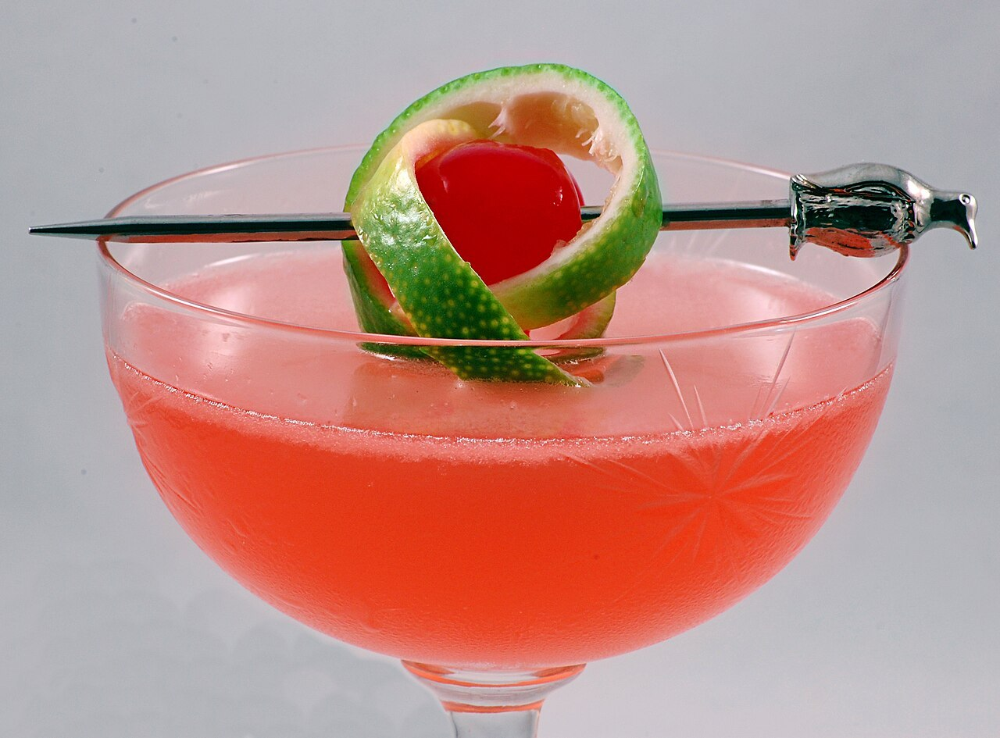

# 粉红佳人

粉红佳人（Pink Lady）常被误认成一杯“给女士喝的甜酒”。真正把它和同类区分开的，是三层结构：金酒与 applejack 的双基酒、石榴糖浆的粉色，以及蛋白摇出的细泡沫。它的历史比名字更复杂。

图：粉红佳人。摄影：File:Pink Lady with a twist of lime, in a cocktail glass.jpg。署名：WxMom，CC BY-SA 2.0，来自 Wikimedia Commons（[来源](https://commons.wikimedia.org/w/index.php?curid=18268285)）。

## 1911 年的百老汇剧，与“1912 年”的转述

最常见的说法是：这款酒得名于百老汇音乐剧《The Pink Lady》，主演 Hazel Dawn 在首演之夜收到了这杯为她而做的酒。《Oxford Companion to Spirits and Cocktails》支持这条线索；Wine Enthusiast 的整理也把 1911 年的音乐剧列为命名的依据。

中文资料常把年份写作 1912 年，但该剧的百老汇首演通常记为 1911 年。更重要的是，Hazel Dawn 当年喝到的那杯“Pink Lady”并不是今天的配方：有记载说它用 ojen（茴香利口酒）与佩肖、安高天娜苦精调成，和后来的金酒酸酒相去甚远。

另一种说法把发明权给了室内设计师 Elsie de Wolfe。她的版本用金酒、粉红西柚汁与君度，既没有 applejack，也没有石榴糖浆。这个故事说明“Pink Lady”在早期更像一个流行名字，而不是一份固定配方。

## 1913 年，Jacques Straub 的最早印刷版

目前可查的最早印刷配方之一，来自 Jacques Straub 的《Manual of Mixed Drinks》（1913）。Cocktailarium 与 Wine Enthusiast 都提到这一版；它还没有蛋白，结构比今天的版本更简单。

Straub 是瑞士人，1913 年定居肯塔基，后来成为美国早期调酒的重要记录者。他的版本被 Wine Enthusiast 视为今天配方的“底稿”：金酒、柠檬、石榴糖浆的组合已经出现，applejack 与蛋白则是后来逐步固定的。

这也解释了为什么粉红佳人的早期资料彼此矛盾：它从一出现就不是“某一位调酒师在某一天发明”的酒，而是多个版本在酒吧、菜单与配方书之间互相覆盖的结果。

## 结构化配方：6 : 2 : 3 : 2 : 2

下面采用 Cocktailarium 记录、并与多数现代酒吧一致的版本。Wine Enthusiast 把石榴糖浆压到 7.5 毫升，成品更干；两种都成立，差别在甜度与颜色深度。酸甜平衡可参考[酸度](ref:acidity)。

| 材料 | 用量 | 说明 |
| --- | --- | --- |
| 金酒（London Dry） | 45 ml | 杜松子骨架，压住甜味 |
| Applejack 或苹果白兰地 | 15 ml | 果香与更圆的酒体 |
| 鲜柠檬汁 | 22.5 ml | 酸度，平衡石榴糖浆 |
| 石榴糖浆 | 15 ml | 粉色、果甜；可减到 7.5 ml |
| 蛋清 | 15 ml（约 1 个） | 泡沫与丝滑质地 |

- **比例**：金酒 : applejack : 柠檬 : 石榴糖浆 : 蛋白约为 6 : 2 : 3 : 2 : 2。
- **杯型**：预冷的 coupe。
- **冰**：先干摇（不加冰）10–15 秒，再加冰湿摇 8–10 秒；滤冰后杯中不加冰。
- **技法**：双重过滤，滤掉碎冰与蛋白筋膜。
- **装饰**：酒渍樱桃，或一片苹果。

## 粉色来自石榴糖浆

这杯酒的粉色不是紫罗兰，也不是食用色素，而是石榴糖浆。石榴糖浆的红色在稀释与蛋白的白色泡沫之间被“调淡”，形成柔和的粉；糖浆放得越多，颜色越深，甜度也越高。

真正用石榴汁做的糖浆，颜色偏暗红、酸度明显；廉价产品常用玉米糖浆与红色素，颜色很艳，味道却像咳嗽糖。后者是粉红佳人最常见的失败来源：它让酒既甜又空，柠檬的酸度被糖压住，尾段留下人工的果味。

## 蛋白：干摇、湿摇与双重过滤

蛋白不是装饰，它决定了这杯酒的质地。先不加冰干摇，让蛋白在室温下被打散、起泡；再加冰湿摇，降温并稀释。顺序反过来，泡沫会稀薄，酒体也不够圆。

干摇 10 至 15 秒是常见区间。摇得太短，泡沫撑不住；摇得太久，蛋白会变得粗糙。湿摇 8 至 10 秒足够降温，过度摇和会让泡沫被稀释、酒体变薄。最后双重过滤，既拦住碎冰，也拦住蛋白里较粗的筋膜。泡沫的稳定与酒体有关，见[酒体](ref:body)。

蛋白的安全要单独说。使用新鲜、可靠来源的鸡蛋；对生蛋白有顾虑的人可以用 aquafaba（鹰嘴豆水）30 毫升替代，泡沫效果接近，但风味会略有不同。

## 与 Clover Club 的亲缘

[三叶草俱乐部](ref:clover-club)是粉红佳人的近亲：同样以金酒、柠檬与蛋白为骨架，同样靠红色糖浆上色。区别在糖浆与基酒：两杯都以[金酒](ref:gin)为骨架，但 Clover Club 用覆盆子糖浆，果味更明亮、酸度更直接；粉红佳人用石榴糖浆，并加入 [applejack](ref:brandy)，酒体更圆、果香更深。

两杯都常被归入“粉色蛋白酸酒”，但喝起来并不一样。Clover Club 像覆盆子果酱被柠檬切开；粉红佳人的石榴糖浆带一点单宁感，applejack 又添了苹果与橡木的气息。把配方互换，颜色或许相近，结构却会散。

## 与飞行（Aviation）的紫色对照

[飞行](ref:aviation)同样是金酒酸酒，也常被拿来和粉红佳人比较。区别首先在颜色来源：飞行用紫罗兰利口酒，呈淡紫到灰蓝；粉红佳人用石榴糖浆，呈粉红。前者是花香，后者是果甜。

质地也不同。飞行不加蛋清，酒液清澈；粉红佳人靠蛋白形成泡沫层。配方上，飞行用 Maraschino 提供樱桃与甜味，粉红佳人用 applejack 增加果味。两杯都“带颜色”，但颜色的来源、香气与口感各走一条路。

## 禁酒令时期与“女士酒”标签

粉红佳人在 1920 年代与 1930 年代流行，这段时间横跨美国禁酒令（1920–1933）与之后的地下酒吧文化。它的粉色与甜味让它容易被记住，也容易被贴上标签。

从 1930 年代到 1960 年代，它常被酒评人归为“女士酒”，在以男性为主的鸡尾酒评论里不受重视。Wine Enthusiast 把这称为“他们的损失”：这杯酒的酸度、蛋白质地与双基酒结构，放到今天的经典酒单里并不轻。

## 常见失败点

第一，干摇不足。蛋白没有充分起泡，表面只有一层薄沫，喝起来水感明显。

第二，石榴糖浆过量。15 毫升已经足够甜；加到 20 毫升以上，酒会腻，粉色也会变得不自然。

第三，用廉价石榴糖浆。红色素与玉米糖浆会盖住金酒与 applejack，尾段像糖果。

第四，杯温不够或湿摇过度。前者让酒迅速升温，后者让泡沫与酒体一起变薄。

第五，忽略蛋白的安全与替代。生蛋白要用可靠来源；有顾虑时用 aquafaba，而不是省略后还期待同样的质地。

## 变体与无酒精版本

- **更干的版本**：石榴糖浆减到 7.5 毫升，柠檬保持 22.5 毫升，适合不喜欢甜的人。
- **省略 applejack**：只剩金酒、柠檬、石榴糖浆与蛋白，果味更轻，酒体更薄。
- **加少量鲜奶油**：早期配方中有加奶油的版本，口感更像甜点，但已偏离现代主流。
- **Calvados 替代 applejack**：法国苹果白兰地更干、更有苹果皮气息，甜度会略降。
- **Aquafaba 版**：以 30 毫升鹰嘴豆水替代蛋白，适合纯素或对生蛋有顾虑的人。

无酒精替代只能近似：0.0% 金酒 45 毫升、无酒精苹果汁 15 毫升、鲜柠檬 22.5 毫升、石榴糖浆 15 毫升与 aquafaba 30 毫升，干摇后再加冰摇和，双重过滤。颜色与泡沫接近，但缺少酒精的重量与金酒的杜松子，口感会更轻、更甜。

相关条目：[金酒](ref:gin)、[白兰地](ref:brandy)。
