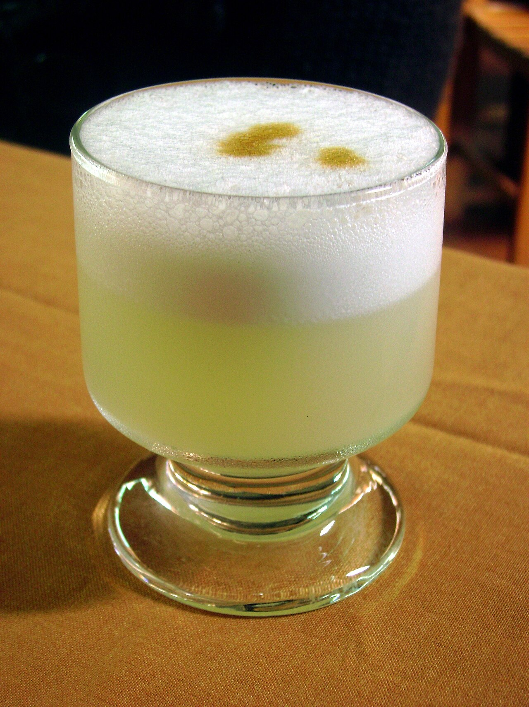

# 皮斯科酸

皮斯科酸（Pisco Sour）是一款以皮斯科、青柠汁、糖浆与蛋清摇制而成的酸类鸡尾酒。成品通常滤入预冷的碟形杯或装有冰块的古典杯，表面覆盖一层细密泡沫，并以几滴安高天娜苦精点缀。皮斯科的葡萄香气、青柠的酸、糖浆的甜、蛋清的丝滑与苦精的香料气息共同构成它的识别点。

图：皮斯科酸。图片：Dtarazona，CC BY-SA 4.0，via Wikimedia Commons（[原图页面](https://commons.wikimedia.org/wiki/File:Pisco_sour_20100613b.JPG)）。

## 起源与命名

皮斯科酸的起源存在竞争性叙述。秘鲁与智利都把皮斯科与酸酒传统视为本国饮食文化的一部分，关于它最早出现在哪个港口、由谁改良、何时定型，公开资料并不一致。流传说法通常把它放在南美太平洋沿岸的港口城市，与当地葡萄蒸馏酒、柠檬与糖的饮用习惯联系在一起；具体年份与人物缺乏统一档案，因此本页写作“流传说法”。

皮斯科本身是一种以葡萄为原料的蒸馏酒，秘鲁与智利各有产区与法规，风格差异明显。秘鲁皮斯科通常不经过长时间木桶陈年，强调新鲜葡萄香；智利皮斯科的法规与风格也有自己的传统。用“皮斯科”三个字笼统指代所有产品，会掩盖这些差异；配方记录应写清产地、葡萄品种与生产方式。

名称中的“Sour”指酸酒家族，即以基酒、柑橘酸与甜味剂构成的基本结构。它和威士忌酸、金酸等属于同一逻辑，但皮斯科的香气与酒体让成品呈现不同的方向。把它简单说成“用皮斯科做的威士忌酸”，会忽略葡萄蒸馏酒特有的花果香与较轻的酒体。

## 配方结构

常见配方为皮斯科 60 毫升、青柠汁 30 毫升、糖浆 20 毫升、蛋清 1 个，另加安高天娜苦精 2 到 3 滴。皮斯科提供葡萄香气与酒精骨架，青柠提供酸度，糖浆平衡酸味，蛋清提供泡沫与丝滑口感，苦精主要提供香气点缀。比例可以微调，但酸、甜、蛋清与酒体的关系需要保持。

糖浆的浓度会明显改变甜度。1:1 糖浆与 2:1 糖浆在同样体积下甜度不同，配方应说明浓度，否则“20 毫升糖浆”会产生不同结果。蛋清的作用是质地，不是味道；它让酸酒的边缘更圆润，也让苦精能停留在表面。若不喜欢蛋清，可以用鹰嘴豆水等替代，或直接省略，但口感会更直接、更薄。

青柠要现挤，皮斯科的香气也应尽量保持新鲜。皮斯科开瓶后长期存放会损失花果香，尤其是不经陈年的风格；配方记录可以注明开瓶时间或批次。苦精的用量很少，但它决定了第一口的香气方向；滴在泡沫上时不要搅动，让饮用者先闻到香料气息。

## 风味与平衡

入口是青柠的酸与糖浆的甜，随后是皮斯科的葡萄香与轻微酒精感，蛋清让口感变得圆润，尾段留下苦精的香料与轻微苦味。它属于酸酒家族，所以平衡的核心仍是酸与甜：太酸时加少量糖浆，太甜时加少量青柠，调整应小幅度进行。蛋清不会增加甜味，但会让酸感显得柔和，因此加不加蛋清会影响对甜度的判断。

皮斯科的香气可能偏向花香、柑橘或成熟葡萄，具体取决于产地与品种。香气较浓的皮斯科适合较少糖浆，以免甜味压住花果香；酒体较轻的皮斯科则需要更注意稀释，避免摇和后变得水薄。苦精不是装饰，它能把泡沫的奶感与柑橘香连接起来，也能在尾段提供一点辛香。

温度与泡沫会随时间变化。刚摇好时泡沫细密、口感紧；放置太久，泡沫会塌陷，香气也会散。冰镇不足会让酸感显得尖锐，冰镇过度则会让香气收敛。理想状态是材料冷藏、摇和充分、杯具预冷，并在泡沫仍然完整时饮用。

## 做法要点

做法通常分两步：先不加冰，把皮斯科、青柠汁、糖浆与蛋清放入摇壶，进行“干摇”，让蛋清充分起泡；然后加冰，再进行“湿摇”，让酒液冷却、稀释并融合。滤入预冷的碟形杯或装有冰块的古典杯，静置片刻让泡沫稳定，最后在泡沫上滴几滴苦精。干摇不是必需，但能显著改善泡沫质地。

蛋清的使用需要注意食品安全。应选择新鲜、妥善冷藏的鸡蛋，必要时使用经过巴氏杀菌的蛋制品；免疫力较弱的人群、孕期人群或对生蛋有顾虑的人，可以选择不加蛋清，或用鹰嘴豆水替代。蛋清替代品的泡沫结构不同，配方应注明，以免比较时产生误解。

摇和时间影响稀释与泡沫。干摇通常十秒左右，湿摇十到十五秒，直到摇壶外壁充分起霜。细滤网可以拦住碎冰与蛋清结块，让口感更干净。苦精滴在泡沫中央或排成小点都可以，但不要用吧勺搅散；饮用时第一口会先接触到苦精的香气。

## 变体

以姜汁汽水或苏打水稀释皮斯科，通常形成 Chilcano 一类较轻盈的饮品；以皮斯科、果汁与糖调制，则有 Pisco Punch 等传统做法。把青柠换成其他柑橘、加入水果泥或辣椒，可以做出不同方向的皮斯科酸。还有不加蛋清的版本，口感更直接；用鹰嘴豆水替代蛋清，则是常见的植物性选择。

变体命名应写清替换了什么。把基酒换成其他葡萄蒸馏酒，仍叫“皮斯科酸”会让产地与香气信息丢失；把蛋清去掉后，最好注明“无蛋清版”，让饮用者知道质地会不同。只有把原料与结构写清楚，同名饮品之间的比较才有意义。

## 怎么点与怎么喝

点单时可以直接说“皮斯科酸”，并询问使用的是秘鲁还是智利皮斯科。若不喜欢蛋清，可以要求“不要蛋清”或“用鹰嘴豆水”。若希望更酸或更甜，可以要求调整糖浆或青柠，但一次只改一个变量。苦精通常默认添加，若不喜欢可以要求省略，但香气会少一层。

它适合作为餐前酒，搭配海鲜、酸橘汁腌鱼、清淡的鱼类与咸味小吃。酸度与泡沫能清口，皮斯科的花果香也能承接海鲜的鲜味。皮斯科酸容易被果汁、气泡或甜味掩盖酒精度，喝的时候要放慢速度，避免空腹快速饮用；驾车、服药或孕期不应饮酒。蛋清版在室温下不宜久放，调好后应尽快饮用。

在酒吧里，如果泡沫很快塌陷，可能是干摇不足或蛋清不新鲜；如果苦精沉入酒液而不是停在泡沫上，说明泡沫结构太薄。可以观察泡沫是否细密、是否与杯口齐平，作为判断制作质量的线索。但外观不是唯一标准，皮斯科的香气与酸甜平衡同样重要。

## 常见误区

第一，把皮斯科酸当成威士忌酸的简单替换。皮斯科的葡萄香与较轻酒体改变了整体方向。第二，认为蛋清是必需项。它影响质地，但可以省略或用替代品。第三，跳过干摇。干摇能显著改善泡沫。第四，把苦精当成装饰。它提供香气与尾段辛香。第五，认为秘鲁与智利的争论能决定哪一杯更好喝。产地与法规影响风格，但杯中的平衡仍取决于配方与执行。

相关条目：[白兰地](ref:brandy)、[摇酒](ref:shaking)、[酸度（acidity）](ref:acidity)。

皮斯科酸的泡沫来自蛋清，不是奶油或乳化剂；不喝蛋清的人可以省略，但口感与外观会明显不同，点单前应先说明。

## 另见

- [白兰地](ref:brandy)：皮斯科作为葡萄蒸馏酒的家族背景。
- [摇和](ref:shaking)：干摇、湿摇与泡沫的形成。
- [酸度](ref:acidity)：青柠在酸酒结构中的作用。
- [古典杯](ref:rocks)：杯型与冰块对泡沫和稀释的影响。
- [鸡尾酒基础](ref:basics)：酸酒家族的基本结构与器具。
