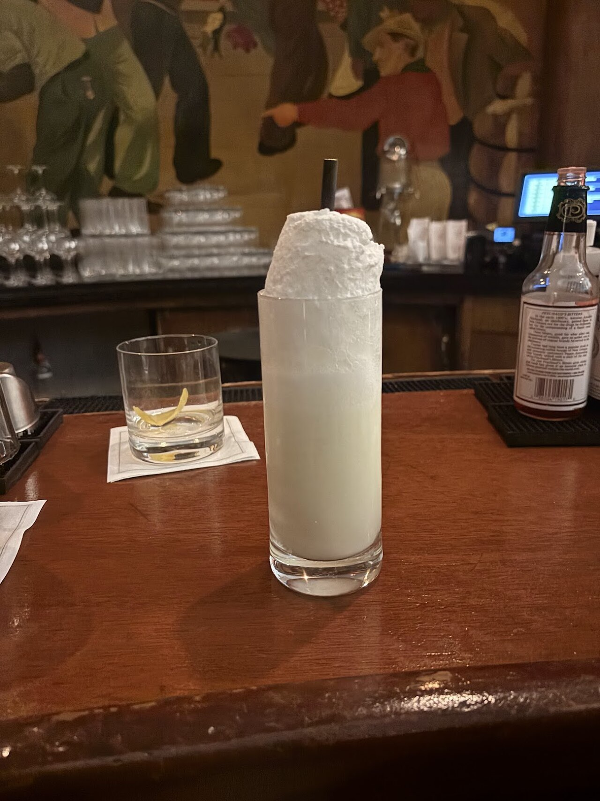

# 拉莫斯金菲士

拉莫斯金菲士是金菲士家族里最“费手”的一杯。金酒、柠檬、青柠、糖、奶油、蛋白、橙花水，加冰长时间摇和，滤入高球杯，再加苏打水。泡沫从杯口升起，像一朵云，酒液在泡沫下呈乳白色。

这杯酒 1888 年由新奥尔良的 Henry C. Ramos 在梅耶餐厅（Meyer's Restaurant）定型。传说在高峰期，一间酒吧要十几个人专门摇这杯酒；今天有电动摇壶与硬摇技巧，但“摇到泡沫细腻”仍是它的核心。

图：拉莫斯金菲士，泡沫丰厚如云。图片：AGnias47，CC BY 4.0，via Wikimedia Commons（[原图页面](https://commons.wikimedia.org/wiki/File:Ramos_Gin_Fizz_at_The_Sazerac_Bar.jpg)）。

## 金酒、柑橘与奶油

金酒提供骨架与香气。伦敦干金酒的杜松子、柑橘与草本，能穿过奶油与蛋白的厚重；老汤姆金酒更甜、更圆，适合这杯酒的复古风格。不要用风味太强的金酒，否则会与橙花水冲突。

柠檬与青柠提供酸度与香气。柠檬的酸圆润，青柠的酸尖锐，两者一起用，酸度有层次；只用柠檬，酒会太“黄”；只用青柠，酒会太“绿”。比例通常是各 1.5 厘升。

奶油提供乳脂与圆润。淡奶油的脂肪能让泡沫更稳定，酒体更顺滑；没有奶油，这杯酒会变成“蛋白泡沫酒”，口感太轻。奶油的用量是 6 厘升，约占总液体的一半。

蛋白提供泡沫的结构。蛋白在摇和时变性、起泡，形成细密的泡沫；没有蛋白，泡沫会很快消失。蛋白要新鲜，冷藏保存，摇和前才取出；不新鲜的蛋白起泡能力差。

橙花水提供花香。它是这杯酒的“签名”，一两滴就能让酒从“柑橘奶油”变成“新奥尔良花园”。橙花水太浓会像香水，太少则闻不到；2 滴是常见的起点。

## 配方：七种材料

IBA 的标准配方是金酒 4.5 厘升、柠檬汁 1.5 厘升、青柠汁 1.5 厘升、糖浆 3 厘升、奶油 6 厘升、蛋白 1 个、橙花水 2 滴，苏打水适量。总量约 180 毫升，滤入高球杯后加苏打至满。

糖浆可以用自制简单糖浆（糖与水 1 比 1），也可以用市售。糖的作用是平衡柑橘的酸、支撑泡沫；糖太少，酒会酸、泡沫不稳；糖太多，酒会腻、泡沫太重。

橙花水要选食品级，不要用香水或精油。橙花水的香气很轻，开瓶后容易挥发；保存时要避光、冷藏。2 滴是起点，可以先加 1 滴，摇和后尝一下，再决定是否加。

苏打水要冰镇、新鲜。苏打水的碳酸能托起泡沫，也能稀释酒液；不新鲜的苏打水气泡不足，泡沫升不起来。加苏打时要沿杯壁缓慢注入，避免冲散泡沫。

## 做法：长摇与苏打

把金酒、柠檬汁、青柠汁、糖浆、奶油、蛋白、橙花水倒入摇壶，先不加冰，干摇 30 秒，让蛋白起泡、奶油乳化。然后加冰，硬摇 2 到 3 分钟，直到摇壶外壁结霜、泡沫细密。

干摇是这杯酒的关键。蛋白在没有冰的摇壶里更容易起泡，奶油也更容易与酒液乳化；先干摇再加冰，泡沫会更稳定、更细。跳过干摇，泡沫会粗、易散。

摇好后用细网滤冰器滤入冷藏的高球杯，滤掉碎冰与未起泡的蛋白。然后沿杯壁注入冰镇苏打水，泡沫会慢慢升起，形成一层“云”。不要搅拌，否则泡沫会消失。

杯子要提前冷藏，杯壁要干净、无油。油渍会破坏泡沫的结构，让“云”塌陷；冷藏能让泡沫更稳定，酒液更清爽。高球杯的容量要足够，泡沫升起后仍有余地。

装饰可以省略，也可以加一片柠檬或一滴橙花水。柠檬片能强化柑橘香，橙花水能强化花香；但传统的拉莫斯金菲士通常不装饰，让泡沫与颜色自己说话。

传统做法要连续摇和十余分钟，现代酒吧多用短摇加硬冰；泡沫是否细密持久，仍是判断一杯拉莫斯金菲士是否合格的关键。

## 新奥尔良的拉莫斯

Henry C. Ramos 是十九世纪末新奥尔良的酒吧老板，在梅耶餐厅工作。1888 年，他把金菲士改良：加入奶油、蛋白与橙花水，延长摇和时间，做出泡沫丰厚的版本。这杯酒很快成为新奥尔良的招牌。

传说在 1880 年代至 1900 年代，拉莫斯金菲士太受欢迎，酒吧需要十几名助手专门摇酒；摇壶在吧台间传递，像一条“摇酒流水线”。这个说法常被引用，但是否完全真实，已难考证。

这杯酒也见证了新奥尔良的酒吧文化：法国区、杰克逊广场、密西西比河。它的花香、奶油与气泡，像这座城市的混合文化；它的“费手”，也像这座城市的慢节奏。

今天，拉莫斯金菲士仍是新奥尔良酒吧的必点之一，也是全球调酒师的“技术考题”。能否做出稳定、细密、升起的泡沫，是判断一杯拉莫斯的标准。

## 变体与常见错误

常见变体包括“Ramos Gin Fizz with egg white powder”，用蛋白粉替代新鲜蛋白；“Chocolate Ramos”，加入可可利口酒；“Ramos Fizz Float”，在泡沫上加一滴橙花水；“Gin Fizz”，省略奶油与蛋白，回归简单版本。

常见错误有四个。第一，跳过干摇，泡沫粗、易散。第二，摇和时间不足，蛋白没有充分起泡。第三，苏打水不新鲜，泡沫升不起来。第四，杯子有油渍，泡沫塌陷。拉莫斯的成败，在“泡沫”。

对家庭调酒者，最实用的建议是：蛋白与奶油冷藏，先干摇 30 秒，再加冰硬摇 2 分钟，滤入冷杯，沿壁加冰镇苏打，不要搅拌。记住，这杯酒的目标是“云一样的泡沫”，不是“蛋白甜酒”。

相关条目：[金菲士](ref:gin-fizz)。

长摇十余分钟是传统做法，短摇加硬冰是现代变体；泡沫是否细密持久，仍是判断这杯酒的关键。

## 另见与参考资料

- 金酒：参见 [金酒](ref:gin)。
- 金菲士：参见 [金菲士](ref:gin-fizz)。
- 干摇：参见 [干摇](ref:dry-shaking)。
- 高球杯：参见 [高球杯](ref:highball)。
- 甜型：参见 [甜型](ref:sweet)。

对照阅读：[金酒](ref:gin)、[干摇](ref:dry-shaking)。

**关键事实。**

| 项目 | 内容 |
| --- | --- |
| 一句话定位 | 金酒、柑橘、奶油、蛋白与橙花水长时间摇和后加苏打的新奥尔良经典，泡沫丰厚如云；1888 年由 Henry C. Ramos 在梅耶餐厅定型 |
| 类型 | IBA Contemporary Classics |
| 起源 | 美国新奥尔良 |

**来源与边界。** 本页关于「拉莫斯金菲士」的关键事实，主要由以下来源交叉核对：International Bartenders Association（IBA 鸡尾酒列表与配方分类；该款无独立页面，参考 IBA 鸡尾酒总目录）、Oxford University Press（鸡尾酒史与术语背景）、CocktailDB（交叉核对配方结构与常见变体）等 5 条来源。价格、批次与状态会变，涉及这些字段时以页面所列来源的最新版本为准。正文为项目自写，来源只作核验，不复制原文。
