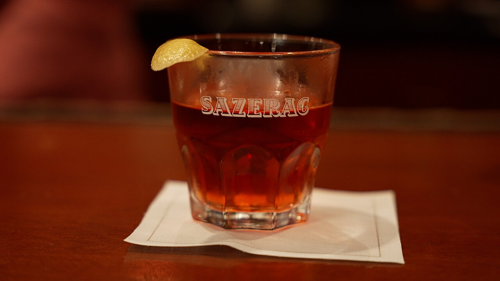

# 萨泽拉克

萨泽拉克（Sazerac）是起源于美国新奥尔良的经典鸡尾酒。IBA 公开版本以干邑、方糖与佩肖苦精调制，杯中以[苦艾酒](ref:absinthe)洗杯，常见装饰为柠檬皮；用黑麦威士忌的版本是美国内战之后干邑短缺时形成的替代传统，也是今天许多酒吧的默认做法。

图：萨泽拉克。图片：Gtandersson，CC BY 4.0，via Wikimedia Commons（[原图页面](https://commons.wikimedia.org/wiki/File:SazeracCocktail.jpg)）。

## 定义与身份

萨泽拉克常被称为新奥尔良的代表鸡尾酒，历史叙述与当地酒吧、苦精品牌和法裔文化有关。具体起源与早期做法存在多种说法，本页只把它写成历史背景，不把某一种说法当成定论。

## 配方（IBA 版本）

IBA 公开配方是：干邑 50 毫升、苦艾酒 10 毫升（用于洗杯）、方糖 1 块、佩肖苦精 2 dash。做法是：在预冷古典杯中倒入苦艾酒，转动杯子使内壁均匀沾附，倒掉多余酒液与杯中碎冰；把干邑、方糖与苦精加冰搅拌，滤入杯中，挤压柠檬皮并放入杯中。IBA 的注释说明，美国内战后干邑难以获得，黑麦威士忌才替代干邑成为常见基酒——这解释了为什么很多现代配方写黑麦，而 IBA 条目仍写干邑。

用量是起点，不是法律。干邑提供骨架，方糖圆润酒体，苦精提供香气，苦艾酒洗杯提供香气背景。任何一项变化都会明显改变成品。

## 干邑、黑麦与苦精

IBA 版本的主体是干邑，带来葡萄、木桶与较柔的果香；黑麦威士忌带来辛辣与干燥的骨架，波本则更甜、更圆润。历史叙述里，干邑是早期做法，黑麦是内战后的替代，两者不是谁“更正宗”，而是不同年代的可得性与口味选择。替换基酒时应相应调整方糖与苦精的用量。

佩肖苦精是萨泽拉克的辨识点，带有茴香与香料气息，与苦艾酒的香气相互呼应。不同苦精的配方差异很大，换苦精等于换风格，应记录清楚。苦精几滴即可，过多会压住基酒。

## 苦艾酒洗杯

[苦艾酒](ref:absinthe)在这款酒里主要用于洗杯，而不是作为主要液体。杯内壁沾附的苦艾酒会为每一口提供香气背景，尤其是茴香与草本气息；倒掉多余酒液，是为了避免苦艾酒压过基酒。

洗杯的用量与时间会影响香气强度。洗得太少，香气几乎察觉不到；洗得太多，苦艾酒会成为主导。不同苦艾酒的香气强度不同，替换时应相应调整用量。

## 搅拌与稀释

萨泽拉克通常搅拌，而不是摇和：搅拌能控制稀释，并保持酒体清澈。搅拌不足，温度不够低、稀释不足；搅拌过度，稀释太多，酒体会变薄。

萨泽拉克传统上不在杯中加冰，而是把古典杯预冷后滤入。搅拌时用大冰块，控制稀释；若喜欢更凉，可把杯子冰得更久，但不要把冰块放进成品，否则茴香与苦精的香气会被水味盖住。

## 杯型与装饰

传统上使用预冷的古典杯或小容量高脚杯。古典杯便于洗杯与放柠檬皮，高脚杯便于集中香气。萨泽拉克的杯体要预冷，苦艾洗杯后的茴香薄膜才不会被室温迅速挥发；杯越冷，香气过渡越完整。

就「萨泽拉克」而言，柠檬皮是常见装饰，提供柑橘香气与视觉识别。挤压柠檬皮时，精油会喷到杯口和酒液表面，直接影响第一口的香气。装饰应在饮用前完成。

## 变体

以黑麦或波本替代干邑，会得到更辛辣或更甜的版本；以其他苦精替代佩肖苦精，会改变香气方向；不使用苦艾酒洗杯，会得到更简单的版本，但会失去标志性的茴香背景。

萨泽拉克的变体常从基酒、苦精与洗杯方式三处发生；干邑与黑麦带来不同骨架，换苦精或省略苦艾都会改变香气层次。关于鸡尾酒结构的一般说明，可以参考[调酒基础](ref:cocktails-guide)；与[古典](ref:old-fashioned)相比，萨泽拉克以苦艾酒洗杯并改用佩肖苦精。

## 常见误区

第一，把苦艾酒洗杯当作添加主料。它的作用是提供香气背景。

第二，苦精越多越好。苦精是香气，不是主要味道。

第三，忽略搅拌与稀释。稀释不足，香气打不开，酒精刺激会显得突出。

第四，把萨泽拉克当作普通威士忌鸡尾酒。洗杯与佩肖苦精是它的辨识点。

## 饮用与边界

萨泽拉克适合作为餐前慢饮，搭配坚果、奶酪或新奥尔良风味的小食。萨泽拉克的酒精度较高，应小口慢饮并补充水分；不要空腹快速饮用。驾车、服药或孕期不应饮酒。

本页以 IBA 萨泽拉克为骨架，不评价具体干邑或黑麦品牌；苦精、方糖与洗杯方式会带来不同版本。成品的强度取决于基酒的[酒精度](ref:abv)、方糖用量与冰块稀释，不能只看配方数字。

对照阅读：[威士忌](ref:whisky)、[酒精度（ABV）](ref:abv)。

## 延伸阅读

- [威士忌](ref:whisky)：黑麦版本与内战后的替代传统。
- [苦艾酒](ref:absinthe)：洗杯与香气背景。
- [调酒基础](ref:cocktails-guide)：读萨泽拉克所需的结构、稀释与搅拌原则。
- [加冰与温度](ref:ice)：萨泽拉克的冰型、稀释与出杯温度。
- [酒精度](ref:abv)：理解成品强度与冰块稀释。
- [古典](ref:old-fashioned)：以威士忌、糖与苦精为基础的另一款经典。

**关键事实。**

| 项目 | 内容 |
| --- | --- |
| 一句话定位 | 起源于美国新奥尔良的经典鸡尾酒，IBA 版以干邑、方糖与佩肖苦精调制，杯中以苦艾酒洗杯；黑麦威士忌版是美国内战后的替代传统 |
| 类型 | 经典鸡尾酒 |
| 起源 | 美国新奥尔良（19 世纪） |

**来源与边界。** 本页关于「萨泽拉克」的关键事实，主要由以下来源交叉核对：International Bartenders Association（官方配方、调制方法与装饰；确认该饮品属于 IBA 官方鸡尾酒名单）、Oxford University Press（萨泽拉克的历史背景与基本构成；由原条目末尾参考资料迁移，未逐条复核访问日期）、David Wondrich / Perigee（19 世纪美国鸡尾酒演变的背景）等 6 条来源。价格、批次与状态会变，涉及这些字段时以页面所列来源的最新版本为准。正文为项目自写，来源只作核验，不复制原文。

**并读。** 把「萨泽拉克」与「威士忌」、「苦艾酒」、「酒精度（ABV）」放在一起读时，先确认它们是同一层级还是上下游关系：先确认基酒与比例，再比较酸甜平衡、杯型与出品差异。本页负责给出鸡尾酒的基本坐标，对照条目补上具体案例与差异；读完再回到本页，才能分清哪些差别属于鸡尾酒本身，哪些只是产地、批次或品牌选择。
