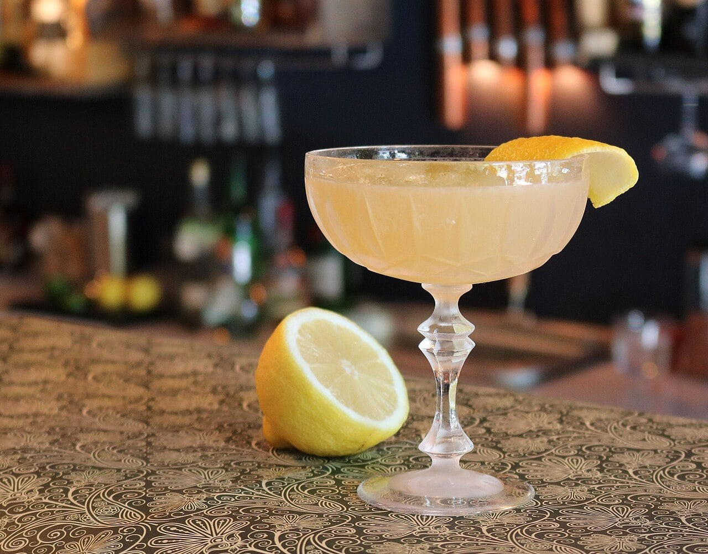

# 边车

边车（Sidecar）是一款以干邑、橙味利口酒和鲜榨柠檬汁摇和而成的经典鸡尾酒。它属于酸酒家族：烈酒提供骨架，柑橘提供酸度，甜味利口酒同时承担甜度与香气。IBA 的公开配方写作干邑 50 毫升、橙味利口酒 20 毫升、鲜榨柠檬汁 20 毫升，摇和后滤入预冷的鸡尾酒杯饮用。糖边是可选做法，不是定义的一部分。

图：一杯边车，琥珀色酒液盛于碟形杯，杯口挂着一片柠檬。图片：Achim Schleuning，CC BY-SA 4.0，via [原图页面](https://commons.wikimedia.org/wiki/File:Sidecar_Cocktail.jpg)。

> **先给结论**
> **一句话：** 这页判断边车该不该点、比例和冰水怎么处理。
>
> - **适合谁：** 想弄懂边车的配方逻辑、点单方式和常见误区的人。
> - **不适合谁：** 只想要“一杯就醉”的配方、不关心比例和冰水的人。
> - **先看这两点：**
>   - 糖边是边车最容易被误解的部分。
>   - 点单时可以说“边车，干邑基酒，糖边半圈或不要”，并问清楚用的是哪一种橙味利口酒。

## 一杯酸酒的三角结构

酸酒的基本结构是“烈酒 + 酸 + 甜”。在边车里，[干邑](ref:cognac)是烈酒，也是风味的主体；[橙味利口酒](ref:orange)同时提供甜度、柑橘香气和一部分酒体；柠檬汁提供酸度与清香。三者不是简单相加，而是互相约束：橙味利口酒的甜需要柠檬的酸来削薄，柠檬的尖需要甜来包住，干邑的木质与果香则需要两者共同托起。

边车的识别点不在某一种原料，而在比例。干邑占比高，酒体才有厚度；橙味利口酒太多，会变成一杯甜橘酒；柠檬太多，干邑的果香会被酸压住。50:20:20 约为 2.5:1:1，是一个偏干、偏酒体的比例；早期书面配方常用等份，三者各占三分之一，喝起来更甜、更圆，也更像“橙味甜酒加一点白兰地”。两种比例都能成立，但它们是不同的版本，不该共用同一个不加说明的配方。

从强度看，边车不是低度饮料。按干邑 40% 酒精度、橙味利口酒 20%–40% 酒精度估算，摇和前的混合液约在 27%–31%，摇和后被冰水稀释，通常落到 25% 上下。具体数值取决于酒精度、摇和时间与滤冰方式，不能只看杯型判断。

## 起源：巴黎、伦敦与一位上尉

边车的起源没有定论，至少有三种常被重复的说法，而且它们指向不同的城市与人。

第一种说法把它放在巴黎的 Harry's New York Bar，归功于 Harry MacElhone。这家酒吧是 1920 年代美国侨民与调酒书作者聚集的地方，MacElhone 也确实在书里记录过边车。第二种说法把它放在伦敦的 Buck's Club，归功于调酒师 MacGarry。较早的印刷记录之一，是 Robert Vermeire 在 1922 年的《Cocktails: How to Mix Them》里收录的 Side-Car：柠檬汁、Cointreau 与干邑各六分之一 gill，等份，并注明这款酒在法国很流行、由伦敦 Buck's Club 的 MacGarry 引入。第三种说法来自 David Embury 1948 年的《The Fine Art of Mixing Drinks》：他写道，这是一位美国陆军上尉在第一次世界大战期间的巴黎发明，名字来自载他往返小酒馆的摩托车边车。Embury 没有给出酒吧名，后来的叙述却常把它补成某一家名店。

三种说法并不互相证明。1922 年的印刷记录能证明“这款酒在当时已经流传”，不能证明谁是发明者；Harry's New York Bar 与 Buck's Club 都可能是传播节点，而不是唯一的出生地；一战上尉的故事更像一则被反复讲述的轶事。因此本页写作“有说法认为”，不把任何一个年份、酒吧或人物当成已证实的事实。

## 为什么 IBA 写 50:20:20

IBA 的边车条目属于“难忘经典”类别，材料只有三项：干邑 50 毫升、橙味利口酒 20 毫升、鲜榨柠檬汁 20 毫升；方法是加冰摇和，滤入预冷的鸡尾酒杯；装饰一栏写的是 N/A。这个“无装饰”很能说明问题：在 IBA 的版本里，糖边不是必需项。

50:20:20 的意义是把干邑放回中心。等份配方里，橙味利口酒的体积与干邑相同，甜度和橙皮香气会盖过干邑的细腻果香，成品更像一杯餐后甜酒；2.5:1:1 则让干邑的葡萄、木桶与轻微辛辣先出现，橙味利口酒退到中段，柠檬在尾段收口。它更干，也更考验基酒的品质。

不同来源的差异主要在“甜”上。除了等份与 2.5:1:1，也能见到 2:1:1 的写法；一些现代配方会额外加 5–10 毫升糖浆，让成品更容易被初次饮用者接受。另一些配方把橙味利口酒加到 25 毫升，用甜度换取更饱满的柑橘香。这些都不是错误，但必须写明：加糖浆的版本更软，等份版本更甜，2.5:1:1 更干。把三者混为一谈，读者就无法判断自己喝到的是哪一种。

## 糖边：可选，而且会压住香气

糖边是边车最容易被误解的部分。它看起来像这款酒的标志，实际上只是一个可选项。做法通常是用柠檬角润湿杯口外沿，再把细砂糖蘸在杯口上，可以只做半圈，也可以做整圈；糖不能撒进杯内，否则会改变酒液本身的甜度。

糖边会改变入口顺序。嘴唇先碰到糖，第一口因此更甜，酸度被压下去，干邑的酒精感也显得柔一些。对喜欢甜味的人来说，这让酒更友好；对手里有一瓶好干邑的人来说，这是一层干扰。糖的甜味会与橙味利口酒的甜叠加，让中段的柑橘香变钝；细糖的颗粒感还会分散对香气细节的注意。简单说，糖边用“甜”换“香”，换得越多，边车越像一杯甜点酒。

这也是为什么 IBA 的配方不写糖边。想要糖边时，建议只做半圈，用细砂糖而不是糖粉，杯子外沿的水要擦到刚好能粘住糖、又不至于流下来。糖受潮会结块，也会让杯口变得黏手；出品前再蘸糖，不要提前做好放在吧台上。若基酒本身偏甜、橙味利口酒也偏甜，糖边可以完全省略，让柠檬的酸把结构撑起来。

## 摇和、稀释与温度

边车用[摇和](ref:shake)，不用搅拌。原因有三：鲜榨柠檬汁需要与酒液充分混合；摇和能快速降温；摇和带来的少量空气会让口感显得轻一点。摇和不足，酒液温度不够低，酸与甜是分开的；摇和过度，冰化水太多，干邑的香气被冲淡，杯底还会积一层水。

操作上，先把所有材料与冰块放入摇壶，摇 10–12 秒，听到冰块碰撞声变闷、壶身明显结霜即可。滤冰时建议双重过滤：先用滤冰器挡住冰块，再经过细滤网挡住果肉与碎冰。边车没有蛋白，不需要干摇；但柠檬果肉会堵塞普通滤冰器，细滤能让口感更干净。杯子要提前冷藏，滤入后不要再加冰，以免继续稀释。

稀释是配方的一部分，不是失误。摇和后进入酒液的冰水通常相当于原体积的 20% 到 25%，它把 30% 左右的混合液降到 25% 上下，也让酸、甜、酒精结合在一起。如果事先把杯子、酒液都冰得很透，可以少摇一两秒；如果材料是室温，摇和时间要够，但不能靠长时间摇和来“降温”，否则稀释会过头。

## 杯型：coupe 与 martini

传统上用[碟形杯](ref:coupe)或鸡尾酒杯。两者都有杯脚，避免手温直接传给酒液；区别在杯腹形状。碟形杯的杯腹较宽、杯口略收，香气有空间聚集，酒液表面积适中，升温速度比锥形杯慢；马天尼杯是浅锥形，杯口很宽，香气散得快，酒液薄薄一层，升温也快，端起来还容易洒。

IBA 只写“预冷的鸡尾酒杯”，没有指定具体器型。若用碟形杯，倒入杯容量的三分之二左右即可，留出闻香的头部空间；若用马天尼杯，杯口宽，适合短时间喝完，不适合慢慢聊天。容量上，150–200 毫升的碟形杯足够；太小会让酒液接近杯口，闻香时酒精刺激明显，太大则显得空。关于杯型对香气与温度的影响，可以延伸阅读[如何选杯](ref:basics)。

## 变体：Chelsea Sidecar 与 Between the Sheets

Chelsea Sidecar 是把干邑换成金酒的版本。金酒的杜松子、芫荽与柑橘皮会让成品更清瘦、更干，橙味利口酒的甜也更突出；如果沿用 2.5:1:1，金酒的植物感会盖过一部分橙香，有些人会把橙味利口酒略微加回。它不是“边车加金酒”，而是换掉了主体，风味方向随之改变。

Between the Sheets 通常写作干邑、白朗姆、橙味利口酒与柠檬汁等份。它常被追溯到 1930 年代的巴黎，也有说法把它与 Harry's New York Bar 联系在一起，但同样没有一致的档案结论。朗姆带来甘蔗与热带果香，干邑带来葡萄与木桶，两者叠加后比边车更厚、更甜，也更接近“多层酸酒”。

更远的亲戚是 Margarita。把干邑换成龙舌兰、把柠檬换成青柠、把糖边换成盐边，结构仍然是“烈酒 + 橙味利口酒 + 柑橘”。但这不是简单的替换：龙舌兰的植物与胡椒感、青柠的苦香、盐对酸度和苦味的抑制，都会改变平衡。说 Margarita 是“龙舌兰版边车”只能当作结构类比，不能当作历史结论。

## 与 Margarita 的结构关系

[玛格丽特](ref:margarita)的 IBA 配方是龙舌兰 50 毫升、橙味利口酒 20 毫升、鲜榨青柠汁 15 毫升，比例约为 10:4:3；边车是 50:20:20，约为 2.5:1:1。两者都把基酒放在一半以上，都用橙味利口酒做甜味与香气，都用柑橘做酸。差别在柑橘种类与杯口处理：柠檬的酸更直接、香气更轻，青柠的酸更尖、带一点苦；糖边加甜，盐边则压低苦味、放大酸与甜。

从结构上看，边车更“干”，玛格丽特更“紧”。边车的柠檬与橙味利口酒让中段更宽，玛格丽特的青柠让收口更短、更利。把边车的糖边换成盐边，会得到一杯更咸鲜、但依然偏干的白兰地酸酒；把玛格丽特的盐边换成糖边，则会得到一杯更甜、更圆润的龙舌兰酸酒。杯口处理不是装饰，它直接改变第一口的感知。

历史关系不宜倒推。玛格丽特的起源同样有多种说法，通常被放在 1930–1940 年代的墨西哥与美国边境地区；没有可靠证据表明它就是边车的直接改造。把两者放在同一个“酸酒模板”里比较，是分析结构，不是宣称血缘。

## 常见失败点

第一，杯子没冷。酒液滤入温杯后会迅速回温，酸度显得松，香气也散得快。第二，柠檬不是现榨。放久的柠檬汁失去清香，只剩尖酸，糖边也救不回来。第三，橙味利口酒太甜或用量过多。甜味盖住干邑，喝起来像橙味甜酒。第四，糖边做满整圈。每一口都先碰到糖，酸与香气被压住。第五，摇和过头。冰化水太多，酒体变薄。第六，不过滤果肉。口感浑浊，杯底有碎冰。第七，干邑本身木桶味过重或过于年轻。前者压住橙香，后者酒精感尖，2.5:1:1 会把缺点放大。

## 怎么点与怎么喝

点单时可以说“边车，干邑基酒，糖边半圈或不要”，并问清楚用的是哪一种橙味利口酒。若喜欢更干，要求 2.5:1:1 或减少橙味利口酒；若喜欢更甜，要求少量糖浆或糖边，而不是让调酒师加更多橙味利口酒，因为后者会同时增加橙香与甜度。若对酒精敏感，可以问杯量；边车通常是小杯短饮，但酒精度不低。

它适合作为餐前酒，也可以搭配坚果、咸味奶酪、橄榄或柑橘类甜点。糖边版本更适合搭配偏苦或偏咸的食物，无糖边版本更适合搭配清淡的海鲜与白肉。饮用时小口慢喝，不要让杯子在桌上放太久；酒液回温后，酸与酒精会变得更突出。驾车、服药或孕期不应饮酒。

## 另见

- [干邑](ref:cognac)：边车的主体、酒精度与风味层次。
- [橙味利口酒](ref:orange)：甜度、橙皮香气与版本差异。
- [摇和](ref:shake)：冷却、稀释与双重过滤。
- [碟形杯](ref:coupe)：杯腹、杯口与香气聚集。
- [玛格丽特](ref:margarita)：同一酸酒模板下的龙舌兰版本。
