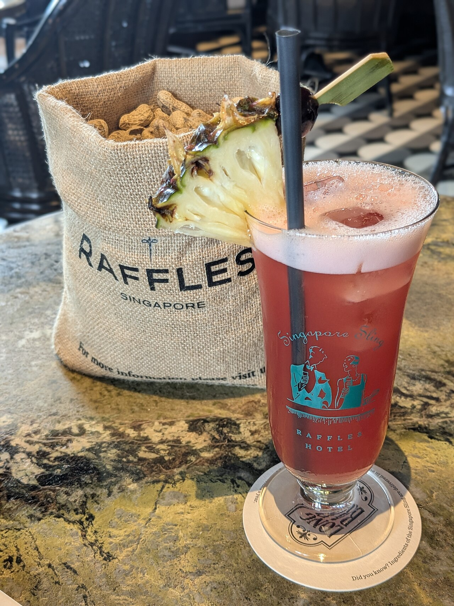

# 新加坡司令

新加坡司令（Singapore Sling）是一款以[金酒](ref:gin)为基底，加入樱桃利口酒、柑橘汁、菠萝汁与少量苦精摇和而成的经典鸡尾酒，滤入飓风杯，以菠萝片与马拉斯奇诺樱桃装饰。它风味酸甜、酒体饱满；IBA 公开版本不加苏打水，早期酒吧版本是否补气泡则因配方而异。

图：新加坡司令。图片：Paul2520，CC BY 4.0，via Wikimedia Commons（[原图页面](https://commons.wikimedia.org/wiki/File:Singapore_Sling_and_peanuts_at_the_Raffles_Hotel_Long_Bar_in_Singapore.jpg)）。

## 定义与身份

新加坡司令的常见叙述把它与 20 世纪初的新加坡酒店酒吧联系起来，原始配方与后来的版本差异较大。具体起源与配方演变存在不同记载，本页只把它写成历史背景，不把某一种说法当成定论。

新加坡司令是长饮型鸡尾酒，结构上包含金酒、樱桃利口酒、柑橘、菠萝汁与糖浆。IBA 版本不加苏打水，靠果汁与冰提供体积；早期酒店版本可能使用更多利口酒与不同果汁。把它当成“新加坡版金汤力”会忽略樱桃与菠萝的复合香气。

## 配方（IBA 版本）

IBA 公开配方是：金酒 30 毫升、樱桃利口酒 15 毫升、君度 7.5 毫升、DOM Bénédictine 7.5 毫升、新鲜菠萝汁 120 毫升、新鲜青柠汁 15 毫升、红石榴糖浆 10 毫升、安高天娜苦精 1 dash。把所有材料加冰摇和，滤入飓风杯，以菠萝片与马拉斯奇诺樱桃装饰。IBA 版本没有苏打水，气泡不是这款酒的必备结构；若你看到补苏打水的做法，那是另一个版本，应单独标明。用量是起点，不是法律：果汁比例、糖浆与利口酒都会改变成品。

摇和时间不足，温度不够低、稀释不足；摇和过度，稀释太多，酒体会变薄。飓风杯容量较大，滤入后杯中的冰块会继续稀释酒液，因此摇和时应保留足够酒体。

## 金酒的选择

[金酒](ref:gin)是这款酒的主体。伦敦干金酒带来杜松子与柑橘的清晰骨架，老汤姆金酒更甜、更柔和，其他风格的金酒则可能带来不同的草本与香料气息。选择取决于你想要的方向。

高酒精度的金酒需要更多稀释，低酒精度的金酒则要少摇。若金酒本身风味强烈，果汁与糖浆的比例也要相应调整，否则成品会失衡。

## 果汁、利口酒与苦精

柑橘汁提供酸度与柑橘香气，菠萝汁提供热带果香与少量酒体。果汁新鲜度直接影响香气与酸度，瓶装果汁的差异明显。

樱桃利口酒提供甜味、果香与颜色，是新加坡司令辨识度的重要来源。它的甜度较高，比例过高会让成品发腻。少量苦精用于增加层次，用量过多会压住果香。

## 摇和与稀释

新加坡司令以摇和完成，而不是直调。摇和让果汁、利口酒与金酒在低温下融合，同时带来必要的稀释。

冰块的质量直接影响摇和结果。大冰块融化慢，稀释可控；碎冰降温快，但容易过度稀释。关于新加坡司令的冰型、稀释与温度，可参考[加冰与温度](ref:ice)。

## 杯型与装饰

IBA 写的是飓风杯（hurricane glass）：杯身中部收腰、上部外扩，容量较大，便于容纳碎冰与装饰。没有飓风杯时，高球杯可以作为近似替代，但容量与握持感不同。新加坡司令容量大、冰量多，飓风杯预冷后能减缓稀释；没有预冷杯时，先用碎冰滚杯再倒掉。

菠萝片与马拉斯奇诺樱桃是 IBA 指定的装饰，提供果香与视觉识别。装饰应在饮用前完成，提前放置太久会失去香气。

## 变体

以其他烈酒替代金酒，会形成不同分支；减少樱桃利口酒，会得到更干、更强调果汁的版本；以其他果汁替代菠萝汁，会改变酸度与香气。与[汤姆柯林斯](ref:tom-collins)相比，新加坡司令增加了果汁与利口酒。

新加坡司令的变体多来自基酒、樱桃利口酒与果汁；减利口酒会更干，换果汁会改酸度，记录时应把替换与比例一并说明。关于鸡尾酒结构的一般说明，可以参考[调酒基础](ref:cocktails-guide)。

## 常见误区

第一，把 IBA 版本当成必须加苏打水。IBA 配方不含苏打水；补气泡的是其他版本。

第二，认为司令必须很甜。酸甜需要平衡。

第三，忽略飓风杯与杯中冰块会继续稀释。摇和时应保留酒体。

第四，用瓶装果汁替代新鲜果汁。香气与酸度差异明显。

## 饮用与边界

新加坡司令适合作为餐前或午后饮品，搭配坚果、水果或简单咸味小食。它的酒精度中等，容量较大，应小口慢饮并补充水分；不要空腹快速饮用。驾车、服药或孕期不应饮酒。

本页以 IBA 新加坡司令为骨架，不把某一种金酒或果汁比例说成标准；樱桃利口酒与菠萝汁的甜酸会改变成品。成品的强度取决于金酒的[酒精度](ref:abv)、果汁与利口酒的甜度、冰块稀释，不能只看配方数字。

对照阅读：[金酒](ref:gin)、[酒精度（ABV）](ref:abv)。

## 延伸阅读

- [金酒](ref:gin)：新加坡司令的主体与风格来源。
- [利口酒](ref:liqueur)：樱桃利口酒的甜度与香气。
- [调酒基础](ref:cocktails-guide)：结构、稀释与摇和的一般原则。
- [加冰与温度](ref:ice)：新加坡司令的冰型、稀释与出杯温度。
- [酒精度](ref:abv)：理解成品强度与冰块稀释。
- [汤姆柯林斯](ref:tom-collins)：同为金酒基底，但以苏打水构建气泡的对照。

**关键事实。**

| 项目 | 内容 |
| --- | --- |
| 一句话定位 | 以金酒、樱桃利口酒、柑橘汁、菠萝汁与少量苦精摇和后滤入飓风杯的经典鸡尾酒；IBA 版本不加苏打水，以菠萝片与马拉斯奇诺樱桃装饰 |
| 类型 | 经典鸡尾酒 |
| 起源 | 新加坡（20 世纪初） |

**来源与边界。** 本页关于「新加坡司令」的关键事实，主要由以下来源交叉核对：International Bartenders Association（官方配方、调制方法与装饰；确认该饮品属于 IBA 官方鸡尾酒名单）、Oxford University Press（新加坡司令的历史背景与基本构成；由原条目末尾参考资料迁移，未逐条复核访问日期）、Raffles Hotel Singapore（1915 年新加坡司令的诞生地与原始配料说明）。价格、批次与状态会变，涉及这些字段时以页面所列来源的最新版本为准。正文为项目自写，来源只作核验，不复制原文。

**并读。** 把「新加坡司令」与「金酒」、「利口酒」、「酒精度（ABV）」放在一起读时，先确认它们是同一层级还是上下游关系：先确认基酒与比例，再比较酸甜平衡、杯型与出品差异。本页负责给出鸡尾酒的基本坐标，对照条目补上具体案例与差异；读完再回到本页，才能分清哪些差别属于鸡尾酒本身，哪些只是产地、批次或品牌选择。
