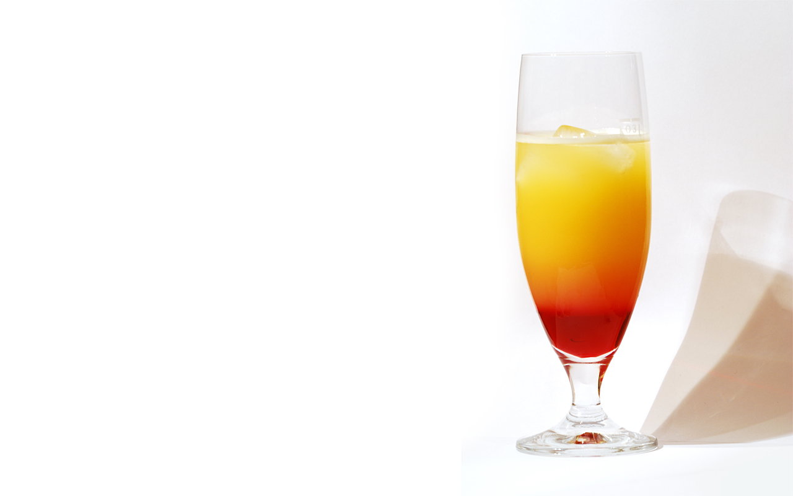

# 龙舌兰日出

龙舌兰日出是一杯“看起来比喝起来更复杂”的鸡尾酒。龙舌兰、橙汁、石榴糖浆，在高球杯里形成从橙黄到深红的渐变，像日出时的天空。它的配方简单，但要让颜色分层、味道平衡，需要一点顺序与耐心。

这杯酒在 1970 年代的加州流行起来，后来因为摇滚乐队的巡演与酒吧文化而广为人知。它的名字、颜色与流行史，几乎和味道一样重要。

图：龙舌兰、橙汁与石榴糖浆形成的日出渐变。图片：Benjamin Nussbaum，CC BY 2.0，via Wikimedia Commons（[原图页面](https://commons.wikimedia.org/wiki/File:Tequila_Sunrise_(2411086102).jpg)）。

## 日出的颜色

颜色来自石榴糖浆的比重。石榴糖浆含糖量高、比重大，倒入杯中后会沉底，再缓慢向上扩散，形成红色在下、橙色在上的渐变。如果一开始就搅拌，颜色会均匀成粉橙色，失去“日出”的层次。

橙汁的浓度也影响颜色。现榨橙汁颜色偏浅、带果肉，渐变更柔和；浓缩还原汁颜色深、甜度高，红色与橙色的对比更强，但口感更平。想要更漂亮的渐变，可以用血橙汁，颜色会更红。

杯子与冰块同样重要。透明高球杯能让颜色被看见；冰块太多会稀释颜色，太少又撑不起层次。冰块要干净、透明，最好是大块硬冰。

## 配方：龙舌兰、橙汁与石榴糖浆

IBA 的标准配方是龙舌兰 45 毫升、橙汁 90 毫升、石榴糖浆 15 毫升。龙舌兰与橙汁的比例约为一比二，酒精度中等；石榴糖浆只占少量，负责颜色与甜度，不负责主体风味。

龙舌兰用白色或金色均可。白色龙舌兰清爽、植物味明显，适合白天；金色龙舌兰经过轻微陈年，带焦糖与香草，和橙汁更合。陈年龙舌兰（Reposado、Añejo）也可以，但风味更重，会压过橙汁。

橙汁必须新鲜。瓶装橙汁的甜与酸都太直，和石榴糖浆叠在一起会腻；现榨橙汁的酸度与果香能撑住酒体。如果没有榨汁机，可以用优质冷藏橙汁，但不要用浓缩糖浆。

石榴糖浆要选真实的石榴汁制品，而不是红色糖水。糖浆的颜色越深、味道越酸，渐变越漂亮，甜度也越可控。廉价糖浆会让整杯酒变成“红色甜水”。

## 做法：如何做出渐变

在高球杯中装满冰块，倒入龙舌兰，再倒入橙汁，轻轻搅拌，让酒与果汁混合、杯壁降温。然后沿杯壁缓慢倒入石榴糖浆，糖浆会沉到底部，形成红色层。不要搅拌，直接上桌。

倒糖浆时用吧匙导流，或把糖浆倒在冰块上，让它慢慢下沉。倒得太快，糖浆会和橙汁混在一起，渐变消失；倒得太慢，糖浆会挂在杯壁，颜色不匀。

装饰用橙片与樱桃。橙片可以夹在杯口，樱桃可以放在杯顶，颜色与“日出”主题呼应。不要用薄荷或青柠，那会改变这杯酒的色调与香气。

喝的时候不要立刻搅匀。先喝上层，感受橙汁与龙舌兰；再慢慢喝到下层，感受石榴的酸与甜。每一口的味道都不同，这是这杯酒的设计。

## 从加州酒吧到摇滚巡演

龙舌兰日出的现代版本通常追溯到 1970 年代初的加州，尤其是旧金山湾区的酒吧。有说法认为，它由某家餐厅的调酒师在1971年前后定型；也有说法认为，名字更早出现，现代配方是后来演变的结果。

真正让它流行的是摇滚乐。1972 年，一支英国摇滚乐队在美国巡演期间，成员在酒吧里喝到这杯酒，随后把它带进巡演与媒体叙事。橙色渐变、加州阳光与摇滚舞台的结合，让这杯酒成为 1970 年代的视觉符号。

流行史也带来了误传。有人说这杯酒是“某位歌手发明”的，有人说“配方来自墨西哥”，这些说法大多缺乏一手证据。可以确认的是：现代配方在加州成型，石榴糖浆的渐变是它的标志。

## 变体与常见错误

常见变体包括“Tequila Sunset”，用黑莓利口酒替代部分石榴糖浆，颜色更深；“Tequila Sunrise Fizz”，加苏打水，口感更轻；“Bloody Sunrise”，用血橙汁，颜色更红。还有“Tequila Sunrise Margarita”，把渐变元素放进玛格丽特。

常见错误有四个。第一，一开始就搅拌，渐变消失。第二，糖浆倒得太快，颜色混成粉橙。第三，橙汁不新鲜，甜酸失衡。第四，冰块太小，酒很快变稀。龙舌兰日出的关键，是“顺序”与“温度”。

对家庭调酒者，最实用的建议是：先调好龙舌兰与橙汁，尝一下甜酸；再沿杯壁慢慢倒糖浆；杯子与冰块提前冷藏；喝前不要搅。记住，这杯酒的美感与味道，都来自“层”。

石榴糖浆也可以自制：石榴汁与糖按 1 比 1 加热溶解，冷却后使用，颜色与酸度都比市售糖浆更自然。杯子越冷，渐变越持久，气泡也越细。

相关条目：[玛格丽特](ref:margarita)。

## 另见与参考资料

- 龙舌兰：参见 [龙舌兰](ref:tequila)。
- 玛格丽特：参见 [玛格丽特](ref:margarita)。
- 高球杯：参见 [高球杯](ref:highball)。
- 倒酒：参见 [倒酒](ref:pouring)。
- 甜型：参见 [甜型](ref:sweet)。

对照阅读：[龙舌兰酒](ref:tequila)、[高球杯](ref:highball)。

**关键事实。**

| 项目 | 内容 |
| --- | --- |
| 一句话定位 | 龙舌兰、橙汁与石榴糖浆在高球杯中形成的渐变鸡尾酒，颜色从橙黄过渡到红；1970 年代在加州走红，并因摇滚乐队巡演而广为人知 |
| 类型 | IBA Contemporary Classics |
| 起源 | 美国加州 |

**来源与边界。** 本页关于「龙舌兰日出」的关键事实，主要由以下来源交叉核对：International Bartenders Association（IBA 配方分类、原料与比例）、Oxford University Press（鸡尾酒史与术语背景）、CocktailDB（交叉核对配方结构与常见变体）等 5 条来源。价格、批次与状态会变，涉及这些字段时以页面所列来源的最新版本为准。正文为项目自写，来源只作核验，不复制原文。

**并读。** 把「龙舌兰日出」与「龙舌兰酒」、「玛格丽特」、「高球杯」放在一起读时，先确认它们是同一层级还是上下游关系：先确认基酒与比例，再比较酸甜平衡、杯型与出品差异。本页负责给出鸡尾酒的基本坐标，对照条目补上具体案例与差异；读完再回到本页，才能分清哪些差别属于鸡尾酒本身，哪些只是产地、批次或品牌选择。

**适用边界。** 对「龙舌兰日出」而言，配方比例、基酒品牌与杯型会变；IBA 版本是参照，不是唯一做法。

**更新提示。** 「龙舌兰日出」最近核对于 2026-11-20；配方比例、基酒品牌、杯型与出品标准会变，调酒前以 IBA 或酒吧现行配方为准。

**编者注。** 本页把「龙舌兰日出」作为鸡尾酒条目处理：定义、流程与关键数字以正文表格为准，与「龙舌兰酒」、「玛格丽特」的差异用对照阅读验证；遇到价格、批次或地址，回到页面所列来源核对。
